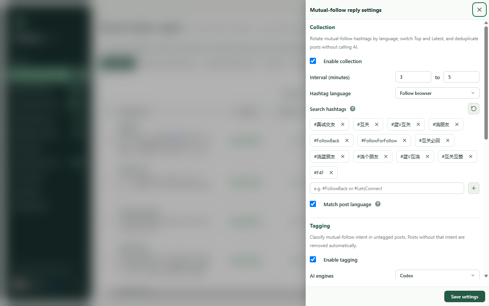

# XFollower · Follower management and mutual replies for X

[简体中文](README.md) · [English](README.en.md) · [Português (Brasil)](README.pt-BR.md) · [Español (Latinoamérica)](README.es-419.md)

**Current release: 5.7.11 · Chrome / Edge MV3 · [Product page and daily code](https://goodexts.com/xfollower)**

XFollower helps you find mutual-follow posts, review followers and relationships, manage a follow queue and learn from post performance. Hashtag searches discover candidates without relying on a personalized home feed.

This public repository provides installable packages, four-language documentation, tutorials and AI integration skills. Current development source is maintained separately in a private repository. Release packages use normal bundling and compression, **without JavaScript obfuscation**. Install the release asset below; this repository and GitHub's generated Source code archives are not the current extension package.

## Download and install

- [Download XFollower-5.7.11.zip](https://github.com/wangsen2020/x-each-follower/releases/download/5.7.11/XFollower-5.7.11.zip)
- [SHA256SUMS.txt](https://github.com/wangsen2020/x-each-follower/releases/download/5.7.11/SHA256SUMS.txt) · [Release notes](https://github.com/wangsen2020/x-each-follower/releases/tag/5.7.11) · [Latest release](https://github.com/wangsen2020/x-each-follower/releases/latest)
- SHA-256: `6b836af5980aa2ad149f6f29389bccb9a24972c464d9d0ec72615a1369c86901`
- [Chrome Web Store](https://chromewebstore.google.com/detail/dbokihddfeclflabcnjggminlkdfjfjf): store review and GitHub releases run separately. Check the store page for the version currently available there.

1. **Extract the whole ZIP into a permanent folder** containing `manifest.json` directly.
2. Open `chrome://extensions` (`edge://extensions` in Edge) and enable Developer mode.
3. Choose Load unpacked and select that folder. Sign in to x.com in the same browser profile, then open XFollower from the toolbar.

For a manual update, replace files in the original loaded folder and click Reload on the extension card. Keep that folder and the existing extension; do not clear its data. Store installations update through the store. Upgrades retain records, settings, drafts and original task receipts.

## The five-step workflow

1. **Mutual replies** opens by default. Configure search hashtags, language and interval, then enable collection. A dedicated search tab in a new or reused notification window rotates hashtags and switches Top / Latest.
2. **Optional anchor extraction** retains the former mutual-tracking page and its data. Enter an account in your field when you need more candidates from its following and followers.
3. **Follower review and notifications** identify new followers, inspect follow-back relationships and supplement profiles.
4. **Follow queue** reviews candidates from the enabled sources and verifies their current relationship before following or optional interaction.
5. **Follow-back monitoring** checks outcomes, protected accounts and overdue follow-backs. New settings use a 7-day review window.

Collection does not call AI. Classification, replies and following have separate controls. Start with collection and classification, review the results, then enable subsequent actions as needed. Default and custom search hashtags can be added or removed individually, up to 20; they are separate from hashtags appended to published replies.

## The 11 sections

| Section | Purpose |
| --- | --- |
| Home | Results, execution outcomes and items to verify |
| Mutual replies | Search posts, classify intent and optionally reply or collect candidates |
| Anchor extraction | Candidates from a relevant account's following and followers |
| Comment extraction | Collect commenters from a specific post with source attribution |
| Follower review | Inspect followers, following and pending follow-backs |
| Notification monitoring | Discover new follow events in X notifications |
| Follow queue | Review candidates and run configured follows or interactions |
| Follow-back monitoring | Review follow-backs, protected accounts and overdue cases |
| Post tracking | Post performance and new replies |
| X leaderboard | Growth snapshots for saved accounts |
| Knowledge base | Retain writing and review notes for content generation |

Existing source priorities remain: pending follow-back fans 200, mutual-post commenters 180, ordinary comment extraction 90, anchor candidates and mutual-post authors 80. Admission to the queue does not immediately follow an account.

## What's changed in 5.7.11

- Mutual replies opens first; anchor extraction remains optional. The tour and localized tutorials follow this order.
- Mutual-reply errors stay in their section. A red sidebar indicator opens details without a banner across unrelated pages.
- Hash routes let notifications reuse an open panel and select the correct section. Direct follow-queue links load their data.
- Direct replies use independent background task tabs that close afterward. Bounded recovery handles search frame replacement while retaining saved results.

## Trial, daily codes and AI

Each X account receives a **72-hour trial** on first connection. Afterward, claim a free daily activation code valid for **24 hours** on [GoodExts](https://goodexts.com/xfollower), or enter a monthly, quarterly or six-month code in Account Authorization.

Use built-in X Grok where available. For local engines, connect [AgentRelay](https://github.com/wangsen2020/agentrelay-releases/releases/latest) in settings and select the engine and conversation separately for classification and replies. Availability depends on X sign-in, your service and engine configuration.

- [agentrelay-integration](agentrelay-integration/SKILL.md): integration and recovery using original task receipts.
- [agentrelay-session-bridge](agentrelay-session-bridge/SKILL.md): cross-session delegation and result delivery.

## Guides and support

- [Official website](https://goodexts.com) · [Product page](https://goodexts.com/xfollower) · [Current five-step guide](https://goodexts.com/blog/xfollower-growth-loop)
- [Report an issue](https://github.com/wangsen2020/x-each-follower/issues) · [Release acceptance record](https://github.com/wangsen2020/x-each-follower/releases/download/5.7.11/RELEASE-ACCEPTANCE.md)
- Older files under `docs/` remain historical references. Use this README, the website and in-extension tutorials for the current workflow.

Working records are stored in the browser. Enabled features may send requests to X/Grok or a configured service; activation may use your X account identifier. Following and posting depend on X rules, sign-in, network and interface limits. XFollower is independent of X Corp.
