# XFollower

[简体中文](README.md) · [English](README.en.md) · [Português (Brasil)](README.pt-BR.md) · [Español (Latinoamérica)](README.es-419.md)

**v5.3.1 · Chrome / Edge MV3 · Official Site: [GoodExts](https://goodexts.com) ([XFollower Product Page & Daily Code](https://goodexts.com/xfollower))**

XFollower is a Chrome / Edge extension built by [GoodExts](https://goodexts.com) for X (Twitter) creators and indie founders to run a repeatable audience-growth loop: mutual-follow tracking, AI timeline commenting, comment extraction, follower follow-back prioritization, 7-day unfollow monitoring, and content knowledge curation. Starting from **v5.3.0 / v5.3.1**, the extension source repository has moved to a private repository and releases are distributed as obfuscated closed-source ZIP builds. This public portal keeps **official releases, 4-language READMEs, step-by-step tutorials, real screenshots, and public AI integration skills**.

## Download & Quick Install (v5.3.1)

- **Download ZIP**: [XFollower-5.3.1.zip](https://github.com/wangsen2020/x-each-follower/releases/download/5.3.1/XFollower-5.3.1.zip) · [SHA256SUMS.txt](https://github.com/wangsen2020/x-each-follower/releases/download/5.3.1/SHA256SUMS.txt) · [Release 5.3.1 Notes](https://github.com/wangsen2020/x-each-follower/releases/tag/5.3.1) · [Latest Releases](https://github.com/wangsen2020/x-each-follower/releases/latest)
- **SHA-256**: `cead6d7310d3460f2581be658c0e85b84d29517ff5eda29df6d29249432aefd9`
- **Pinned Extension ID (Closed Release Build)**: `colllpngfoieccfbgljaklpgiphpiebj`

### 3-Step Chrome / Edge Installation

1. Download and unzip `XFollower-5.3.1.zip` into a permanent local folder (do not load directly from inside an archive, and keep the extracted folder in place).
2. Open `chrome://extensions` (or `edge://extensions`) and enable **Developer mode** in the top-right corner.
3. Click **Load unpacked**, select the folder directly containing `manifest.json`, and sign in to X inside the same browser profile before opening XFollower.

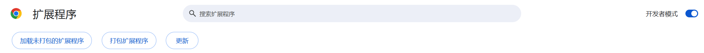

## 3-Day Persistent Trial & Daily Free Activation Code

- **3-Day Free Trial (No Code Needed)**: Each X account automatically starts a persistent 3-day trial anchored by its immutable numeric X user ID and anti-tamper verification checks.
- **Claim a Free 24-Hour Activation Code Daily**: After your trial ends, search Google for the phrase below or visit the official site to claim a free 1-day code bound to your X numeric ID (supports one-click auto-fill via the built-in `goodexts-bridge`):
  - Search keyword: `free xfollower activation code`
  - Official portal: [Claim on GoodExts Official Website](https://goodexts.com/xfollower)

## 5-Step Growth Loop & 11-Module Workspace

v5.3.0 / v5.3.1 reorders the left navigation around the 5-step operational growth loop and adds an interactive **Driver.js 5-step onboarding tour** plus an in-extension illustrated guide:

| Sidebar Order | Module | Role & Action | Base Weight |
| --- | --- | --- | ---: |
| 1 | **Overview (`home`)** | Workspace summary, 3-day trial / license status, and 5-step quick links | — |
| 2 | **Mutual Follow Tracking (`candidates`)** — Step 1 / 5 | Pick a peer anchor (`@handle`), inspect overlap, and queue candidates | 80 |
| 3 | **Home Replies (`mutualComments`)** — Step 2 / 5 | Draft contextual replies with X Grok and enable commenter capture on mutual-follow posts | 180 |
| 4 | **Comment Discovery (`comments`)** — Step 2 / 5 | Extract commenters from target single posts while preserving post provenance | 90 |
| 5 | **Follower Review (`monitor`)** — Step 3 / 5 | Sync followers/following, confirm awaiting follow-back accounts, and approve to queue | 200 |
| 6 | **Notifications (`notificationMonitor`)** — Step 3 / 5 | Spot incoming follow events from X notifications for verification in Follower Review | — |
| 7 | **Follow Queue (`followQueue`)** — Step 4 / 5 | Review all 4 candidate sources ordered by weight and safety filters before execution | By source weight |
| 8 | **Follow-back Monitor (`unreciprocated`)** — Step 5 / 5 | Track overdue non-reciprocators with a new **7-day default deadline** and whitelist protection | — |
| 9 | **Post Tracking (`postTracking`)** | Review your original posts' reach, engagement, and follow-up comment leads | — |
| 10 | **X Leaderboard (`leaderboard`)** | Save niche peers, snapshot metrics, and study high-performing topics | — |
| 11 | **Knowledge Base (`knowledge`)** | Curate reusable insights, examples, and tone references for AI drafting | — |

## UI Walkthrough (v5.3.0 / v5.3.1 Screenshots)

| Overview & Reordered 11-Item Sidebar | 5-Step Interactive Tour & Profile Handle Guide |
| --- | --- |
| 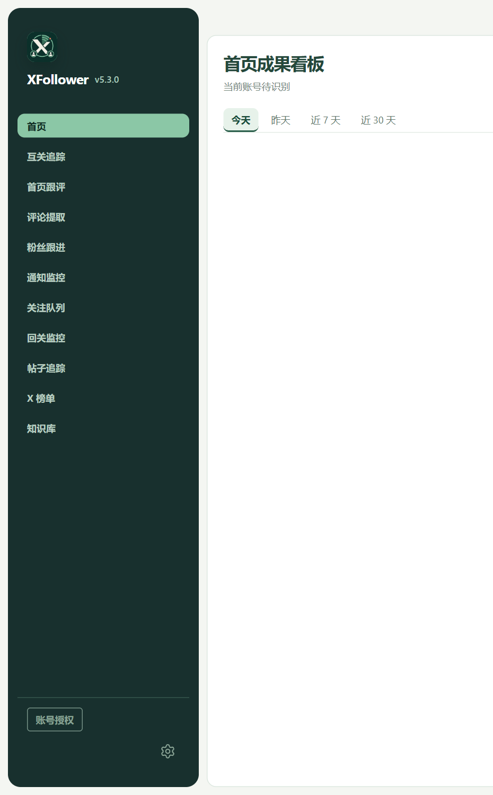 | 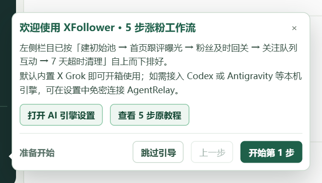 |

| Step 1 — Peer Anchor & Candidate Preview | Step 2 — Home Replies & Commenter Capture |
| --- | --- |
| 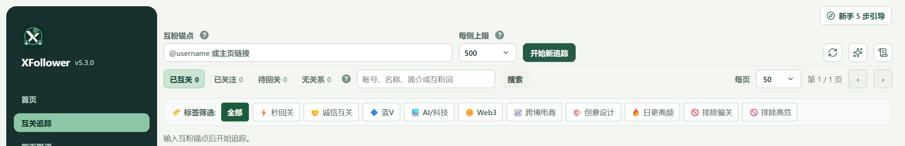 | 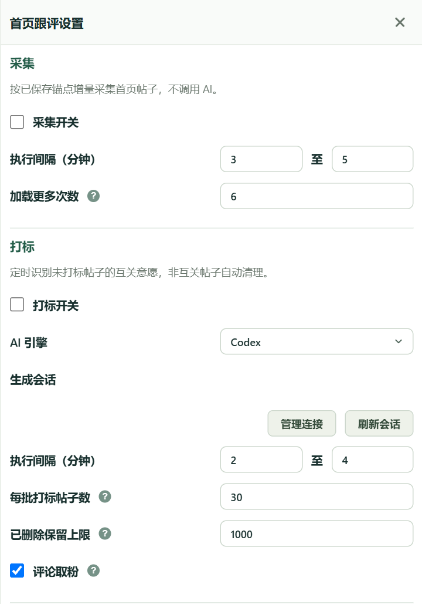 |

| Step 3 — Confirmed Followers Awaiting Follow-Back | Step 4 — Unified Follow Queue & Source Weights |
| --- | --- |
| 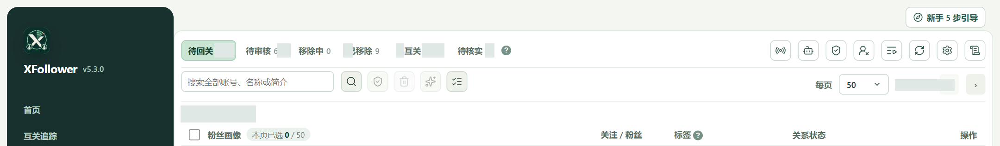 | 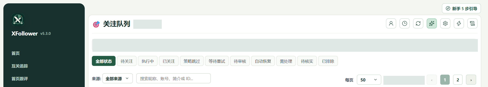 |

| Step 5 — 7-Day Default Follow-Back Review | Advanced Content Workspace (Post Tracking) |
| --- | --- |
| 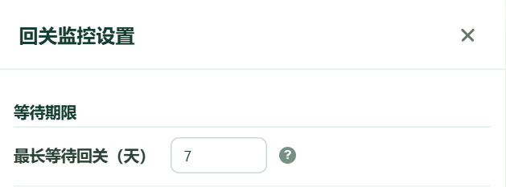 | 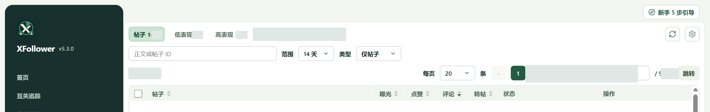 |

## AI Engines: Zero-Config X Grok + AgentRelay Skills

| Built-in X Grok (Default) | Local AgentRelay Engines |
| --- | --- |
| 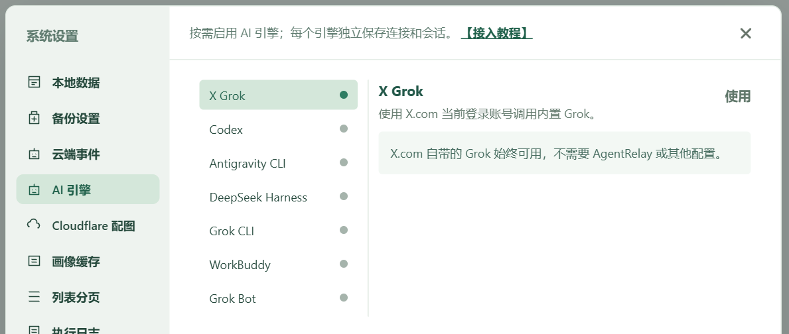 | 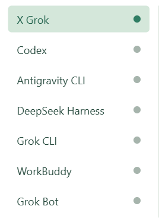 |

- **Zero-Config Built-in X Grok**: Tagging, comment drafting, and quote-post drafting default to **X Grok** out of the box—no external token or local AI daemon required (uses your logged-in X session with Grok access).
- **Power Mode with AgentRelay**: Connect local **Codex**, **Antigravity CLI / IDE**, or **WorkBuddy** by installing [AgentRelay Releases](https://github.com/wangsen2020/agentrelay-releases/releases/latest). When running on loopback (`127.0.0.1:8787`) with default local settings, supported AgentRelay builds auto-connect without manually copying tokens.

### Public AI Integration Skills Included

| Skill Folder | Purpose | Documentation |
| --- | --- | --- |
| `agentrelay-integration` | Standard `/jobs` API integration, job deduplication, polling, and recovery rules for extensions & clients (Node 22+ `scripts/self-test.mjs` included) | [SKILL.md](agentrelay-integration/SKILL.md) |
| `agentrelay-session-bridge` | Cross-workspace, cross-engine session bridge (Codex / Antigravity / DeepSeek Harness / WorkBuddy) with active-turn steer and callback relay | [SKILL.md](agentrelay-session-bridge/SKILL.md) |

Copy the skill folder you need into `~/.codex/skills/` (keeping `scripts/` and `references/`) so your AI assistant can inspect or orchestrate local AgentRelay tasks cleanly.

## Tutorials & Official Links

- [GoodExts Official Website](https://goodexts.com) · [XFollower Product & Free Code Page](https://goodexts.com/xfollower) · [5-Step X Growth Loop Blog Post](https://goodexts.com/blog/xfollower-growth-loop)
- [5-Step Illustrated Setup Guide & Screenshot Index (zh-CN)](docs/使用指南/200.%20XFollower五步上手图文教程与截图清单_20261119_1553_wangsen.md)
- [5-Step Growth Loop Bilingual Article (zh-CN / EN)](docs/使用指南/202.%20XFollower五步运营专栏文章中英文稿_20261119_1553_wangsen.md)
- [Full Module Docs Directory](docs/使用指南/使用说明.md) · [X Account Safety & Rate-Limit Strategy](docs/使用指南/35.%20X账号防封策略_20261025_2154_wangsen.md)

## Notes & Scope

- Collection, follow, reply, and unfollow actions depend on your active X login session, local filter configuration, and X platform rate limits.
- This public repository serves official releases, multilingual onboarding documentation, screenshots, and AI integration skills; Chrome Web Store packaging and private extension source remain separate.
