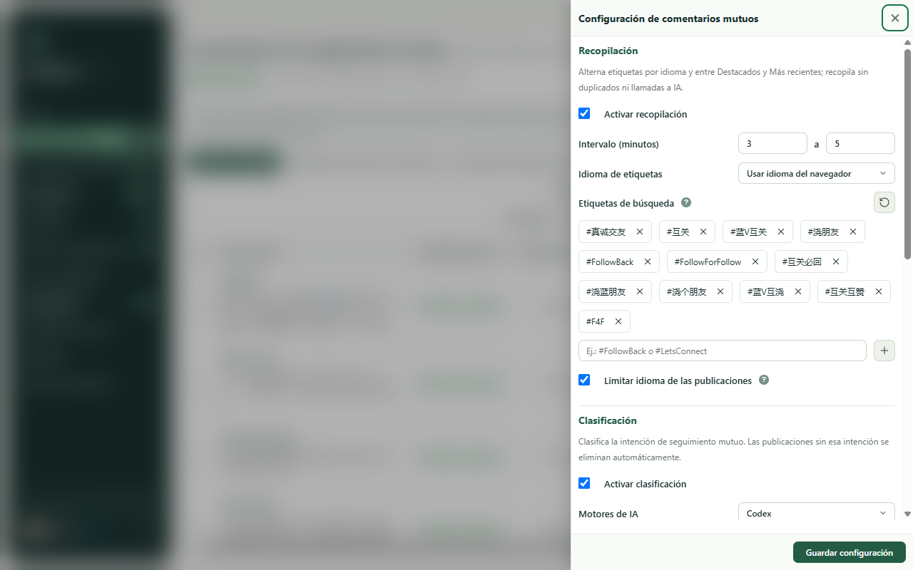

# XFollower · Gestión de seguidores y respuestas mutuas en X

[简体中文](README.md) · [English](README.en.md) · [Português (Brasil)](README.pt-BR.md) · [Español (Latinoamérica)](README.es-419.md)

**Versión actual: 5.7.11 · Chrome / Edge MV3 · [Producto y código diario](https://goodexts.com/es/xfollower)**

XFollower ayuda a encontrar publicaciones de seguimiento mutuo, revisar seguidores y relaciones, administrar una cola de perfiles y analizar resultados. La búsqueda por hashtags permite descubrir candidatos sin depender del inicio personalizado.

Este repositorio público ofrece paquetes de instalación, documentación en cuatro idiomas, tutoriales y skills de integración con IA. El código actual se mantiene por separado en un repositorio privado. Los paquetes usan empaquetado y compresión normales, **sin ofuscación de JavaScript**. Instala el archivo de la versión indicado abajo; el repositorio y los archivos Source code generados por GitHub no son el paquete actual de la extensión.

## Descarga e instalación

- [Descargar XFollower-5.7.11.zip](https://github.com/wangsen2020/x-each-follower/releases/download/5.7.11/XFollower-5.7.11.zip)
- [SHA256SUMS.txt](https://github.com/wangsen2020/x-each-follower/releases/download/5.7.11/SHA256SUMS.txt) · [Notas de la versión](https://github.com/wangsen2020/x-each-follower/releases/tag/5.7.11) · [Versión más reciente](https://github.com/wangsen2020/x-each-follower/releases/latest)
- SHA-256: `6b836af5980aa2ad149f6f29389bccb9a24972c464d9d0ec72615a1369c86901`
- [Chrome Web Store](https://chromewebstore.google.com/detail/dbokihddfeclflabcnjggminlkdfjfjf): la revisión de la tienda es independiente de GitHub. Consulta la tienda para ver qué versión está disponible.

1. **Extrae todo el ZIP en una carpeta permanente** que contenga `manifest.json` directamente.
2. Abre `chrome://extensions` (`edge://extensions` en Edge) y activa el modo de desarrollador.
3. Elige Cargar extensión sin empaquetar y selecciona esa carpeta. Inicia sesión en x.com en el mismo perfil del navegador y abre XFollower desde la barra de herramientas.

Para actualizar una instalación manual, reemplaza los archivos en la carpeta original y pulsa Recargar en la tarjeta de la extensión. Conserva la carpeta y la instalación sin borrar los datos. Las instalaciones de la tienda se actualizan desde ella. Se conservan registros, ajustes, borradores y comprobantes de las tareas originales.

## Flujo de cinco pasos

1. **Respuestas mutuas** es la página inicial. Configura hashtags, idioma e intervalo y activa la recopilación. Una pestaña de búsqueda dedicada en la ventana de notificaciones, nueva o reutilizada, alterna hashtags y las búsquedas Top / Latest.
2. **Extracción opcional desde un perfil de referencia** conserva la antigua página de seguimiento mutuo y sus registros. Usa un perfil de tu sector para añadir candidatos desde sus seguidores y cuentas seguidas.
3. **Revisión de seguidores y notificaciones** permite detectar nuevos seguidores, comprobar relaciones y completar los perfiles.
4. **Cola de perfiles** reúne candidatos de las fuentes habilitadas, aplica la revisión y verifica la relación actual antes de seguir o interactuar según los ajustes.
5. **Monitoreo de seguimiento de vuelta** permite revisar resultados, cuentas protegidas y casos vencidos. Los ajustes nuevos usan un plazo predeterminado de 7 días.

La recopilación no llama a la IA. Clasificación, respuestas y seguimiento tienen controles separados. Empieza por recopilar y clasificar, revisa los resultados y activa las demás acciones cuando lo necesites. Puedes agregar o quitar individualmente hashtags predeterminados y propios, hasta 20; son independientes de los hashtags añadidos a las respuestas publicadas.

## Las 11 secciones

| Sección | Función |
| --- | --- |
| Inicio | Resultados, ejecución y asuntos por verificar |
| Respuestas mutuas | Buscar publicaciones, clasificar intención y responder o recopilar candidatos |
| Extracción por referencia | Candidatos desde seguidores y cuentas seguidas de un perfil relevante |
| Extracción de comentarios | Recopilar comentaristas de una publicación conservando su origen |
| Revisión de seguidores | Revisar seguidores, cuentas seguidas y devoluciones pendientes |
| Monitoreo de notificaciones | Detectar nuevos eventos de seguimiento en X |
| Cola de perfiles | Revisar candidatos y ejecutar las acciones configuradas |
| Monitoreo de seguimiento de vuelta | Revisar devoluciones, cuentas protegidas y plazos vencidos |
| Seguimiento de publicaciones | Rendimiento y nuevas respuestas |
| Ranking X | Historial de crecimiento de las cuentas guardadas |
| Base de conocimiento | Guardar experiencias y notas para generar contenido |

Se conservan las prioridades: seguidores pendientes de devolución 200, comentaristas de publicaciones mutuas 180, extracción común de comentarios 90, candidatos por referencia y autores de publicaciones mutuas 80. Entrar a la cola no implica seguir de inmediato.

## Cambios de 5.7.11

- Respuestas mutuas abre primero; la extracción por referencia sigue siendo opcional. El recorrido y los tutoriales siguen ese orden.
- Los errores aparecen dentro de su módulo, accesibles mediante el indicador rojo lateral, sin una franja sobre las demás páginas.
- Las rutas hash permiten que las notificaciones reutilicen el panel y abran la sección correcta. Los enlaces directos de la cola cargan sus datos.
- Las respuestas directas usan pestañas de tarea en segundo plano que se cierran al terminar. La recuperación limitada de la página de búsqueda conserva los resultados guardados.

## Prueba, códigos diarios e IA

Cada cuenta X recibe una **prueba de 72 horas** al conectarse por primera vez. Después, consigue en [GoodExts](https://goodexts.com/es/xfollower) un código diario gratuito válido durante **24 horas**, o introduce un código mensual, trimestral o semestral en la autorización de cuenta.

Usa X Grok integrado cuando esté disponible. Para motores locales, conecta [AgentRelay](https://github.com/wangsen2020/agentrelay-releases/releases/latest) desde los ajustes y elige motor y conversación por separado para clasificación y respuestas. La disponibilidad depende del inicio de sesión en X, del servicio y de la configuración del motor.

- [agentrelay-integration](agentrelay-integration/SKILL.md): integración y recuperación con los comprobantes de la tarea original.
- [agentrelay-session-bridge](agentrelay-session-bridge/SKILL.md): delegación entre sesiones y entrega de resultados.

## Guías y soporte

- [Sitio oficial](https://goodexts.com/es) · [Producto](https://goodexts.com/es/xfollower) · [Guía actual de cinco pasos](https://goodexts.com/es/blog/xfollower-growth-loop)
- [Reportar un problema](https://github.com/wangsen2020/x-each-follower/issues) · [Registro de validación](https://github.com/wangsen2020/x-each-follower/releases/download/5.7.11/RELEASE-ACCEPTANCE.md)
- Los archivos antiguos de `docs/` son referencias históricas. Para el flujo actual, usa este README, el sitio y los tutoriales de la extensión.

Los registros se guardan en el navegador. Las funciones activadas pueden enviar solicitudes a X/Grok o a un servicio configurado; la activación puede usar el identificador de tu cuenta X. Seguir y publicar dependen de las reglas de X, de la sesión, de la red y de los límites de la interfaz. XFollower es independiente de X Corp.
