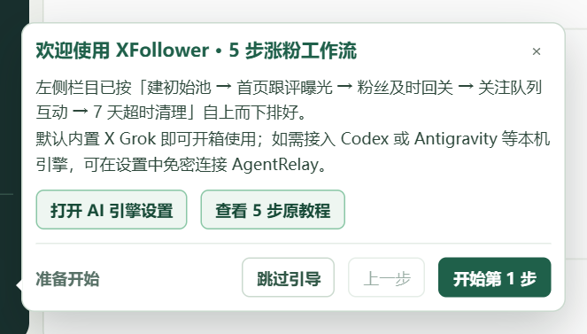
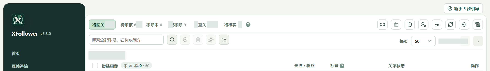
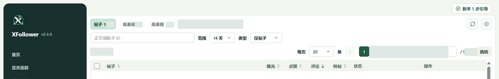
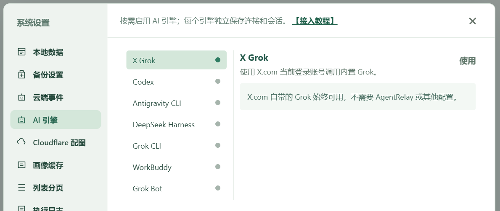

# XFollower

[简体中文](README.md) · [English](README.en.md) · [Português (Brasil)](README.pt-BR.md) · [Español (Latinoamérica)](README.es-419.md)

**v5.3.1 · Chrome / Edge MV3 · Sitio Oficial: [GoodExts](https://goodexts.com) ([Página de XFollower y Código Diario](https://goodexts.com/es/xfollower))**

XFollower es una extensión para Chrome / Edge creada por [GoodExts](https://goodexts.com) para que creadores y desarrolladores en X (Twitter) ejecuten un ciclo completo de crecimiento: seguimiento mutuo con cuentas ancla, respuestas inteligentes con IA en el timeline, extracción de comentaristas, priorización de follow-back, revisión de 7 días y base de conocimiento. Desde la versión **v5.3.0 / v5.3.1**, el código fuente de la extensión se mantiene en un repositorio privado y las versiones se distribuyen como paquetes ZIP ofuscados de código cerrado; este repositorio público conserva **lanzamientos oficiales, README en 4 idiomas, tutoriales con capturas reales y skills públicas de integración IA**.

## Descarga e Instalación Rápida (v5.3.1)

- **Descargar ZIP**: [XFollower-5.3.1.zip](https://github.com/wangsen2020/x-each-follower/releases/download/5.3.1/XFollower-5.3.1.zip) · [SHA256SUMS.txt](https://github.com/wangsen2020/x-each-follower/releases/download/5.3.1/SHA256SUMS.txt) · [Notas de versión 5.3.1](https://github.com/wangsen2020/x-each-follower/releases/tag/5.3.1) · [Últimos lanzamientos](https://github.com/wangsen2020/x-each-follower/releases/latest)
- **SHA-256**: `cead6d7310d3460f2581be658c0e85b84d29517ff5eda29df6d29249432aefd9`
- **ID Fijo de la Extensión (Compilación Release)**: `colllpngfoieccfbgljaklpgiphpiebj`

### Instalación en 3 pasos en Chrome / Edge

1. Descarga y descomprime `XFollower-5.3.1.zip` en una carpeta permanente (no la cargues desde dentro del archivo comprimido ni borres la carpeta luego de instalar).
2. Abre `chrome://extensions` (o `edge://extensions`) y activa el **Modo de desarrollador** en la esquina superior derecha.
3. Haz clic en **Cargar extensión sin empaquetar**, elige la carpeta que contiene directamente `manifest.json` e inicia sesión en X en el mismo perfil del navegador antes de abrir el panel.

## Prueba Persistente de 3 Días y Código Gratuito Diario

- **3 Días de Prueba Sin Código**: Las cuentas de X nuevas disfrutan automáticamente de 3 días de prueba persistente ligada a su ID numérico de X, sin necesidad de ingresar código.
- **Reclamar Código Gratuito de 24 Horas**: Al finalizar la prueba, busca en Google la siguiente frase clave o entra directamente en el sitio oficial (con autocompletado y activación en un clic mediante `goodexts-bridge`):
  - Palabra clave de búsqueda: `free xfollower activation code`
  - Enlace directo oficial: [Reclamar gratis en GoodExts](https://goodexts.com/es/xfollower)

## Ciclo de Crecimiento en 5 Pasos y 11 Módulos

La versión **v5.3.0 / v5.3.1** reorganizó los 11 accesos laterales siguiendo el flujo de trabajo diario e incluye un **tour interactivo de 5 pasos (Driver.js)** y una guía visual integrada:

| Orden | Módulo | Función principal | Peso base |
| --- | --- | --- | ---: |
| 1 | **Resumen (`home`)** | Panel general, estado de prueba/licencia y accesos a los 5 pasos | — |
| 2 | **Seguimiento Mutuo (`candidates`)** — Paso 1 / 5 | Elige una cuenta ancla del sector (`@usuario`) y revisa candidatos | 80 |
| 3 | **Respuestas en Inicio (`mutualComments`)** — Paso 2 / 5 | Redacta respuestas con X Grok y captura comentaristas en publicaciones mutuas | 180 |
| 4 | **Descubrimiento en Comentarios (`comments`)** — Paso 2 / 5 | Extrae comentaristas de publicaciones específicas conservando su origen | 90 |
| 5 | **Revisión de Seguidores (`monitor`)** — Paso 3 / 5 | Sincroniza seguidores y aprueba cuentas pendientes de follow-back | 200 |
| 6 | **Monitor de Notificaciones (`notificationMonitor`)** — Paso 3 / 5 | Captura nuevos seguidores desde notificaciones de X para verificarlos | — |
| 7 | **Cola de Seguimiento (`followQueue`)** — Paso 4 / 5 | Revisa las 4 fuentes ordenadas por peso y filtros antes de seguir | Según fuente |
| 8 | **Monitor de Follow-Back (`unreciprocated`)** — Paso 5 / 5 | Plazo predeterminado de **7 días** para revisar cuentas no recíprocas con lista segura | — |
| 9 | **Seguimiento de Posts (`postTracking`)** | Analiza el rendimiento, comentarios nuevos e ideas de contenido propio | — |
| 10 | **Ranking X (`leaderboard`)** | Guarda creadores referentes, snapshots y temas destacados del nicho | — |
| 11 | **Base de Conocimiento (`knowledge`)** | Almacena aprendizajes, ejemplos y notas reutilizables para respuestas IA | — |

## Vista Previa de Interfaz (v5.3.0 / v5.3.1)

| Resumen y Barra Lateral de 11 Módulos | Tour Interactivo de 5 Pasos |
| --- | --- |
|  |  |

| Paso 1 — Cuenta Ancla y Candidatos | Paso 2 — Respuestas en Timeline y Captura |
| --- | --- |
|  |  |

| Paso 3 — Pendientes de Follow-Back | Paso 4 — Cola Unificada por Peso |
| --- | --- |
|  |  |

| Paso 5 — Plazo Predeterminado de 7 Días | Análisis Avanzado de Publicaciones |
| --- | --- |
|  |  |

## Motores IA: X Grok Integrado + Skills AgentRelay

| X Grok Integrado (Predeterminado) | Opciones Locales con AgentRelay |
| --- | --- |
|  |  |

- **Predeterminado sin configuración (X Grok)**: El etiquetado de perfiles y los borradores de respuestas utilizan **X Grok** de serie mediante tu sesión activa en X, sin instalar servidores ni copiar tokens.
- **Modo Avanzado con AgentRelay**: Para trabajar con **Codex**, **Antigravity CLI** o **WorkBuddy** locales, instala [AgentRelay Releases](https://github.com/wangsen2020/agentrelay-releases/releases/latest). Con la configuración loopback local por defecto (`127.0.0.1:8787`), las versiones compatibles se conectan automáticamente sin token manual.

### Skills Públicas de Integración IA

| Carpeta | Propósito | Documentación |
| --- | --- | --- |
| `agentrelay-integration` | Integración general `/jobs`, deduplicación y recuperación segura de tareas para clientes y extensiones | [SKILL.md](agentrelay-integration/SKILL.md) |
| `agentrelay-session-bridge` | Puente directo entre sesiones y motores locales (Codex / Antigravity / DeepSeek Harness / WorkBuddy) | [SKILL.md](agentrelay-session-bridge/SKILL.md) |

## Enlaces Oficiales y Tutoriales

- [Sitio Oficial GoodExts](https://goodexts.com) · [Página de Producto y Código Diario](https://goodexts.com/es/xfollower) · [Artículo Ciclo en 5 Pasos](https://goodexts.com/es/blog/xfollower-growth-loop)
- [Guía Ilustrada de 5 Pasos (zh-CN)](docs/使用指南/200.%20XFollower五步上手图文教程与截图清单_20261119_1553_wangsen.md) · [Artículo Operativo de 5 Pasos (zh-CN / EN)](docs/使用指南/202.%20XFollower五步运营专栏文章中英文稿_20261119_1553_wangsen.md)
- [Índice Completo de Documentación](docs/使用指南/使用说明.md) · [Estrategia de Seguridad y Límites en X](docs/使用指南/35.%20X账号防封策略_20261025_2154_wangsen.md)
