# XFollower

[简体中文](README.md) · [English](README.en.md) · [Português (Brasil)](README.pt-BR.md) · [Español (Latinoamérica)](README.es-419.md)

**v5.3.1 · Chrome / Edge MV3 · 官网：[GoodExts](https://goodexts.com)（[XFollower 产品页与每日领码](https://goodexts.com/zh/xfollower)）**

XFollower 是面向 X（Twitter）创作者与独立开发者的粉丝跟进、互关追踪、智能跟评与内容复盘浏览器扩展，由 [GoodExts 官网](https://goodexts.com) 出品。自 **5.3.0 / 5.3.1** 起，项目源码已迁入私有仓库独立维护，扩展以闭源混淆 Release 包形式分发；本公开仓库长期保留 **闭源发行版下载、四语说明、图文教程、实机截图与公开 AI 接入 Skill**。

## 下载与快速安装（v5.3.1）

- **安装包下载**：[XFollower-5.3.1.zip](https://github.com/wangsen2020/x-each-follower/releases/download/5.3.1/XFollower-5.3.1.zip) · [SHA256SUMS.txt](https://github.com/wangsen2020/x-each-follower/releases/download/5.3.1/SHA256SUMS.txt) · [Release 5.3.1 发行说明](https://github.com/wangsen2020/x-each-follower/releases/tag/5.3.1) · [全部版本](https://github.com/wangsen2020/x-each-follower/releases/latest)
- **SHA-256**：`cead6d7310d3460f2581be658c0e85b84d29517ff5eda29df6d29249432aefd9`
- **固定扩展 ID（闭源 Release 构建）**：`colllpngfoieccfbgljaklpgiphpiebj`

### Chrome / Edge 3 步加载安装

1. 下载并完整解压 `XFollower-5.3.1.zip` 到固定目录（切勿直接从压缩包内运行，安装后不要删除该目录）。
2. 在 Chrome 地址栏打开 `chrome://extensions`（Edge 打开 `edge://extensions`），打开右上角 **开发者模式**。
3. 点击 **加载已解压的扩展程序**，选择直接包含 `manifest.json` 的目录；在同一浏览器配置文件中登录 X 后打开扩展面板即可开始。

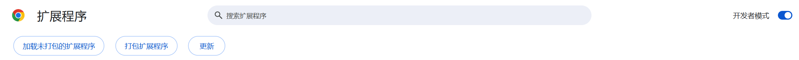

## 3 天持久化试用与每日免费激活码

- **前 3 天免码试用**：新接入的 X 账号自动开启 **3 天持久化试用**，以不可变数字 User ID 与本地时间/服务端校验锚点为凭据，免填激活码。
- **每日免费领码**：试用结束后，可在 Google 搜索以下关键词，或前往官网免费领取 1 天激活码（按 X 账号数字 ID 签名绑定，支持跨官网一键回填激活）：
  - 搜索关键词：`free xfollower activation code`
  - 官网直达：[前往 GoodExts 官网领取每日免费激活码](https://goodexts.com/zh/xfollower)

## 五步 X 涨粉主线与新版 11 项工作区

v5.3.0 / v5.3.1 重排左侧栏并内置 **Driver.js 五步交互式引导** 与完整图文教程页，按实际运营闭环编排 11 个核心入口：

| 导航顺序 | 模块 | 定位与核心动作 | 基础权重 |
| --- | --- | --- | ---: |
| 1 | **首页** | 总览统计、3 天试用 / 激活码状态与 5 步入口 | — |
| 2 | **互关追踪**（第 1 / 5 步） | 选定同领域同行锚点（如复制 `@` 用户名），预览候选列表 | 80 |
| 3 | **首页跟评**（第 2 / 5 步） | 刷首页帖时 AI 起草引用/回复，开启「评论取粉」提取互关帖评论者 | 180 |
| 4 | **评论提取**（第 2 / 5 步） | 从指定单帖提取评论用户，保留帖子来源并人工筛选 | 90 |
| 5 | **粉丝跟进**（第 3 / 5 步） | 同步个人粉丝与关注，核对「待回关」关系并放行至队列 | 200 |
| 6 | **通知监控**（第 3 / 5 步） | 捕获 X 通知里的新关注事件，联动回到「粉丝跟进」核验 | — |
| 7 | **关注队列**（第 4 / 5 步） | 四路候选按权重优先级统一审查、过滤门槛并有序关注 | 按来源权重 |
| 8 | **回关监控**（第 5 / 5 步） | 设定默认 **7 天** 复核期限，区分保留名单与逾期未回关账号 | — |
| 9 | **帖子追踪** | 持续观察原创帖子数据表现、新评论与长尾主题机会 | — |
| 10 | **X 榜单** | 收藏同行与标杆创作者，追踪快照增长与爆款模式 | — |
| 11 | **知识库** | 沉淀个人观点、实测案例与表达规范，供 AI 跟评引用 | — |

## 实机界面预览（5.3.0 / 5.3.1）

### 总览与交互式五步新手引导
| 总览与 11 项新版侧栏 | 五步引导欢迎页与第一步提示 |
| --- | --- |
| 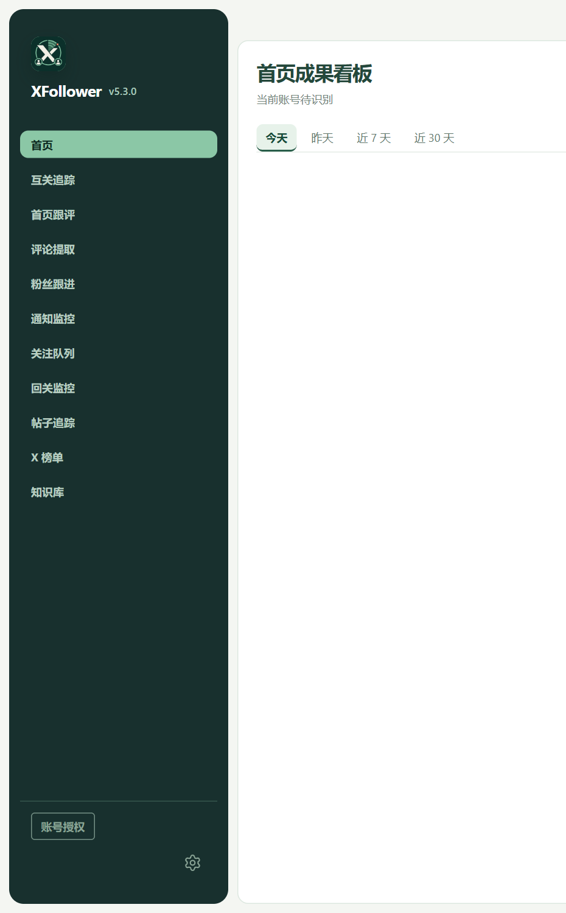 | 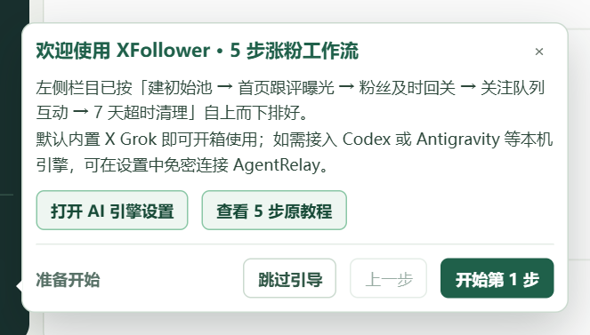 |

| 第 1 步引导浮层 | X 个人主页 `@用户名` 复制位置示例 |
| --- | --- |
| 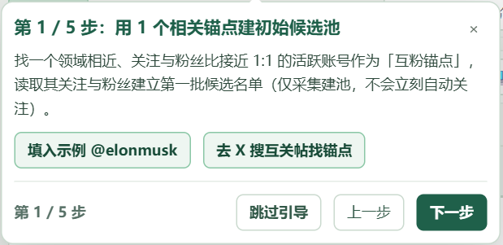 | 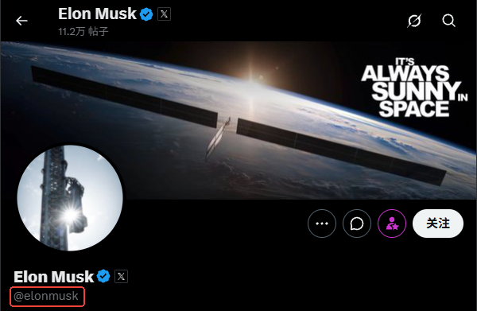 |

### 互关锚点、首页跟评、粉丝复核与队列闭环
| 1. 互关追踪锚点与候选 | 2. 首页跟评设置与评论取粉 |
| --- | --- |
| 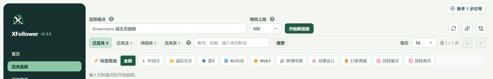 | 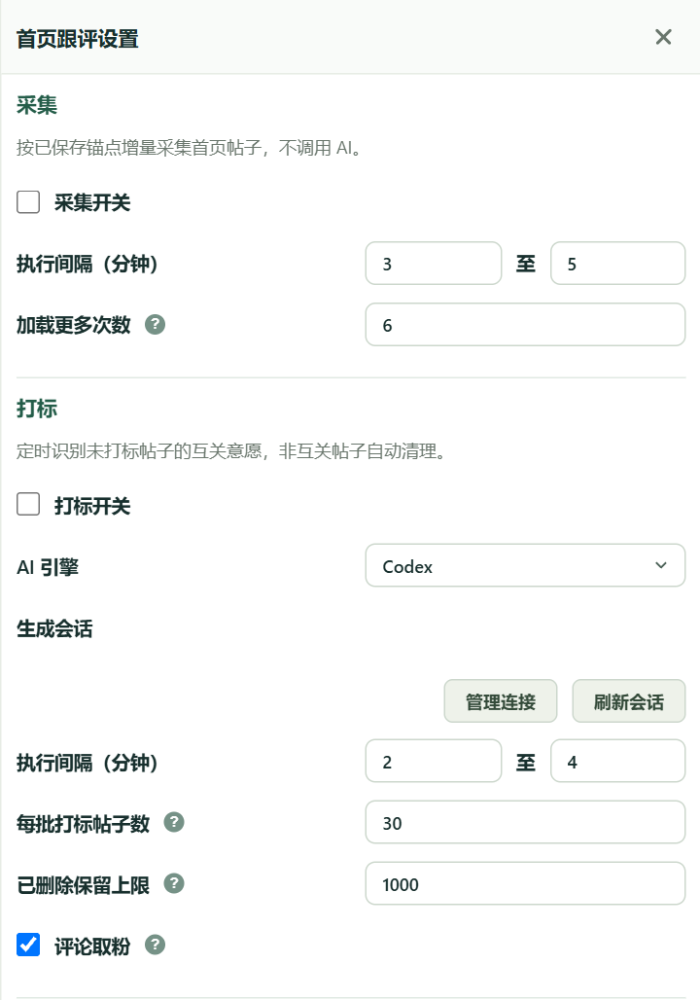 |

| 3. 粉丝跟进（待回关） | 4. 关注队列来源与权重筛选 |
| --- | --- |
| 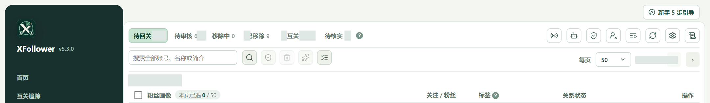 | 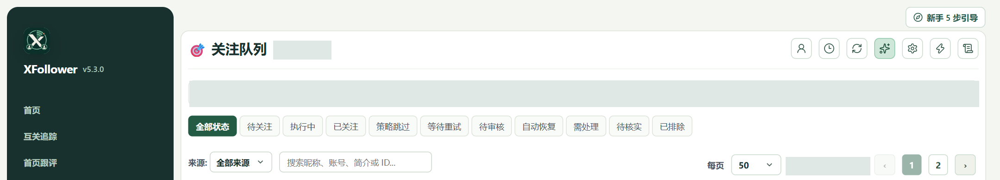 |

| 5. 回关监控（默认 7 天期限） | 进阶内容工作台（帖子追踪） |
| --- | --- |
| 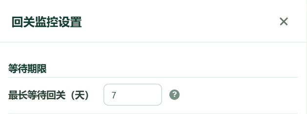 | 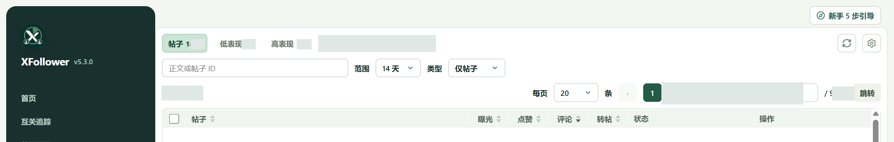 |

## AI 引擎接入：默认内置 X Grok + AgentRelay 公开 Skills

| 默认内置 X Grok 引擎 | 本机 AgentRelay 多引擎列表 |
| --- | --- |
| 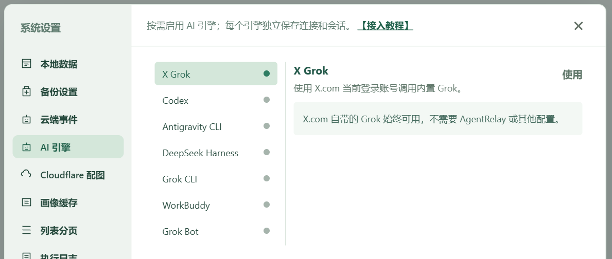 | 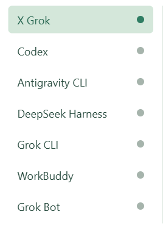 |

- **默认免配置（X Grok）**：安装后默认使用内置 **X Grok** 完成账号画像打标、首页跟评与引用草拟；同一浏览器配置已登录可用 Grok 的 X 账号即可直接使用，无需配置本地 AI 客户端。
- **进阶本机大模型（AgentRelay）**：如需改用本机 **Codex**、**Antigravity** 或 **WorkBuddy**，请下载并启动 [AgentRelay 最新版本](https://github.com/wangsen2020/agentrelay-releases/releases/latest)。保持本机默认回环（`127.0.0.1:8787`）配置时，XFollower 自动免填 Token 连接（`ALLOW_INSECURE` 严格限定为真实回环连接）。

### 本仓库保留的 AI 接入 Skills

| Skill 目录 | 用途说明 | 入口文档 |
| --- | --- | --- |
| `agentrelay-integration` | 浏览器扩展 / 本地客户端通过 `/jobs` 接口接入 AgentRelay，含健康检查、幂等去重与未知结果按原任务恢复 | [SKILL.md](agentrelay-integration/SKILL.md) |
| `agentrelay-session-bridge` | 通过本机 AgentRelay 实现跨项目/跨引擎（Codex / Antigravity / DeepSeek Harness / WorkBuddy）活动轮次直达引导与异步回执 | [SKILL.md](agentrelay-session-bridge/SKILL.md) |

将所需 Skill 文件夹整体复制到本地代理目录（如 Windows 下 `%USERPROFILE%\.codex\skills\` 或 `~/.codex/skills/`），保留其中的 `scripts/` 与 `references/` 目录，在 Node.js 22+ 环境下即可配合本地 AgentRelay 使用（附带的 `agentrelay-integration/scripts/self-test.mjs` 可离线自测契约逻辑）。

## 教程与官网入口

- [五步上手图文教程与截图清单](docs/使用指南/200.%20XFollower五步上手图文教程与截图清单_20261119_1553_wangsen.md)
- [五步 X 运营循环实战专栏（中英文）](docs/使用指南/202.%20XFollower五步运营专栏文章中英文稿_20261119_1553_wangsen.md)
- [完整文档索引与各模块专项手册](docs/使用指南/使用说明.md)
- [X 账号防封与频率控制策略](docs/使用指南/35.%20X账号防封策略_20261025_2154_wangsen.md)
- [GoodExts 官网首页](https://goodexts.com) · [XFollower 产品页与每日领码](https://goodexts.com/zh/xfollower) · [五步增长循环中文博客](https://goodexts.com/zh/blog/xfollower-growth-loop)

## 使用边界说明

- 扩展的采集、关注、引用跟评与逾期复核能力受实际浏览器登录会话、用户本地设定及 X 平台接口限流影响。
- 本公开仓库用于版本分发、四语入门引导与 AI Skill 协作说明；GitHub Release ZIP 面向已解压加载安装，不等同于 Chrome Web Store 审核上架包。
