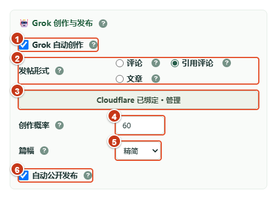

# XFollower · 粉丝跟进 · v4.0.0

管理 X 粉丝、待回关账号和关注任务，追踪帖子与作者，使用 Grok、Grok Hook 或本地 Grok Bot 辅助创作与发布。

发行版本：[XFollower 4.0.0](https://github.com/wangsen2020/x-each-follower/releases/tag/4.0.0)。[下载最新发行版](https://github.com/wangsen2020/x-each-follower/releases/latest)。GitHub 发行与 Chrome 商店上架是不同步骤。

4.0.0 整合知识库定时学习、Grok Bot 就地选择与引导、队列和取关恢复、异常提醒及引用评价过滤修复。宗教与战争冲突过滤采用有限词表，无法覆盖所有语言、图片或视频；不能保证自动互动完全避开相关内容。

3.10.6 持续自动核验待确认账号；冷却后接口与主页一致且符合条件时自动恢复排队，不再三次后停止。

3.10.5 为取关新增持久提交检查点和双重核验恢复排队，避免中断记录永久滞留；历史无提交证据的记录不自动重复操作。

3.10.4 无候选的自动取关周期只更新调度状态，不再新增开始或等待执行日志；历史纯空转轮次从执行日志视图收起，保留实际清理、取关、核验和异常。

3.10.3 自动取关日志区分取关成功、清理完成和等待处理；没有符合条件的目标时显示等待原因，历史零操作汇总按原始计数兼容展示，避免“成功 0 人”误报执行成功。

3.10.2 自动取关遇到不存在账号时，接口与中英文主页双重确认后清理本地业务记录，并在同一轮立即处理下一条；清理不占取关额度和普通关系核验名额，保留操作日志。修正后台清理调用缺少扩展内部身份造成的暂停。

3.10.1 修正互关追踪关系筛选与搜索控件的垂直对齐，统一搜索控件高度并保留换行间距。

3.10.0 增加持续异常提醒：阻断性故障在所有页面顶部保留提示，首次桌面通知，未恢复时每 30 分钟提醒；检测到恢复后才解除。执行日志备份序号冲突自动选取校验完整的已提交链作为主线，按记录 ID、版本和时间合并为统一结果；日志已保存本地时，备份故障不再使取关等任务整轮失败。详见[异常提醒与统一备份合并验收](docs/互粉与粉丝管理/80.%20持续异常提醒与日志备份自动合并_20261028_1214_wangsen.md)。

## 主要功能

- **粉丝与回关管理**：保存账号资料和关注关系，支持全局搜索、分页、单条与批量删除、关系核验；核验结果可关闭，切换筛选时取消旧核验并清空选择。
- **统一关注队列**：汇总粉丝跟进、互关追踪和评论追踪候选，核实身份与关系后执行；已申请关注、等待确认的账号避免重复关注。
- **回关监控**：取关结果与关系记录联动；单个待确认操作独立隔离，其他账号继续调度，显示排队、额度与恢复条件。
- **持续异常提醒**：跨页面保留异常原因、发现时间、处理入口和桌面提醒；备份冲突由程序自动合并，恢复后解除提示。
- **Grok 创作**：支持评论、引用评论和文章。排除置顶帖，从最近最多 20 条普通帖子按评论＋3×转发＋3×点赞＋3×收藏选题；保留参与概率，未抽中不调用生成。评论和引用评论移除生成前的素材质量筛选指令。
- **Grok Hook**：通过 Grok 自动化 Webhook 生成与回传文本，提供 Cloudflare Worker、D1 接入向导及手动教程。仍使用 Grok 用量，不代表独立 Bot 额度。
- **Grok Bot 本地通道**：填写端口与 Token，选择 Bot 并通过生成测试后启用；配置在重开后自动还原，后台中断后按原任务查询回复。
- **发布与恢复**：发送生成请求前保存任务 ID，回传后继续原任务；已有结果直接复用，保留发布证据并阻止重复执行。可按语言追加“来关必回”，超长内容保留草稿。
- **知识增强**：定时总结为带来源的经验，可单条或批量合入当前智慧；智慧为可复制编辑的 Markdown 写作 Skill，多版本单选使用；支持每日总结、每周自动合并及分页执行记录。关注队列 AI 生成可选使用当前智慧，默认关闭。
- **文章与追踪**：文章支持配图及可选 Cloudflare 备用出图；提供帖子追踪、作者榜单、知识库和执行日志。

## 4.0.0 更新

本版替代已撤回公开发布的 3.11.1，保留其代码与数据升级路径。修复智慧版本及执行记录分页的横排、垂直居中和10px间距，调整窄屏弹窗、版本表格、学习设置和经验列表；浏览器验收页加载完整插件样式，避免遗漏全局样式冲突。知识增强默认关闭，智慧版本可单选、复制编辑及另存。

增加本地 Grok Bot 生成通道，支持端口、Token、Bot 选择及验证后保存。服务采用异步持久任务，后台中断后可查询原回复；发送结果不明时保留待确认。Windows 本地服务现更名为 Grok Bridge，[0.7.0 完整 ZIP](https://github.com/wangsen2020/grok-bot-bridge/releases/download/v0.7.0/grok-bridge-0.7.0-win-x64.zip) 已正式发布；完整解压后运行 grok-bridge.exe，无需另装 Node.js 或 CLI。

已验证真实 Bot 回复、服务重启续查、扩展后台停止后取回回复，以及配置重开还原。历史测试中已验证真实回复与发布；本次 GitHub 发行不代表 Chrome 商店上架。

## 3.7.5 更新

修复教程 Worker 的源码校验值不一致，固定部署源码使用 LF 换行，并同步教程内嵌资源。此补丁延续 3.7.4 的业务功能；没有新增生成请求或修改已发布任务。发行前完成历史工作区差异核对与清理，并重新验证依赖、测试和安装包。

## 3.7.4 更新与验收边界

本版汇总粉丝目录及批量操作、统一工具栏、队列恢复、选题与多语言后缀、通知来源路由、自动取关隔离、Grok Hook 接入及引用编辑器修复。具体记录见[发行整理](docs/创作与发帖/75.%20Grok-Hook链路复盘与3.7.4发行验收_20261028_0135_wangsen.md)。

已完成 Worker → Grok 自动化 → 回传验证，并复用已有生成结果完成关注队列自动引用发布及防重复核验。随后六次只读监测记录新增 5 条已发布、1 条保留草稿和 1 条待回传，没有发现新增失败、重复生成或重复发布。监测结束时的待回传任务不等于已完成；历史异常不据此宣称全部修复。

引用评论优先定位实际弹窗，忽略背景回复框。发送结果不明确时继续核验，避免盲目重发。字数不足、账号权限、Grok 用量和 X 页面变化仍可能使任务保留草稿或等待处理。接入向导与实际回传分别验收，不能把 Webhook 的 accepted 或自动化运行成功当作回传和公开发布成功。

## 安装与升级

1. 下载发行 ZIP 并完整解压；从源码安装则先运行 npm ci、npm run build、npm run build:check。
2. 打开 chrome://extensions 或 edge://extensions，开启开发者模式，选择“加载已解压的扩展程序”。发行包选择含 manifest.json 的目录；源码选择 dist，不能直接加载仓库根目录。
3. 在同一浏览器登录 X，点击扩展打开面板，按提示确认队列账号和来源，再配置需要启用的自动任务。
4. 升级前等待正在执行的任务结束；更新文件并重载扩展，检查扩展管理页实际版本。不要把源码版本或下载完成当作已加载成功。

## 使用教程

- **Grok Bot 本地接入**：打开插件「系统设置 → Grok Bot → 图解教程」，按「下载 → 授权 → 连接 → 测试」完成配置。教程附 6 张带编号的真实界面截图、当前扩展地址与白名单片段复制、401 / 403 / 417 排错；创作时在实际配置中选择生成 Bot。源码入口为 [grok-local-guide.html](src/grok-local-guide.html)，通过构建后的扩展打开可自动读取当前扩展地址。

- **[近期功能图解教程 · 3.2.7](docs/使用指南/61.%20近期功能图解教程_20261027_0919_wangsen.md)**：8 张 CDP 实机局部截图，按编号介绍三种创作形式、Cloudflare 备用配图、评价核对与重新评估、待回关放行、自动取关设置及知识库。
- [帖子追踪与二审](docs/使用指南/06-帖子追踪.md) · [X 榜单](docs/使用指南/07-X榜单.md) · [关注队列](docs/使用指南/08-关注队列.md)
- [安装与初次使用](docs/使用指南/01-安装与初次使用.md)
- [粉丝管理与回关](docs/使用指南/02-粉丝管理与回关.md)
- [互关追踪](docs/使用指南/03-互关追踪.md)
- [评论追踪](docs/使用指南/04-评论追踪.md)
- [定时任务与日志](docs/使用指南/05-定时任务与日志.md)
- [教程目录](docs/使用指南/使用说明.md)与[开发文档索引](docs/文档时间顺序编号对照表_wangsen.md)

下图编号依次为：① 创作开关、② 三种形式单选、③ 备用配图管理、④ 创作概率、⑤ 篇幅、⑥ 自动公开发布。入口：**关注队列 → 齿轮 → Grok 创作与发布**。修改后需在抽屉底部保存，并重新打开核对。图中开关和数值是现场已有配置，不是首次安装默认值或推荐设置。



完整步骤见[近期功能图解教程](docs/使用指南/61.%20近期功能图解教程_20261027_0919_wangsen.md)。新截图已遮蔽账号资料和连接标识，采集过程未触发真实关注、发布、私信或取关；旧教程截图可能与现版布局不同。

## 数据与权限

扩展申请 scripting、storage、alarms、notifications、tabs、windows、clipboardWrite，以及 x.com、twitter.com、grok.com 域权限。Cloudflare API 和自建回传服务域权限按需申请；直接 Grok 使用 X 页面，Grok Hook 使用 Grok 自动化 Webhook 与自建回传服务。

账号资料、队列、记录与设置保存在本地存储及 IndexedDB，部分历史数据与备份位于 X 站点存储。启用 Grok 会将选中的资料或帖子发送给 Grok；启用 Grok Hook 会把生成任务发送给自建 Worker、D1 与 Grok 自动化；启用 Cloudflare 配图会向其发送图片提示词；启用自动关注、私信、取关或发布会按对应功能设置产生真实操作。卸载扩展不等于清除 X 站点备份。

筛选与风险提示是辅助判断，不保证回关率，也不能仅凭关键词认定账号性质。插件会使用 X 页面及其接口能力；不能将其描述为“不调用接口、不使用 AI、不自动关注”。

## 源码与开发

Node.js 22 或更新版本。运行源码集中在 src，Chrome 只加载构建后的 dist。

```text
src/
  entries/             # background、panel、content、main-world、verification 入口
    panel/styles/      # 面板样式
  features/            # relationships、follow-queue、records、grok 业务
  platform/            # Chrome 存储及 X 页面读取适配
  shared/              # 通用规则、日志、统一版本
  assets/              # 图标、提醒页图片
  vendor/              # 第三方预构建签名脚本
  manifest.json        # 扩展清单与应用版本来源
  panel.html           # Vite HTML 入口
```

构建与检查：

```sh
npm ci
npm test
npm run check
npm run build
npm run test:build
npm run build:check
```

使用 npm run version:set -- <版本号> 同步清单、package 和锁文件；后台、面板等读取共享版本入口。发版前同步本 README 的版本、功能、安装方式和限制，并使用全局 git-flow-release 技能核对 Git Flow、本地及远程分支收尾、发行包和发布状态。

## AI 协作与开发规范（开始前必读）

本节是 Codex、Claude、Antigravity、Grok 等 AI 协作者的项目级约定。开始分析或修改前先读本节及相关功能代码；任务提示与本节冲突时，遵循用户最新的明确要求，并及时更新文档。

### Git 与协作

- 统一使用 Git Flow：新功能分支必须通过 `git flow feature start <名称>` 创建，禁止新建 `codex/*` 分支。已有功能在对应 `feature/*` 分支继续迭代；发布前先确认实际分支状态。此约定替代旧的默认 `codex/` 前缀规则。

- 动手前检查当前分支、工作区状态、远程分支和已确认的生产基线；不要假设当前分支就是生产版本。
- 不在 `master`、`main` 或 release 分支上开发。功能和修复在基于已确认基线的隔离 feature 分支中进行；当前用户明确允许直接在 `develop` 持续开发时，按该授权执行。
- 不为切分支而覆盖、重置或混入其他人的未提交改动。只提交自己负责且已检查的文件，不要把其他代理的改动一起提交。
- 用户已要求及时提交自己完成的代码；提交前检查 diff 和 `git diff --check`，提交信息简洁说明改动。未经用户要求，不推送、合并或发布。
- 多代理并行时，各代理先确认负责文件与边界；Codex 负责整合审查与验收。发现其他代理的改动有问题，应反馈给对应代理，不要擅自覆盖。

### UI 与 CSS

- 优先使用 flex 布局，并用明确的 `padding`、`margin` 控制间距；谨慎使用 `gap`。普通列表行默认约 `10px` 间距，通常不超过 `20px`，除非有明确的视觉理由。
- 禁止用 `!important` 修补样式。通过更具体、合理的选择器和组件作用域解决优先级问题，避免无边界的全局覆盖。
- 同一工具栏或操作组内的按钮高度、内边距和对齐方式要一致；图标按钮与文字按钮并排时也要保持同高。输入框、下拉框、按钮和下拉箭头需在同一行正确对齐。
- 页面内容区、表格行、段落与容器要有一致的基础留白，避免意外的空白区、文字换行或图标错位。修改布局后检查实际渲染效果及计算后的间距；仅凭 CSS 源码或截图局部不能认定全局问题已修复。
- 保持现有简洁、紧凑的视觉体系；新增控件应与同一页面已有控件在尺寸、色彩、圆角和交互反馈上协调。

### 功能语义与验收

- “互粉追踪”功能名称使用“互关追踪”；“评论追踪”名称及其独立功能保持不变。修改一个模块时，不要顺带重命名或改变另一个模块的语义。
- 优先使用可验证的页面网络接口获取数据，避免不必要的模拟点击；接口是否可用必须实测，不能只凭推测下结论。涉及关注等写操作时，严格遵循用户明确的产品流程与确认条件。
- 对扩展功能按完整链路验收：用户输入、界面事件、后台请求、响应解析、数据持久化和页面展示。分别说明代码检查、自动化测试、真实浏览器验证完成到哪一步；HTTP 成功、单元测试通过或静态检查通过，都不能单独代表用户功能可用。
- UI 修复应在真实扩展页面检查受影响的页面与状态。若登录态、浏览器权限、CDP 或其他环境问题阻止实测，应准确说明未完成的验收环节，不要声称已验证。
- XFollower 的 CDP 接入先运行 [tools/cdp-session.ps1](tools/cdp-session.ps1)：脚本会核对固定登录 profile、9222 端口与扩展目标；已有实例时直接附加。具体操作边界见 [AGENTS.md](AGENTS.md)。
- 新增设置、状态和持久化数据时检查升级兼容性；不能仅修改新用户默认值而忽略已有用户的数据迁移。

### 协作者交接

- 被分配实现任务的代理应报告改动文件、行为变化、验证结果和未完成事项；不要宣称未运行的测试或未观察到的浏览器结果。
- 向 Antigravity 或 Grok 分配 UI 工作时，提示中必须重复本节的布局规则（flex、谨慎使用 `gap`、行间距约 `10px` 且通常不超过 `20px`、按钮同高、禁止 `!important`）及真实页面验收要求。


### Grok Hook 通道

通过 Grok 自动化 Webhook 生成文本，仍使用 Grok 用量，不代表独立 Bot 额度。

在 Grok 创作设置中选择 **Grok / Grok Hook**，选择立即保存。Grok Hook 未绑定时自动打开接入向导，通过生成测试后切换；取消保留原选择。教程包含网页 Webhook、Cloudflare Worker 与 D1、专用连接 Token 和脱敏截图，可复制完整实施内容交给 ChatGPT 或 Claude。已有待回传任务继续查询原任务，避免重复消耗额度。

### 自动接入向导

Grok Hook 设置新增自动接入：引导登录和授权，自动读取本次部署凭据、创建专用 Cloudflare Worker 与 D1，并填写 Grok 网页任务、绑定接口及验证回传。只操作向导自建页面与资源；部署凭据暂存浏览器会话，完成后清除，保留手动教程入口。
