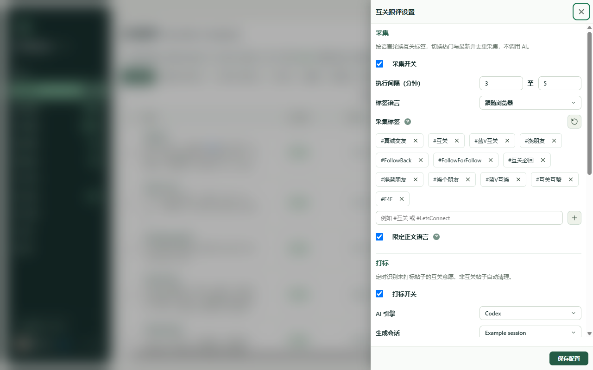

# XFollower · X 粉丝管理与互关跟评

[简体中文](README.md) · [English](README.en.md) · [Português (Brasil)](README.pt-BR.md) · [Español (Latinoamérica)](README.es-419.md)

**当前发行版：5.7.11 · Chrome / Edge MV3 · [GoodExts 产品页与每日领码](https://goodexts.com/zh/xfollower)**

XFollower 帮助你发现互关帖子、审查新增粉丝和关注关系、管理关注队列，并复盘帖子表现。互关候选通过标签搜索采集，不依赖个性化首页推荐。

本公开仓库提供安装包、四语说明、教程与 AI 接入 Skills；新版开发源码在独立私有仓库维护。当前安装包采用常规打包压缩，**不做 JavaScript 混淆**。请使用下方发行附件安装，仓库文件和 GitHub 自动生成的 Source code 压缩包不是新版扩展安装包。

## 下载与安装

- [下载 XFollower-5.7.11.zip](https://github.com/wangsen2020/x-each-follower/releases/download/5.7.11/XFollower-5.7.11.zip)
- [SHA256SUMS.txt](https://github.com/wangsen2020/x-each-follower/releases/download/5.7.11/SHA256SUMS.txt) · [5.7.11 发行说明](https://github.com/wangsen2020/x-each-follower/releases/tag/5.7.11) · [最新发行版](https://github.com/wangsen2020/x-each-follower/releases/latest)
- SHA-256：`6b836af5980aa2ad149f6f29389bccb9a24972c464d9d0ec72615a1369c86901`
- [Chrome 商店](https://chromewebstore.google.com/detail/dbokihddfeclflabcnjggminlkdfjfjf)：商店审核与 GitHub 发行独立进行，实际可安装版本以商店页面为准。

1. 将 ZIP **完整解压到固定目录**，确认该目录直接包含 `manifest.json`。
2. 打开 `chrome://extensions`（Edge 使用 `edge://extensions`），开启“开发者模式”。
3. 点击“加载已解压的扩展程序”，选择上述目录。在同一浏览器配置中登录 x.com，再从工具栏打开 XFollower。

已有手动安装用户：在原加载目录替换文件，然后点击扩展卡片的“重新加载”；保留原目录，不删除扩展或清空数据。商店安装用户等待商店更新。升级沿用已有记录、配置、草稿和原任务凭据。

## 从互关跟评开始的 5 步流程

1. **互关跟评**：默认打开此页。编辑采集标签、语言和时间间隔，开启采集；扩展会创建或复用通知常驻窗口，在专属标签页轮换搜索并切换“热门 / 最新”。
2. **按需锚点提取**：原“互关追踪”已改名，功能和数据保留。需要更多候选时，再输入同领域账号，合并其关注与粉丝。
3. **粉丝跟进与通知监控**：发现新增粉丝、核对待回关关系，补充候选资料。
4. **关注队列**：统一审查各来源候选，执行前核验当前关系；按配置执行关注及可选互动。
5. **回关监控**：按复核期限查看是否回关，保护保留名单，按需处理超时账号；新设置默认期限为 7 天。

采集不调用 AI。打标、评论生成和关注分别控制；可以先只开启采集和打标，确认结果后再按需启用后续动作。默认采集标签和自定义标签都可逐项添加、移除，最多保留 20 个；它们与发布评论时追加的标签独立保存。

## 11 个栏目各做什么

| 栏目 | 用途 |
| --- | --- |
| 首页 | 查看成果、执行情况和需要核实的事项 |
| 互关跟评 | 搜索互关帖、判断意愿、按配置跟评与提取候选 |
| 锚点提取 | 从同领域账号的关注和粉丝中补充候选 |
| 评论提取 | 从指定帖子的评论中采集用户，保留来源 |
| 粉丝跟进 | 核对粉丝、关注与待回关关系 |
| 通知监控 | 从 X 通知中持续发现新增关注事件 |
| 关注队列 | 汇合候选并执行审查、关注与可选互动 |
| 回关监控 | 复核回关情况、保留名单与超时账号 |
| 帖子追踪 | 查看帖子表现及新增评论 |
| X 榜单 | 追踪收藏账号的增长快照 |
| 知识库 | 保存复盘与写作经验，供内容生成参考 |

既有来源优先级保留：待回关粉丝 200、互关帖评论用户 180、普通评论提取 90、锚点及互关帖作者候选 80。入队不等于立即关注，关注前仍按设置审查。

## 5.7.11 的主要变化

- 互关跟评成为默认入口；锚点提取作为可选来源保留，五步引导与四语教程同步。
- 互关跟评错误只在本栏目展示，侧栏红色图标可打开详情，不占用其他栏目顶部。
- 通知使用 hash 精准定位并复用已打开的面板；直接打开关注队列也会加载数据。
- 直接评论使用独立后台任务标签，完成后关闭；搜索页切换时的短暂 frame 失效有界恢复，保留已采集结果。

## 试用、每日码与 AI 接入

每个 X 账号首次接入提供 **72 小时试用**。试用后可在 [GoodExts](https://goodexts.com/zh/xfollower) 免费领取有效期 **24 小时**的每日激活码，或在“账号授权”中使用月度、季度、半年码。

按账号可用性使用内置 X Grok；需要本机引擎时，在设置中连接 [AgentRelay](https://github.com/wangsen2020/agentrelay-releases/releases/latest)，为打标与评论分别选择引擎和会话。实际可用性取决于 X 登录、本地服务与引擎配置。

- [agentrelay-integration](agentrelay-integration/SKILL.md)：接入与任务凭据恢复参考。
- [agentrelay-session-bridge](agentrelay-session-bridge/SKILL.md)：跨会话派单与主动回执参考。

## 教程与支持

- [四语官网](https://goodexts.com) · [中文产品页](https://goodexts.com/zh/xfollower) · [最新五步图文教程](https://goodexts.com/zh/blog/xfollower-growth-loop)
- [问题反馈](https://github.com/wangsen2020/x-each-follower/issues) · [本版验收记录](https://github.com/wangsen2020/x-each-follower/releases/download/5.7.11/RELEASE-ACCEPTANCE.md)
- 仓库中旧版 `docs/` 保留为历史资料；当前入口、版本和操作以本页、官网及扩展内教程为准。

工作记录保存在浏览器中；按启用功能，请求可能发送至 X/Grok 或配置的服务，激活可能使用 X 账号标识。关注和发帖受 X 平台规则、登录、网络及接口限制影响。XFollower 与 X Corp. 无隶属关系。
