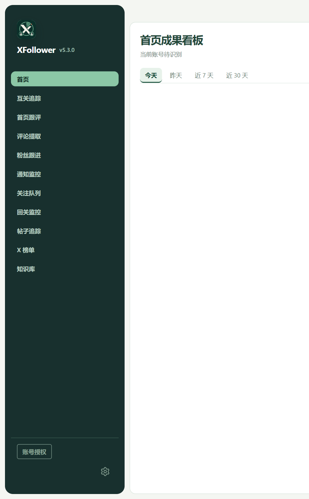

# XFollower

[简体中文](README.md) · [English](README.en.md) · [Português (Brasil)](README.pt-BR.md) · [Español (Latinoamérica)](README.es-419.md)

**v5.3.1 · Chrome / Edge MV3 · Site Oficial: [GoodExts](https://goodexts.com) ([Página do XFollower e Código Diário](https://goodexts.com/pt-br/xfollower))**

XFollower é uma extensão Chrome / Edge da [GoodExts](https://goodexts.com) para criadores e fundadores no X (Twitter) executarem um ciclo completo de crescimento orgânico: rastreamento de mútuos, respostas com IA na timeline, captura de comentaristas, triagem de retorno de seguimento, monitoramento de 7 dias e base de conhecimento de conteúdo. A partir da **v5.3.0 / v5.3.1**, o código-fonte passou para um repositório privado e as versões são distribuídas como pacotes ZIP ofuscados de código fechado; este repositório público mantém **lançamentos oficiais, documentação em 4 idiomas, tutoriais ilustrados, capturas reais e skills públicas de integração IA**.

## Download e Instalação Rápida (v5.3.1)

- **Baixar ZIP**: [XFollower-5.3.1.zip](https://github.com/wangsen2020/x-each-follower/releases/download/5.3.1/XFollower-5.3.1.zip) · [SHA256SUMS.txt](https://github.com/wangsen2020/x-each-follower/releases/download/5.3.1/SHA256SUMS.txt) · [Notas da versão 5.3.1](https://github.com/wangsen2020/x-each-follower/releases/tag/5.3.1) · [Todas as versões](https://github.com/wangsen2020/x-each-follower/releases/latest)
- **SHA-256**: `cead6d7310d3460f2581be658c0e85b84d29517ff5eda29df6d29249432aefd9`
- **ID Fixo da Extensão (Build Release)**: `colllpngfoieccfbgljaklpgiphpiebj`

### Instalação em 3 passos no Chrome / Edge

1. Baixe e descompacte `XFollower-5.3.1.zip` em uma pasta permanente (não carregue de dentro do ZIP e não apague a pasta após instalar).
2. Acesse `chrome://extensions` (ou `edge://extensions`) e ative o **Modo do desenvolvedor** no canto superior direito.
3. Clique em **Carregar sem compactação**, selecione a pasta que contém diretamente `manifest.json` e faça login no X no mesmo perfil antes de abrir o painel.

## Teste Persistente de 3 Dias e Código Gratuito Diário

- **3 Dias de Teste Sem Código**: Contas X iniciam automaticamente um teste persistente de 3 dias ancorado no ID numérico da conta X, sem exigir código de ativação.
- **Resgatar Código Gratuito Diário (24h)**: Após o teste, pesquise no Google pela palavra-chave abaixo ou acesse diretamente o site oficial (com preenchimento automático na extensão via `goodexts-bridge`):
  - Palavra-chave de busca: `free xfollower activation code`
  - Link direto do site oficial: [Resgatar gratuitamente em GoodExts](https://goodexts.com/pt-br/xfollower)

## Ciclo de Crescimento em 5 Passos e 11 Módulos

A versão **v5.3.0 / v5.3.1** reorganizou os 11 menus laterais na ordem do fluxo operacional diário, com **tour interativo em 5 etapas (Driver.js)** e guia ilustrado integrado:

| Ordem | Módulo | Função principal | Peso base |
| --- | --- | --- | ---: |
| 1 | **Visão Geral (`home`)** | Resumo da conta, status de teste/licença e atalhos dos 5 passos | — |
| 2 | **Rastreamento Mútuo (`candidates`)** — Passo 1 / 5 | Escolher uma conta referência (`@usuario`), visualizar candidatos do nicho | 80 |
| 3 | **Respostas na Timeline (`mutualComments`)** — Passo 2 / 5 | Gerar comentários contextuais com X Grok e capturar comentaristas de posts mútuos | 180 |
| 4 | **Descoberta em Comentários (`comments`)** — Passo 2 / 5 | Extrair comentaristas de posts específicos preservando a origem | 90 |
| 5 | **Revisão de Seguidores (`monitor`)** — Passo 3 / 5 | Sincronizar seguidores e aprovar quem já segue você de volta | 200 |
| 6 | **Monitor de Notificações (`notificationMonitor`)** — Passo 3 / 5 | Capturar novos seguidores em notificações do X para conferência | — |
| 7 | **Fila de Seguimento (`followQueue`)** — Passo 4 / 5 | Consolidar as 4 fontes por peso e filtros antes de executar ações | Por peso |
| 8 | **Monitor de Retorno (`unreciprocated`)** — Passo 5 / 5 | Prazo padrão de **7 dias** para revisar não-retornos com lista de proteção | — |
| 9 | **Rastreamento de Posts (`postTracking`)** | Acompanhar alcance, comentários e tópicos para novas publicações | — |
| 10 | **Ranking X (`leaderboard`)** | Salvar criadores de referência, snapshots e tendências do nicho | — |
| 11 | **Base de Conhecimento (`knowledge`)** | Guardar insights, exemplos reais e referências para citações da IA | — |

## Prévia da Interface e Guia Visual

| Visão Geral e Nova Barra Lateral (11 itens) | Tour Interativo de 5 Passos |
| --- | --- |
|  |  |

| Passo 1 — Conta Referência | Passo 2 — Respostas na Timeline |
| --- | --- |
|  |  |

| Passo 3 — Aguardando Retorno | Passo 4 — Fila Unificada de Seguimento |
| --- | --- |
|  |  |

| Passo 5 — Prazo Padrão de 7 Dias | Conteúdo Avançado (Rastreamento de Posts) |
| --- | --- |
|  |  |

## Motores de IA: X Grok Nativo + AgentRelay Skills

| X Grok Integrado (Padrão) | Opções Locais via AgentRelay |
| --- | --- |
|  |  |

- **Padrão Zero-Config (X Grok)**: A classificação de perfis e rascunhos de comentários usam **X Grok** por padrão, aproveitando sua sessão ativa do X sem exigir servidor local nem token.
- **Modo Avançado com AgentRelay**: Para conectar **Codex**, **Antigravity CLI** ou **WorkBuddy** locais, instale [AgentRelay Releases](https://github.com/wangsen2020/agentrelay-releases/releases/latest). Na configuração loopback padrão (`127.0.0.1:8787`), versões compatíveis do AgentRelay conectam automaticamente sem colar token manual.

### Skills Públicas de Integração IA

| Pasta | Descrição | Documentação |
| --- | --- | --- |
| `agentrelay-integration` | Fluxo padrão `/jobs`, desduplicação e recuperação segura para extensões e clientes locais | [SKILL.md](agentrelay-integration/SKILL.md) |
| `agentrelay-session-bridge` | Ponte direta entre sessões e motores locais (Codex / Antigravity / DeepSeek Harness / WorkBuddy) | [SKILL.md](agentrelay-session-bridge/SKILL.md) |

## Links Oficiais e Tutoriais

- [Site Oficial GoodExts](https://goodexts.com) · [Página do Produto e Código Diário](https://goodexts.com/pt-br/xfollower) · [Artigo Ciclo em 5 Passos](https://goodexts.com/pt-br/blog/xfollower-growth-loop)
- [Guia Ilustrado de 5 Passos (zh-CN)](docs/使用指南/200.%20XFollower五步上手图文教程与截图清单_20261119_1553_wangsen.md) · [Coluna de Operação em 5 Passos (zh-CN / EN)](docs/使用指南/202.%20XFollower五步运营专栏文章中英文稿_20261119_1553_wangsen.md)
- [Índice Completo de Documentação](docs/使用指南/使用说明.md) · [Segurança e Limites no X](docs/使用指南/35.%20X账号防封策略_20261025_2154_wangsen.md)
