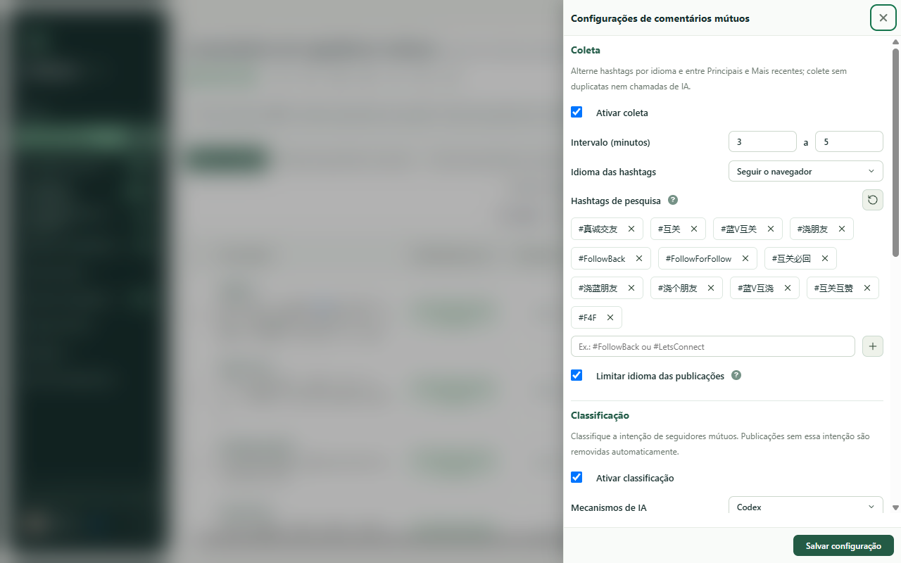

# XFollower · Gestão de seguidores e respostas mútuas no X

[简体中文](README.md) · [English](README.en.md) · [Português (Brasil)](README.pt-BR.md) · [Español (Latinoamérica)](README.es-419.md)

**Versão atual: 5.7.11 · Chrome / Edge MV3 · [Produto e código diário](https://goodexts.com/pt-br/xfollower)**

O XFollower ajuda a encontrar publicações sobre seguir de volta, revisar seguidores e relações, gerenciar uma fila de perfis e analisar resultados. A descoberta usa buscas por hashtags e não depende do feed personalizado.

Este repositório público oferece pacotes de instalação, documentação em quatro idiomas, tutoriais e skills de integração com IA. O código atual é mantido em um repositório privado separado. Os pacotes usam empacotamento e compressão comuns, **sem ofuscação de JavaScript**. Instale o arquivo da versão abaixo; os arquivos do repositório e os arquivos Source code gerados pelo GitHub não são o pacote atual da extensão.

## Download e instalação

- [Baixar XFollower-5.7.11.zip](https://github.com/wangsen2020/x-each-follower/releases/download/5.7.11/XFollower-5.7.11.zip)
- [SHA256SUMS.txt](https://github.com/wangsen2020/x-each-follower/releases/download/5.7.11/SHA256SUMS.txt) · [Notas da versão](https://github.com/wangsen2020/x-each-follower/releases/tag/5.7.11) · [Versão mais recente](https://github.com/wangsen2020/x-each-follower/releases/latest)
- SHA-256: `6b836af5980aa2ad149f6f29389bccb9a24972c464d9d0ec72615a1369c86901`
- [Chrome Web Store](https://chromewebstore.google.com/detail/dbokihddfeclflabcnjggminlkdfjfjf): a revisão da loja é independente da publicação no GitHub. Consulte a loja para saber qual versão está disponível.

1. **Extraia todo o ZIP para uma pasta permanente** que contenha `manifest.json` diretamente.
2. Abra `chrome://extensions` (`edge://extensions` no Edge) e ative o modo de desenvolvedor.
3. Use Carregar sem compactação e selecione essa pasta. Entre no x.com no mesmo perfil do navegador e abra o XFollower pela barra de ferramentas.

Para atualizar uma instalação manual, substitua os arquivos na pasta original e clique em Recarregar no cartão da extensão. Preserve a pasta e a instalação, sem apagar os dados. Instalações da loja recebem atualizações pela loja. Registros, configurações, rascunhos e comprovantes das tarefas são preservados.

## Fluxo em cinco etapas

1. **Respostas mútuas** é a página inicial. Defina hashtags, idioma e intervalo e ative a coleta. Uma aba dedicada na janela de notificações criada ou reutilizada alterna hashtags e as buscas Top / Latest.
2. **Extração por perfil de referência, opcional** preserva a antiga página de rastreamento mútuo e seus dados. Use um perfil da sua área para encontrar mais candidatos entre seguidores e contas seguidas.
3. **Revisão de seguidores e notificações** identifica novos seguidores, verifica relações e complementa os perfis.
4. **Fila de perfis** reúne candidatos das fontes ativadas, aplica a revisão e confere a relação atual antes de seguir ou interagir conforme a configuração.
5. **Monitoramento de retorno** permite revisar quem seguiu de volta, contas protegidas e casos vencidos. Novas configurações usam um prazo padrão de 7 dias.

A coleta não chama IA. Classificação, respostas e ações de seguir têm controles separados. Comece pela coleta e classificação, confira os resultados e ative as outras ações quando necessário. Hashtags padrão e personalizadas podem ser adicionadas ou removidas individualmente, até 20; são independentes das hashtags incluídas nas respostas publicadas.

## As 11 seções

| Seção | Finalidade |
| --- | --- |
| Início | Resultados, execução e itens a verificar |
| Respostas mútuas | Buscar publicações, classificar intenção e responder ou coletar candidatos |
| Extração por referência | Candidatos entre seguidores e contas seguidas por um perfil relevante |
| Extração de comentários | Coletar comentaristas de uma publicação e preservar a origem |
| Revisão de seguidores | Conferir seguidores, contas seguidas e retornos pendentes |
| Monitoramento de notificações | Identificar novos eventos de seguir no X |
| Fila de perfis | Revisar candidatos e executar as ações configuradas |
| Monitoramento de retorno | Revisar retornos, contas protegidas e prazos vencidos |
| Rastreamento de publicações | Desempenho e novas respostas |
| Ranking X | Histórico de crescimento das contas salvas |
| Base de conhecimento | Guardar experiências e notas para criação de conteúdo |

As prioridades permanecem: seguidores aguardando retorno 200, comentaristas de publicações mútuas 180, extração comum de comentários 90, candidatos por referência e autores de publicações mútuas 80. Entrar na fila não significa seguir imediatamente.

## Novidades da versão 5.7.11

- Respostas mútuas abre primeiro; a extração por referência continua opcional. O guia e as imagens acompanham essa ordem.
- Erros ficam no próprio módulo, acessíveis pelo indicador vermelho lateral, sem faixa sobre outras páginas.
- Rotas hash permitem que notificações reutilizem o painel e abram a seção correta. Links diretos da fila carregam os dados.
- Respostas diretas usam abas de tarefa em segundo plano, fechadas ao terminar. A recuperação limitada da página de busca preserva os resultados já salvos.

## Teste, códigos diários e IA

Cada conta X recebe **72 horas de teste** na primeira conexão. Depois, obtenha no [GoodExts](https://goodexts.com/pt-br/xfollower) um código diário gratuito válido por **24 horas**, ou insira um código mensal, trimestral ou semestral na autorização de conta.

Use o X Grok integrado quando disponível. Para motores locais, conecte o [AgentRelay](https://github.com/wangsen2020/agentrelay-releases/releases/latest) nas configurações e escolha motor e conversa separadamente para classificação e respostas. A disponibilidade depende do login no X, do serviço e da configuração do motor.

- [agentrelay-integration](agentrelay-integration/SKILL.md): integração e recuperação pelos comprovantes da tarefa original.
- [agentrelay-session-bridge](agentrelay-session-bridge/SKILL.md): delegação entre sessões e envio de resultados.

## Guias e suporte

- [Site oficial](https://goodexts.com/pt-br) · [Produto](https://goodexts.com/pt-br/xfollower) · [Guia atual em cinco etapas](https://goodexts.com/pt-br/blog/xfollower-growth-loop)
- [Relatar um problema](https://github.com/wangsen2020/x-each-follower/issues) · [Registro de validação da versão](https://github.com/wangsen2020/x-each-follower/releases/download/5.7.11/RELEASE-ACCEPTANCE.md)
- Os arquivos antigos em `docs/` são referências históricas. Para o fluxo atual, use este README, o site e os tutoriais da extensão.

Os registros ficam no navegador. Recursos ativados podem enviar solicitações ao X/Grok ou ao serviço configurado; a ativação pode usar o identificador da conta X. Seguir e publicar dependem das regras do X, do login, da rede e dos limites da interface. O XFollower não é afiliado à X Corp.
