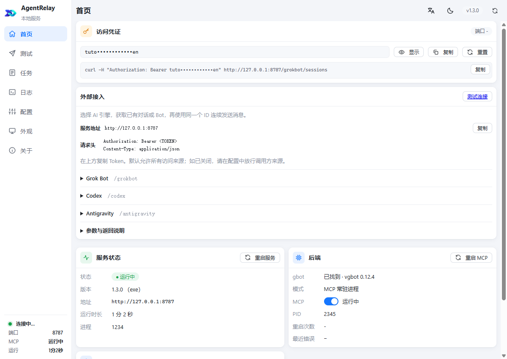
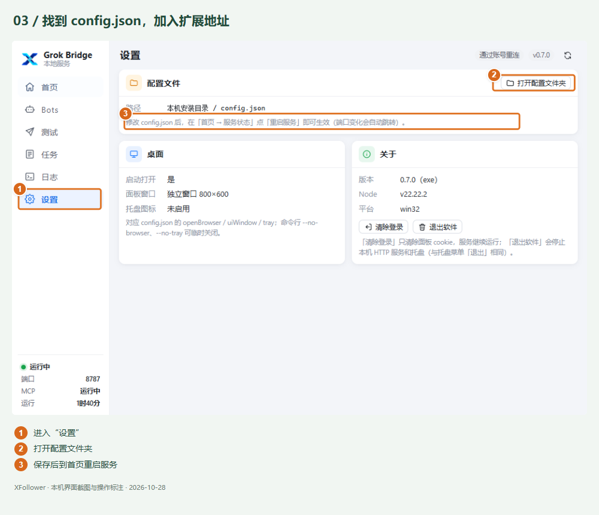
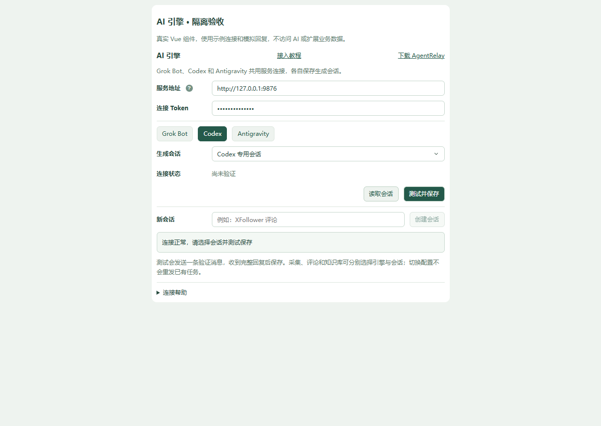
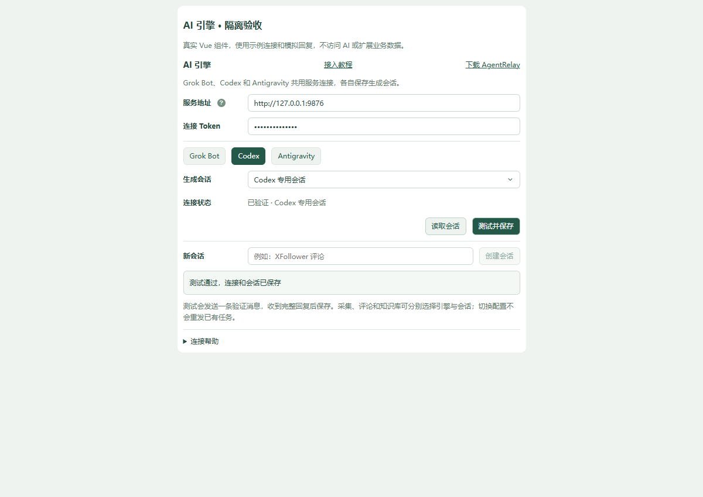
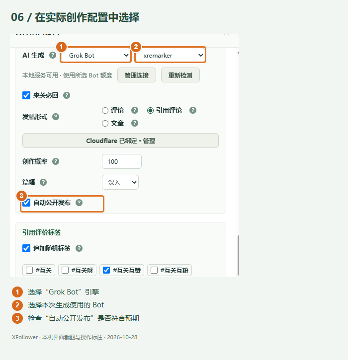

# AI 引擎教程与云端事件整合发行

创建：2026-10-30 13:22，wangsen。归档补充：2026-10-30 14:18。

本篇记录同一轮教程更新、截图重拍、Git Flow 发行及最终运行验收。沿用 101 号，不另建重复文档。

## 背景与更新范围

旧本地接入教程仍指向 Grok Bridge 0.7.0，并使用「系统设置 → Grok Bot → 授权」「测试并启用」等旧入口。实际产品已升级为 AgentRelay 三引擎接入，继续使用旧图文会导致选错页面、误填接口路径或遗漏业务会话选择。

本轮将本地教程重写为「AI 引擎接入教程」，覆盖 Grok Bot、Codex、Antigravity。系统设置的 AI 引擎区域增加「接入教程」链接。下载入口改为 AgentRelay 正式发行页，不再固定到 0.7.0 旧包。

原 Grok Webhook 的中文产品名称统一为「云端事件」，英文名称为 Cloud Event。内部 grok-bot provider、持久化字段、接口、签名与任务恢复协议保持兼容。当前提供方仍为 Grok Automation Task；改名不代表已实现其他云提供方。

## 新教程的完整操作路径

1. 安装并运行 AgentRelay，确认所用客户端已登录、对应引擎可用。
2. 在 AgentRelay「配置 → 允许的访问来源」添加扩展地址，按页面操作保存并重启服务；窗口、主题和语言在「外观」中设置。
3. 在 XFollower「系统设置 → AI 引擎」填写服务根地址与连接 Token。地址不附带 /codex、/grokbot、/antigravity 等接口路径。
4. 切换引擎并读取会话，选择真实标题；Codex、Antigravity 可显式创建新会话，Grok Bot 使用已有 Bot。
5. 在专用会话中点击「测试并保存」，收到完整回复并显示成功后，关闭、重开核对持久化。
6. 在关注队列、首页跟评的两个阶段、知识库自动学习中分别核对并保存业务引擎与会话。

教程区分服务连接、默认会话和业务会话；说明启动服务不等于开启发布，待确认的任务需先查询原任务，避免重发。

## 截图重拍清单

五张新版 PNG 均为 1200 × 850，已经随 4.8.2 正式包交付。旧 01-download.png 已移除，教程脚本改为引用以下五张图片。

| 文件 | 展示内容 | 图像来源与数据边界 |
| --- | --- | --- |
| 02-bridge-home.png | AgentRelay 1.3.0 首页、地址与引擎入口 | 真实界面代码与示例状态数据 |
| 03-bridge-settings.png | 配置、允许来源及保存并重启 | 真实界面代码与示例扩展地址 |
| 04-plugin-connect.png | 三引擎选项、读取会话与选择 | 真实 Vue 组件与模拟连接 |
| 05-plugin-test.png | 测试成功、已验证及已保存状态 | 真实 Vue 组件与模拟回复 |
| 06-provider.png | 首页跟评两阶段分别选择会话 | 真实业务组件与示例会话 |

所有图注均明确示例数据及模拟回复的性质。图片不包含真实 Token、真实扩展 ID、业务消息或私密路径，不能作为真实生成成功的证据。真实操作验收见[100. Codex会话标题与选择框排障](./100.%20Codex会话标题与选择框排障_20261030_1117_wangsen.md)。

### AgentRelay 首页

### 允许的访问来源

### 插件读取与选择会话

### 测试并保存

### 两阶段独立选择

## 实现与资源对应

| 文件 | 职责 |
| --- | --- |
| src/grok-local-guide.html | 统一 AI 引擎教程正文、流程及排错 |
| src/entries/tutorial/grok-local-guide.js | 五张图片绑定、扩展地址与配置片段复制 |
| src/assets/grok-local-tutorial/ | 新版截图资源 |
| src/entries/panel/components/GrokLocalSettings.vue | 接入教程入口、连接与会话配置 |
| src/grok-bot-guide.html | 云端事件教程标题与当前 Grok 提供方说明 |
| src/entries/panel/generation-choice.js | 引擎显示名称与原 provider 兼容 |
| tests/grok-local-guide.test.js | 图片存在、PNG 格式、教程锚点检查 |
| tests/generation-choice.test.js | 显示名称和持久化路由标识兼容检查 |

## 实际验收与发行结果

- 合并冲突保留了 develop 中的 503 可恢复提示、会话标题处理及双方回归用例。最终 master 上 1401 项单测、57 项构建测试通过。
- 最终 master 重新构建并校验，发行包包含 52 个文件。此前准备阶段的 53 文件记录属于尚未移除旧下载截图的中间构建，不作为最终包数量。
- 正式发行：[XFollower 4.8.2](https://github.com/wangsen2020/x-each-follower/releases/tag/4.8.2)。最终提交为 020e98dbcc514741dfd311655f07c9e90e7a994c，正式标签解引用与 master 一致。
- ZIP SHA-256：95ecb56592c3d51e5cbbc561dedb0158950f770451210a989b144caae6885878。ZIP 与 SHA256SUMS.txt 上传资产的 digest 均与本地一致。
- 通过项目 CDP 入口打开扩展内正式教程，五张图片均加载成功，宽度均为 1200；逐张计算加载资源哈希，与最终 dist 图片一致。页面包含三个引擎和 Cloud Event 说明，不再包含旧的「Grok Bot → 授权」入口。
- 实际 Chrome 加载路径为 E:/WebstormProjects/x-each-follower/dist。新后台脚本与最终 dist/background.js 逐字节一致，SHA-256 为 338ed544cd15c07bf0b7b275f483c96dd78ec254720e1873456aeae0a04fdc47；后台与清单版本均为 4.8.2。
- 系统设置菜单、配置标题和关注队列引擎选项均实测显示「云端事件」；AI 引擎页面的「接入教程」链接可用。
- 运行更新前后业务数据库均保留；关注队列、首页跟评、知识库及 AI 连接业务配置对比一致。等待在途任务时临时移开的定时触发已恢复，未改业务开关或会话配置。

真实会话选择、保存重开及专用 Codex 会话三轮上下文测试已完成，含 AgentRelay 重启后取回口令。此处仅归档已核实证据，不为文档或截图再次发送生成消息。

## Git Flow 与资料保留

所有本地 feature/release 已按标准流程完成整合或确认被新版替代后的清理。旧工作区逐文件核对，无独有未合并提交；批量反馈/重试、蓝 V、齿轮布局、提示词、身份核验、知识库和统一引擎内容已由当前集成版覆盖。备份保存在本机 C:/jtmp/xfollower-release-backup-20261030，清理时未递归删除共享依赖目标。

本次文档归档补充在 feature/tutorial-documentation 的独立工作区进行，只修改本篇与作者索引；不改变已发行 4.8.2 的源码、图片、安装包或运行配置，不据此再升级业务版本。

## 本机证据位置

- C:/jtmp/xfollower-final-runtime-verification.json：最终运行脚本、教程图片哈希和数据库保留核验摘要。
- C:/jtmp/xfollower-release-runtime-before.json、C:/jtmp/xfollower-release-runtime-after.json：本机配置快照及数据库数量记录，可能包含敏感配置，仅本机保留，不纳入仓库。
- C:/jtmp/session-context-result.json：专用会话三轮任务编号与回复结果。

这些路径仅定位本轮本机证据，不作为后续验收的固定入口。GitHub 发行不等于 Chrome Web Store 提交；本轮没有执行商店上架。
