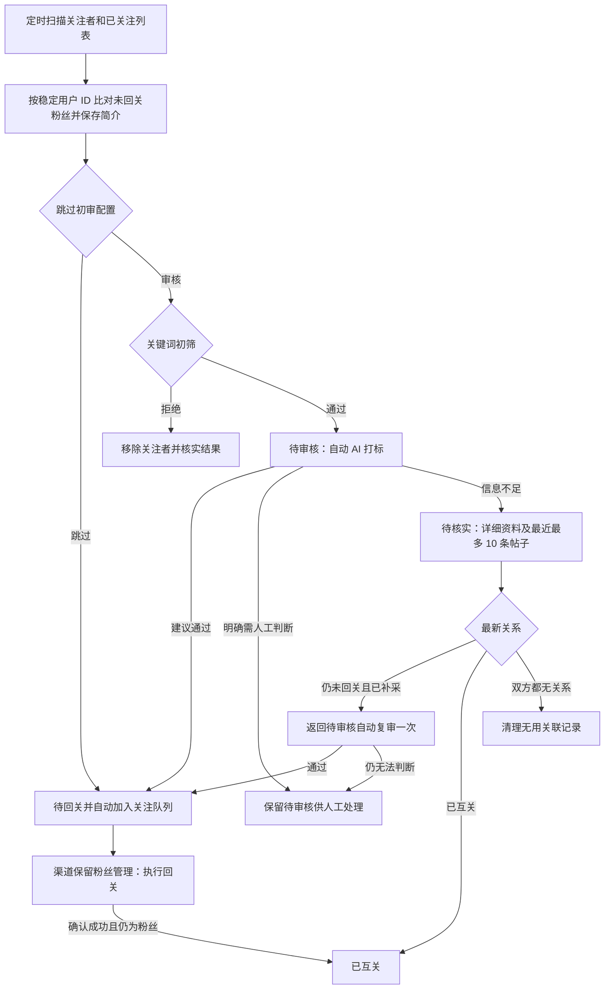

# 待回关粉丝自动审核与补采复审闭环

## 目标与边界

2026-11-02 用户确认：粉丝管理围绕尚未回关的粉丝展开，取消单向关注 Tab。关注列表仅作为关系比对底账；保留互关、待回关、待审核、待核实等有业务意义的状态。先整理本方案，再实施。

本轮属于 feature/fan-review-flow 已有审核功能的补充迭代，保留工作区全部既有未提交修改。源码当前 4.23.2，共享 dist 当前 4.23.1；本轮目标 4.24.0，涉及入口移除与状态流转调整，不代表提交、发布或已加载。

## 用户确认的流程

## 必须成立的业务规则

1. 扫描分页续传，列表简介直接用于审核；已有数量和帖子作为附加证据。分页未完成、空页或请求失败不得推导关系消失。
2. 单向关注仍保留底账，但不再占用粉丝管理 Tab；默认进入待回关。未回关总数按有证据的 following=false、followedBy=true 去重，包含待审核、待核实和已放行者。
3. 跳过初审按现有配置直接放行；需要初审时复用现有确定性拒绝规则，命中即进入既有移除关注者流程，不把本地删除冒充 X 移除成功，不扩大规则。
4. AI 通过直接生成有效放行凭证、进入待回关并幂等入队，保留 fans 来源。定时扫描不是每次无条件重复提交同一份资料。
5. 无简介且无足够证据、AI 明确资料不足时进入待核实。AI 服务异常保持可重试错误，不伪装成资料不足。
6. 补采详细资料、最新关系与最多 10 条本人帖子，允许不足 10 条。复用现有采集任务、缓存、身份校验及后台执行入口。
7. 一次补采完成后自动回到待审核并复审。没有简介但有有效帖子可复审。复审仍不确定则停留人工处理，不再次自动补采形成死循环。网络重试不算新的业务补采轮次。
8. 账号 ID、当前登录账号及审核版本在写入前复核。新人工决策优先于旧 AI 回包。重复事件不能重复移除或重复入队。
9. 回关成功后同步真实关系，再投影为已互关；执行失败、未确认结果不得提前标为互关。
10. 首次启用新逻辑需恢复历史待审核与资料不足项目，但不得覆盖人工拒绝、未知外部操作或其他渠道任务。

## 实施范围与复用评估

已检查 package.json 与现有实现。继续复用 Dexie 4.4.7 数据层、现有审核批次、采集队列、关注队列和 Vue/Lucide 控件。本轮只补业务状态及事件连接，不增加通用调度、数据库或状态机框架。

2026-11-02 核对 [Dexie 开源项目](https://github.com/dexie/Dexie.js) 与 [事务文档](https://dexie.org/docs/Dexie/Dexie.transaction())：Apache-2.0，现有 IndexedDB 运行环境已接入，无新增体积或迁移成本。库提供通用事务能力，粉丝关系、一次复审、审核凭证属于本项目业务，沿用现有适配层实现。

主要入口：fan-directory.js 分类；follow-review-background.js 自动初审与恢复；follow-review-engine.js AI 结果及人工批次；fan-profile-collector.js 补采与回调；background.js 后台联动；MonitorSection.vue/panel.js 数量、默认分类及文案。优先复用已存在的回关关系回写，不重复实现。

## 验收清单

- 列表资料充足：关键词通过 → AI 通过 → 待回关且 fans 来源入队；重复扫描无重复任务。
- 命中拒绝规则：不发送 AI，不进入关注队列，移除失败或未知不会伪装成功。
- 缺资料：待核实 → 详细资料与最多 10 帖 → 自动复审；第二次不确定停止循环。
- 空简介但有有效帖子可以复审；采集失败可恢复，账号切换/身份冲突不写错人。
- 现有跳过配置、人工决策、停止与重启恢复保持有效。
- 已关注目标不再回关；确认回关后互关状态同步；失败状态不误报。
- 运行 npm test、npm run test:build、npm run check；完整隔离构建。
- 桌面、窄屏及等效 200% 宽度实机检查，取消单向 Tab、默认待回关、数量与进度一致。
- 实机重载前确认在用外部任务空闲；分别记录源码、构建、已加载版本。

## 实施与验收记录

2026-11-03 完成本轮实现与验收，继续使用本编号记录。

### 已实施

- 移除单向关注 Tab，默认待回关；侧栏和列表摘要显示有明确关系证据的未回关粉丝总数。关系未知的待核实记录不混入总数。
- 未审核的待回关候选先归待审核；关键词拒绝复用持久移除执行器及身份校验，确认后回写关系和移除凭据，结果未知不重复提交。
- 自动初审和手动 AI 审核的有效通过结果直接生成放行凭据并入队；修复已有任务凭据更新被同步优化跳过的问题，已完成任务不被重新打开。
- 资料不足转待核实，借助已有关系核验与资料采集器补充资料、最近最多 10 帖；记录补采开始和完成时间，完成后自动复审。空简介但有效帖子可送 AI，复审仍不确定不重复补采。
- 采集重试耗尽转人工处理，服务异常保留错误和重试时间，不把错误当作内容拒绝。周期恢复和采集完成通知接通自动审核。
- 修正来源同步过滤：待审核和资料不足的真实待回关粉丝不会再被排除。回关成功仍复用既有关系回写、投影及渠道记录。
- 派生目录同时保留独立的未回关计数；修复持久投影覆写聚合标签导致总数为 0。刷新期间复用有效汇总，避免将当前页人数或 0 显示成全量统计。约束窄屏长名称和审核详情的文本宽度。
- 实机检查点复核发现补采时间可选字段的 undefined 被严格 canonicalValue 校验拒绝，普通初审因此停留 reserved。统一未补采时间为 0，并使后台恢复压缩未关联源记录的旧预留批次；测试 fixture 使用与真实记录库相同的严格校验。最终实机旧预留记录清理完成，新任务进入 submitting，原有未知提交仅保留查询，不重发。

### 验证证据

- 最终 npm test：1782 通过，0 失败。涵盖补采后无简介有帖子、通过自动放行、第二次不确定停止循环、关键词移除及未知结果不重发；更新旧版人工二次放行和分类测试口径。
- npm run test:build：57 通过。npm run check：195 个源码模块语法和 238 个 JS/Vue 调用契约通过。
- 隔离完整构建 scratch/build-tests/fan-followback-flow：4.24.0，61 文件、20 个运行 ESM 模块校验通过。
- tools/fan-followback-flow-ui-acceptance.mjs 在无登录、无网络的独立 Chrome 中加载真实构建：22 个未回关样本由 14 待回关、5 待审核、3 待核实构成，互关与单向关注不计入；检查默认分类、分类切换清空选择、键盘 tips、刷新保留资料及 1280/720/640 像素宽度，无页面错误。
- 共享 Chrome 在 AI 审核、核验、关注队列、互评、补采及自动取关均空闲时备份重载。面板清单与后台握手均确认 4.24.0，源码、构建、实际加载版本一致；61 个文件逐个比对。
- 真实面板于 2026-11-03 00:08 观察到未回关粉丝 218 人，这是当时的本地关系快照，不代表 X 全量扫描已经补齐。实际查看桌面、窄屏、等效 200% 宽度截图；旧清理账号精确搜索仍为 0。
- 最后复核未回关总数 209，待回关 14，已互关 3944；此前对应待回关 22、已互关 3936，观察到后台自然执行期间 8 个待回关完成后的关系投影变化，没有额外发送验收关注请求。统计会随真实任务继续变化。
- 真实窄屏复验定位到旧标签的透明伪元素提示框撑宽滚动区域；改用共享提示层并支持键盘焦点。最终 640 像素验收滚动区域 clientWidth=403、scrollWidth=403，无横向溢出。最后这次修正只改变三个面板资源和 panel.html，后台文件逐字节一致，因此在队列运行时仅替换面板资源并打开专属验收标签，没有重启后台；最终构建所含文件与共享 dist 的内容差异为 0。
- 证据目录：C:/jtmp/xf-fan-followback-flow。acceptance.json 为隔离场景，ui-acceptance.json 为真实面板，loaded.json 和 deployment.json 为加载证明；私有备份不提交。

### 保留边界

- 历史 AI 任务仍有“发送状态待确认/结果未知”记录，继续保留原任务并查询，不强制重发；本轮交付的是流程实现，不宣称历史积压均已审核或回关完成。
- 真实外部关注和移除没有因验收额外触发测试操作；生产后台按用户已启用的配置继续运行，业务分支使用隔离数据和回归测试覆盖。
- 未提交、推送或发行。保留共享工作区此前所有改动及用户配置。

## 4.24.1 验收反馈修复：核验后仍停留待核实

2026-11-03 对截图中 9 个账号逐条核对：7 个关系核验成功且缓存已有 1–10 条帖子，但历史队列 skipped 阻断复审；1 个最新关系已互关但遗留身份冲突标记未解除；1 个连续三次关系读取失败。此次属于原闭环的验收纠错。

- 将资料审核与执行关注分开。历史机器筛选跳过允许补采复审；仅当前审核通过、身份和关系匹配后恢复待回关。旧筛选原因必须与系统记录一致，人工排除、人工改写、已成功关注、未知外部操作和删除凭据不自动放行。
- 恢复队列复用原存储事务，比较任务状态、稳定 ID 和筛选回执，避免 AI 返回期间覆盖用户新操作。复用现有 Dexie 数据层与任务调度；不新建迁移或调度框架。
- 完整关系核验成功后清除已解决的 legacyHandleIdentityConflict；用独立历史标记保留旧用户名归属保护，不将旧 handle-only 任务归给新 ID。真实不同 ID 且旧身份尚未核实的冲突仍保留。
- 核验成功后通知审核调度，包括帖子已在缓存、无需再次补采的情况。一次补采复审仍无法判定时保留人工审核，不再反复补采。
- HTTP 成功但资料或关系字段缺失时仅重读一次，分别显示资料缺失/关系不完整；失败原因保存到账号，成功后清除。未对暂时无法访问的账号伪造关系。
- 待核实原因区分资料不足、关系读取失败和身份冲突；目录版本升级后重建说明。

验证：最终 npm test 1791 通过，0 失败；构建测试 57 通过；195 源码模块与 238 JS/Vue 调用契约检查通过。新增覆盖旧 skipped + 无简介有帖子、复审通过和不确定分流、人工限制与并发修改保护、已解决身份冲突、有限重试及成功恢复。

真实构建 4.24.1 经 61 文件、20 ESM 模块校验；共享扩展于空闲窗口备份并重载，面板清单和后台握手均为 4.24.1。独立 Chrome 与共享扩展专属非激活标签检查 1280/720/640 宽度、分类/选择/键盘提示/刷新，实际查看截图，无页面异常；真实页面显示资料待补充、身份冲突、资料读取失败三种不同原因。证据位于 C:/jtmp/xf-fan-review-4241，私有备份不提交。

未替用户点击本批核验。已启用的后台调度自然运行期间观察到待核实从 9 变为 6，这只是实时快照，不代表这批全部完成；@666Q0 仍需重新核验以应用身份修复，@JAMESEVANS04 若仍取不到 X 资料将保留具体失败原因。未提交、推送或发行。
