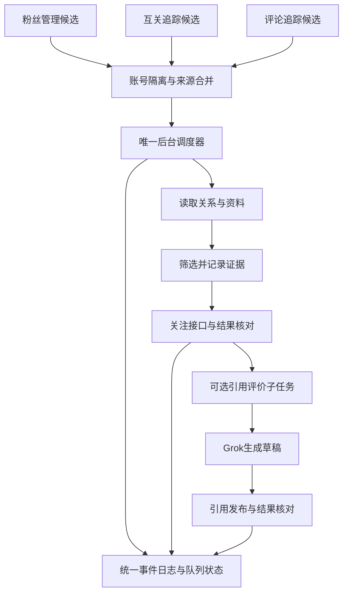

# 4. Grok 引用评价与发布验收

> **用户已确认的方案：** [统一关注队列与后台调度](#unified-follow-queue-proposal)。四项决策已确认，尚未实施。

- **作者**：`wangsen`
- **创建时间**：`2026-10-16 18:18`
- **涵盖版本**：`v0.25.4` → `v1.0.5`
- **核心模块**：`grok-comment.js`、`page-reader.js`、`panel.js`、`background.js`、`tests/grok-comment.test.js`
- **相关提交**：`09ee95c`、`ae36363`、`a672645`、`8864375`、`602f65e`、`36bdd5b`

---

## 一、目标与结果

把 Grok 为候选用户帖子生成的互动文字从普通回复改为**引用原帖评价**。评价以独立帖子发布，并附带原帖卡片，便于获得二次曝光；评论追踪和互关追踪原有处理流程保留，只改变 Grok 评价的发布形式。

本次在已登录的 X 浏览器中完成真实发布与核验。账号 `@WatsonTaylor23` 的引用评价发布到 [Edward913413 的原帖](https://x.com/Edward913413/status/2109821923832316001)，生成的帖子为 [WatsonTaylor23 的引用帖](https://x.com/WatsonTaylor23/status/2111029885582078253)。已在账号主页时间线和引用帖详情页核对正文及原帖卡片。

## 二、实现变化

### 2.1 Grok 生成引用评价

- 更新 Grok 提示词，明确生成适合公开传播的观点或补充内容，不把文本写成针对作者的站内回复。
- 使用“引用评价”开始/结束标记抽取正文，并保留 X 字数权重限制校验。
- 互关追踪及评论追踪复用同一引用评价生成和发布模块，日志状态文案区分生成失败、发布失败和成功发布。

### 2.2 跨路由引用发布

- X 点击“Quote/引用”后可能切换到 `/compose/post` 并销毁原页面注入上下文。流程拆为“打开引用编辑器”和“编辑器就绪后发布”两个阶段；后台等待路由稳定，再次注入检查与发布函数。
- 发布前确认编辑器可见、原帖卡片与目标相符、评价确实写入且发送按钮可用。点击后等待编辑器关闭，并检查失败提示。
- 若编辑器未嵌入目标原帖，或目标无法可靠识别，流程拒绝发布，避免把评价误发到其他帖子。

### 2.3 X 文章卡片校验

X 的长文章引用卡片有时不暴露指向状态帖的普通链接，单靠 `a[href*="/status/<id>"]` 会把正确的文章引用误判成缺少原帖。针对这种 DOM 结构，校验改为：当前页面必须是目标帖子详情页；页面中找到链接到目标 ID 的原帖；嵌入卡片作者与源帖作者一致；源帖文章标题出现在引用卡片中。普通帖子仍优先用状态链接校验。两种识别方式都不匹配时停止发布。

## 三、真实验收记录

- **浏览器环境**：连接既有登录实例 `C:\jtmp\xfollower-cdp-profile`，确认 X 当前用户为 `@WatsonTaylor23`，扩展重载后版本为 `0.25.5`。
- **目标原帖**：[https://x.com/Edward913413/status/2109821923832316001](https://x.com/Edward913413/status/2109821923832316001)。真实文章引用卡片没有直接的目标状态链接；通过源帖作者和文章标题确认对应关系。
- **发布内容**：

  > 定主线那三问和“50条不准换”才是真正卡脖子的地方。冷启动动作谁都能抄，但多数人死在选了个撑不过三个月的方向，后面的回复和长帖全变成自我消耗。

- **发布结果**：[https://x.com/WatsonTaylor23/status/2111029885582078253](https://x.com/WatsonTaylor23/status/2111029885582078253)。账号主页时间线与帖子详情页均显示该正文和 Edward913413 原帖卡片。
- **安全处理**：测试中 X 曾显示一个与本次目标不符的编辑器状态；目标校验拒绝发送。确认页面与目标文章卡片一致后才发布已批准的准确文本。

## 四、自动化验证与边界

- `npm test`：**59 项通过**，包含路由切换恢复、目标原帖不匹配时拒发以及 X 文章卡片作者/标题校验。
- `npm run check`：通过。
- `git diff --check`：通过。
- 真实 X 页面已验证引用编辑器、实际发送结果、账号主页时间线和帖子详情页。此前完整“扩展界面触发 → 后台调度 → Grok 生成 → 发布”的各模块有自动化覆盖，但本次实发验收是使用本仓库发布页面函数在已登录 X 标签中执行；不把单元测试或这次页面函数验证夸大为每个扩展界面入口都经过了独立手工点击验收。

## 五、提交记录

- `09ee95c` — `feat(grok): publish generated evaluations as quote posts`
- `ae36363` — `fix(grok): resume quote flow after X composer navigation`
- `a672645` — `fix(grok): verify quoted X articles without status links`

## 六、后续异常清理补充

2026-10-16 增加引用草稿清理：引用编辑器未就绪或发布失败时，只关闭并尝试丢弃与本次目标原帖相符的草稿，不影响其他帖子编辑器。实现位于 `page-reader.js` 的 `dismissQuoteComposerOnPage`，由 `grok-comment.js` 的 `postQuoteOnTab` 在失败路径调用。提交：`8864375`（`fix: dismiss stalled quote composer drafts`）。自动化测试确认目标帖子草稿会关闭、非目标帖子草稿不会被触碰；本次未重新执行真实浏览器端到端发布。

## 七、v1.0.5：回答截断和引用误判的排障复盘

先前把 Grok 回答工具栏中的“复制”按钮当作完成信号，但 X 会在流式输出尚未结束时就显示它，因此可能提取到半截评价。用户观察到：**当前提问下方出现新一组后续建议按钮时，回答才已完成**。`grok-comment.js` 现在用本次提问的 nonce 找到对应 DOM 节点，只接受排在该节点之后的后续建议按钮；同时要求停止生成按钮消失、抽取出的评价连续四次采样不变。复制按钮不再单独决定完成。向 Grok 的 Lexical 输入框写提示词时，校验忽略其自动折叠的空白；`execCommand('insertText')` 成功后不重复派发合成 `input`，避免 React 把文字插入两次。

另一故障是引用发布时普通回复编辑器被误判成 Quote 编辑器：两者可能同处 `main`，回复页面也包含目标原帖链接。`page-reader.js` 现要求**编辑器本身**有独立的 `Quote/引用` 标签，且不能含有 `Replying to/回复 @`；正则只允许标签前后出现横向空白，避免 `\s*` 跨行吞掉标签边界。X 的引用卡片可能省略原帖状态链接并改变标点或换行，因此再结合作者 handle 和忽略空白、标点后的原帖正文确认目标；长文章仍保留作者与标题兜底。若看到回复编辑器或无法确认目标，就停止发布并清理本次草稿。

写入正确引用编辑器后，使用浏览器原生 `execCommand('insertText')` 让 Draft.js/React 接收输入，核对编辑框内容与准备发布的文字一致，再点引用帖的 `tweetButton`，避免误点普通回复的 `tweetButtonInline`。只有 X 未报失败且引用编辑器关闭时，页面函数才返回 `mode: 'quote'`。这仍需结合实际时间线确认最终发布结果。

## 八、复现与验收证据

- **代码与版本**：`grok-comment.js`、`page-reader.js` 和 `tests/grok-comment.test.js` 的修复在提交 `602f65e`；`manifest.json` 与 `package.json` 版本为 `1.0.5`。单测包含复制按钮过早出现、后续建议出现后的稳定采样、回复编辑器拒发、`/compose/post` 引用识别和 React 文本输入。修复后 `npm test` 为 **81/81 通过**，`npm run check` 与 `git diff --check` 通过。
- **真实浏览器**：连接已有的 `C:\jtmp\xfollower-cdp-profile` 登录 Chrome（CDP 端口 `9222`），在 X 自带 Grok 页面提交带 nonce 的提示词，等到回答结束后取得完整评价。随后在 [DTee000 的原帖](https://x.com/DTee000/status/2111296102330986892)打开引用编辑器，页面发布函数返回 `{ok:true, mode:'quote'}`。在 `@WatsonTaylor23` 主页时间线核对正文与原帖卡片；[实际引用帖](https://x.com/WatsonTaylor23/status/2111311393794539754)可复核。这次验证覆盖 Grok 实际生成与真实引用发布，但不是从定时任务入口执行的整条后台调度链。
- **CDP 复用**：提交 `36bdd5b` 加入 `tools/cdp-session.ps1` 与 `AGENTS.md` 操作约束。先核对固定 profile、Chrome 主进程、`9222` 监听者和扩展目标；实例存在则直接附加，只有确实不存在时才使用 `-StartIfAbsent`。脚本在同一已运行实例上连续两次返回 `attached` 和相同 PID；本次没有执行冷启动分支。测试标签页用完关闭，避免触碰用户正在编辑的页面或遗留窗口。

## 2026-10-17 18:57：未聚焦窗口引用失败与定时恢复

本次在固定 CDP 配置 C:\jtmp\xfollower-cdp-profile 实测，未读取日常 Chrome 的任务日志，因此不把测试配置的结论等同于日常配置的完整诊断。

### 真实复现与修复

- 完整单人任务对 @4111y80y 关注成功，x.com 自带 Grok 生成评价，但 Quote 阶段报找不到菜单。长帖操作栏位于视窗外：内容区高 561px，Quote 菜单 top 为 1068px。现在先将转发按钮滚到视窗中央。
- 随后复现路由已到 /compose/post，弹窗却为空、height 为 0。页面 visibilityState 为 hidden；临时用计时器补充 requestAnimationFrame 后，编辑框立即渲染。正式方案只在自动创建的引用窗口、发布期间注入 MAIN world；可见页面保留原生 rAF，隐藏页面通过原生回调与计时器竞速，防止重复回调，并支持取消。结束时恢复原函数，120 秒到期也恢复，最后关闭该任务窗口，不抢焦点。
- 启动、安装及服务 worker 唤醒补齐已启用但缺失的定时器，不推迟已有定时器。同步及 X 持久缓存仅填补缺失设置，避免覆盖本地明确保存的开关；评论任务优先读取独立设置。

### 验收证据与边界

1. 首次任务失败后，复用同一条 Grok 评价，完成真实填写与发布。在个人主页核对到 [本次引用帖](https://x.com/WatsonTaylor23/status/2111410568280363282)，正文与目标 @4111y80y 原帖卡片均正确。
2. 正式 postQuoteOnTab 入口用修复后的代码再次验收，未聚焦窗口返回 ready:true、目标原帖匹配，自动关闭窗口；这次复测不重复发布已成功的评论。
3. 删除互关定时器并重载扩展后，定时器自动恢复，设置保持不变。临时批次上限 1 已恢复为原先 10。
4. npm test：97 项通过；npm run check 通过。版本 1.0.8。
5. 已证实一条实际引用发布成功；不据此宣称日常 Chrome 已完成数小时连续运行验收。日常配置需要重新加载扩展才能运行新代码。

---

## 已确认方案：统一关注队列与后台调度

- 方案更新时间：2026-10-17 23:38，Asia/Shanghai。
- 状态：**四项决策已于 2026-10-17 23:50 经用户确认；尚未实施，不代表功能已实现或验收通过。**
- 本轮范围：只修改文档，不修改调度代码、不启动关注任务、不变更用户开关。
- 建议结论：保留「粉丝管理」「互关追踪」「评论追踪」三个候选入口，增加「关注队列」作为统一执行和日志中心。

### 方案一览

| 项目 | 推荐设计 | 用户可感知的变化 |
| --- | --- | --- |
| 候选来源 | 三个模块向同一队列提交候选 | 同一人不会被三个模块反复检查 |
| 自动执行 | 后台唯一调度器，不依赖管理面板常驻 | 关闭面板不影响已开启的自动任务；浏览器关闭期间不执行 |
| 任务区分 | 关注任务与引用评价任务分开保存、分阶段统计 | 不再把「关注成功但评价失败」当成全部完成 |
| 关注队列 | 统一设置、全局暂停、当前任务、下次执行、来源筛选 | 不用在两个抽屉分别调整相似定时参数 |
| 结果通知 | 默认只通知新增关注、发布成功或需要处理的异常 | 无候选、全部跳过写日志，避免每轮弹出“0 人” |
| 上线方式 | 停止旧执行器后再启用新队列，历史记录原样保留 | 避免新旧定时器同时关注同一个人 |

### 1. 已知事实与尚未证实的问题

1. 最新截图中的互关日志时间为 **2026-10-17 18:56:16**；截图证明界面当前展示了这一条记录，不能单凭截图认定最后一次实际执行时间或后台从此停机。
2. 「处理 10 人、关注 0 人、条件不符 10 人」表示该轮记录了筛选跳过，不能直接认定关注接口失败；应展示每种跳过原因及对应账号。
3. 当前代码中，后台的 `x-mutual-auto-follow` 闹钟向面板发送 `runMutualAutoFollowTick`，实际工作由 `panel.js` 的 `runMutualAutoFollowBatch` 完成。面板没有响应时，只发提示通知。
4. 评论追踪的 `runCommentAutoFollow` 在 `background.js` 执行，与互关追踪不是同一个执行器；各自有运行标记、参数和候选名单。
5. 过去两个日志按钮打开混合记录，来源与任务名称容易混淆；最近代码已增加分类显示与后台统一写日志，但这并不等于所有日常浏览器实例已加载新代码。
6. 先前 CDP 测试配置出现了今天的评论关注记录，但不能据此替代日常 Chrome 的现场证据。界面硬编码的 v1.0.2 也不能作为实际加载版本；新方案要求显示运行中的 manifest 版本。

**需要解决的结构性问题**：多套执行器、候选重复、配置与进度混存、长任务依赖页面生命周期，以及阶段结果不清晰。统一队列不能自动解决 X 接口变动、Grok 输出失败或 React 输入问题，这些仍需各执行阶段独立验收。

### 2. 页面职责与操作入口

| 页面 | 保留功能 | 改为调用队列的功能 |
| --- | --- | --- |
| 粉丝管理 | 粉丝读取、关系展示、资料与画像 | 待回关用户入队；手动回关加入高优先级任务 |
| 互关追踪 | 锚点收集、候选筛选、关系与标签 | 符合来源设置的用户入队；不再单独定时看帖关注 |
| 评论追踪 | 帖子链接、评论者收集、多个来源帖子展示 | 评论者入队；不再单独定时关注 |
| 关注队列 | 新增的执行中心 | 统一设置、启动/暂停、队列排序、重试、阶段状态、全部执行日志 |
| 回关监测 | 保留超期未回关检测 | 本轮不合并取关业务；将来若共享账号操作锁，关注和取关必须互斥 |

三个来源页保留「加入关注队列」和「查看该来源任务」入口；后者打开关注队列并预选来源。批量选择数量变化仍按当前页和选择集合正确处理。

「立即执行」表示唤醒同一个调度器，不另开一套执行流程。手动选中的任务可提高优先级，但仍遵守全局暂停、去重和账号限制。

布局沿用现有抽屉，工具栏使用 flex 对齐，避免新增 gap；标签 12px 字体、24px 高度，同组按钮高度一致。

### 3. 候选合并与账号隔离

队列以 **当前登录的 X 账号 + 目标用户 ID + 动作类型** 唯一标识任务。禁止只按目标用户名全局去重，否则切换自己的账号后会错误跳过。

- 优先使用目标 User Rest ID，禁止用 Tweet ID；首次只有 handle 时按规范化 handle 暂存，解析出 ID 后事务合并，保留用户名变更记录。
- 每个用户保存 `sources[]`：来源模块、来源帖子或锚点、首次/最近发现时间、是否允许该来源自动入队。评论者来自多个帖子时，所有来源链接保留。
- 同一人被三个模块发现，只生成一个关注任务；新增来源不会把完成任务重新变成待执行。
- 未开启自动关注的来源只收集候选；不能因为历史开关或其他来源的配置迁移而自动获得执行授权。若任一来源明确允许自动执行，可按统一策略入队；用户全局排除、暂停优先级最高。
- 已关注或互关：同步所有来源页的关系，结束关注任务，不再次打开 Grok；除非用户另行明确加入评价任务。
- 暂时无法识别当前登录账号：暂停执行并说明原因；不能借用另一个账号的关系缓存或凭据。
- 浏览器配置之间不共享运行锁或认证信息。本方案仅解决同一扩展实例内的重复执行。

#### 去重与防止重复消耗：硬性要求

补充确认：2026-10-17 23:46，用户要求同一人不得反复关注、消耗资源；以下为待实施的验收约束。

- **入队去重**：使用当前账号 ID、目标 User Rest ID 与关注动作的数据库唯一键，事务式新增或合并。三个来源反复发现同一人，只补充来源链接，不生成新关注任务，不重置完成、跳过、冷却或执行中状态。handle 大小写、带不带 @ 统一处理；解析出 ID 后合并临时记录。
- **执行去重**：定时唤醒、手动执行、多个面板统一经过同一个原子领取入口。租约未结束时不能重复领取；重启后先恢复检查点和核对执行结果，不能直接重做关注。
- **提前节省资源**：领取前先查持久化关系、处理结果和资料缓存。已关注直接结束；因条件不符跳过的用户，只有策略或相关资料发生变化、或达到明确的复查时间才重新评估，不能每轮重开主页、重读帖子或重问 Grok。
- **关注前复核**：真正发送关注前检查当前关系；若已关注则同步所有来源页，不再发送关注，也不计为本轮新增关注。关注请求超时或进程中断时记为结果待核实，先确认关系，再决定是否重试；不宣称外部接口能保证严格一次执行。
- **完成记录持久化**：关注完成状态独立于展示日志与队列历史保存。清空日志、分页、刷新、浏览器重启、历史日志数量截断，都不能删除去重依据。用户后来取消关注，也不能因来源再次发现而自动重新关注；重新关注须显式请求。
- **失败阶段隔离**：关注已经成功，Grok 生成或引用发布失败，只重试对应评价阶段，禁止退回关注步骤。
- **统计按唯一用户计算**：展示新增候选、合并重复候选、已关注跳过及各类跳过原因。重复来源不增加待执行人数；发现某几人不可执行后继续寻找下一位合格候选，遵守本轮检查与时间预算。

### 4. 队列状态与筛选依据

建议为关注和引用评价分别保存状态，不能继续用一个 `processedHandles` 同时表达成功、跳过、失败与处理中。

| 状态 | 含义 | 后续动作 |
| --- | --- | --- |
| 待检查 | 新发现、资料不足 | 优先读取缓存/接口，必要时打开主页 |
| 待关注 | 已通过当前策略，等待执行 | 等待额度与计划时间 |
| 执行中 | 已领取任务，带租约和阶段检查点 | 其他执行请求不能重复领取 |
| 已关注 | 本次确认新增关注 | 可派生一条引用评价任务 |
| 原已关注 | 现场确认此前已经关注 | 更新关系，不计入新增关注数 |
| 策略跳过 | 当前筛选条件不符 | 保存原因、证据时间、策略版本；不每轮重复看帖 |
| 等待重试 | 网络、资料读取等临时失败 | 按退避时间重试，优先处理未尝试的新用户 |
| 等待确认 | 发送后响应丢失、结果不确定 | 先核对实际状态，禁止直接重发 |
| 需人工处理 | 重试达到上限或明确不可处理 | 显示操作入口与失败原因 |
| 已取消/已排除 | 用户主动取消或排除 | 不自动重新入队 |

每次判断记录：粉丝数、关注数、读取时间、数据来源、意向命中依据、风险命中依据、策略版本。缓存与页面不一致时使用现场结果并修正缓存，不能把“读取失败”记为“账号不推荐”。

**筛选策略建议先保持现有语义**：最低粉丝数、互粉意向/推荐条件、关注数达到粉丝数 80% 的比例规则均明确展示；本次方案不暗中放宽。是否把 80% 改为可配置，由用户核对后确定。该比例只是现有筛选指标，不能当作对方必定回关或骗关的事实证据。

策略跳过不永久封死：资料发生实质更新、策略版本变化或用户手动“重新评估”时才重回待检查；新增同一来源记录本身不能触发重评。资料获取失败应进入可重试状态，而非永久跳过。

### 5. 唯一后台调度器

- 后台负责调度和状态，面板只展示与提交命令；关闭、刷新、重复打开面板不启动第二个执行器。
- 同一登录账号同一时间只允许一个自动账号操作；首版全局并发也设为 1，降低账号切换与窗口归属复杂度。
- 用 IndexedDB 事务领取任务并写入 `leaseOwner`、`leaseUntil`、递增的领取版本。内存布尔变量或简单的 storage 先读后写不能代替互斥锁。旧执行器的过期结果不得覆盖新领取版本。
- 用 `chrome.alarms` 唤醒。任务分为短阶段，每阶段落盘；不依赖后台进程永久存活、长时间 setTimeout 或一个跨数分钟的 Promise。
- 打开主页、等待 Grok、等待发布结果时保存拥有的 tab/window ID、截止时间与阶段。恢复后先检查页面和结果，再决定继续、重试或清理。
- 休眠、浏览器退出或 worker 重启后，依据 `nextRunAt` 恢复；不突发补跑所有错过的周期。处理过期租约前先做结果核对。
- 全局暂停立即停止领取新任务；已在发送阶段的操作先确认结果并清理，不能当作从未发送。

### 6. 额度、优先级与资源控制

以下为**待确认默认值**，不是平台官方限额，也不保证避免平台限制：

| 设置 | 建议初值 | 说明 |
| --- | --- | --- |
| 基础调度间隔 | 8 分钟，浮动 ±2 分钟 | 展示下次执行时间与实际采样间隔 |
| 单轮新增关注上限 | 5 人 | 只累计真正新增关注；原已关注和跳过不占新增额度 |
| 单轮新检查上限 | 20 人 | 不能为了凑满 5 人无限看帖 |
| 单轮时间预算 | 10 分钟 | 达到任一预算就结束，余下任务下轮继续 |
| 主页停留 | 沿用确认后的统一基准与浮动 | 缓存/接口足够时不打开主页；不为每个候选强制滚动 |
| 临时失败重试 | 最多 3 次，5/15/60 分钟基准加浮动 | 429 等限流优先遵守服务器提示并暂停账号操作 |
| 引用评价 | 每轮最多处理 1 条 | 与关注共用调度，避免 Grok 长任务占满全部资源 |

关注候选排序：人工指定 → 待回关优先 → 其他来源按首次入队时间轮转。对等待时间增加权重，并限制连续从同一来源取人，防止评论来源或旧失败任务长期占用队首。

新增来源与失败重试分池；优先处理尚未尝试的账号，重试到期才参与调度。所有浮动参数都记录本次实际值，便于复核；用于正确性保障的租约到期、最大等待上限无需为了随机而随机。

复用已登录 X 标签页；需要临时页面时，在现有浏览器中新建非激活 tab，记录归属，用完关闭。确需 Grok/引用独立窗口时沿用 800×600、不聚焦；只能清理本任务创建的窗口，不能关闭用户正在使用的页面。

### 7. 关注与引用评价分别完成

1. 关注前核对目标身份与当前关系；可用接口时优先接口。响应成功后再次核实 relationship.following，才记“新增关注成功”。
2. 若关注已成功而 Grok 失败，只将评价子任务置为等待重试；不能重新执行关注。
3. 评价子任务保存原帖 ID、来源 URL、完整草稿、生成通道、生成状态、发布状态和实际发布 URL。进程重启后继续使用已有草稿，不反复调用 Grok。
4. 发布幂等键为“当前账号 + 原帖 ID + 引用评价动作”。发布请求已经发出但结果不确定时，先查个人主页/结果记录；未核实前不自动重发。无法确定则交由人工确认，不能承诺外部操作绝对只发生一次。
5. Grok 出现复制按钮、推荐提问按钮只作为辅助信号；还需检查生成结束状态、正文稳定及格式。不能凭一个 DOM 节点宣布完成。
6. 日志分别显示“关注成功，评价失败”“草稿已生成，尚未发布”“引用已发布并核对链接”。关注数与引用发布数分开统计。

### 8. 统一日志、通知和可观测状态

日志标题统一为「关注队列 · 执行日志」。三个来源页打开时预选来源筛选，不再把来源模块当成执行器名称。

每条事件至少包含：`runId`、`jobId`、当前账号、目标账号、全部来源、执行阶段、开始/结束时间、结果、原因代码、重试次数、下次重试时间、截图引用或核验 URL。来源来自多个模块时，可在各来源筛选中看到同一任务，但总数只计一次。

每轮必须记录：唤醒 → 领取数量 → 各账号结果 → 本轮结束或中断。无候选、全局暂停、账号未登录、租约占用也必须留痕。持续卡住时显示当前阶段、已耗时与超时时间，不能只保留昨天的最后一条成功记录。

任务状态与事件日志由后台统一写入；优先在同一 IndexedDB 事务提交，面板监听变更并在打开时重新读取。界面需区分最后唤醒时间、最后完成时间、下次计划时间、运行版本及当前账号，避免再靠旧截图推断运行状态。

示例汇总：

> 本轮检查 12 人：新增关注 3、原已关注 2、策略跳过 5、等待重试 2。引用评价：发布 1、等待生成 2。下一轮预计 23:46。

默认自动通知只报告实际新增、发布成功、限流/登录失效等需处理的异常；连续“无候选/全部跳过”保留日志并合并提示。手动执行则始终展示完整结果。历史手动测试明确标注，不计入新调度的成功率。

### 9. 数据迁移与实施顺序

### 第一阶段：可观测性与统一模型

建立候选、来源、任务、阶段事件、策略设置的数据结构；把当前日志的来源和动作拆开。先让队列可查看，不执行任何新任务。

### 第二阶段：单一关注执行器

将三个入口改为投递任务，把互关面板中的关注执行搬到后台。旧闹钟可以暂时保留为投递入口，但不得再执行关注；同一运行版本只能有一个关注执行器。接口、DOM 与身份解析复用现有可验证代码。

### 第三阶段：评价子任务与恢复

接入 Grok 生成、草稿保存、引用发布与结果核验；验证超时、重启、页面关闭和发送结果未知的恢复行为。

### 第四阶段：迁移和切换

- 备份旧设置、追踪数据和日志，记录迁移版本；按当前账号归属迁移，归属不明的数据不自动执行。
- 保留旧来源的开关含义。多个旧定时参数不直接相加；统一配置需要用户核对，迁移后先暂停，确认再开启。
- 旧 `processedHandles` 和 `autoFollowAttempt:*` 结合用户状态与日志解释。不能把所有历史已处理记录都视为成功，也不能把网络失败永久当成策略跳过。
- 历史未发布草稿默认不自动发布，用户明确重试后才进入新子任务。
- 切换时清除旧关注执行闹钟与面板执行消息入口，只保留统一队列唤醒；收集粉丝/评论等只读任务可以继续独立采集。
- 回滚时先暂停新调度、核实进行中的外部操作并清理租约，再恢复旧版本；不得丢弃迁移后已关注/已发布的结果。

预计代码职责：后台路由与调度、队列事务存储、来源适配、关注执行、Grok 子任务、日志与面板各自拆分。具体文件名在实施时确定，避免继续向 `panel.js` 堆叠执行流程。

### 10. 验收标准

| 场景 | 必须通过的结果 |
| --- | --- |
| 三个来源重复提交同一用户 100 次，包括 handle 大小写变体 | 最终一个关注任务，所有来源保留；成功后再次提交不重复看帖或关注 |
| 多面板、重复定时唤醒及关注成功后立即重启 | 同一人不会被并发领取；结果未知先核对关系，不盲目重发 |
| 清空日志、历史记录截断后再次发现已处理用户 | 去重依据仍存在；关注成功不重做，评价失败仅重试评价阶段 |
| 关闭面板、打开两个面板 | 任务照常执行且不重复领取 |
| 候选已关注但缓存旧 | 页面/接口确认后同步三个来源页，不增加新增关注计数 |
| 前 10 人均不符合条件 | 给出具体原因，在检查预算内继续看后续候选，不反复检查这 10 人 |
| 全部候选不符合条件 | 结束本轮并说明原因，不伪造关注成功、不无限扫页 |
| 网络失败、资料不全 | 有限重试并让新账号先行，不永久标为不推荐 |
| 关注成功、Grok失败 | 关注保持成功，只重试评价，不重复关注 |
| 发布后响应丢失 | 先核对个人主页和原帖卡片，不能直接重复发送 |
| worker 重启或浏览器休眠 | 恢复阶段和下次计划，过期租约不造成重复操作 |
| 切换自己的 X 账号 | 队列、关系、限流暂停隔离；身份不明时不执行 |
| 日志并发、界面刷新 | 开始/结束记录完整，来源筛选正确，新日志不被旧缓存覆盖 |
| 任务中断/超时 | 本次创建的 tab/window 最终清理，用户窗口不受影响 |

实际验收使用真实队列中的不同账号，不再只反复测试 @Edward913413。每个关键阶段结合截图、接口/DOM结果和事件日志；公开发布验收必须有可核验的新帖子链接。单条测试通过不能宣称日常配置已连续稳定运行。

### 11. 用户已确认的实施决策

确认时间：2026-10-17 23:50，Asia/Shanghai。

1. **统一入口**：新增「关注队列」页面，粉丝管理、互关追踪、评论追踪负责候选收集和入队，统一由队列调度执行关注。
2. **默认额度与设置**：每轮新增关注最多 5 人、检查最多 20 人、时间预算 10 分钟，均可调整。复用现有定时设置的图标、抽屉、周期、随机浮动、停留与筛选配置交互，避免再造不同的设置体系。
3. **筛选门槛**：80% 比例改为可配置，迁移默认保持 80%；不暗中改变现有筛选语义。
4. **评价自动发布**：保留显式开关，统一配置确认前不自动启用，旧草稿不自动补发。关注成功与评价成功分别统计，关注用户与评价帖子必须可回溯。

### 12. 关注用户与评价帖子的追溯要求

- 保存完整关联链：当前操作账号 → 来源模块与来源帖子/锚点 → 目标用户 ID → 关注任务 ID → 评价任务 ID → 被评价原帖 ID/链接 → 已发布引用帖 ID/链接。
- 一个用户可对应多个来源与多条评价记录；每条评价明确关联具体原帖和触发它的关注任务，不能只保存用户名或最后一条评价覆盖历史。
- 原帖作者与被关注用户分别记录；转帖、引用帖等场景不能默认两者相同。无关注任务的独立评价应明确标记“独立评价”，不能伪造关联。
- 用户详情能查看关注时间、结果、评价原帖、生成内容、发布状态与发布链接；评价日志能反查目标用户、来源与关注任务。失败也保留阶段、原因、时间和重试记录。
- 发布任务按当前账号与目标原帖去重，同一原帖被多个来源发现不重复自动发布；额外评价需显式操作。每次重试属于同一任务的尝试记录，不能被统计成多次成功。
- 任务关系与已确认结果独立于可清理的展示日志持久化；旧数据缺失关联时标记“历史关联缺失”，不得靠用户名猜测补全。

追加验收：从任一关注用户可找到其关联评价与真实发布链接；从任一评价能回到对应原帖、目标用户和关注结果；关注成功但评价失败时，两种状态独立准确，同一用户的多来源、多原帖记录均保留。

实施顺序保持为统一队列与日志 → 评价子任务 → 迁移切换，分阶段验收。本次确认不代表已启动自动关注或发布。
