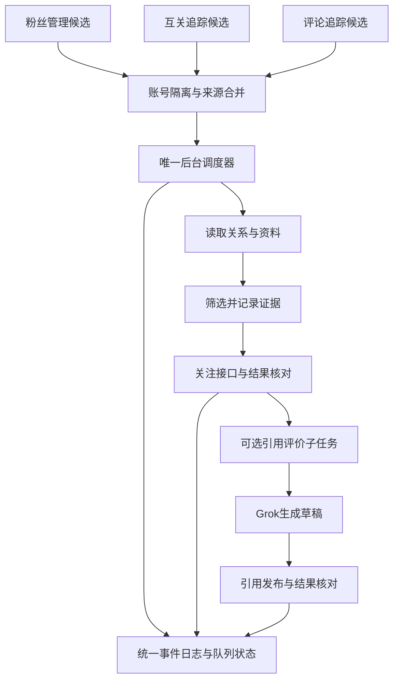

# 4. Grok 引用评价与发布验收

> **用户已确认的方案：** [统一关注队列与后台调度](#unified-follow-queue-proposal)。四项决策已确认，首批独立模块已实现，正式调度尚未接入。

- **作者**：`wangsen`
- **创建时间**：`2026-10-16 18:18`
- **涵盖版本**：`v0.25.4` → `v1.0.8`
- **核心模块**：`grok-comment.js`、`page-reader.js`、`panel.js`、`background.js`、`tests/grok-comment.test.js`
- **相关提交**：`09ee95c`、`ae36363`、`a672645`、`8864375`、`602f65e`、`36bdd5b`

---

## 一、目标与结果

把 Grok 为候选用户帖子生成的互动文字从普通回复改为**引用原帖评价**。评价以独立帖子发布，并附带原帖卡片，便于获得二次曝光；评论追踪和互关追踪原有处理流程保留，只改变 Grok 评价的发布形式。

本次在已登录的 X 浏览器中完成真实发布与核验。账号 `@WatsonTaylor23` 的引用评价发布到 [Edward913413 的原帖](https://x.com/Edward913413/status/2109821923832316001)，生成的帖子为 [WatsonTaylor23 的引用帖](https://x.com/WatsonTaylor23/status/2111029885582078253)。已在账号主页时间线和引用帖详情页核对正文及原帖卡片。

## 二、实现变化

### 2.1 Grok 生成引用评价

- 更新 Grok 提示词，明确生成适合公开传播的观点或补充内容，不把文本写成针对作者的站内回复。
- 使用“引用评价”开始/结束标记抽取正文，并保留 X 字数权重限制校验。
- 互关追踪及评论追踪复用同一引用评价生成和发布模块，日志状态文案区分生成失败、发布失败和成功发布。

### 2.2 跨路由引用发布

- X 点击“Quote/引用”后可能切换到 `/compose/post` 并销毁原页面注入上下文。流程拆为“打开引用编辑器”和“编辑器就绪后发布”两个阶段；后台等待路由稳定，再次注入检查与发布函数。
- 发布前确认编辑器可见、原帖卡片与目标相符、评价确实写入且发送按钮可用。点击后等待编辑器关闭，并检查失败提示。
- 若编辑器未嵌入目标原帖，或目标无法可靠识别，流程拒绝发布，避免把评价误发到其他帖子。

### 2.3 X 文章卡片校验

X 的长文章引用卡片有时不暴露指向状态帖的普通链接，单靠 `a[href*="/status/<id>"]` 会把正确的文章引用误判成缺少原帖。针对这种 DOM 结构，校验改为：当前页面必须是目标帖子详情页；页面中找到链接到目标 ID 的原帖；嵌入卡片作者与源帖作者一致；源帖文章标题出现在引用卡片中。普通帖子仍优先用状态链接校验。两种识别方式都不匹配时停止发布。

## 三、真实验收记录

- **浏览器环境**：连接既有登录实例 `C:\jtmp\xfollower-cdp-profile`，确认 X 当前用户为 `@WatsonTaylor23`，扩展重载后版本为 `0.25.5`。
- **目标原帖**：[https://x.com/Edward913413/status/2109821923832316001](https://x.com/Edward913413/status/2109821923832316001)。真实文章引用卡片没有直接的目标状态链接；通过源帖作者和文章标题确认对应关系。
- **发布内容**：

  > 定主线那三问和“50条不准换”才是真正卡脖子的地方。冷启动动作谁都能抄，但多数人死在选了个撑不过三个月的方向，后面的回复和长帖全变成自我消耗。

- **发布结果**：[https://x.com/WatsonTaylor23/status/2111029885582078253](https://x.com/WatsonTaylor23/status/2111029885582078253)。账号主页时间线与帖子详情页均显示该正文和 Edward913413 原帖卡片。
- **安全处理**：测试中 X 曾显示一个与本次目标不符的编辑器状态；目标校验拒绝发送。确认页面与目标文章卡片一致后才发布已批准的准确文本。

## 四、自动化验证与边界

- `npm test`：**59 项通过**，包含路由切换恢复、目标原帖不匹配时拒发以及 X 文章卡片作者/标题校验。
- `npm run check`：通过。
- `git diff --check`：通过。
- 真实 X 页面已验证引用编辑器、实际发送结果、账号主页时间线和帖子详情页。此前完整“扩展界面触发 → 后台调度 → Grok 生成 → 发布”的各模块有自动化覆盖，但本次实发验收是使用本仓库发布页面函数在已登录 X 标签中执行；不把单元测试或这次页面函数验证夸大为每个扩展界面入口都经过了独立手工点击验收。

## 五、提交记录

- `09ee95c` — `feat(grok): publish generated evaluations as quote posts`
- `ae36363` — `fix(grok): resume quote flow after X composer navigation`
- `a672645` — `fix(grok): verify quoted X articles without status links`

## 六、后续异常清理补充

2026-10-16 增加引用草稿清理：引用编辑器未就绪或发布失败时，只关闭并尝试丢弃与本次目标原帖相符的草稿，不影响其他帖子编辑器。实现位于 `page-reader.js` 的 `dismissQuoteComposerOnPage`，由 `grok-comment.js` 的 `postQuoteOnTab` 在失败路径调用。提交：`8864375`（`fix: dismiss stalled quote composer drafts`）。自动化测试确认目标帖子草稿会关闭、非目标帖子草稿不会被触碰；本次未重新执行真实浏览器端到端发布。

## 七、v1.0.5：回答截断和引用误判的排障复盘

先前把 Grok 回答工具栏中的“复制”按钮当作完成信号，但 X 会在流式输出尚未结束时就显示它，因此可能提取到半截评价。用户观察到：**当前提问下方出现新一组后续建议按钮时，回答才已完成**。`grok-comment.js` 现在用本次提问的 nonce 找到对应 DOM 节点，只接受排在该节点之后的后续建议按钮；同时要求停止生成按钮消失、抽取出的评价连续四次采样不变。复制按钮不再单独决定完成。向 Grok 的 Lexical 输入框写提示词时，校验忽略其自动折叠的空白；`execCommand('insertText')` 成功后不重复派发合成 `input`，避免 React 把文字插入两次。

另一故障是引用发布时普通回复编辑器被误判成 Quote 编辑器：两者可能同处 `main`，回复页面也包含目标原帖链接。`page-reader.js` 现要求**编辑器本身**有独立的 `Quote/引用` 标签，且不能含有 `Replying to/回复 @`；正则只允许标签前后出现横向空白，避免 `\s*` 跨行吞掉标签边界。X 的引用卡片可能省略原帖状态链接并改变标点或换行，因此再结合作者 handle 和忽略空白、标点后的原帖正文确认目标；长文章仍保留作者与标题兜底。若看到回复编辑器或无法确认目标，就停止发布并清理本次草稿。

写入正确引用编辑器后，使用浏览器原生 `execCommand('insertText')` 让 Draft.js/React 接收输入，核对编辑框内容与准备发布的文字一致，再点引用帖的 `tweetButton`，避免误点普通回复的 `tweetButtonInline`。只有 X 未报失败且引用编辑器关闭时，页面函数才返回 `mode: 'quote'`。这仍需结合实际时间线确认最终发布结果。

## 八、复现与验收证据

- **代码与版本**：`grok-comment.js`、`page-reader.js` 和 `tests/grok-comment.test.js` 的修复在提交 `602f65e`；`manifest.json` 与 `package.json` 版本为 `1.0.5`。单测包含复制按钮过早出现、后续建议出现后的稳定采样、回复编辑器拒发、`/compose/post` 引用识别和 React 文本输入。修复后 `npm test` 为 **81/81 通过**，`npm run check` 与 `git diff --check` 通过。
- **真实浏览器**：连接已有的 `C:\jtmp\xfollower-cdp-profile` 登录 Chrome（CDP 端口 `9222`），在 X 自带 Grok 页面提交带 nonce 的提示词，等到回答结束后取得完整评价。随后在 [DTee000 的原帖](https://x.com/DTee000/status/2111296102330986892)打开引用编辑器，页面发布函数返回 `{ok:true, mode:'quote'}`。在 `@WatsonTaylor23` 主页时间线核对正文与原帖卡片；[实际引用帖](https://x.com/WatsonTaylor23/status/2111311393794539754)可复核。这次验证覆盖 Grok 实际生成与真实引用发布，但不是从定时任务入口执行的整条后台调度链。
- **CDP 复用**：提交 `36bdd5b` 加入 `tools/cdp-session.ps1` 与 `AGENTS.md` 操作约束。先核对固定 profile、Chrome 主进程、`9222` 监听者和扩展目标；实例存在则直接附加，只有确实不存在时才使用 `-StartIfAbsent`。脚本在同一已运行实例上连续两次返回 `attached` 和相同 PID；本次没有执行冷启动分支。测试标签页用完关闭，避免触碰用户正在编辑的页面或遗留窗口。

---

## 九、v1.0.7：Draft.js 输入重复修复、实机引用发布与有关必回设置

### 9.1 Draft.js 重复输入根因与修复

在 X 的真实页面中，引用推文编辑器采用基于 Draft.js 的 contenteditable富文本结构。当使用 `document.execCommand('insertText', false, text)` 注入内容时，Chromium 既执行了浏览器的默认插入行为，又被 Draft.js 的 input 事件捕获处理，导致文字被**连续插入了两次**（例如“文本文本”）。随后的文本一致性检查：
`typed !== normalizeText(text)`
严格比较失败，流程立刻阻断并抛出 `引用评价没有准确写入输入框，已停止发布`。

修复方案：
1. **采用原生粘贴事件**：在 `page-reader.js` 的 `writeTextToComposer` 中，优先使用 `ClipboardEvent('paste')` 结合 `DataTransfer` 模拟标准粘贴行为。Draft.js 对剪贴板事件具有单一受控的插入逻辑，能够一次性写入目标正文并同步更新 React 状态与发布按钮高亮，同时保留 `execCommand` 作为非 Draft.js 编辑器的兜底。
2. **Quote 对话框原帖卡片校验增强**：部分包含长推文或换行统计信息的原帖在 Dialog 弹窗中提取文本时存在空白与截断偏差，补充了对话框专属的文本匹配规则，确保在正文完全一致时不再误判目标不符。
3. **内联回复框干扰消除**：在推文详情页发布引用时，页面底部始终常驻一个 `[data-testid="tweetTextarea_0"]` 内联回复框。等待弹窗关闭的检查逻辑改为根据 `findComposer() == null` 进行精准判定，避免误判为“发布后编辑框未关闭”。

### 9.2 “有关必回”引流文案配置闭环

为了提升通过引用评价获得新关注的转化率，在定时任务中追加了“有关必回”功能：
1. **文案拼接引擎 (`grok-comment.js`)**：
   - 导出 `appendFollowBackSuffix(text, suffix = '有关必回')` 方法；
   - 智能识别原句结尾标点（如句号、感叹号、问号、空格），平滑拼接后缀；
   - 内置去重逻辑，防止原评价中已包含该文案时重复追加；
   - 结合 `getTweetWeight` 与 280 字符/字数限制安全截断，确保推文不会因超出字数导致发布失败。
2. **面板交互与持久化 (`panel.html` / `panel.js`)**：
   - 在“评论追踪设置”与“互粉网络设置”两处抽屉中的 Grok 引用评价配置下方，分别增加 `commentAutoGrokFollowBack` 与 `mutualAutoGrokFollowBack` 复选框；
   - 配置与抽屉设置同步持久化至 `chrome.storage.local`，并支持手动单次测试触发。
3. **后台调度链路 (`background.js`)**：
   - 评论追踪定时自动化发评时，读取 `grokFollowBackSuffix` 配置，自动调用 `appendFollowBackSuffix` 对 Grok 评价做后置增强再提交发布。

### 9.3 CDP 实机验证证据

- **测试环境**：连接本地 CDP profile `C:\jtmp\xfollower-cdp-profile`（端口 9222），登录账号为 `@WatsonTaylor23`。
- **发布目标**：[https://x.com/DTee000/status/2111296102330986892](https://x.com/DTee000/status/2111296102330986892)
- **实际发布推文**：[https://x.com/WatsonTaylor23/status/2111403651097071864](https://x.com/WatsonTaylor23/status/2111403651097071864)
- **发布正文**：`限制剧毒农药大幅降低了冲动轻生率，生命教育比事后救援更关键。有关必回`
- **核验结论**：
  1. 页面发布函数返回 `{ok: true, mode: 'quote'}`；
  2. 引用帖在线上时间线正常呈现，DTee000 原帖卡片完整内嵌；
  3. “有关必回”后缀完整呈现于句末且格式自然；
  4. 临时测试标签页已自动安全清理。
- **自动化测试**：`tests/grok-comment.test.js` 补充了后缀拼接与边界单测，运行 `npm test` **87/87 项测试全部通过**。

---

## 十、v1.0.8：低回关账号反复看帖死循环排障复盘与防重闭环

### 10.1 现场排查与账号画像（以 @SquadBookHome 为例）

用户反馈插件老是打开特定账号（如 `https://x.com/SquadBookHome`）下拉滑动查看却不点击关注，怀疑存在算法机制或状态更新缺陷导致被反复查看。

经 CDP 实机连线核对 `@SquadBookHome` 真实画像：
- **Handle**：`SquadBookHome`
- **关注数**：**12**
- **粉丝数**：**4,938**
- **Bio 简介**：`Collect. Swap. Complete. Repeat.`
- **回关比率**：`12 / 4938 ≈ 0.24%`，且 Bio 无任何互粉意向词。

### 10.2 为什么算法绝不点关注

在画像评估引擎 `evaluateMutualProfile` 中：
1. **1/5 推荐门槛**：要求博主关注数至少达到粉丝数的 4/5（即 80%），该账号关注比仅 0.24%，差额远超 1/5，直接触发“回关比例偏低”规则并判定为 `isNotRecommended = true`（不推荐）；
2. **意向过滤**：由于开启了“仅互粉意向”（`onlyMutualIntent !== false`），该账号既无互粉标签又非推荐，被评定引擎坚决拦截并返回 `status: 'skipped'`，因此算法本身未执行关注是完全符合预期的安全防御机制。

### 10.3 反复打开看帖的死循环根因

为什么被跳过之后还会被插件反复打开？排查定位出两处严重的状态防重缺失：

1. **评论追踪定时任务候选池未排除跳过账号 (`background.js`)**：
   - 在 `runCommentAutoFollow` 中挑选 `candidates` 时，过滤条件原为：
     `handle && !user.followedAt && !ownFollowing.has(handle) && user.relationship?.following !== true && !mutual`
   - 当用户被判定 `skipped` 跳过后，其 `followedAt` 依然为 null，且未关注。
   - **过滤逻辑完全漏掉了对 `user.autoFollowState === 'skipped'` 的排查，且未读取 `processedHandles` 防重集合**；
   - 候选人列表按 `lastSeenAt` 升序排列，导致被跳过的老用户永远排在队列第一位。每隔一个定时周期，后台就重新打开它主页、滚动 5 轮看帖 15 秒、跳过，下一轮又再次打开，形成死循环反复查看。
2. **互粉网络定时看帖防重写盘滞后 (`panel.js` & `scoring.js`)**：
   - 在 `runMutualAutoFollowBatch` 中，`processedHandles` 原来仅在整批 10 个全部跑完后才统一写盘；中途如果刷新、报错中断，内存中的 Set 立即丢失；
   - `mutualNetwork.users` 列表项在被跳过时未持久记录 `autoFollowState = 'skipped'`；
   - `selectValuableMutualTargets` 原逻辑仅依赖易失的 `processedSet`，未直接排查候选人对象及 `profileCache` 中的 `autoFollowState === 'skipped'` 标记。

### 10.4 闭环修复方案

1. **`background.js` 候选人过滤与即时防重记录**：
   - 过滤条件追加 `user.autoFollowState !== 'skipped'` 以及 `!processedSet.has(handle)`；
   - 无论是跳过、关注成功还是异常失败，每处理一个账号，立即将 `handle.toLowerCase()` 存入 `cfg.processedHandles`，并调用 `saveCommentTrackingData` 即时持久化。
2. **`panel.js` 逐个候选人即时增量写盘与标记**：
   - 在看帖评估跳过时，同步在 `profileCache[key]`、`target` 以及 `mutualNetwork.users` 对应条目上打上 `autoFollowState: 'skipped'`、`autoFollowReason` 和 `autoFollowCheckedAt`；
   - 每轮单人看帖结束立刻增量更新并写盘 `mutualNetwork.autoFollow.processedHandles`，彻底杜绝批处理中途断开导致的防重丢失。
3. **`scoring.js` 候选池直接排除跳过账号**：
   - 在 `selectValuableMutualTargets` 中增加直接短路判断：
     若 `user.autoFollowState === 'skipped'` 或 `profileCache[key]?.autoFollowState === 'skipped'`，直接忽略，绝不再选入看帖队列。
4. **验证**：
   - 补充针对 `@SquadBookHome` 画像判定与已跳过账号排除的自动化测试，`npm test` **95/95 项全部通过**。

## 2026-10-17 18:57：未聚焦窗口引用失败与定时恢复

本次在固定 CDP 配置 C:\jtmp\xfollower-cdp-profile 实测，未读取日常 Chrome 的任务日志，因此不把测试配置的结论等同于日常配置的完整诊断。

### 真实复现与修复

- 完整单人任务对 @4111y80y 关注成功，x.com 自带 Grok 生成评价，但 Quote 阶段报找不到菜单。长帖操作栏位于视窗外：内容区高 561px，Quote 菜单 top 为 1068px。现在先将转发按钮滚到视窗中央。
- 随后复现路由已到 /compose/post，弹窗却为空、height 为 0。页面 visibilityState 为 hidden；临时用计时器补充 requestAnimationFrame 后，编辑框立即渲染。正式方案只在自动创建的引用窗口、发布期间注入 MAIN world；可见页面保留原生 rAF，隐藏页面通过原生回调与计时器竞速，防止重复回调，并支持取消。结束时恢复原函数，120 秒到期也恢复，最后关闭该任务窗口，不抢焦点。
- 启动、安装及服务 worker 唤醒补齐已启用但缺失的定时器，不推迟已有定时器。同步及 X 持久缓存仅填补缺失设置，避免覆盖本地明确保存的开关；评论任务优先读取独立设置。

### 验收证据与边界

1. 首次任务失败后，复用同一条 Grok 评价，完成真实填写与发布。在个人主页核对到 [本次引用帖](https://x.com/WatsonTaylor23/status/2111410568280363282)，正文与目标 @4111y80y 原帖卡片均正确。
2. 正式 postQuoteOnTab 入口用修复后的代码再次验收，未聚焦窗口返回 ready:true、目标原帖匹配，自动关闭窗口；这次复测不重复发布已成功的评论。
3. 删除互关定时器并重载扩展后，定时器自动恢复，设置保持不变。临时批次上限 1 已恢复为原先 10。
4. npm test：97 项通过；npm run check 通过。版本 1.0.8。
5. 已证实一条实际引用发布成功；不据此宣称日常 Chrome 已完成数小时连续运行验收。日常配置需要重新加载扩展才能运行新代码。

---

## 已确认方案：统一关注队列与后台调度

- 方案更新时间：2026-10-17 23:38，Asia/Shanghai。
- 状态：**四项决策已于 2026-10-17 23:50 经用户确认；首批独立模块已实现，整体流程尚未接入验收。**
- 本轮范围：只修改文档，不修改调度代码、不启动关注任务、不变更用户开关。
- 建议结论：保留「粉丝管理」「互关追踪」「评论追踪」三个候选入口，增加「关注队列」作为统一执行和日志中心。

### 方案一览

| 项目 | 推荐设计 | 用户可感知的变化 |
| --- | --- | --- |
| 候选来源 | 三个模块向同一队列提交候选 | 同一人不会被三个模块反复检查 |
| 自动执行 | 后台唯一调度器，不依赖管理面板常驻 | 关闭面板不影响已开启的自动任务；浏览器关闭期间不执行 |
| 任务区分 | 关注任务与引用评价任务分开保存、分阶段统计 | 不再把「关注成功但评价失败」当成全部完成 |
| 关注队列 | 统一设置、全局暂停、当前任务、下次执行、来源筛选 | 不用在两个抽屉分别调整相似定时参数 |
| 结果通知 | 默认只通知新增关注、发布成功或需要处理的异常 | 无候选、全部跳过写日志，避免每轮弹出“0 人” |
| 上线方式 | 停止旧执行器后再启用新队列，历史记录原样保留 | 避免新旧定时器同时关注同一个人 |

### 1. 已知事实与尚未证实的问题

1. 最新截图中的互关日志时间为 **2026-10-17 18:56:16**；截图证明界面当前展示了这一条记录，不能单凭截图认定最后一次实际执行时间或后台从此停机。
2. 「处理 10 人、关注 0 人、条件不符 10 人」表示该轮记录了筛选跳过，不能直接认定关注接口失败；应展示每种跳过原因及对应账号。
3. 当前代码中，后台的 `x-mutual-auto-follow` 闹钟向面板发送 `runMutualAutoFollowTick`，实际工作由 `panel.js` 的 `runMutualAutoFollowBatch` 完成。面板没有响应时，只发提示通知。
4. 评论追踪的 `runCommentAutoFollow` 在 `background.js` 执行，与互关追踪不是同一个执行器；各自有运行标记、参数和候选名单。
5. 过去两个日志按钮打开混合记录，来源与任务名称容易混淆；最近代码已增加分类显示与后台统一写日志，但这并不等于所有日常浏览器实例已加载新代码。
6. 先前 CDP 测试配置出现了今天的评论关注记录，但不能据此替代日常 Chrome 的现场证据。界面硬编码的 v1.0.2 也不能作为实际加载版本；新方案要求显示运行中的 manifest 版本。

**需要解决的结构性问题**：多套执行器、候选重复、配置与进度混存、长任务依赖页面生命周期，以及阶段结果不清晰。统一队列不能自动解决 X 接口变动、Grok 输出失败或 React 输入问题，这些仍需各执行阶段独立验收。

### 2. 页面职责与操作入口

| 页面 | 保留功能 | 改为调用队列的功能 |
| --- | --- | --- |
| 粉丝管理 | 粉丝读取、关系展示、资料与画像 | 待回关用户入队；手动回关加入高优先级任务 |
| 互关追踪 | 锚点收集、候选筛选、关系与标签 | 符合来源设置的用户入队；不再单独定时看帖关注 |
| 评论追踪 | 帖子链接、评论者收集、多个来源帖子展示 | 评论者入队；不再单独定时关注 |
| 关注队列 | 新增的执行中心 | 统一设置、启动/暂停、队列排序、重试、阶段状态、全部执行日志 |
| 回关监测 | 保留超期未回关检测 | 本轮不合并取关业务；将来若共享账号操作锁，关注和取关必须互斥 |

三个来源页保留「加入关注队列」和「查看该来源任务」入口；后者打开关注队列并预选来源。批量选择数量变化仍按当前页和选择集合正确处理。

「立即执行」表示唤醒同一个调度器，不另开一套执行流程。手动选中的任务可提高优先级，但仍遵守全局暂停、去重和账号限制。

布局沿用现有抽屉，工具栏使用 flex 对齐，避免新增 gap；标签 12px 字体、24px 高度，同组按钮高度一致。

### 3. 候选合并与账号隔离

队列以 **当前登录的 X 账号 + 目标用户 ID + 动作类型** 唯一标识任务。禁止只按目标用户名全局去重，否则切换自己的账号后会错误跳过。

- 优先使用目标 User Rest ID，禁止用 Tweet ID；首次只有 handle 时按规范化 handle 暂存，解析出 ID 后事务合并，保留用户名变更记录。
- 每个用户保存 `sources[]`：来源模块、来源帖子或锚点、首次/最近发现时间、是否允许该来源自动入队。评论者来自多个帖子时，所有来源链接保留。
- 同一人被三个模块发现，只生成一个关注任务；新增来源不会把完成任务重新变成待执行。
- 未开启自动关注的来源只收集候选；不能因为历史开关或其他来源的配置迁移而自动获得执行授权。若任一来源明确允许自动执行，可按统一策略入队；用户全局排除、暂停优先级最高。
- 已关注或互关：同步所有来源页的关系，结束关注任务，不再次打开 Grok；除非用户另行明确加入评价任务。
- 暂时无法识别当前登录账号：暂停执行并说明原因；不能借用另一个账号的关系缓存或凭据。
- 浏览器配置之间不共享运行锁或认证信息。本方案仅解决同一扩展实例内的重复执行。

#### 去重与防止重复消耗：硬性要求

补充确认：2026-10-17 23:46，用户要求同一人不得反复关注、消耗资源；以下为待实施的验收约束。

- **入队去重**：使用当前账号 ID、目标 User Rest ID 与关注动作的数据库唯一键，事务式新增或合并。三个来源反复发现同一人，只补充来源链接，不生成新关注任务，不重置完成、跳过、冷却或执行中状态。handle 大小写、带不带 @ 统一处理；解析出 ID 后合并临时记录。
- **执行去重**：定时唤醒、手动执行、多个面板统一经过同一个原子领取入口。租约未结束时不能重复领取；重启后先恢复检查点和核对执行结果，不能直接重做关注。
- **提前节省资源**：领取前先查持久化关系、处理结果和资料缓存。已关注直接结束；因条件不符跳过的用户，只有策略或相关资料发生变化、或达到明确的复查时间才重新评估，不能每轮重开主页、重读帖子或重问 Grok。
- **关注前复核**：真正发送关注前检查当前关系；若已关注则同步所有来源页，不再发送关注，也不计为本轮新增关注。关注请求超时或进程中断时记为结果待核实，先确认关系，再决定是否重试；不宣称外部接口能保证严格一次执行。
- **完成记录持久化**：关注完成状态独立于展示日志与队列历史保存。清空日志、分页、刷新、浏览器重启、历史日志数量截断，都不能删除去重依据。用户后来取消关注，也不能因来源再次发现而自动重新关注；重新关注须显式请求。
- **失败阶段隔离**：关注已经成功，Grok 生成或引用发布失败，只重试对应评价阶段，禁止退回关注步骤。
- **统计按唯一用户计算**：展示新增候选、合并重复候选、已关注跳过及各类跳过原因。重复来源不增加待执行人数；发现某几人不可执行后继续寻找下一位合格候选，遵守本轮检查与时间预算。

### 4. 队列状态与筛选依据

建议为关注和引用评价分别保存状态，不能继续用一个 `processedHandles` 同时表达成功、跳过、失败与处理中。

| 状态 | 含义 | 后续动作 |
| --- | --- | --- |
| 待检查 | 新发现、资料不足 | 优先读取缓存/接口，必要时打开主页 |
| 待关注 | 已通过当前策略，等待执行 | 等待额度与计划时间 |
| 执行中 | 已领取任务，带租约和阶段检查点 | 其他执行请求不能重复领取 |
| 已关注 | 本次确认新增关注 | 可派生一条引用评价任务 |
| 原已关注 | 现场确认此前已经关注 | 更新关系，不计入新增关注数 |
| 策略跳过 | 当前筛选条件不符 | 保存原因、证据时间、策略版本；不每轮重复看帖 |
| 等待重试 | 网络、资料读取等临时失败 | 按退避时间重试，优先处理未尝试的新用户 |
| 等待确认 | 发送后响应丢失、结果不确定 | 先核对实际状态，禁止直接重发 |
| 需人工处理 | 重试达到上限或明确不可处理 | 显示操作入口与失败原因 |
| 已取消/已排除 | 用户主动取消或排除 | 不自动重新入队 |

每次判断记录：粉丝数、关注数、读取时间、数据来源、意向命中依据、风险命中依据、策略版本。缓存与页面不一致时使用现场结果并修正缓存，不能把“读取失败”记为“账号不推荐”。

**筛选策略建议先保持现有语义**：最低粉丝数、互粉意向/推荐条件、关注数达到粉丝数 80% 的比例规则均明确展示；本次方案不暗中放宽。是否把 80% 改为可配置，由用户核对后确定。该比例只是现有筛选指标，不能当作对方必定回关或骗关的事实证据。

策略跳过不永久封死：资料发生实质更新、策略版本变化或用户手动“重新评估”时才重回待检查；新增同一来源记录本身不能触发重评。资料获取失败应进入可重试状态，而非永久跳过。

### 5. 唯一后台调度器

- 后台负责调度和状态，面板只展示与提交命令；关闭、刷新、重复打开面板不启动第二个执行器。
- 同一登录账号同一时间只允许一个自动账号操作；首版全局并发也设为 1，降低账号切换与窗口归属复杂度。
- 用 IndexedDB 事务领取任务并写入 `leaseOwner`、`leaseUntil`、递增的领取版本。内存布尔变量或简单的 storage 先读后写不能代替互斥锁。旧执行器的过期结果不得覆盖新领取版本。
- 用 `chrome.alarms` 唤醒。任务分为短阶段，每阶段落盘；不依赖后台进程永久存活、长时间 setTimeout 或一个跨数分钟的 Promise。
- 打开主页、等待 Grok、等待发布结果时保存拥有的 tab/window ID、截止时间与阶段。恢复后先检查页面和结果，再决定继续、重试或清理。
- 休眠、浏览器退出或 worker 重启后，依据 `nextRunAt` 恢复；不突发补跑所有错过的周期。处理过期租约前先做结果核对。
- 全局暂停立即停止领取新任务；已在发送阶段的操作先确认结果并清理，不能当作从未发送。

### 6. 额度、优先级与资源控制

以下为**待确认默认值**，不是平台官方限额，也不保证避免平台限制：

| 设置 | 建议初值 | 说明 |
| --- | --- | --- |
| 基础调度间隔 | 8 分钟，浮动 ±2 分钟 | 展示下次执行时间与实际采样间隔 |
| 单轮新增关注上限 | 5 人 | 只累计真正新增关注；原已关注和跳过不占新增额度 |
| 单轮新检查上限 | 20 人 | 不能为了凑满 5 人无限看帖 |
| 单轮时间预算 | 10 分钟 | 达到任一预算就结束，余下任务下轮继续 |
| 主页停留 | 沿用确认后的统一基准与浮动 | 缓存/接口足够时不打开主页；不为每个候选强制滚动 |
| 临时失败重试 | 最多 3 次，5/15/60 分钟基准加浮动 | 429 等限流优先遵守服务器提示并暂停账号操作 |
| 引用评价 | 每轮最多处理 1 条 | 与关注共用调度，避免 Grok 长任务占满全部资源 |

关注候选排序：人工指定 → 待回关优先 → 其他来源按首次入队时间轮转。对等待时间增加权重，并限制连续从同一来源取人，防止评论来源或旧失败任务长期占用队首。

新增来源与失败重试分池；优先处理尚未尝试的账号，重试到期才参与调度。所有浮动参数都记录本次实际值，便于复核；用于正确性保障的租约到期、最大等待上限无需为了随机而随机。

复用已登录 X 标签页；需要临时页面时，在现有浏览器中新建非激活 tab，记录归属，用完关闭。确需 Grok/引用独立窗口时沿用 800×600、不聚焦；只能清理本任务创建的窗口，不能关闭用户正在使用的页面。

### 7. 关注与引用评价分别完成

1. 关注前核对目标身份与当前关系；可用接口时优先接口。响应成功后再次核实 relationship.following，才记“新增关注成功”。
2. 若关注已成功而 Grok 失败，只将评价子任务置为等待重试；不能重新执行关注。
3. 评价子任务保存原帖 ID、来源 URL、完整草稿、生成通道、生成状态、发布状态和实际发布 URL。进程重启后继续使用已有草稿，不反复调用 Grok。
4. 发布幂等键为“当前账号 + 原帖 ID + 引用评价动作”。发布请求已经发出但结果不确定时，先查个人主页/结果记录；未核实前不自动重发。无法确定则交由人工确认，不能承诺外部操作绝对只发生一次。
5. Grok 出现复制按钮、推荐提问按钮只作为辅助信号；还需检查生成结束状态、正文稳定及格式。不能凭一个 DOM 节点宣布完成。
6. 日志分别显示“关注成功，评价失败”“草稿已生成，尚未发布”“引用已发布并核对链接”。关注数与引用发布数分开统计。

### 8. 统一日志、通知和可观测状态

日志标题统一为「关注队列 · 执行日志」。三个来源页打开时预选来源筛选，不再把来源模块当成执行器名称。

每条事件至少包含：`runId`、`jobId`、当前账号、目标账号、全部来源、执行阶段、开始/结束时间、结果、原因代码、重试次数、下次重试时间、截图引用或核验 URL。来源来自多个模块时，可在各来源筛选中看到同一任务，但总数只计一次。

每轮必须记录：唤醒 → 领取数量 → 各账号结果 → 本轮结束或中断。无候选、全局暂停、账号未登录、租约占用也必须留痕。持续卡住时显示当前阶段、已耗时与超时时间，不能只保留昨天的最后一条成功记录。

任务状态与事件日志由后台统一写入；优先在同一 IndexedDB 事务提交，面板监听变更并在打开时重新读取。界面需区分最后唤醒时间、最后完成时间、下次计划时间、运行版本及当前账号，避免再靠旧截图推断运行状态。

示例汇总：

> 本轮检查 12 人：新增关注 3、原已关注 2、策略跳过 5、等待重试 2。引用评价：发布 1、等待生成 2。下一轮预计 23:46。

默认自动通知只报告实际新增、发布成功、限流/登录失效等需处理的异常；连续“无候选/全部跳过”保留日志并合并提示。手动执行则始终展示完整结果。历史手动测试明确标注，不计入新调度的成功率。

### 9. 数据迁移与实施顺序

### 第一阶段：可观测性与统一模型

建立候选、来源、任务、阶段事件、策略设置的数据结构；把当前日志的来源和动作拆开。先让队列可查看，不执行任何新任务。

### 第二阶段：单一关注执行器

将三个入口改为投递任务，把互关面板中的关注执行搬到后台。旧闹钟可以暂时保留为投递入口，但不得再执行关注；同一运行版本只能有一个关注执行器。接口、DOM 与身份解析复用现有可验证代码。

### 第三阶段：评价子任务与恢复

接入 Grok 生成、草稿保存、引用发布与结果核验；验证超时、重启、页面关闭和发送结果未知的恢复行为。

### 第四阶段：迁移和切换

- 备份旧设置、追踪数据和日志，记录迁移版本；按当前账号归属迁移，归属不明的数据不自动执行。
- 保留旧来源的开关含义。多个旧定时参数不直接相加；统一配置需要用户核对，迁移后先暂停，确认再开启。
- 旧 `processedHandles` 和 `autoFollowAttempt:*` 结合用户状态与日志解释。不能把所有历史已处理记录都视为成功，也不能把网络失败永久当成策略跳过。
- 历史未发布草稿默认不自动发布，用户明确重试后才进入新子任务。
- 切换时清除旧关注执行闹钟与面板执行消息入口，只保留统一队列唤醒；收集粉丝/评论等只读任务可以继续独立采集。
- 回滚时先暂停新调度、核实进行中的外部操作并清理租约，再恢复旧版本；不得丢弃迁移后已关注/已发布的结果。

预计代码职责：后台路由与调度、队列事务存储、来源适配、关注执行、Grok 子任务、日志与面板各自拆分。具体文件名在实施时确定，避免继续向 `panel.js` 堆叠执行流程。

### 10. 验收标准

| 场景 | 必须通过的结果 |
| --- | --- |
| 三个来源重复提交同一用户 100 次，包括 handle 大小写变体 | 最终一个关注任务，所有来源保留；成功后再次提交不重复看帖或关注 |
| 多面板、重复定时唤醒及关注成功后立即重启 | 同一人不会被并发领取；结果未知先核对关系，不盲目重发 |
| 清空日志、历史记录截断后再次发现已处理用户 | 去重依据仍存在；关注成功不重做，评价失败仅重试评价阶段 |
| 关闭面板、打开两个面板 | 任务照常执行且不重复领取 |
| 候选已关注但缓存旧 | 页面/接口确认后同步三个来源页，不增加新增关注计数 |
| 前 10 人均不符合条件 | 给出具体原因，在检查预算内继续看后续候选，不反复检查这 10 人 |
| 全部候选不符合条件 | 结束本轮并说明原因，不伪造关注成功、不无限扫页 |
| 网络失败、资料不全 | 有限重试并让新账号先行，不永久标为不推荐 |
| 关注成功、Grok失败 | 关注保持成功，只重试评价，不重复关注 |
| 发布后响应丢失 | 先核对个人主页和原帖卡片，不能直接重复发送 |
| worker 重启或浏览器休眠 | 恢复阶段和下次计划，过期租约不造成重复操作 |
| 切换自己的 X 账号 | 队列、关系、限流暂停隔离；身份不明时不执行 |
| 日志并发、界面刷新 | 开始/结束记录完整，来源筛选正确，新日志不被旧缓存覆盖 |
| 任务中断/超时 | 本次创建的 tab/window 最终清理，用户窗口不受影响 |

实际验收使用真实队列中的不同账号，不再只反复测试 @Edward913413。每个关键阶段结合截图、接口/DOM结果和事件日志；公开发布验收必须有可核验的新帖子链接。单条测试通过不能宣称日常配置已连续稳定运行。

### 11. 用户已确认的实施决策

确认时间：2026-10-17 23:50，Asia/Shanghai。

1. **统一入口**：新增「关注队列」页面，粉丝管理、互关追踪、评论追踪负责候选收集和入队，统一由队列调度执行关注。
2. **默认额度与设置**：每轮新增关注最多 5 人、检查最多 20 人、时间预算 10 分钟，均可调整。复用现有定时设置的图标、抽屉、周期、随机浮动、停留与筛选配置交互，避免再造不同的设置体系。
3. **筛选门槛**：80% 比例改为可配置，迁移默认保持 80%；不暗中改变现有筛选语义。
4. **评价自动发布**：保留显式开关，统一配置确认前不自动启用，旧草稿不自动补发。关注成功与评价成功分别统计，关注用户与评价帖子必须可回溯。

### 12. 关注用户与评价帖子的追溯要求

- 保存完整关联链：当前操作账号 → 来源模块与来源帖子/锚点 → 目标用户 ID → 关注任务 ID → 评价任务 ID → 被评价原帖 ID/链接 → 已发布引用帖 ID/链接。
- 一个用户可对应多个来源与多条评价记录；每条评价明确关联具体原帖和触发它的关注任务，不能只保存用户名或最后一条评价覆盖历史。
- 原帖作者与被关注用户分别记录；转帖、引用帖等场景不能默认两者相同。无关注任务的独立评价应明确标记“独立评价”，不能伪造关联。
- 用户详情能查看关注时间、结果、评价原帖、生成内容、发布状态与发布链接；评价日志能反查目标用户、来源与关注任务。失败也保留阶段、原因、时间和重试记录。
- 发布任务按当前账号与目标原帖去重，同一原帖被多个来源发现不重复自动发布；额外评价需显式操作。每次重试属于同一任务的尝试记录，不能被统计成多次成功。
- 任务关系与已确认结果独立于可清理的展示日志持久化；旧数据缺失关联时标记“历史关联缺失”，不得靠用户名猜测补全。

追加验收：从任一关注用户可找到其关联评价与真实发布链接；从任一评价能回到对应原帖、目标用户和关注结果；关注成功但评价失败时，两种状态独立准确，同一用户的多来源、多原帖记录均保留。

实施顺序保持为统一队列与日志 → 评价子任务 → 迁移切换，分阶段验收。本次确认不代表已启动自动关注或发布。

### 13. Grok 4.7 与 Antigravity 分工及首批模块验收

记录时间：2026-10-18 00:12，沿用同一会话方案补充，不另建文档。

| 责任方 | 独立文件范围 | 当前结果 |
| --- | --- | --- |
| Grok 4.7 | follow-queue-store.js、tests/follow-queue-store.test.js | 已实现扩展来源 IndexedDB 队列、去重、租约、持久结果、设置；13 项单测通过 |
| Antigravity | follow-queue-panel.js、follow-queue-panel.css、tests/follow-queue-panel.test.js | 已实现可挂载列表、设置抽屉、溯源展示、分页选择和错误处理；17 项单测通过 |
| Codex | 共用接口约定、审查反馈、实际浏览器隔离验收、集成交付 | 已完成首批模块审查和隔离验收；生产入口与执行器接入尚未完成 |

验证：当前工作区 npm test 共 137 项通过，npm run check 与两个新模块的语法检查通过。通过既有 C:\jtmp\xfollower-cdp-profile 的 CDP 实例，在隔离扩展页面检查原生 IndexedDB：100 次并发入队只生成一个任务，完成后重开数据库不会重复领取；禁用来源不领取、用户名重新发现不重复、过期租约提交被拒绝。页面实测先全选 20 条再切换每页 100 条，可以全选 55 条再全不选；执行失败提示和设置抽屉正常显示。页面测试使用虚拟候选，没有真实关注或发布。

后续必须完成：后台唯一调度器与消息路由、当前账号身份确认、三个来源适配、关注与评价执行阶段、未知结果核对恢复、迁移与旧定时器停用、正式入口和真实流程验收。store.claim 本身不读取 settings.enabled，正式调度器必须检查总开关和迁移状态。结果待核实状态需要核对后恢复的专门入口，不能盲目重做关注。来源授权变更也须显式更新，不能用重复采集偷偷开启。

本批新模块未接入现有 panel/background，不更改现有定时行为，不升级发布版本，不宣称统一队列已完整上线。Antigravity 桥接等待出现 300 秒超时，但代理仍继续落盘；以实际文件、测试和截图为验收依据，不以桥接退出码判定实现完成。

### 14. 统一调度接入与浏览器验收

记录时间：2026-10-18 01:11，Asia/Shanghai；版本准备为 1.1.0。

- 新增后台运行适配、来源迁移、唯一调度器与正式关注队列入口。首次接入必须核对当前 X 账号并明确勾选来源，默认不启用定时及公开引用发布；接入后停止旧互关和评论关注闹钟，原设置入口转到统一队列。
- 历史已关注、跳过和处理状态导入独立去重记录。来源重复发现不能重新开启授权；用户 ID 在执行前通过用户接口确认，不把推文 ID 当用户 ID。暂停前没有外部动作的任务有限重试；关注请求发出后结果不明则保留待核对，避免盲目重复关注。
- 关注成功先落盘，再生成评价。评价关联关注任务、原帖与发布链接；只有个人主页确认证据才记为已发布。Grok 失败不会撤销已成功的关注记录。
- 浏览器实测：复用固定已登录 profile，正式面板加载 1823 条去重任务，设置抽屉正常；所有来源关闭时手动执行检查数为 0，旧关注闹钟已清除。隔离原生 IndexedDB 测试合并三个来源为一个用户，模拟执行一次，第二轮不再领取，评价草稿关系保留。
- 自动化验证：本轮完整 npm test 为 163 项通过，npm run check 通过。覆盖恢复按钮、来源同步不降级成功结果、身份晋升后的历史去重、暂停中断及租约续期。
- 验收边界：本轮没有真实新增关注或公开发布；隔离测试的成功计数仅为模拟执行器结果。日常 Chrome 配置未切换，不能把测试 profile 的结果视为日常账号已连续稳定运行。待核对任务的人工核验入口及评价独立重试仍需后续完善，当前保守保留，不自动补发旧草稿。

### 15. Argon 调用优先级与档位

- 优先使用官方 agy.exe，并显式指定 `--model gemini-4-argon-medium`。已检查运行事件与会话元数据；模型身份核验不代表订阅账号或额度池已核验。
- 调用方式更正：CLI 与桥接不能视为独立额度池；仅在调用通道故障时考虑已升级的本地桥接：`run.bat "任务说明" --model=argon-medium`。
- 桥接默认是 High，禁止省略 Medium 参数；RPC 回退需要重新核实实际模型，不能把自报模型名称当唯一证据。此次未更改桥接文件、登录账号或付费额度设置。
- Argon 负责调度器与测试，Grok 4.7 负责去重存储、来源适配与测试，Codex 负责集成、复核、浏览器验收和交付。代理自报成功不替代本地测试。

### 16. 收尾闭环：Grok 4.7 存储租约修正、待核实人工核验、评价独立重试与 CDP 全流程实测

记录时间：2026-10-18 02:25，Asia/Shanghai；保持版本 `1.1.0`。

- **Grok 4.7 存储层收尾 (`follow-queue-store.js` & `tests/follow-queue-store.test.js`)**：
  - 调用 `grok.exe -m grok-4.7` 完成 `importedHold` 与 `settle` 租约释放修复：当 `running` 租约任务在身份晋升（Handle -> `targetUserId`）时合并了已有持久状态的同人记录，终态 `settle(state !== 'running')` 若非真实关注成功（`followed` 或 `followResult` 含 `added/following/succeeded`），立即应用 `importedHold` 持久状态、合并评价、释放租约并同步 `outcomes`，返回 `{ok: false, reason: 'imported-hold', job}`，不再残留活动租约阻塞同批后续 `claim()`。
  - 新增 `store.resolveJob({accountId, id, state, stage, followResult, nextEligibleAt, evaluations})`：拒绝改写活动租约中的任务（`{ok: false, reason: 'leased'}`），支持将 `uncertain` 任务核实后转为 `followed` / `excluded` 或重新放回 `pending`（同时清理旧 `outcomes` 记录），以及在保持 `followed` 不变的前提下独立更新 `evaluations`。
- **调度器与运行时闭环 (`follow-queue-scheduler.js`、`follow-queue-runtime.js`)**：
  - 调度器 `finalizeJobOutcome` 识别 `settled.reason === 'imported-hold'` 并按实际恢复状态统计（`alreadyFollowing` / `skipped` / `excluded` / `uncertain`），发出 `job-imported-hold-applied` 事件，不误计为 `failed`。
  - 运行时 `execute()` 在 Handle 晋升为 `targetUserId` 后若发现 `merged.importedHold?.state`，立即返回对应持久状态，避免对历史已处理账号发起多余关注请求。
  - 新增 `followQueueVerify`：对 `uncertain`（结果待核实）任务通过 `UserByScreenName` 核对当前真实关系——已关注则落盘为 `followed` 并回写三模块状态，未关注则恢复为 `pending` 重新排队，用户 ID 变化或手动排除则记为 `excluded`。
  - 新增 `followQueueRetryEvaluation`：对已 `followed` 任务支持独立核对与重试 Grok 引用评价，绝不回退或重做关注；若评价处于 `uncertain` 先在当前账号个人主页核查是否已发出引用帖，未发出则优先复用已有草稿 `text`（仅无草稿时重新调用 Grok），并在显式发布或开启 `autoPublish` 时提交与主页验真。
- **CDP 全流程实测发现并修复的 3 项真实交互问题 (`follow-queue-panel.js`、`follow-queue-panel.css`)**：
  1. `handleRunNow()` 与 `handleSaveSettings()` 在请求成功后调用 `await fetchAll()`，而 `fetchAll()` 内部会递增 `activeReqId`，导致外层 `finally` 中 `reqId === activeReqId` 恒为 `false`，按钮状态卡在「调度中...」/「保存中...」。已在调用 `fetchAll()` 前及 `finally` 中显式重置 `isExecuting = false` 与 `isSettingsSaving = false`，并补充单测。
  2. 设置抽屉输入项补齐 `name` 属性，来源下拉筛选补充 `e.target.value || 'all'` 兜底。
  3. 移除 `.fq-drawer-backdrop` 与 `.fq-drawer` 上的 `@keyframes` 入场动画，防止 `render()` 执行 `root.replaceChildren()` 时抽屉重复闪烁或在后台标签页卡在半透明帧。
- **CDP 浏览器全流程实机核验结果（`C:\jtmp\xfollower-cdp-profile`）**：
  1. **门禁与迁移激活**：未勾选归属确认时点击「确认来源并接入队列」被拦截（提示 `请先确认本地数据的账号归属。`）；勾选三模块与归属确认后成功接入，旧闹钟 `x-mutual-auto-follow` 与 `x-comment-auto-follow` 立即清空（`alarmsAfter: []`），1823 条去重任务（含 292 条多来源合并任务）完整加载；粉丝管理 `#processFollowBack`、互关追踪 `#openMutualSettingsDrawer`、评论追踪 `#openCommentAutoFollowSettings` 点击后全部自动跳转至 `关注队列`。
  2. **真实 `uncertain` 关系核对 (`followQueueVerify`)**：在「待核实」筛选页点击 `@unseenai` 与 `@Huahuazo` 的「核对关系」按钮，后台通过真实 X `UserByScreenName` 接口解析出 `targetUserId`（`62336571`、`1775713394945032192`），核实尚未关注后自动恢复为 `pending`（`核实确认未关注，恢复待关注`），待核实数从 14 降至 12 且后续同步不再被旧缓存覆盖。
  3. **真实队列调度执行 (`followQueueRun`)**：在 UI 点击「⚡ 立即执行」跑通 2 轮真实 X 主页访问、分段下拉看帖、比例门槛校验与 `friendships/create` 关注，真实新增关注 `@hasibdreamer35`、`@momolyjh`、`@leoju55237`、`@haozihan001`、`@qqa16809`、`@qqa16807`，已关注数从 821 增至 828，执行完成后「⚡ 立即执行」按钮正常恢复可用。
  4. **真实评价独立生成与溯源抽屉 (`followQueueRetryEvaluation`)**：对已关注账号 `@qqa16807`（`2090101279498625024`）在不重做关注的前提下独立拉取其原帖 `2111397368545652871` 并通过 `grok.com` 生成引用评价草稿（`status: "draft"`，`attempts: 1`），列表行显示 `发布评价` 按钮，打开「溯源详情」抽屉完整展示操作账号、目标 Handle/Rest ID、任务 ID、来源记录、关注结果与 Grok 引用评价详情。测试完毕后已恢复默认安全配置（`enabled: false`、`grokEnabled: false`、`autoPublish: false`）并关闭临时面板标签页。
  5. **自动化单测**：`npm run check` 通过，`npm test` 共 **169 项全部通过（0 失败）**。

### 17. 评论追踪入队改造、Quote 原帖容错增强与真实 Quote Post 线上发布验收

记录时间：2026-10-18 03:20，Asia/Shanghai；版本号保持 `1.1.0`。

- **三大模块自动同步机制与排查结论**：
  1. **自动入队机制已就绪**：当统一关注队列已激活绑定（`followQueueBinding.activated === true` 且当前 X 账号匹配），粉丝管理（`monitor`）、互关追踪（`mutualNetwork`）与评论追踪（`commentTracking`）的数据变更会通过 `chrome.storage.onChanged` 自动触发 `followQueueRuntime.syncCandidates()`。各模块来源在开启状态（`sources[module] === true`）下会自动汇总入队，按账号小写 `handle` 去重并赋予初始 `pending` 状态。
  2. **前端交互体验断层修复**：此前评论追踪在前端仅有旧版单行“关注”按钮（点击被队列重定向），缺乏复选框与手动入队入口。现已补齐：
     - 表格新增多选框列（`commentSelectAll` 支持全选与半选状态），表头显示 `已选 X / Y` 徽标；
     - 顶部新增【加入关注队列】批量操作按钮（`#commentBatchAddToQueue`）；
     - 每行操作列新增【加入关注队列】图标按钮（已关注账号自动置灰显示“已关注”，未关注账号点击即时入队）；
     - 后台 `followQueueRuntime.handle` 增加 `followQueueEnqueue` 处理指令，支持单条与批量安全入队。
- **Quote Post 原帖识别与主页核验容错增强 (`page-reader.js`、`follow-queue-runtime.js`)**：
  1. **短文本与嵌套引用匹配容错**：原 `sameExcerpt` 与 `expectedTextMatch` 仅支持全量长句匹配，当原帖正文较短（如 `@qqa16807` 的“确实很不错”仅 5 字符，低于此前 8 字符下限）或原帖本身为转推/内嵌卡片时，导致引用编辑框校验失败。现将 `sameExcerpt` 门槛调整为自适应 `Math.min(4, len)`，并在原帖校验中增加前缀模糊容错与包含判断，确保各种长短文本与转推卡片均能稳定识别 Quote Composer。
  2. **主页时间线异步渲染等待**：发帖完成后跳转个人主页核验时，此前因立即查询而错过 X 的 GraphQL Timeline 异步渲染。现增加带轮询与延时重试的查找机制，确保真实发帖后能准确提取已发布的推文 Snowflake ID 与线上链接。
- **真实 CDP 浏览器全流程实机发帖与核验（`C:\jtmp\xfollower-cdp-profile`）**：
  1. **评论追踪批量入队实测**：在评论追踪界面勾选 `@a_little_white`，点击【加入关注队列】，状态栏即时反馈成功，切换至统一关注队列立即查见该任务已入队，各筛选与徽标响应正常。
  2. **真实引用推文成功发布至 X 线上**：
     - **发布账号**：`@WatsonTaylor23`（ID: `1485853007346827264`）
     - **引用目标**：娜娜 `@qqa16807` 的原帖（ID: `2111397368545652871`）
     - **Grok 评价内容**：`不用预存余额看着方便，实则把消费全押在交易所上，平台一冻结卡比废纸还不如。`
     - **线上真实推文链接**：[https://x.com/WatsonTaylor23/status/2111535917215482277](https://x.com/WatsonTaylor23/status/2111535917215482277)
     - **推文 Snowflake ID**：`2111535917215482277`
     - **线上状态**：推文正文与内嵌的 `@qqa16807` 原帖卡片在 X 线上完美展示。
  3. **关注队列终态落盘**：任务状态更新为 `posted`，关注任务溯源抽屉完整呈现 `publishedPostId: "2111535917215482277"` 与点击直达链接。
  4. **CDP 真实截图存档**：
     - `cdp_comment_tracking_queue_ui.png`：评论追踪复选框与【加入关注队列】界面实景；
     - `cdp_published_quote_tweet_permalink.png`：X 线上已发布引用帖详情页真实呈现；
     - `cdp_follow_queue_drawer_posted.png`：统一队列任务溯源抽屉中已发布链接与 posted 状态实景。
- **自动化测试**：
  - `npm run check` 零语法错误通过；
  - `npm test` **170 项单元测试全量通过（0 失败）**。

### 18. 冗余交互按钮清理、关注队列分页组件与配置/操作边界重构验收

记录时间：2026-10-18 03:40，Asia/Shanghai；版本号递增至 `1.1.1`。

- **冗余交互按钮与遗留抽屉全面移除**：
  1. **粉丝管理 (`#monitorSection`)**：移除检索设置齿轮按钮（`#openSettingsDrawer`）与「一键加入互关追踪」按钮（`#addSelectedToMutual`）；彻底移除遗留检索配置抽屉（`#settingsDrawer`）。
  2. **互关追踪 (`#candidatesSection`)**：移除设置齿轮按钮（`#openMutualSettingsDrawer`）；彻底移除遗留定时看帖与关注抽屉（`#mutualSettingsDrawer`）。
  3. **评论追踪 (`#commentsSection`)**：移除设置齿轮按钮（`#openCommentAutoFollowSettings`）；彻底移除遗留定时看帖与关注抽屉（`#commentAutoFollowDrawer`）。
  4. **安全保护与空指针防御**：保留独立的回关监测定时取关抽屉（`#unreciprocatedSettingsDrawer`）；`panel.js` 的 `syncDrawerMask` 调整为仅监控活跃抽屉，移除所有对已下线抽屉的非空假设，确保运行时 100% 健壮。
- **关注队列配置与操作边界重构**：
  1. **调度总开关页面化**：将「开启后台定时关注调度」开关从抽屉内剥离，直接提至关注队列主页面顶栏（`renderHeader`），提供悬停提示（`title="开启后后台按设定周期自动在后台调度关注任务"`），点击即时触发后台调度器启用/暂停。
  2. **执行/停止按钮图标化与状态流转**：顶栏动作按钮重构为纯图标按钮，空闲态展示 `⚡`（hover 提示「立即执行」），点击触发单轮调度；执行态动态流转为 `⏹` 危险警示色图标（hover 提示「停止执行」），点击即时向后台发送 `followQueuePause` 终止当前调度并重置状态，职责边界更加清晰。
  3. **设置抽屉聚焦参数**：设置抽屉剥离启停开关后，专注维护基础间隔、随机浮动、批次上限、看帖停留基准及 Grok 引用参数。
- **关注队列双向分页组件与页码交互**：
  1. 在列表筛选栏右侧（Top）与表格底栏（Bottom）双向提供分页控制组件（`monitor-pagination` 风格）；
  2. 支持每页条数下拉选择（10 / 20 / 50 / 100 / 200，默认 20，实机测验证实 50 同样丝滑切换）；
  3. 实时展示当前页码与条数汇总（如 `第 1 / 92 页 · 共 1824 条`，切换为 50 条/页后动态计算为 `第 1 / 37 页 · 共 1824 条`）；
  4. 完整呈现页码数字按钮（1、2、...、37）、高亮当前页（`.active`）及前翻/后翻（`‹`、`›`）导航，切换页码与每页条数时实时重新切片展示。
- **CDP 实机验收与截图存档（`C:\jtmp\xfollower-cdp-profile`）**：
  1. `cdp_fans_tab_clean.png`：粉丝管理模块实拍，已清除齿轮与「一键加入互关追踪」按钮；
  2. `cdp_mutual_tab_clean.png`：互关追踪模块实拍，已清除设置齿轮按钮；
  3. `cdp_comments_tab_clean.png`：评论追踪模块实拍，已清除设置齿轮按钮；
  4. `cdp_follow_queue_main_view.png`：关注队列主界面实拍，顶栏「定时自动调度」开关、`⚡` 执行图标按钮与顶部/底部双分页组件正常展示；
  5. `cdp_follow_queue_page2.png`：切换 50 条/页后翻至第 2 页实拍，页码高亮 `2`、前翻激活、数据实时展示 50 条；
  6. `cdp_follow_queue_drawer_clean.png`：设置抽屉实拍，证实启停开关已彻底剥离。
- **自动化测试与质量保障**：
  1. `npm test` **170 项单元测试全部通过（0 失败）**；
  2. `npm run check` 零语法错误通过。

### 19. 1.2.0 首次使用引导、重装账号初始化与纯扩展运行边界

记录时间：2026-10-18 11:22，Asia/Shanghai；整理者：wangsen；实施：Codex。

本节合并同一会话内的三个修复提交，保留原文档编号和创建时间。前述 Antigravity 实施记录属于此前阶段；本次验收仅覆盖以下明确列出的内容，不将此前公开发布结果计入本次测试。

#### 19.1 问题与根因

- UI：全局 label 子元素的底部外边距作用到了行内复选框；互关锚点和每侧上限输入框又有额外左边距，导致文字、控件和提示图标错位。
- 本地请求：panel.js 和 background.js 混入开发用 Grok 桥接，循环访问 http://127.0.0.1:18288/task，manifest 同时允许回环地址。该代码不属于用户功能，不应随扩展交付。
- 卸载重装：识别账号需要 UserByScreenName 请求模板，而卸载会清除扩展存储。已经打开的 X 页面仍可能保留旧扩展上下文，重新安装不会自动让这些页面重新捕获模板。因此即使 X 已登录，队列仍提示无法识别账号。
- 引导不足：原页面失败时只有简短错误，缺少自动处理进度、登录入口和清晰的下一步；首次导入大量候选时也缺少等待提示。

#### 19.2 实现与文件对照

| 文件 | 最终行为 |
| --- | --- |
| panel.js、background.js、manifest.json | 删除两处本地开发桥接轮询及回环地址权限；正常功能不依赖本地服务 |
| brand-layout.css、follow-queue-panel.css | 主要内容区统一 10px 内边距；字段左对齐；行内复选框和文字垂直居中；修正提示图标、按钮高度与内容区滚动 |
| follow-queue-runtime.js | 优先识别现有 X 页面；失败时创建一个非激活的 X 首页标签，等待登录账号，再访问该账号主页捕获新模板；完成或失败均关闭自己创建的标签 |
| follow-queue-runtime.js | 并发识别复用同一个任务；提供 checking、opening、initializing、ready、failed 阶段；账号识别失败后允许重新发起 |
| follow-queue-entry.js | 自动显示三步进度；首次预选三个来源；明确账号确认、来源接入、候选收集与设置入口；来源全未选时给出提示 |
| follow-queue-entry.js | 自动识别失败后显示“打开 X 完成登录”和“重新识别账号”，解释同一浏览器配置及网络要求；登录标签由用户点击打开，不属于自动清理的临时标签 |
| tests/production-boundary.test.js | 阻止面板/后台重新混入本地桥接和 manifest 回环权限 |
| tests/follow-queue-runtime.test.js | 覆盖缺模板初始化、并发合并、未登录时有限等待与标签清理，以及识别进度 |

账号识别完成不等于启动自动化。来源接入仍需确认账号归属，定时调度及 Grok 自动发布默认关闭。首次导入大量历史候选可能需要等待，页面会说明正在接入。

#### 19.3 升级、重装与数据边界

- 商店升级通常保留扩展本地数据；已打开的 X 页面不会自动替换旧脚本，刷新或重新打开页面后才会加载新脚本。队列识别不要求用户先刷新，必要时通过新的临时页面初始化。
- 开发者模式卸载再安装会清除扩展自身存储；本次测试从原模块在 X 站点保存的数据重新导入候选，不代表完整队列历史、配置及评价记录均可跨卸载恢复。
- 不主动刷新用户已有 X 标签页，避免打断浏览或未完成草稿；自动初始化只使用自己创建的后台标签。
- 未登录、页面加载缓慢、网络故障或 X 请求限制仍可能导致失败；自动重试能力不应被描述为任何环境都能成功。自动阶段失败后进入人工引导。

#### 19.4 实际验证与证据

- 使用固定 CDP profile：C:/jtmp/xfollower-cdp-profile。正式扩展未被卸载，验收通过单独路径加载隔离测试副本完成。
- 修复前，全新安装测试副本复现“无法确认当前 X 账号”，虽然已有 X 页面处于登录状态。
- 修复后，实际卸载并重新安装测试副本，无需刷新原 X 页面，自动识别 @WatsonTaylor23 并捕获 UserByScreenName 模板；确认来源后正常加载 1823 条候选，设置读取成功，未开启定时或自动发布，临时标签已关闭。
- 1.2.0 新安装副本再次验证三步进度与自动识别成功。人工引导分支通过测试页面模拟识别失败验证，恢复真实消息接口后点击重试再次成功；没有为此退出用户的真实 X 登录状态。
- UI 截图检查覆盖五个模块及队列设置抽屉，另检查 1280px 宽度抽屉。页面切换和打开设置时未观察到本地服务请求。
- 最终 npm test：174 项全部通过；npm run check 和 git diff --check 通过。
- 本机截图证据：C:/jtmp/ui-candidates-final.png、C:/jtmp/ui-switches-final.png、C:/jtmp/queue-login-guide.png。临时截图未作为永久仓库附件归档；临时路径可能在后续测试中覆盖，不作为长期唯一证据。

未验证范围：Chrome 商店实际升级安装过程、日常浏览器配置的长期运行，以及卸载后的完整队列历史恢复。本轮没有新增真实关注或公开发帖。

#### 19.5 版本与交付

| 版本 | 提交 | 变更 |
| --- | --- | --- |
| 1.1.2 | c1b9ba4 | 移除本地开发桥接、统一控件对齐 |
| 1.1.3 | 9e41936 | 修复重装后账号识别与临时页面清理 |
| 1.2.0 | a2c1473 | 完整自动初始化进度和人工兜底引导 |

版本已同步至 manifest.json、package.json、后台构建版本、面板握手标识和可见版本。记录时处于 codex/fix-quote-composer-react 分支，以上提交仅在本地；未推送、未创建商店发布。

### 20. Grok 后台窗口输出停滞与全程不聚焦验收 — 1.3.4

记录时间：2026-10-18 12:39，维护者：wangsen。

#### 根因与修复

上一轮真实验收发现：X Grok 已返回回答，但后台窗口的逐字动画没有完整渲染，切到前台后才继续。复制按钮、后续建议已出现也不能证明正文已完整进入 DOM。浏览器可能暂停后台或被遮挡窗口的 requestAnimationFrame；不能仅凭 document.hidden 为 false 就认为动画帧仍正常。

在 grok-comment.js 的自建 Grok 临时窗口中，加载完成后注入 MAIN world 的 setGrokFrameFallbackOnPage：原生动画帧与 80ms 定时器竞争，每个回调只执行一次；保留取消能力、时间戳和原生帧优先路径。180 秒自动恢复原函数，并将未执行的动画任务交还原生调度。窗口仍为 800×600、focused:false，不伪造 visibilityState，不调用窗口激活接口。此入口同时覆盖 X Grok、grok.com 的评价和通用分析；窗口加载或注入失败也关闭本次创建的窗口。

继续要求评价开始/结束标记、完成信号及连续稳定读数；渲染兜底不代替回答完整性校验。1.3.2 的语言字段及语言对应后缀/标签、1.3.3 的 Lexical 单段落输入修复一起用于本次验收。

#### 真实验收结果

使用现有 C:\jtmp\xfollower-cdp-profile，通过 CDP 加载隔离的 1.3.4 扩展副本，未切换任何测试窗口到前台，也未使用 Page.bringToFront。

1. 从真实英文帖子读取正文：[原帖](https://x.com/konig0000/status/2111673857455329476)。
2. 调用真实 requestGrokComment，命中 x.com 自带 Grok，返回 language=en，未使用 grok.com 降级。读取完整答案时，页面 hidden=true、hasFocus=false，后台帧兜底已安装。
3. 调用真实 postQuoteOnTab 和 publishQuotePostOnPage，自动打开引用框、填写英文正文和后缀/标签、点击发布，返回 mode=quote、ok=true。
4. 在本次创建的非激活主页标签中核实正文完全匹配、引用作者和卡片正确、5 个英文标签均成为独立链接；核实时仍 hidden=true、hasFocus=false。
5. 窗口事件记录中 Grok 窗口 1472735778 和引用窗口 1472735787 均以 focused:false 创建；没有这两个窗口获得焦点的事件。原主窗口与 Chrome 失去焦点之间的切换属于用户现有窗口，不是测试窗口激活。ID 仅为此次证据，不能硬编码到后续测试。

[已发布引用帖](https://x.com/WatsonTaylor23/status/2111678264083382375)：

> The constitution metaphor for CLAUDE.md locks agents into rigid rules they should transcend. I follow back.
>
> #FollowBack #FollowForFollow #MutualFollow #F4F #LetsConnect

后台主页截图归档于 docs/images/grok-background-home-20261018.png。截图采集未调用激活接口。Grok 与引用窗口由生产代码自动关闭，测试主页和隔离扩展由验收脚本清理，保留用户原有标签与窗口。

npm test：187 项通过；新增覆盖原生帧与定时器竞争、取消、重复安装、超时恢复。npm run check、git diff --check 通过。

验证边界：本次在 Chrome 155 的已登录 CDP 配置中完成一次全程不聚焦真实发布；未据此宣称浏览器最小化、操作系统休眠或任意长时间冻结均可正常运行。日常扩展尚需重新加载以启用新代码；未推送远程、未发布商店版本。

### 21. 临时窗口定时回收 — 1.3.5

后台新增每分钟运行一次的 x-temporary-window-cleanup 闹钟。Grok 和引用发布窗口统一由 temporary-windows.js 创建，按窗口 ID 单独写入 chrome.storage.session，保存原标签 ID、用途、创建时间和过期时间；正常完成仍由 finally 立即关闭并删除登记。默认最长存活 15 分钟，显式更长的通用分析超时会预留额外清理预算。

清理器仅处理本扩展登记的过期 popup。若窗口正获得焦点，暂缓关闭；若用户新增标签、更换原标签或导航到非 X/Grok 网站，则撤销接管，保留窗口。已经不存在的窗口只清登记。关闭失败保留登记供下一轮重试，关闭/失败结果写入会话存储 xfTemporaryWindowLastCleanup。会话存储可跨后台 Service Worker 休眠保留，浏览器重启后清空，避免恢复会话时窗口 ID 复用造成误关。

重要边界：不扫描或终止操作系统 Chrome 进程；不凭网址关闭用户手动打开的 Grok；旧版残留或浏览器重启恢复的窗口没有可靠归属记录，不批量认领。该机制处理启用新版本后登记的临时窗口。

测试覆盖过期/未过期/未登记窗口、用户新增标签、导航到其他网站、替换标签、聚焦保护、消失窗口、登记失败立即回收、删除失败重试，以及分钟闹钟和长任务期限。自动化测试共 191 项通过。

CDP 实机验收使用隔离扩展副本，创建过期受管窗口 1472735819、未过期受管窗口 1472735821 和未登记对照窗口 1472735823。仅将测试登记的过期时间设为过去，未手动调用扫描函数；等待真实分钟闹钟后，关闭列表仅含 1472735819，未过期与未登记窗口仍存在，失败列表为空。验收结束只清理测试创建的窗口和隔离扩展，没有关闭用户原有窗口。

#### 21.1 Grok 窗口复用与八分钟空闲回收 — 1.3.6

2026-10-18 13:10 根据用户补充要求调整上述策略：Grok 不再每次任务结束立即关闭，而是释放为可复用窗口；从本次任务结束或最近一次使用起计算 8 分钟空闲期限。每分钟闹钟扫描，因此实际回收通常在空闲满 8–9 分钟内发生，受 Chrome 闹钟调度影响。引用发布窗口仍用完即关。

X Grok 与 grok.com 按来源分别匹配窗口。后台统一串行处理申请、释放、触碰和扫描，避免面板与后台同时抢用；执行中的窗口标记 busy，不交给另一任务。新任务复用原窗口 ID，但导航到新对话入口，避免继承上一次回答或对话内容。正在聚焦的窗口不被任务接管或清理，聚焦扫描和焦点离开事件会更新空闲时间。异常任务未释放时仍保留原有 15 分钟兜底，显式长任务拥有更长执行预算。

本轮不新增公开帖子。193 项测试通过，包括同源窗口复用、忙碌窗口隔离、跨来源隔离、八分钟边界和聚焦续期。CDP 实机调用共用 createBackgroundGrokWindow 入口，连续申请并释放后，两次均返回窗口 1472735846；占用期间另一个任务获得 1472735850。持久化空闲期限精确为 480000ms。为避免等满八分钟，仅回拨测试窗口登记的空闲时间，再等待真实分钟闹钟验证回收；没有回拨系统时钟。

真实闹钟结果：关闭列表为 [1472735846]，仍在执行期的 1472735850 保留，失败列表为空。验收后清理所有本次创建窗口及隔离扩展，保留用户原有窗口。

### 22. 通知监控与独立互动模块方案 — 待用户核对

编写时间：2026-10-18 13:18，作者：wangsen。依据当前 codex/fix-quote-composer-react 分支源码；本节仅为设计，不表示已实现或已通过 X 通知页实测。不修改业务代码、不新增自动互动开关的启用状态。

#### 22.1 目标与待确认行为

增加常驻、非激活的 X 通知监控标签，发现谁对当前账号的帖子点赞、回复、转帖或引用。优先把可确认身份的点赞用户作为新的关注候选来源，同时把评论和点赞拆成可独立调用、独立测试、独立维护的模块。

“给点赞的人”尚未明确完整动作。本方案暂定默认建议为：记录互动 → 补全已知账号信息 → 依据开关进入关注队列 → 沿用既有筛选门槛。自动回赞、生成评价、公开评论均为独立选项，默认关闭；本方案本身不构成开启这些功能的授权。关注成功不必强制触发评论，评论失败也不影响关注已成功的记录。

#### 22.2 当前源码与改造边界

| 当前位置 | 已确认现状 | 规划改造 |
| --- | --- | --- |
| follow-queue-runtime.js | 关注成功后内联选择帖子、生成评价、保存草稿、发布与核验 | 保留关注职责，把互动意图交给独立任务接口；保持 followJobId 和 evaluation 追溯 |
| grok-comment.js | 同时包含 Grok 输入/读取、语言和后缀处理、引用发布编排 | 拆分生成提供者、文本处理、评论执行器；旧导出先保留兼容适配 |
| page-reader.js | 页面画像读取和引用编辑器操作共处 | 按页面适配器边界逐步拆分；评论与点赞不互相导入 |
| follow-queue-sources.js | 粉丝、互关、评论三类来源合并 | 加入 notifications 来源；复用已有身份去重，不新增第二套自动关注执行器 |
| background.js | Chrome 系统通知、多个业务消息入口、闹钟恢复 | 增加通知采集唤醒与互动调度入口；Chrome 提示与 X 通知页面分开命名 |
| temporary-windows.js | Grok 窗口复用及空闲回收 | 通知页另设长期受管标签类型，不进入 Grok 的八分钟回收池 |

源码目前未发现独立“给帖子点赞”的执行模块。通知页 DOM、徽标结构、合并通知可展开程度、可获取的点赞用户范围，均须实现前先通过截图和 DOM 采样验证，不能预设全部可获取。

#### 22.3 模块划分与调用关系

建议新增逻辑边界如下，文件名可按实际依赖调整：

| 模块 | 职责与输入输出 | 明确不承担 |
| --- | --- | --- |
| notification-monitor | 监听徽标变化、定时扫描、常驻标签恢复，输出扫描请求 | 不点击关注/点赞/发布 |
| notification-page-adapter | 读取真实通知卡片、解析可见用户和帖子，输出标准事件及证据 | 不根据头像数量或总数猜用户身份 |
| notification-store | 按当前账号持久化事件、水位、候选关联与扫描日志 | 不判断互动是否值得执行 |
| interaction-policy | 把事件和明确开启的规则转成候选或互动意图 | 不操作页面 |
| interaction-scheduler / store | 排队、配额、租约、幂等、暂停恢复、结果溯源 | 不依赖 Grok DOM 或点赞 DOM |
| comment-service | 选择 reply 或 quote 模式，生成/复用草稿、语言适配、发布前校验、提交与核验 | 不依赖点赞成功，不自行执行关注 |
| like-service | 校验目标帖子、识别已点赞状态、执行点赞、核验结果 | 不调用 Grok，不自动取消点赞，不强制发表评论 |
| grok-provider / quote-publisher / like-page-adapter | 各自封装外部页面差异，返回结构化结果 | 不决定候选来源、配额或跨模块业务策略 |

调用方向：通知采集 → 事件库 → 策略 → 关注队列或互动队列 → 对应执行器 → 独立结果库。评论与点赞只依赖公共契约、账号上下文和调度器，不互相调用。界面通过这些入口操作，不直接抓取另一个页面的按钮或内部变量。

同一账号的外部写入动作由统一调度仲裁，初期每次只执行一个关注/点赞/发布动作。通知只读采集可独立运行；Grok 等待生成不持有外部写入锁，最终点击发布时重新取得锁并检查账号和开关。这样防止跨模块争抢同一编辑器，又避免一次 Grok 等待阻塞所有候选发现。

#### 22.4 常驻通知标签与触发流程

1. 用户开启通知监控后确认当前 X viewer 的稳定用户 ID；未知账号时沿用已有自动识别与登录引导，不绑定猜测账号。
2. 优先使用扩展登记的通知标签；缺失时在现有浏览器中新建一个非激活的 https://x.com/notifications 标签。每个浏览器配置的当前登录账号最多一个受管通知标签。账号切换后暂停旧账号监听与待执行任务，重新绑定；不能假定同一配置可以同时登录多个账号。
3. 在当前站点布局中定位左侧通知徽标，首次可见值仅建立基线。用 MutationObserver 监听稳定的父区域，同时处理 X 的 SPA 路由、节点重建和扩展更新后的旧监听器销毁；同页同版本仅一个监听器。
4. 数字/红点变化经 1–3 秒去抖后请求扫描。记录变化但不把计数差当事件数；数值减少可能是已读，数字不变也可能有新事件，红点与 99+ 等封顶显示更不能算人数。
5. 在受管通知标签内点击经现场确认的通知导航或“新通知”入口，以读取实际列表变化，不激活浏览器标签或窗口。若已在通知路由，优先读取现有列表与新内容提示；确认没有更新且页面异常时才有限刷新。
6. 不修改用户当前正在操作的 X 标签。若用户接管受管通知标签并导航到别处，撤销归属，不把它拉回；下个周期再按单实例规则创建替代页。用户手动关闭通知标签时不立即循环重开，等待下一周期；关闭监控后不再创建。
7. 用 chrome.alarms 兜底唤醒后台并检查标签/监听器健康，避免依赖 Service Worker 永久存活。页面休眠、系统睡眠、断网、登录过期要展示状态，恢复后增量补扫；不承诺浏览器退出后仍能监控。

建议默认扫描周期为 5 分钟、浮动 ±1 分钟，可配置。徽标事件合并扫描的最小间隔建议 30 秒；单轮最多读取 50 条卡片、翻页 3 次或耗时 60 秒即暂停并保存进度，均为待核对默认值。浮动只用于执行节奏；去抖、租约和超时属于工程边界，不强行随机化。

进入通知页可能改变 X 的未读状态，首次启用说明中应明确这一点。监控标签可以一直打开；用户关闭监控时，仅关闭扩展创建且未被用户接管的标签。

#### 22.5 事件解析、去重与数据结构

建议事件记录包含：accountId、eventKey、providerEventId、type、actorUserId、actorHandle、actorName、avatar、blueVerified、subjectPostId、subjectPostUrl、occurredAt、observedAt、evidence、resolution、sourceEventIds。身份字段和时间缺失时保持 unknown；蓝 V 只在有明确证据时标记。

- 优先使用现场可以确认的原生事件 ID。没有原生 ID 时，以 accountId + eventType + actorUserId + subjectPostId 建稳定键；这时同一用户反复取消/重新点赞可能无法区分，产品显示“已观察到点赞”，不声称完整事件流。
- 仅有 handle 时先建临时身份；拿到 User Rest ID 后合并，保留原关联。严格区分用户 ID 与帖子 ID。不能使用每次扫描时间作为去重键。
- “A 和另外 N 人赞了你”只记录确实显示/可合法展开读取的用户，保存 hiddenActorCount 和 partial 状态；绝不凭总数批量虚构候选，也不把未知用户算成入队成功。
- 若通知无法解析具体帖子，先记录通知，允许已知用户作为关注候选；不安排对未知帖子的点赞或评论。
- 首次启用默认只建立最近可见通知基线，不批量追溯执行历史互动；历史补扫需单独选择范围并预览数量。刷新或启动恢复从持久化水位继续，水位前进须在事件成功保存后发生。
- 建议保留详细通知 30 天或每账号最多 10000 条，幂等动作结果另存并按现有已操作记录策略保留，避免详细通知过期后重复执行。保留策略可配置，不删除已经关联的发布凭据。

通知来源进入关注队列时，与粉丝管理、互关追踪、评论追踪按同一目标用户去重，只增加来源证据。已关注、已排除、已有冷却记录的用户不因再次点赞而重新关注。

#### 22.6 独立互动任务、结果核验与重试

建议任务字段：jobId、accountId、actionType、targetUserId、targetPostId、mode、sourceEventIds、followJobId、policyVersion、idempotencyKey、status、attempts、leaseUntil、nextAttemptAt、draftId、publishedPostId、verifiedAt、errorCode。

| 行为 | 去重与执行前置 | 完成判据 |
| --- | --- | --- |
| 关注候选 | 当前账号 + 目标 User Rest ID；沿用队列筛选 | 已有关注队列的关系核验 |
| 点赞 | 当前账号 + like + 目标帖子 ID；排除本人帖子、不可用帖子、明确已点赞 | 目标帖对应按钮由未点赞变已点赞，并重新读取确认；已点赞返回 already_liked，不再次点击 |
| 评论/引用 | 当前账号 + comment + 模式 + 目标帖子 ID；同帖同模式默认只发一次 | 生成成功仅记 draft；提交成功需拿到发布凭据，并从本人主页/帖子页确认正文与原帖关联 |

点赞面向“帖子”，不能只提供一个用户就直接执行。回赞规则需要先明确选择哪条：建议选择对方最近 7 天内的一条原创公开帖子，排除广告或高风险内容的规则需独立配置；没有合格帖子记录 skipped_no_target。此选择范围尚未获用户确认。

状态区分 pending、running、draft、succeeded、already_done、skipped、failed、uncertain、paused。点击后结果不明进入 uncertain，优先只读核实，不直接重复点击，避免点赞变取消点赞或重复发布。人工重试某一个动作不重跑已成功的关注/点赞/评论。对登录失效、403、429、DOM 不匹配分别暂停、退避或报告，不吞掉为“成功 0 人”。

通知事件与动作使用可重复消费的已持久化意图；在“事件已保存、入队未完成”或后台重启时恢复派发，依赖幂等键避免重复。写入前重新核对 viewer、当前开关、全局暂停、任务租约和目标关系，取消的任务不能因生成结果晚到而继续发布。

#### 22.7 配置、日志与界面

新增“通知监控”入口，使用既有设置图标与抽屉样式。列表显示互动类型、用户头像/昵称/handle/蓝 V、目标帖子、首次/最近发现时间、来源完整性、关注队列状态及点赞/评论结果，分别支持筛选。正常标签保持 24px 高、12px 字体，控件左对齐、常规内边距 10px。

设置分为三组：

- 采集：监控开关、扫描周期/浮动、常驻标签状态、历史补扫范围、事件类型、数据保留期限。
- 候选：点赞用户是否自动入关注队列、是否只接收自己帖子产生的互动、沿用关注队列门槛；默认不把别人帖子下的无关互动当自己的潜在关注者。
- 动作：回赞、生成评价、自动发布分别开关；评论模式区分普通回复和引用评价，保留既有语言/标签/后缀设置；每轮/每日动作额度及目标帖子选择规则独立配置。建议试运行先只采集并生成候选，不新增自动公开动作。

日志至少分为“通知扫描”“关注执行”“点赞执行”“评论生成/发布”。单轮统计分别列出发现通知、可识别用户、合并通知未展开人数、去重命中、候选入队、已关注跳过、回赞成功、草稿数、发布成功、结果待核验及失败原因。点击任一结果可回溯：原通知 → 用户 → 关注任务 → 被互动帖子 → 发布链接。没有新通知属于正常空轮；登录失败或解析失败不能伪装成正常空轮。

#### 22.8 分阶段实施与验收

1. **现场取证与契约测试**：在已有登录的 CDP 配置中只读采样通知页，截图确认点赞、合并点赞、回复、引用、关注通知及徽标的实际结构。记录可读与不可读范围，建立脱敏夹具，再确定适配器选择器；不编造尚未见到的接口。
2. **评论模块拆分**：先保持旧功能行为不变，将生成、格式化、发布和核验抽出独立服务；旧入口转调服务。保留原草稿/已发布记录、任务 ID、语言与来源关系，不自动补发旧草稿。
3. **点赞模块**：独立实现目标校验、already_liked、点击与核验；用未点赞/已点赞/不可见/失败页面分别验收，确保重试不取消已有点赞。
4. **通知采集一期**：实现常驻非激活标签、徽标触发、定时兜底、账号隔离、增量去重与只读日志；此阶段不自动关注、点赞或评论。
5. **来源接入与互动策略**：用户确认默认动作后接入关注队列和独立互动任务。沿用统一写入调度与账号额度，旧模块的直接发布路径关闭后才启用新路径，避免双重执行；可通过功能开关回退到旧版，回退不清除幂等记录。

每阶段单独验收，核心变更运行 npm test。必须覆盖相同徽标但新事件、徽标减少、红点/封顶、MutationObserver 重挂载、重复通知、合并事件部分用户、账号切换、后台重启、标签关闭/丢弃、断网恢复、限流、点击后超时、独立动作重试及全局暂停。

最终 CDP 验收：连续多轮监控不抢焦点、不新开重复监控标签；同一点赞用户重复出现仅增加证据，不重复入队；点赞模块脱离 Grok 可运行；评论模块脱离点赞可运行；任何成功动作均核对实际页面结果。每个真实公开动作使用明确的测试账号/帖子和本轮授权范围，无法核实就报告 uncertain，不以脚本返回值代替验收。

#### 22.9 待核对决策

- 点赞用户默认仅进入关注队列，还是另外回赞或生成评论草稿？本稿暂定仅候选入队，自动回赞/发评论关闭。
- 是否采用新增“通知监控”页，并将评论/点赞设置作为统一“互动设置”分组，各自独立日志？建议采用。
- 是否接受常驻非激活标签、5 分钟 ±1 分钟兜底扫描、初次仅建立基线、允许单独历史补扫？建议采用。
- 若启用回赞，是否采用“对方最近 7 天内一条合格原创帖”作为候选规则？需要确认后再实现执行策略。

当前交付：待审核方案；没有新增通知监控、点赞或评论自动执行代码，没有通过本方案触发真实关注/点赞/发帖。

---

### 23. 粉丝管理职责澄清、独立执行日志与自动入队闭环（v1.3.15）

- **归档时间**：2026-10-19 10:45
- **修订版本**：`v1.3.15`
- **主要作者**：`wangsen`
- **涉及文件**：[`manifest.json`](file:///e:/WebstormProjects/x-each-follower/manifest.json)、[`package.json`](file:///e:/WebstormProjects/x-each-follower/package.json)、[`background.js`](file:///e:/WebstormProjects/x-each-follower/background.js)、[`panel.html`](file:///e:/WebstormProjects/x-each-follower/panel.html)、[`panel.js`](file:///e:/WebstormProjects/x-each-follower/panel.js)、[`execution-log.js`](file:///e:/WebstormProjects/x-each-follower/execution-log.js)、[`tests/execution-log.test.js`](file:///e:/WebstormProjects/x-each-follower/tests/execution-log.test.js)

#### 23.1 改造背景与核心职责定位

在前期版本中，粉丝管理页面顶部工具栏的「执行日志」按钮误绑定到了关注队列的日志弹窗（`openLogsModal('autoFollow')`），导致用户在粉丝管理中点击执行日志时，展现的却是关注队列的批次、耗时及 Grok 引用评价等与粉丝无关的日志。

根据产品定位澄清，**粉丝管理**的职责与**关注队列**有明确的界限与上下游关系：
1. **粉丝管理的核心职责**：集中处理本人账号的粉丝与关注全貌。定期或手动检测本人的 `following`（关注）和 `follower`（粉丝）列表，建立双向关粉对账；统计当前粉丝总数、关注总数、待回关数、未互关数与本次新增粉丝；排查高风险账号（博彩、色情等）；识别出「关注了自己但自己未回关且符合安全条件」的待回关用户；
2. **与关注队列的协同职责**：粉丝管理不再维护独立的底层关注发帖循环，而是将待回关用户以候选人（`module: 'fans'`）形态**自动或一键拉取推送到统一关注队列**（`followQueueEnqueue`），由关注队列统一进行看帖、停留、发引用评价及安全回关；
3. **日志的独立性**：粉丝管理必须拥有自己的专属执行日志（`monitorLogs`），记录每一轮检测的触发方式（手动/定时闹钟）、粉丝与关注总数变动、新发现粉丝、自动拉取入队账号列表及异常告警，清晰透明呈现粉丝变动轨迹。

#### 23.2 架构调整与实现细节

1. **执行日志彻底隔离**：
   - 存储层：新增 `monitorLogs` 独立键，通过 `chrome.storage.local` 与 `durableGet / durableSet` 持久化，与 `autoFollowLogs` 彻底物理隔离；
   - 展现层：`openLogsModal('fans')` 渲染专用标题「粉丝管理 · 粉丝检测与回关入队日志」，卡片展示结构化指标条（当前粉丝、当前关注、待回关、未互关、本次新增、自动拉取入队）、检测概要与自动入队的 handle 药丸标签；
   - 过滤层：`execution-log.js` 的 `selectExecutionLogs` 增加 `scope === 'fans' || scope === 'monitor'` 分支；
   - 清理机制：在 `clearAutoFollowLogs` 中对 `currentLogsScope === 'fans'` 分流，确认后仅清空 `monitorLogs`，不破坏关注队列执行记录。
2. **后台定时扫描与自动入队**：
   - `background.js` 在 `x-followers-scan` 闹钟触发时向活动面板派发 `{ cmd: 'runFollowersScanTick' }`；若面板开启则静默触发 `scanFollowerList('alarm')`；
   - `scanFollowerList` 在网络 API 与 DOM 降级读取完成后，严格同步本人 following 列表（`syncOwnFollowingList`），执行对账（`reconcileFollowBackQueue`），过滤出未关且安全的待回关用户（`pendingEligible`）；
   - 若配置开启 `monitorAutoEnqueue !== false`，自动向运行时派发 `{ cmd: 'followQueueEnqueue', candidates: [...], module: 'fans' }`，入队成功后记录结构化日志并更新状态栏与设置抽屉内的历史位点。
3. **设置抽屉全面恢复与双向绑定**：
   - `panel.html` 在 `#monitorSection` 头部右上角恢复 `#openSettingsDrawer` 齿轮按钮，新增专用侧边抽屉 `<aside id="settingsDrawer">`；
   - 支持配置：定时检测周期（`#monitorEvery`）、随机浮动间隔（`#monitorJitter`）、自动拉取入队开关（`#monitorAutoEnqueue`）、过滤高风险账号开关（`#monitorFilterDanger`）、后台定时总开关（`#monitorEnabled`）；展示最新位点与检测摘要，并提供「立即检测并拉取入队」和查看日志按钮；
   - 抽屉配置与 `monitor` 对象及存储实时同步持久化；修复了打开抽屉时 `closeUnreciprocatedDrawer` 命名错位与 `syncDrawerMask` 遮罩联动，确保齿轮点击立即弹出且遮罩点击/Esc 键均能正常关闭。
4. **一键回关交互优化**：
   - 点击 `#processFollowBack` 时，将全部符合条件的待回关用户打包推入关注队列，记录日志后提示用户已推入队列，并可平滑切换至关注队列查看执行进度。

#### 23.3 验证与测试结果

- **自动化测试**：执行 `npm test`，全套 210 项单元测试全部通过（新增了 `tests/execution-log.test.js` 中 `fans` 范围筛选测试）。
- **静态语法检查**：执行 `npm run check`，包括 `panel.js`、`background.js` 等所有 23 个核心文件语法检验 100% 通过。
- **版本号迭代**：严格递增版本号至 `1.3.15`。

#### 23.4 定时设置按钮点击报错排障与遮罩联动闭环

- **排障时间**：2026-10-19 11:05
- **现象描述**：用户反馈粉丝管理右上角定时设置齿轮按钮（`#openSettingsDrawer`）点击无响应，抽屉未弹出。
- **根因分析**：
  1. 通过 CDP 连接 9222 端口在活动面板捕获到未处理异常：`Uncaught ReferenceError: closeUnreciprocatedSettingsDrawer is not defined`（触发于 `panel.js:1041`）；
  2. `openSettingsDrawer()` 打开抽屉前为了防止多抽屉重叠会先关闭其他抽屉，其中回关监测抽屉的实际定义名为 `closeUnreciprocatedDrawer()`，但在调用处误写为了 `closeUnreciprocatedSettingsDrawer()`，导致点击时抛出未定义异常，执行提前中断；
  3. 全局遮罩同步函数 `syncDrawerMask()` 未将 `settingsDrawer` 纳入打开状态检查列表，且 `profileDrawerMask` 点击和 `Escape` 键盘事件中缺少回关监测抽屉的关闭逻辑。
- **修复方案**：
  1. 将 `openSettingsDrawer()` 中的调用修正为 `closeUnreciprocatedDrawer()`，并在 `panel.js` 中定义 `function closeUnreciprocatedSettingsDrawer() { closeUnreciprocatedDrawer(); }` 别名防御；
  2. 完善 `syncDrawerMask()`，统一检查 `['profileDrawer', 'settingsDrawer', 'mutualSettingsDrawer', 'commentAutoFollowDrawer', 'unreciprocatedSettingsDrawer']`；
  3. 在 `profileDrawerMask` 点击和 `Escape` 按键监听器中补全所有抽屉的联动关闭。
- **CDP 实机验收**：
  - 通过自动化测试脚本 `scratch/verify-drawer-fix.mjs` 连接真实 Chrome 实例执行全流程断言：
    - 步骤 1：触发 `#openSettingsDrawer.click()`，返回 `{ btnClicked: true, drawerHidden: false, maskHidden: false, drawerTitle: '粉丝管理 · 定时检测与自动回关设置' }`，控制台 0 异常；
    - 步骤 2：触发 `#closeSettingsDrawer.click()`，返回 `{ closeClicked: true, drawerHidden: true, maskHidden: true }`；
    - 步骤 3：再次开启后点击遮罩，返回 `{ drawerHiddenAfterMaskClick: true, maskHiddenAfterMaskClick: true }`；
    - 步骤 4：在抽屉中点击查看日志，成功调起专属弹窗并显示「粉丝管理 · 粉丝检测与回关入队日志」；
  - 全部 210 项单元测试保持 100% 通过。

### 2026-10-19 安全验证恢复与提醒弹窗补验

在 Git Flow 创建的 feature/grok-verification-recovery 分支独立处理，候选修订版本 1.4.1。原工作区会话复用开发保持不动。

现场发现正常 grok.com 聊天页存在 Stripe 和尺寸为 0 或 1 像素的后台 iframe，不能继续把任意 iframe 等同于验证。检测改为可见且宽高大于 1 像素的 iframe，或明确的外层 Turnstile 字段；仍不依赖中英文提示词。此规则还需持续检查正常页面中可见嵌入内容的误报。

提醒弹窗改为直接调用共用模块，避免后台服务工作线程向自身发送消息时没有接收器。打开失败保留诊断记录。恢复需要聊天输入框可用，随后清除验证通知、关闭同一事件的扩展提醒窗，并将被暂停的 Grok 窗口恢复到窗口池及执行租约。

CDP 使用已有登录 profile，加载完整独立扩展包。新页面没有自然触发 Cloudflare，因此通过自建测试字段模拟验证状态，未改动或绕过真实安全质询。实际运行结果：暂停时提交次数为 0；正式提醒弹窗出现且配图加载；移除测试字段后自动提交一次提示词；真实 Grok 回答“自动恢复流程已完成”并包含本轮请求编号；验证记录和提醒窗口记录清空，窗口状态恢复 grok-pool。后台服务工作线程另行验证了相同暂停、提醒、恢复一次和清理流程。测试未发送本人私信，也未公开发布内容。

已通过的是受控验证状态下的浏览器集成流程和真实 Grok 回复。尚未完成的是自然 Cloudflare 质询由用户验证通过后的全链路，以及此前验证循环根因确认；不得将受控标记测试描述成真实质询已通过。
