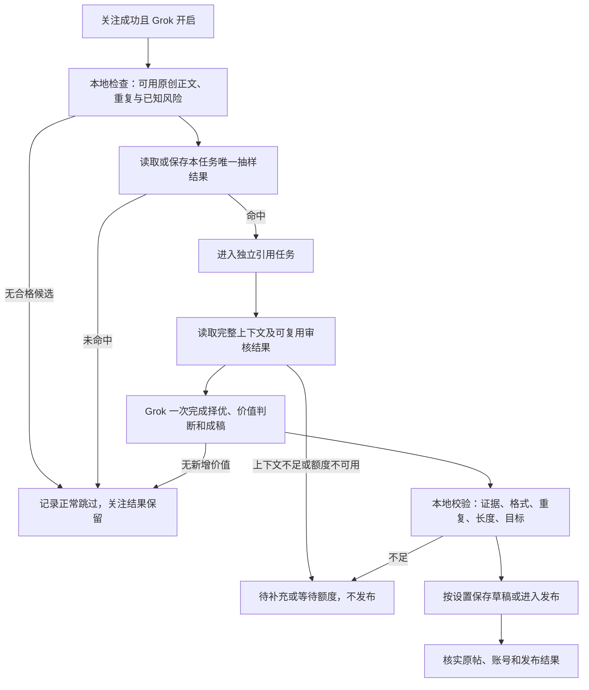

# 少发，但值得读：关注队列质量优先引用方案

创建时间：2026-10-26 11:53，北京时间；作者：wangsen。

状态：方案及核心实施记录。阶段一、阶段二已完成源码、自动化测试和隔离 CDP 验收，源码版本 2.18.0；长引用自动发布能力适配尚未完成，当前保留完整长草稿供人工处理。未替换共享 dist、重载运行扩展或执行真实公开发布。初始调研基线为 feature/recent-feature-tutorials 工作区 2.17.1，最近提交 4d79aed；实施前其他迭代已将源码更新到 2.17.2。工作区包含其他未提交迭代，不将其全部归入本需求。

## 1. 产品决策

将“关注成功后尽量评价”改为“关注完成后，按概率进入选题；只有能提供独立价值的内容才形成引用帖”。关注结果与评论结果独立，跳过评价是一种正常完成状态。

核心规则：

1. 新增“引用概率”，默认 **60%**，支持 **0—100% 整数**。抽样发生在引用流程的首次 Grok 调用之前，不先生成再丢弃。
2. 每个符合条件的关注任务只抽取一次，结果持久化。重启、刷新、调度重试不会重新抽取，避免最终人人都命中。
3. 命中仅代表获得选题资格，不保证发帖。Grok 可以从最近最多五条合格帖子中择一，也可以全部放弃；不因没有发够而补发。
4. 不再把长引用强行压缩到 280 加权字符。根据当前发布账号的实际能力和内容价值决定长度；写得长不是质量指标。
5. 先用同一次 Grok 请求完成选题、价值判断与成稿，不默认追加第二次模型自评。质量不足直接结束，不自动反复改写直到“通过”。
6. 沿用独立评论队列和现有发布结果核验，关注失败不能靠评论补救，评论失败不能重跑关注。

**60% 是参与概率，不是发帖完成率，也不是每日发帖目标。** 不承诺展示量提升，不把抽样当作规避平台限制的方法。

## 2. 现状核对与真正缺口

| 当前代码事实 | 对用户的影响 | 本次设计 |
| --- | --- | --- |
| follow-queue-runtime.js 在关注成功、grokEnabled 开启且有合格帖子时创建 automaticComment 任务，没有概率入口 | 大部分有内容的成功关注都可能进入 Grok 流程 | 增加一次性抽样并记录未命中原因 |
| 已有最近五帖、原创正文过滤、帖子去重和独立 comment-worker | 不需要重做调度或重建评论队列 | 复用现有任务、认领、结果及去重机制 |
| buildGrokCommentPrompt 已允许“无具体价值则跳过” | 不是完全没有质量判断，缺少可解释的标准和完整输入 | 明确值得引用的理由、证据与新增观点 |
| 提示词把每条候选正文截到 180 字符 | 只能看到片段，难以判断技术细节、前提和反例 | 读取完整可用正文；截断内容不冒充全文 |
| 提示词、超长修复、postQuoteOnTab 和 quote-tags 都存在 280 相关限制 | 仅修改提示词仍会被后续阻断或额外改写，浪费调用 | 统一账号能力与长度策略，贯穿生成、标签、预检、发布 |
| 引用任务还可能调用 evaluateProfileGrokRisk | 一次评论不一定只消耗一次模型请求 | 单独统计画像审核、选题成稿和技术重试的调用次数 |
| grokEnabled 与 autoPublish 是两个开关，默认均为 false | “开启 Grok”不等于默认自动发布 | 保留开关语义，草稿与自动发布分别表达 |

本次不改变关注资格、回关放行或关注前已有的风险审核。抽样省的是引用相关调用，不能为节约额度绕过关注动作本身的必要核验。

## 3. 平台能力与方案边界

X 官方说明，订阅用户可发表最长 25,000 字符的长帖，并支持长引用与回复。因此“基本无限制”应修正为“可充分表达，但仍有平台上限”。蓝 V 不作为本产品确认长引用能力的唯一证据；订阅能力、实际发布通道和编辑器能力需要分别确认。[X Premium 官方说明](https://help.x.com/en/using-x/x-premium)

X 允许符合其规则的自动引用，但禁止批量、激进或垃圾式转发；其自动化规则还明确限制网站脚本自动化。概率和较低频次不等于合规保证。当前仓库采用浏览器流程，自动发布通道的合规适配是实施前需解决的独立事项；本方案优先交付选题和草稿能力，不能把页面模拟点击包装成安全发布保证。本次讨论的是引用帖，不扩展成自动回复或主动提及。[X 自动化规则](https://help.x.com/en/rules-and-policies/x-automation)

以上资料查阅时间为 2026-10-26；后续实施需复核能力。没有查证到“多发引用必然降低展示量”或“改为 60% 必然提升展示量”的可靠依据，按用户观察提出可验证假设，不写成算法定律。

## 4. 用户配置与可理解的反馈

关注队列设置中的“引用评价”区域建议如下：

| 控件 | 默认或范围 | 含义与反馈 |
| --- | --- | --- |
| Grok 评价 | 保留当前开关；新安装关闭 | 开启后才启用本流程，关闭不影响已成功关注 |
| 引用概率 | 60%；0—100%，步长 1 | 决定是否进入选题；0% 暂停新的自动评价和未发布自动任务；100% 仍须通过质量审核 |
| 篇幅 | 自适应；可选精简、深入 | 自适应按原帖信息量表达，不设置必须写满的字数；平台能力始终有效 |
| 自动发布 | 保留当前明确选择；新安装关闭 | 关闭时合格内容保存草稿；开启时仅在发布能力确认后发布 |

常驻短说明：**“抽中后仍会筛选，内容不值得分析就跳过。未抽中不调用引用评价 Grok。”**

引用概率 tips：适用于新成功关注任务中的合格候选；按任务独立抽取，短期结果可能偏离设定比例；修改比例影响尚未抽取的任务，不重抽已有结果。关注动作不受影响。

保存行为：

- 空值、负数、小数、超过 100 均在字段旁显示“请输入 0—100 的整数”；保留输入，阻止保存，不静默恢复 60。
- 保存成功显示“已保存：引用概率 60%，篇幅自适应；对尚未抽取的任务生效”。后台未确认应用时只显示“已保存，等待后台应用”，不能提前说已生效。
- 设为 0% 后显示“自动引用已暂停，关注照常”；未提交的自动任务停在当前阶段，已发布内容不撤回，提交结果不明的任务继续只读核实。
- 队列头部摘要：“Grok 开启 · 概率 60% · 自适应 · 自动发布关闭”。不要要求用户进深层日志才能理解为什么没发帖。
- 不新增隐藏最低频率、隐式日上限或强制长文阈值。本方案中的成本边界须明示；现有发布节奏不在本需求中暗改。

## 5. 完整流程与概率口径

抽样单位为“发布账号 accountId + 关注任务 jobId + 任务创建代次”，不能用易变昵称或每次执行的 runId。任务自身重试沿用原结果；重新同步来源、重新打开面板、重新入队同一关注结果不得创建新的抽样机会。只在明确的新业务任务中创建新代次。

实现建议：使用浏览器原生随机数产生一次落在 [0,1) 的值 u，以 u < p/100 判定；在任务已认领且尚未调用 Grok 时，将 u、阈值、决策与时间原子写入现有任务记录。0% 必不命中，100% 必命中。并发认领冲突时采用已保存决策，不覆盖；不要每次 Math.random 后临时决定。

分母是通过本地预检、首次进入抽样的独立任务数，排除关注失败、重复任务、无合格原帖和 Grok 关闭的任务。不按整批凑足六成，也不提高剩余任务命中率来补偿跳过。

示例仅用于解释：100 个符合抽样条件的任务，60% 的期望命中数为 60，不保证恰好 60。假设其中 30 个得到有价值草稿，只有 24 个完成发布，则参与率约 60%、内容通过率 50%、实际发布率 24%；其余不是失败，也不补发。质量通过率是假设，不是当前实测。

手动“重新分析”是明确例外：展示“将消耗 Grok 调用，不受自动概率限制”，保留原抽样记录并增加手动尝试记录。不得自动把未命中任务转成手动任务。

## 6. Grok 的编辑判断：先决定值不值得写

不以粉丝量、蓝 V、点赞数或正文长度直接代替内容质量。原帖至少提供一种可分析材料：具体事实、论点、方法、数据、案例、产品变化或可检验的问题。

建议采用内部四维量表，每项 0—2 分，总分 8 分；这是待校准的产品规则，不是客观真值或平台标准：

| 维度 | 0 分 | 1 分 | 2 分 |
| --- | --- | --- | --- |
| 信息与依据 | 口号、空泛或证据不足 | 有具体观点但边界不清 | 有明确材料和可追溯依据 |
| 新增分析价值 | 只能赞同或复述 | 能增加一个解释 | 能给出机制、取舍、反例或可操作判断 |
| 受众相关性 | 与账号内容定位无关 | 有一定关联 | 直接服务既定读者需求 |
| 讨论与应用价值 | 无可讨论内容 | 有问题或启发 | 能帮助读者判断、应用或验证 |

建议起始通过线 6 分，且“信息与依据”“新增分析价值”不得为 0；所有合格候选中选择价值最高的一条，不是第一条。分数只辅助解释；结构校验失败、凭空编造事实、无法确定原帖身份等否决项优先。量表以首批人工审阅校准，不宣传为精确的内容质量算法。

允许且鼓励跳过：纯互关口号、没有信息的问候、重复宣传、仅能写出“说得好”、图片或视频缺少足够文字依据、断章取义才能分析、同一观点近期已经表达过。合理的短帖可以通过，复杂长帖也可以跳过。

合格引用至少回答：原帖提出什么；我的补充判断是什么；为什么成立；适用范围或不确定性是什么。按内容自然组织，不要求每篇固定四段。不能假装亲历、测试、看过视频或查过资料。

质量对比示例，均为虚构素材：原帖称“缓存让接口耗时从 800ms 降到 80ms”。低质量是“缓存太强了，值得学习”；有价值的引用应说明这一结果依赖命中率、数据新鲜度和失效策略，建议同时观察缓存未命中时的尾延迟，并明确这些是需要进一步验证的条件，不能补造测试环境。

## 7. 完整阅读、篇幅与长引用

### 输入完整性

保持最多五条候选，不扩大到大量历史帖以换取调用成本。先沿用已采集数据，发现正文被截断时，通过受支持的读取方式补充选题所需全文，并记录完整性。不能继续把前 180 字符交给 Grok，却称为认真分析全文。

缺少视频、图片、外链或关键线程上下文时，不能假设已经阅读。能独立成立的文本可以分析；论点依赖缺失材料则标记“上下文不足”。受输入预算影响无法完整提供的候选进入待补充或人工审阅，不截掉限制条件后自动发布。材料量上限依据实测模型输入能力确定并在日志显示，不把字符数当作精确 token 数。

### 输出长度

- 自适应为默认：一句话能说清就写短；需要论证再展开。中文 300—800 字可作为深度引用的写作参考，绝非硬性最低或必达目标。确有材料时允许上千字，不为了 Premium 容量凑字数。
- 开头先给核心观点，后续补依据、边界和启发；避免整篇复述、空泛结论和流水线模板。
- 不默认追加互关或推广标签。生成 0—2 个与主题直接相关的标签即可；现有用户自定义标签保留选择，但进入重复和相关性检查，异常时保留草稿并说明。
- 普通能力仍按已有 twitter-text 规则检查标准帖；长引用能力须核实订阅与发布通道，不能把旧 280 加权规则直接乘成 25,000，也不能仅删除检查。
- 统一 lengthPolicy 在提示词、解析结果、标签附加、发布前检查中传递。平台上限、产品篇幅偏好和模型输出预算是三个不同概念。
- 超过已确认能力时保留完整草稿，说明当前能力；不机械截断，不默认拆线程，不静默再花一次 Grok 额度压缩。用户可选择手动改短或切换有能力的发布方式。
- 能力未知时先生成草稿，自动长引用暂不提交；显示原因和重新核验入口。不要通过试发内容探测权限。

## 8. 调用成本与质量门槛如何配合

抽样在引用专用画像审核、选题生成之前完成。引用相关的既有审核结果可在同账号、同资料版本、同策略版本且仍有效时复用；资料或候选变化则失效。关注前的安全审核与引用前的内容质量判断分别记账，不把前者纳入“节省 40%”的宣传。

默认每个入选任务只做一次“选帖 + 判断 + 成稿”请求；五条候选放进同一请求，不逐帖调用五次，也不强制追加模型自评。模型明确跳过是终态。同一原帖被判定无价值后，自动重试不重新请求；用户明确手动分析或内容实质变更才允许新尝试。

有完整响应但格式错误：保留响应和原因，进入待审；不自动多轮修复。明确未发出的技术失败可沿用现有可证明未提交的重试策略，并显示次数；超时或响应未知先核对会话，禁止盲目再问。发布失败但草稿已保存时只重试发布核实，不重新生成。

长输出可能增加单次推理成本，所以调用次数下降不等于额度或 token 消耗同比下降。展示本产品观测到的调用次数、阶段及可用的输入输出长度；若 X 页面没有可靠剩余额度数据，显示“未知”，不伪造剩余次数。

## 9. 状态、日志与产品指标

沿用关注任务已完成状态，在 evaluations 内记录引用子状态。建议理由码区分：not_sampled、no_candidate、insufficient_context、quality_skipped、quota_wait、draft_ready、capability_unknown、publishing、posted、uncertain、failed。能映射既有状态时优先映射，不为展示文案重造一套调度器。

新增决策元数据建议包括：samplingVersion、sampleKey、sampleValue、probabilityAtDecision、sampled、sampledAt；候选 Post ID 与内容版本、完整性；selectedPostId、qualityDecision、各维理由、证据摘录、draft、language、lengthPolicy；各阶段实际调用计数；publishAttemptId、publishedPostId 与核验结果。模型理由写简短可审计摘要，不存储或索取内部思维链。

日志直接回答“为什么没发、是否花了额度、是否已公开”：

| 情况 | 用户可见文案示例 |
| --- | --- |
| 未命中 | @alice 已关注；本次未进入引用选题，概率 60%，引用 Grok 调用 0 次 |
| 质量跳过 | @bob 已关注；5 条候选均无足够新增分析价值，本次正常跳过，选题调用 1 次 |
| 上下文不足 | @carol 原帖依赖未取得的视频内容，未生成分析，未发布 |
| 长引用能力不明 | 深度草稿已保存；当前账号发布能力待核实，未提交 |
| 成功 | 已发布引用：原帖链接、发布帖链接、实际长度、选题理由 |
| 不确定 | 提交后未取得可靠结果；待核实，禁止重复发布 |

每次最终结果只保留一张主卡，轮次统计放详情；不要重复把单帖成功与汇总展示成两次发布。

指标分层：

- 成本：每百个抽样合格任务的引用请求数、画像审核请求数、技术重试数；有可靠 token 数据时另计。
- 内容：人工抽检的有效新增观点比例、事实错误率、近重复率、草稿采纳率及修改幅度。不能只看 Grok 自评分。
- 分发：同发布龄期的 24 小时、72 小时展示中位数及互动率；总展示量同时列出，避免只挑单帖漂亮数据。无数据记未知。
- 漏斗：合格任务 → 抽中 → 有价值草稿 → 提交 → 已确认发布，分别显示分母。

建议先观察一周或至少 30 篇可评审草稿；样本不足就延长观察，不强行发够样本。可与改版前同主题、相近时间和账号规模的内容作描述性比较；期间改了多个变量则不能将变化单独归因于概率。

## 10. 技术接入与复用取舍

| 入口 | 建议改动 | 明确不做 |
| --- | --- | --- |
| follow-queue-store.js | 新字段默认值、输入校验、抽样原子持久化、旧任务兼容 | 不另建概率服务或替换存储框架 |
| follow-queue-runtime.js | 本地预检后建立抽样决策；引用执行前核验开关与决策 | 不把 Grok 生成塞回关注执行期限 |
| comment-worker.js | 复用认领、quota_wait 与 uncertain；缺抽样决策的旧 pending 任务先补一次 | 不在每轮唤醒时重新抽取 |
| grok-comment.js | 完整候选输入、质量判断契约、统一长度策略；跳过终态 | 不只改提示词而保留旧发布阻断 |
| quote-tags.js | 按同一长度策略附加相关标签 | 不再写死 280 或默认堆互关标签 |
| 设置组件与日志 | 概率输入、真实生效反馈、选题原因和成本漏斗 | 不展示原始随机数等无助决策的实现细节；必要时放诊断 |

已核查开源 twitter/twitter-text：项目已有 ^3.1.0，仓库采用 Apache-2.0，提供文本解析和字符规则，适合复用标准帖计数；不能据此推断其覆盖当前 Premium 长引用的全部计数、授权或发布能力，实施时需验证。此次不为概率引入调度库，不为结构化判断另建模型代理；优先扩展已有解析器和独立评论 worker。[twitter-text 官方仓库](https://github.com/twitter/twitter-text)

抽样决策与引用任务认领的最小写事务只涉及当前账号对应任务及必要的去重记录。网络读取、Grok 请求、发布及 DOM 等待全部在事务外。提交前写入尝试记录，确认后记录结果；重启恢复先核对已发布证据，不能把 uncertain 改回 pending 重发。新字段是扩展现有记录，不以此设计引入全量数据库迁移。

## 11. 配置变更、旧任务与发布前检查

首次升级，缺少概率字段的账号使用 60%，明确显示更新说明；不改原有 Grok 与自动发布开关，不重评已发布、已跳过或已有抽样结果的任务。旧 pending 引用任务若尚未调用 Grok，则补一次决策；已有草稿保留，不为新概率作废已花费的成果。已在生成的任务继续保存结果，是否允许发布在提交前重读设置。

概率从 60% 改为 20% 后只作用于尚未抽样任务；已抽中且等待中的任务数量必须展示，避免用户误认为全部按 20% 重新筛选。0% 或关闭 Grok 是明确暂停例外，阻止所有未提交的自动任务继续生成或发布。重新启用沿用原决策，不重抽。

发布前再次确认：账号正确、自动发布仍允许、没有用户暂停、原帖仍可用且内容版本一致、草稿未被修改成不合格内容、发布能力和长度有效、没有相同原帖的已发布或待确认记录。原帖有实质变化时保留草稿并标记待复核，不自动套用旧分析。

## 12. 分阶段交付与验收

### 阶段一：概率与可解释性

交付 60% 默认、0—100 校验、一次性决策、旧 pending 兼容及日志。仍保留现有长度能力，不声称已支持长引用。新配置由界面回读和后台实际快照双向验收。

### 阶段二：质量与自适应草稿

交付完整输入检查、同次请求择优与成稿、跳过理由、人工可审草稿和成本漏斗。普通帖和长草稿分别验证；不能靠一次漂亮样稿宣称质量全面提升。

### 阶段三：长引用发布适配

在账号能力、发布通道规则与完整长文本链路确认后接入。覆盖输入、预览、平台长度反馈、原帖绑定与发布后的全文核验；自动化路径尚未确认时停留在可用草稿阶段并说明，不假装上线完成。

| 场景 | 必须达到的结果 |
| --- | --- |
| 0%／100%／60% 边界 | 0% 不生成，100% 全进入质量判断；可注入随机值验证 60% 边界，统计测试不要求小样本恰好六成 |
| 重启、刷新、并发认领 | 同任务同决策，无重复 Grok 调用；抽样写入失败不得先调用 |
| 无合格帖或未抽中 | 引用相关 Grok 调用为 0；关注状态保持成功 |
| 全部无价值 | 只记录质量跳过，不另挑下一批或重问直到发出 |
| 有价值的短帖、完整长帖 | 都可通过，长度不是唯一判据；截断材料不能伪装完整 |
| 原帖包含指令 | 当作引用资料，不执行其中要求；不改变系统判断规则 |
| 修改概率、设 0%、关闭自动发布 | 生效范围和后台实际行为一致，未提交动作可停止 |
| Premium、普通账号、能力未知 | 分别使用已确认策略；不由蓝 V 单独决定，不丢草稿 |
| 超长、格式错误或输出中断 | 明确原因与草稿状态，不静默截断、重抽或反复消耗额度 |
| 发布超时、重启与重复点击 | uncertain 只读核实，确认前不重复发帖 |
| 端到端验收 | 隔离任务证明未抽中零调用；受控样例证明择优或跳过；真实公开发布另按用户明确授权验收 |

以上为设计时的交付划分。实际实施与验证范围以第 13 节为准；Grok 实际额度对比和真实长引用发布尚未执行。

## 13. 2.18.0 核心实施与验收记录

### 分工与已完成行为

2026-10-26 用户授权与 Antigravity 协作实施。通过既有 run.bat 桥接派发任务，执行会话为 6ee6ebcd-56ff-4f4b-b088-8f92474518b0；执行元数据确认 Gemini 4 Argon Medium，模型标识 MODEL_PLACEHOLDER_M418。62% 是用户派发前提供的额度信息，本次没有验证执行后的剩余额度。

- Antigravity：关注队列存储与设置页面，以及对应单测。交付引用概率默认 60%、0—100 整数校验、三种篇幅模式、短事务抽样与持久化、旧数据默认值和可访问提示。
- Codex：执行链路、独立评论 worker、质量优先提示词与解析、正文完整性读取、长草稿保留、日志解释、版本同步、代码复查、回归与 CDP 验收。
- 文件边界避免交叉覆盖；保留工作区其他取关、日志、画像和帖子追踪迭代，没有提交或推送这些改动。

关注成功后，本地确认有候选正文和去重记录，再持久化一次抽样。未抽中直接保存 skipped 和 probability_skip，评论 worker 不进入 Grok；旧 pending 任务在首次处理时补抽样。修改普通概率不重抽已有任务，0% 暂停未提交的自动引用，关注结果保持独立。

主页读取只把 tweetText 正文且没有“显示更多”的材料标为完整。缓存或候选缺少完整标识时，评论任务打开对应原帖详情，只读获取完整正文；仍不完整、超出本次阅读预算或没有可用正文时，明确跳过且不调用 Grok。不会截取前 180 字符后假装读完。

队列引用使用质量优先模式，已有其他模块的标准短评路径保持兼容。原先独立的模型风险判断合入同一次选帖与生成提示词；本地检查继续执行。模型返回四项评分和一句具体价值理由：缺少完整判断的保留为待复核草稿，未达门槛则正常跳过。不会为超长或格式错误默认追加模型修复请求。

生成请求前先保存尝试状态。明确在提交前发现额度不足，保留稍后重试资格；已经提交后才遇限额或结果不明，记录 uncertain，避免重复请求。生成期间暂停也会保留已收到的草稿，提交前再次检查开关和账号。已发布结果不明确时只核实，不因主页暂未查到就自动补发。

设置显示引用概率与篇幅，非法输入在字段旁报错并保留原值；保存后回读持久化值。任务详情增加处理原因、Grok 调用记录和引用价值。长草稿及质量待复核草稿的发布按钮说明待复核原因，避免可点击却无法完成的误解。

### 验证结果与证据

| 层次 | 结果 | 范围与边界 |
| --- | --- | --- |
| Antigravity 定向测试 | 77 通过，0 失败 | 存储、原生 IndexedDB 行为及设置页面；Codex 另行复查其 diff |
| 最终完整单测 | 956 通过，0 失败 | npm test，包含质量选帖、完整材料、抽样边界、重启、防重复、暂停及额度前后边界 |
| 构建测试 | 54 通过，0 失败 | npm run test:build |
| 源码检查 | 通过 | 113 个源码模块语法，133 个 JS/Vue 文件浏览器调用契约 |
| 扩展隔离构建 | 通过 | scratch/build-tests/quote-quality-2.18.0，27 个文件、15 个 ESM 模块完整性校验 |
| 编译后的 UI 隔离 CDP | 通过 | 将真实设置组件、样式、存储与生成流程编译到独立测试页，通过现有登录 Chrome 的 CDP 在自建非激活标签验收 |
| 输入与保存 | 通过 | 默认 60；101 保留并报错；0 与 deep 保存、重开、存储值一致 |
| 浏览器流程 | 通过 | 未抽中任务只抽一次，状态保持 followed；质量测试生成一次且长草稿完整保留；模型响应为受控样例 |
| 桌面与窄屏 | 通过 | 1200px 与 375px；375px 抽屉宽 356.25px，输入完整可见，无页面横向溢出；截图已人工查看 |
| 真实运行扩展 | 未切换 | 未覆盖共享 dist、重载扩展、改真实设置、触发关注或发布；没有声称新后台已经生效 |

本地验收证据位于 scratch/quote-cdp-acceptance.json、scratch/quote-cdp-acceptance.png、scratch/quote-cdp-narrow.png；测试和构建输出分别位于 scratch/quote-full-final.txt、scratch/quote-build-tests.txt、scratch/quote-build-output.txt。scratch 是本地验收材料，不将其作为生产源码提交。只关闭本次创建的标签，原有运行标签保持不变。

### 仍未完成的范围

长草稿可按信息量展开并完整保存，超过当前已确认的 280 加权字符发布能力时，明确停留在草稿，不自动压缩或丢失。Premium 长引用的账号能力识别、发布通道适配和发布后全文核实仍属阶段三，不能把草稿支持说成已实现长引用自动发布。

本次没有实际调用 X 内置 Grok 做质量抽样，也没有真实发帖，因此不能证明生产额度节省比例、内容质量提升或展示量增加。以上功能测试使用注入的受控模型响应，仍需后续在真实运行版本中验证模型对新提示词的遵循情况。
