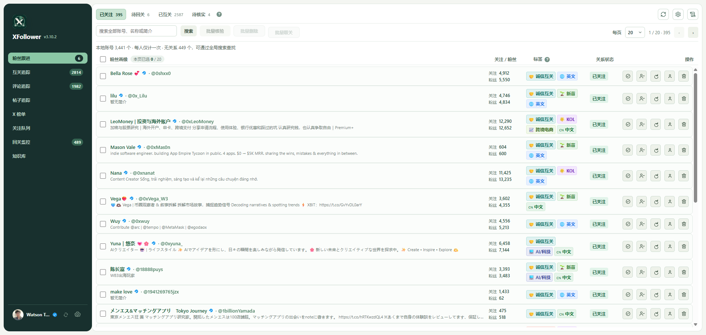
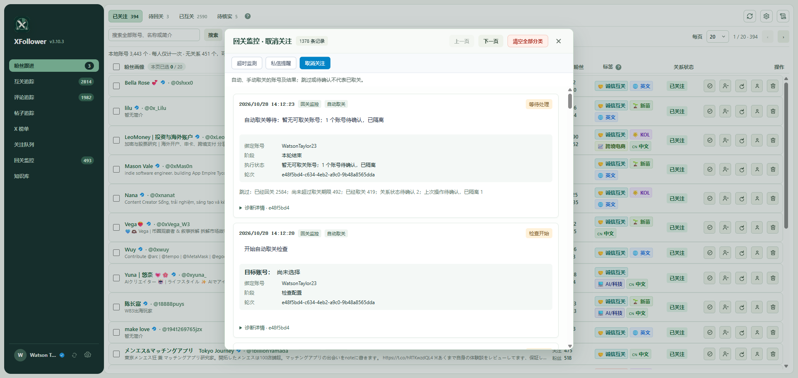

# 不存在账号双重确认清理与同轮递补

创建：2026-10-28 13:42；归档复核：2026-10-28 13:45；作者：wangsen；时区：Asia/Shanghai。

## 需求与根因

近期取关日志反复出现 `AUTO_UNFOLLOW_TARGET_MISSING`，`justkeepgoing01`、`real__cheng` 等主页实际显示“此账号不存在”。旧适配器在接口返回空资料时直接结束目标核验，保留记录并移到队尾；每轮最多检查五个目标，持续消耗调度周期。

用户要求接口与主页双重确认不存在后删除该账号本地数据，直接检查下一条，直到找到正常目标执行本轮取关或候选耗尽。中文、繁体和英文主页均需识别。

## 实现与边界

- `auto-unfollow-adapter.js` 对资料缺失增加只读主页复核。接口必须明确返回不存在错误或有效空资料，且目标主页的 `primaryColumn` / `emptyState` 明确显示账号不存在，才标记 `confirmedMissing`。核验使用任务自身创建的非激活标签，并在结束后关闭。
- 复用 `profile-access.js` 和 `page-reader.js` 的中英文空状态解析，避免匹配简介、帖子或推荐账号中的同名文字。网络异常、限流、权限错误、正常主页、加载中和封禁均不触发本次“不存在”清理。
- `network-client.js` 支持只读新鲜核验及返回原始不可用结果，避免旧缓存替代当前证据；收集双重证据期间不提前将单个接口不可用结果发布为终态缓存。
- 清理复用记录服务的 `deleteUnavailableAccount`，保留日志和既有持久化恢复机制。必须先完成持久化删除，再移除当前账号队列与待确认项。历史不确定操作的额度不返还，也不记成成功取关。
- 不存在目标不占普通关系核验五次上限。有限队列逐项推进，遇到正常账号仍执行原有条件检查、每日额度和每轮最多一次操作限制；普通身份未知目标继续按原有上限处理。
- 汇总与单条日志区分“清理不存在账号”和“已确认取关”，并保留账号、错误代码、清理数量及同轮编号。

## 代码与测试对照

| 文件 | 本轮职责 |
| --- | --- |
| `src/features/relationships/auto-unfollow-adapter.js` | 获取新鲜接口证据、读取目标主页、核验登录身份及调用持久化清理 |
| `src/features/relationships/auto-unfollow.js` | 删除完成后移出队列与待确认项、不占核验名额、同轮递补、清理日志与数量 |
| `src/platform/x/network-client.js` | 显式只读刷新及返回不可用原始结果，保留默认调用行为 |
| `tests/auto-unfollow-identity.test.js` | 双重证据、单证据保护、待确认清理与内部来源身份 |
| `tests/auto-unfollow.test.js` | 连续五个不存在后第六个同轮取关、全不存在及写入失败保护 |
| `tests/profile-access.test.js` | 终态缓存下的显式新鲜接口复核 |
| `tests/page-reader.test.js` | 简体、繁体及英文不存在文案识别 |

本轮复用记录服务和主页解析能力，没有另建删除存储或解析体系。`record-runtime.js` 等已有未提交改动不归入本轮七个业务与测试文件改动。

## 实机发现的接入错误与修正

首次验收清理时，内部 `service.handle` 调用未携带扩展来源，记录服务拒绝并显示“仅扩展内部可访问记录”。未放宽记录服务鉴权；适配器补充真实 `api.runtime.getURL('background.js')`，测试验证调用来源。重新构建加载后正常清理，调度恢复，异常提示自动解除。

## 验收证据

- 源码从生产 `master` 的 `3aca7ee` 创建 `feature/missing-account-cleanup` 隔离开发，检查后将本轮七个文件改动同步到已有集成工作区 `feature/queue-generation-recovery`，保留其他未提交改动。版本同步为 `3.10.2` 开发版，未提交、推送或发行。
- 最终核心测试 1262/1262，构建测试 54/54，源码检查 152 个模块、浏览器调用检查 181 个 JS/Vue 文件通过；构建校验通过。
- 新增覆盖连续五个不存在目标后第六个同轮取关、候选全不存在、清理失败保留队列、待确认目标清理、接口单证据不删除、API 错误不删除和新鲜接口复核。中英文解析覆盖简体、繁体、英文直引号与弯引号、`does not exist`。
- CDP 真实加载版本 `3.10.2`。2026-10-28 13:41:54 至 13:42:35，同一轮 `23fa8bab-d132-4946-b20a-f4409f0dad9e` 连续清理七个账号：`hid65628262`、`vhl717098394588`、`vhbxr28596338`、`JustKeepGoing01`、`real__cheng`、`Altruism540138`、`jdjdj30284`。逐条日志间隔约五至七秒，无需等待下个调度。
- 另一个此前已核实不存在的 `247520dzy` 由现有自动清理流程清除。重新查询这八个账号，非日志业务记录数均为零；原操作日志保留。
- 今日用量前后均为 49/200，本轮尝试 0、成功取关 0、清理 7；队列为空，`fofqyr` 原待确认项保留。实际本轮无正常可取关候选，因此“第六个正常目标同轮取关”由自动化用例证明，未将其表述为真实取关验收。
- 调度最终为 `waiting`，原因“待确认账号已隔离，暂无其他排队账号”；`automationHealth.alerts` 为空，记录“自动取关异常已解除”，页面黄条消失。
- 本机现场证据：`C:/jtmp/missing-cleanup-live-after.json`、`C:/jtmp/missing-cleanup-accepted.png`、`C:/jtmp/missing-cleanup-final-tests.txt`、`C:/jtmp/missing-cleanup-final-build-tests.txt`。这些临时现场文件不纳入版本控制。

归档复核读取了上述测试输出与现场 JSON，核对本轮源码和索引；本次文档整理未重新触发取关。恢复后的面板截图已复制到仓库，避免仅依赖临时目录图片：

## 补充验收：零操作不能显示执行成功

2026-10-28 14:04:56 的轮次 `8fd9b22a-5396-4bed-b63c-86eab3194818` 显示“成功 0 人，清理 0 个，尝试 0 人”，仍标为绿色执行完成。现场计数确认符合条件候选为零：492 个尚未超过期限、1 个操作待确认已隔离，另外为已回关、已取关和关系状态待确认。上一次双重确认与递补修复有效，但汇总代码仍将无操作轮次统一写为 `success`，导致用户误以为调度没有执行应做的任务。

3.10.3 对本需求补齐结果语义：

- 实际核实取关成功才写 `success` 并列出账号。
- 只清理不存在记录时写 `cleaned`，显示“清理完成”和数量。
- 无符合条件目标、剩余目标待核实或设置条件变化时写 `waiting`，显示具体等待原因；不生成“成功 0 人”文案。
- `followback-log.js` 兼容展示旧汇总，仅对自动取关、本轮结束、明确成功人数与处理次数均为零且成功账号列表为空的历史记录转换展示。原始数据、轮次和时间不修改。缺少证据或存在真实操作的记录不套用该兼容规则。
- `ExecutionLogsModal.vue` 使用展示摘要与状态，无操作汇总不再展示“目标账号：未记录”。跳过原因与完整原始诊断仍可查看。

补充测试覆盖无候选等待、纯清理结果、历史零操作展示与不修改原始记录，继续保留连续五个不存在账号后第六个正常目标同轮取关用例。最终核心测试 1264/1264、构建测试 54/54、源码及浏览器调用检查通过。

CDP 确认真实加载 `3.10.3`。14:12:23 新轮次 `e48f5bd4-c634-4eb2-a9c0-9b48a8565dda` 原始结果为 `waiting`，摘要“自动取关等待：暂无可取关账号；1 个账号待确认，已隔离”；截图所指 14:04:56 历史记录在界面显示“等待处理”，原始日志仍保留原来的 `success` 与计数。用量维持 50/200。现场本轮仍无正常候选，没有为了验收放宽到期、互关或待确认保护条件。

## 补充修正：空转检查不进入执行日志

3.10.3 仅修正结果文案，仍在每个无候选周期写入开始与等待记录，导致用户再次报告重复日志。3.10.4 将开始记录延迟到存在队列目标时写入，无候选且无清理的轮次只持久化调度状态与下一次计划。异常和有目标的待确认核验仍独立记录。

`execution-log-select.js` 在展示阶段收起明确符合条件人数、成功人数、处理次数均为零且无清理的历史自动取关汇总，以及同轮开始记录；保留同轮待确认事件、实际清理、真实成功和证据不完整的旧记录。原始历史日志不删除。

验证：核心测试 1265/1265、构建测试 54/54、源码和浏览器调用检查通过。CDP 加载 3.10.4，空队列下重新触发检查，调度更新时间推进，执行日志可见总数保持 1323，额度仍为 50/200。待确认账号 fofqyr 独立隔离，队列为空；此次修正没有自动重复提交其不确定操作。
