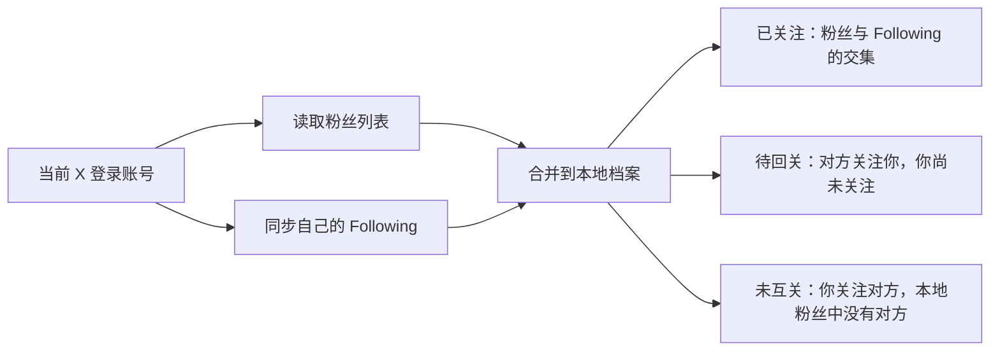

# 粉丝管理：获取列表、筛选与回关

“粉丝管理”用来累积自己的粉丝账号、辨认单向关系，并处理待回关账号。

## 第一次获取粉丝

1. 打开左侧“粉丝管理”。
2. 首次使用时点击空列表中央的“获取初始列表”；已有数据后可点击顶部的刷新图标（↻）增量同步。
3. 等状态栏显示本次读取数量、新增数量及累计本地记录数。
4. 首次扫描每次最多读取 3000 个账号；后续增量扫描会根据记录位点在读到旧数据后停止。很大的账号列表可以分次积累。

扩展优先尝试从 X 页面网络请求读取数据；模板不可用时会尝试从 X 粉丝列表页面读取。页面结构、登录状态或 X 的请求变化都可能使某次扫描失败，状态栏会显示原因。

## 三个列表分别表示什么

- **已关注**：在本地粉丝档案中，同时也被你关注的账号；它不是你全部 Following 的完整名单。
- **待回关**：对方关注了你、而当前记录显示你还没关注对方的账号。
- **未互关**：本地关注档案中你已关注、但本地粉丝资料里暂时没有对方的账号。它适合快速发现单向关注对象，点开账号资料人工核对即可。

“已关注”显示本地粉丝与本地 Following 的交集；“未互关”还会展示 Following 中未出现在粉丝档案里的账号。分类根据已经读取并累积的列表计算。首次未扫描完整、X 状态更新较慢或历史数据不完整时，可能出现近似结果；若某条记录看起来不对，点击“采集资料”或到 X 主页确认。

列表顶部可切换三种状态，搜索、分页、刷新和资料操作都在同一面板内完成。截图中的数量已遮蔽，实际账号行没有放入教程。

## 搜索、分页和资料

1. 在列表上方的搜索框输入账号、名称或简介关键词。
2. 使用右侧“每页”下拉框和左右翻页按钮浏览较长列表。
3. 点击某行的资料图标，右侧抽屉显示已缓存的账号资料。
4. 点击抽屉底部“采集资料”刷新公开资料和近期帖子；需要人工查看时点“在 X 打开”。
5. 需要 Grok 分析时，先勾选目标账号，再点“Grok 分析”。一次最多选择 20 个账号。

## 回关一个或多个账号

- **单个回关**：切到“待回关”，在目标行点“回关”图标。
- **一键回关与自动拉取入队**：点击顶部「一键回关」图标（或在设置抽屉中点击「立即检测并拉取入队」），系统会自动筛选出符合安全条件（自动过滤高风险账号）的待回关用户，一键推送至**统一关注队列**。关注队列将按计划对每个账号进行安全看帖、停留及仿真关注，无需在粉丝管理页面停留等待。
- 完成后状态栏显示已拉取的账号数，可直接切换到「关注队列」标签页查看实时执行进度。

## 粉丝管理独立执行日志

点击右上角「执行日志」按钮，可打开**粉丝管理专属日志弹窗**：
- 清晰记录每一轮检测的时间、当前粉丝数、关注数、待回关数、未互关数、本次新增粉丝数；
- 记录自动拉取到关注队列的账号清单；
- 与关注队列自身的看帖/评价日志相互隔离，专注呈现粉丝资产的动态变迁。

## 取消关注

“未互关”列表支持选择账号并使用“批量取关”。执行前会出现确认提示；只确认你确实要取消关注的对象。成功后该账号会从本地未互关列表移除或更新关系。

## 定时检测与自动回关设置

1. 点击粉丝管理右上方齿轮图标，打开设置抽屉。
2. 设置“定时检测周期（分钟）”和“随机浮动间隔（±分钟）”。
3. 勾选“自动将待回关用户拉取到关注队列”，新发现的符合条件待回关粉丝将自动推入关注队列处理。
4. 勾选“自动过滤高风险账号”，避免回关包含涉赌、涉黄等高风险特征的账号。
5. 勾选“开启后台定时检测与自动入队”，点击“保存配置”。到达周期时插件自动检测粉丝变动并执行入队。

