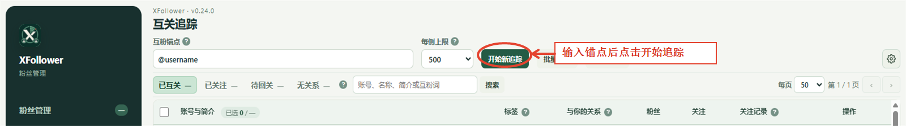
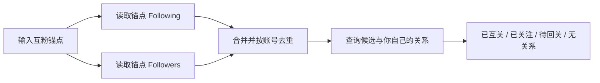
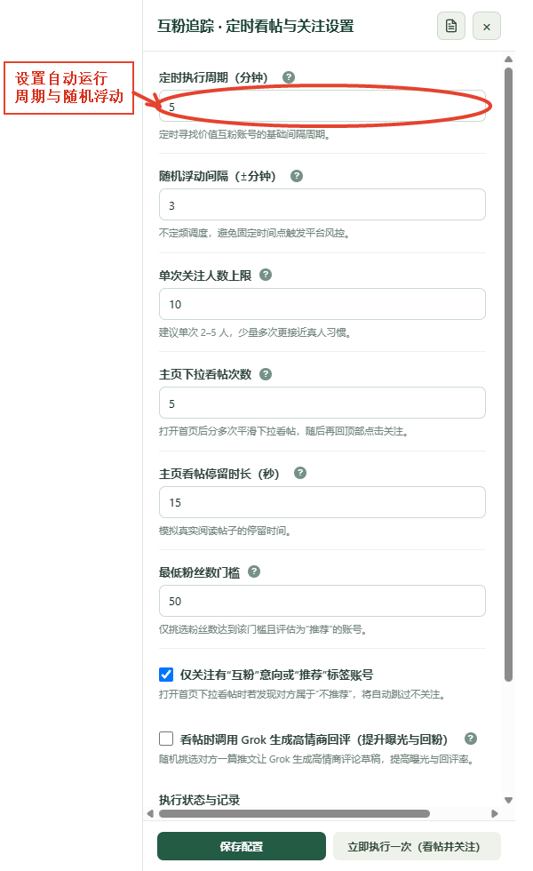

# 互关追踪：从锚点建立候选网络

“互关追踪”从一个你认可的账号（互粉锚点）收集它的 following 和 followers，再合并去重。重要的是，关系分类显示这些候选账号与你自己的关系；锚点只用来扩展候选来源。

## 收集一组候选账号

1. 左侧点击“互关追踪”。
2. 在“互粉锚点”输入 `@用户名` 或该账号主页链接。
3. 选择“每侧上限”（最多 500），即分别限制从锚点的 following 与 followers 读取的条数。
4. 点击“开始新追踪”，等待状态栏显示完成数量和错误信息。
5. 收集完成后，扩展会按账号去重，并保存在本地；以后可以继续扩展其他锚点。

初始列表由 X 网页数据和当前账号已收集的关系资料共同决定。若模板或页面数据不可用，状态栏会说明失败或回退情况；不要把一个空列表理解为锚点没有关注者。

## 用关系标签找到目标

列表上方的关系分类按你与候选用户的关系筛选：

- **已互关**：双方都关注对方。
- **已关注**：你关注对方，对方尚未回关。
- **待回关**：对方关注你，你还没有关注对方。
- **无关系**：当前本地记录没有显示双方任一方向的关注关系；也可能是关注关系尚未读取到。

锚点不是“你”的替代物；例如一个人关注了锚点，不等于他关注了你。关系资料还会随着粉丝/关注列表持续累积而更新，因此可以通过资料刷新和后续同步提高准确度。

## 搜索、更新资料与分析

1. 输入账号、名称、简介或互粉关键词后点击“搜索”。
2. 勾选目标行；如果没有勾选，点击“批量更新”会更新当前页。
3. 点击“批量更新”刷新公开资料和关注关系。
4. 选择最多 20 个账号后点击“Grok 分析”，让 Grok 按资料和近期帖子给出分类参考。
5. 查看标签提示、关系、粉丝/关注数和关注记录，再人工决定是否关注。

行内操作图标可悬停查看用途，例如关注、查看资料、扩展新锚点或刷新。以按钮提示文字为准，避免仅凭图标形状猜测。

## 自动看帖并关注

右上方齿轮打开“互关追踪 · 定时看帖与关注设置”。这里的开关默认关闭。开启后会根据候选质量和你设置的粉丝门槛，打开后台主页、分段看帖、更新帖子资料，并尝试关注符合条件的账号。

第一次建议先保持关闭，完成手动收集、批量更新和筛选。确定筛选规则后，再设置执行周期、随机浮动、每轮人数、看帖次数和停留时长，开启开关并点“保存配置”。“立即执行一次（看帖并关注）”会马上运行一批并可能产生真实关注，只有准备好实际执行时再点击。

定时到点但管理面板没有接到执行请求时，插件可能只发送提醒，要求保持管理面板打开。遇到失败或 X 限制时，先看状态和日志，不要连续重复触发。

