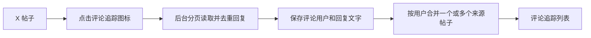
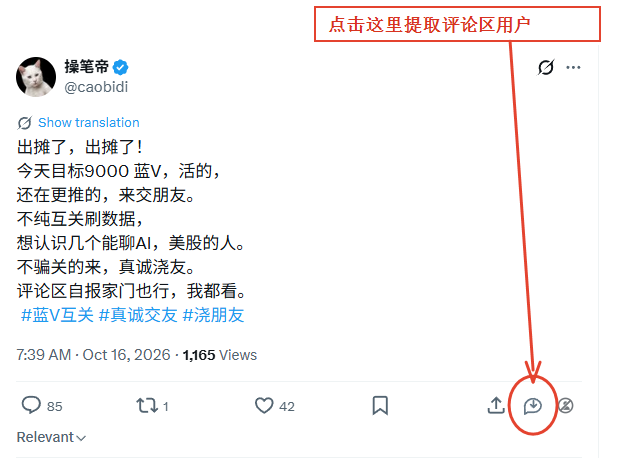
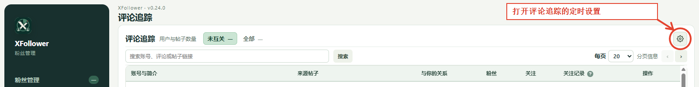

# 评论追踪：从帖子收集评论用户

评论追踪适合从一条 X 帖子的评论者中寻找可能愿意交流或互关的账号。每个评论用户会保留来源帖子；同一个用户来自多条帖子时，来源会合并展示。

## 从 X 帖子开始收集

1. 在同一浏览器配置中登录 X，打开目标帖子。
2. 在原帖下方的互动按钮行中，找到 XFollower 注入的评论追踪图标。它在回复、转发、喜欢、书签、分享等原有按钮旁边。
3. 点击该图标。按钮提示为“提取这条帖子的评论用户”。页面会提示任务已加入后台队列。
4. 切回扩展面板的“评论追踪”查看进度；无需在面板中另贴帖子 URL，插件会把帖子链接作为来源保存。
5. 完成后，评论用户出现在列表中，每一行“来源帖子”可打开原帖核对上下文。

下图是在真实 X 帖子页面通过浏览器会话采集的截图。红圈和箭头标出“提取这条帖子的评论用户”按钮；它是注入在 X 互动栏中的小图标：

收集结果会出现在扩展面板的“评论追踪”页。顶部提供用户筛选、搜索和分页，右上角齿轮打开独立的定时看帖与关注设置。下图分别标出了页面入口和设置项；截图中的本地记录没有展示。

[查看未标注的帖子互动栏截图](../images/x-comment-post.png)。截图只证明按钮出现在该帖子互动栏，不代表教程运行时实际收集了截图中的所有评论用户。

## 在评论追踪里管理结果

- **未互关**：显示本地关注资料未确认与你互关的评论用户；**全部**显示所有已收集用户。
- 搜索框可以按账号、评论文字或来源帖子链接筛选。
- 每个用户会显示“来源帖子”、与你的关系、粉丝/关注数、关注记录和操作按钮。
- 点击来源链接可回到对应帖子。若用户在多条被追踪帖子下评论，会看到多个来源。
- 点“查看近期帖子”图标打开侧边抽屉。首次查看会在后台读取该用户最近 5 条帖子；最近资料超过 7 天时会重新读取。新帖子会追加保留，历史最多 100 条。
- 点行内关注按钮会通过当前 X 会话尝试关注；成功、失败或已关注状态会反馈到行内记录。

## 一条帖子读不到评论时

查看面板顶部的状态信息。帖子链接和页面来源校验通过后，扩展会在后台分页读取 X 返回的回复并去重。单条帖子最多读取 3000 条回复，最多 150 页；超过安全上限或分页没有继续返回新内容时，可能只得到部分结果。私密账号、不可见回复、X 的登录/频率限制或页面变化也可能让收集失败。

## 评论用户的定时看帖与关注

评论追踪右上方的齿轮打开“评论追踪 · 定时看帖与关注设置”。这里的开关默认关闭。设置执行周期、随机浮动、每轮人数、主页看帖次数、停留时间、最低粉丝门槛以及意向筛选，然后点击“保存配置”。

打开“开启定时看帖并关注”后，后台会挑选评论追踪中的未关注用户，读取近期帖子并根据门槛决定跳过或尝试关注。点击“立即执行一次（看帖并关注）”会立刻处理一批，可能产生真实关注；先确认列表和筛选条件再执行。可从齿轮中的日志按钮查看成功、跳过、失败和帖子记录。

