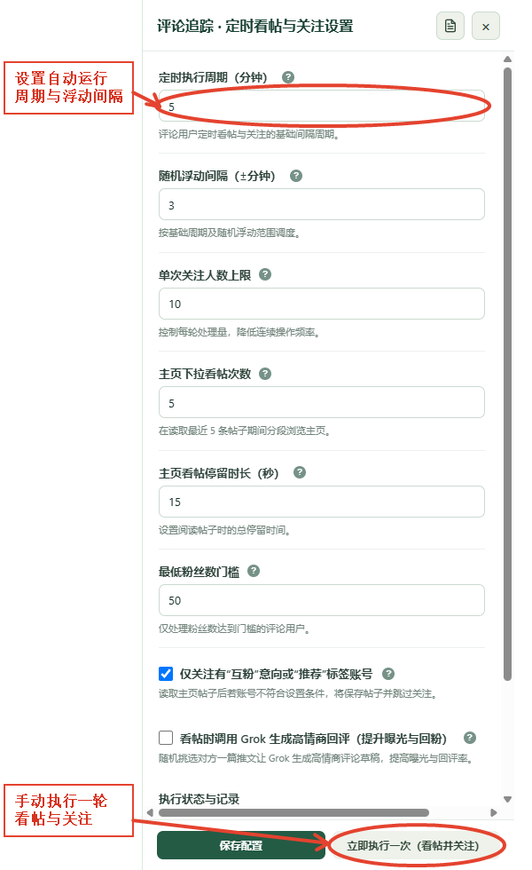

# 定时任务、近期帖子与执行日志

本篇说明不同模块的定时功能。打开开关前先看清抽屉标题：粉丝管理会更新关系数据并可自动入队；关注队列才会按独立调度看帖和尝试关注。

## 粉丝定时检测与入队

1. 在“粉丝管理”点击右上方齿轮。
2. 设置检测间隔、随机浮动，以及粉丝与关注列表各自的每轮上限（100–1000，20 的倍数）。默认每 10 分钟检测一次、每轮各 1000。
3. 需要自动接入关注队列时，打开“自动将待回关用户拉取到关注队列”和风险过滤；再向下滚动，打开“开启后台定时检测与自动入队”并保存配置。
4. 到时自动续读两个列表、更新本地档案。符合条件的待回关账号可入队；实际关注由关注队列另行调度。详情见[粉丝管理与回关](./02-粉丝管理与回关.md)和[关注队列](./08-关注队列.md)。

## 互关追踪定时看帖并关注

1. 先在“互关追踪”中收集锚点，并刷新候选资料。
2. 打开页面右上方齿轮，检查执行周期、随机浮动、每轮人数、看帖次数、停留时间、最低粉丝数和“仅关注有互粉意向或推荐标签”选项。
3. 点击“保存配置”。
4. 准备好自动操作后，再打开“开启定时看帖并关注”。可点击“立即执行一次（看帖并关注）”手动启动一轮。
5. 定时任务如果未在面板中执行，会提示保持管理面板开启。可在抽屉中查看上次执行状态和详细日志。

## 评论追踪定时看帖并关注

在“评论追踪”的齿轮抽屉中，单独配置评论用户的周期、每轮人数、看帖参数、粉丝门槛和互粉意向筛选。这个开关和互关追踪的开关彼此独立；关闭其中一个不会自动关闭另一个。点击“保存配置”保存，点击“立即执行一次（看帖并关注）”会立刻尝试处理一轮。

## 看懂执行日志

1. 打开互关追踪或评论追踪的设置抽屉。
2. 点击标题旁的日志图标。
3. 查看目标用户、执行时间、看过的帖子和结果说明。
4. 结果可能是关注成功、跳过、失败或触发频率限制。失败时先阅读原因；如果显示 X 限制，等待一段时间再试。
5. “清空日志”会删除本地执行记录，无法从此处恢复。

## 帖子历史如何保留

评论追踪每个用户的近期帖子历史最多保留 100 条。首次打开“查看近期帖子”会读取最近 5 条；达到 7 天后再次打开会刷新并把新帖并入历史。旧帖子会保留到历史上限，不会因为刷新就只剩最新 5 条。帖子内容便于之后人工查看或作为分析资料。

