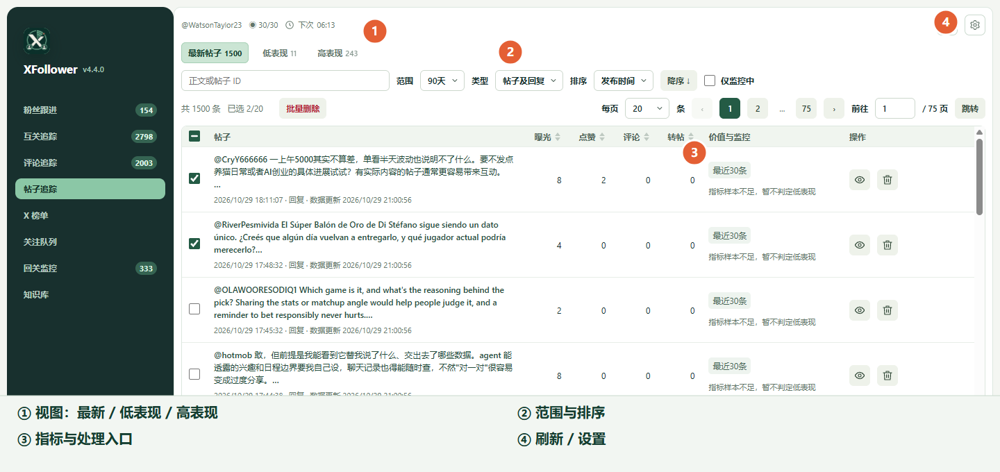

# 帖子追踪：看表现、做保留与删除

“帖子追踪”读取当前登录账号自己的帖子及回复。先用指标筛选，再决定保留、保护或删除。写作经验由知识库的批量分析生成，不在帖子追踪里逐帖提炼。

1. 在左侧打开“帖子追踪”，确认标题下方显示的是自己的 X 账号。点右上角刷新图标更新；首次无数据时可在齿轮设置中使用“补齐90天”。
2. 用“最新帖子 / 低表现 / 高表现”切换视图，再按范围、类型、发布时间或指标缩小结果。表头也可以排序。“低表现”只是指标初筛，不能直接等同于应删除。
3. 点某行的查看图标打开详情抽屉，阅读完整内容、数据表现和监控快照。最近 30 条的监控状态在标题下方显示。
4. 勾选 1–20 条帖子可用于批量删除；保留、保护与删除操作在行内或详情抽屉中完成。
5. 齿轮内可设置定时检测间隔、每批上限、复查周期和低表现规则；需要立即处理一批时点“立即执行”。请求遇到冷却时等倒计时结束。

删除入口会先列出待删除帖子的完整清单并要求再次确认。删除自己的帖子无法恢复；批量删除逐条处理，单条失败或结果待核实时保留该条结果并继续其他条目。未取得明确回执的条目不能自动重发；账号切换或页面不可用等整体条件异常会影响后续处理。教程不要求实际删除任何帖子。

知识库的状态筛选、类型和新增入口见[近期功能图解教程](./61.%20近期功能图解教程_20261027_0919_wangsen.md#使用知识库)。经验由知识库按批量样本生成，帖子追踪不产生经验。
