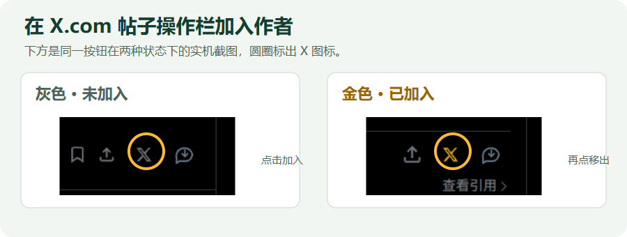
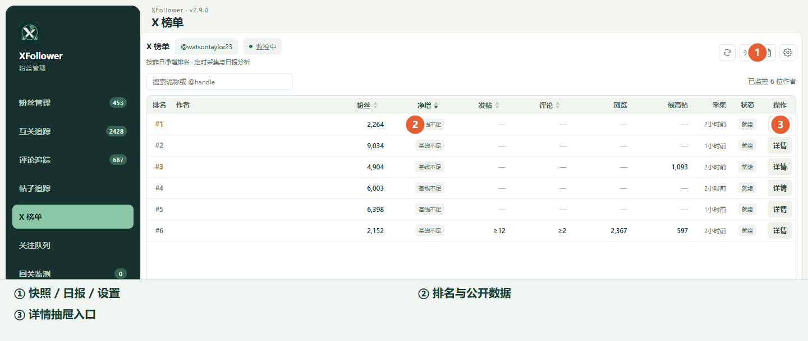
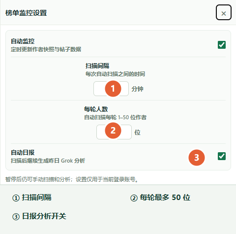

# X 榜单：收藏作者、查看快照和日报

在 X.com 任意用户的帖子操作栏里，找到扩展的 **X** 图标。下面两张实机截图分别展示未加入和已加入状态；这里放大并圈出了按钮。

灰色表示作者尚未加入榜单，点击后加入；金色表示已加入，再点可移出。加入后到扩展面板左侧打开“X 榜单”查看作者。图标属于**帖子作者**，并不是把这条帖子单独收藏。

1. 表格按作者展示粉丝数、昨日净增、昨日发帖/评论、公开浏览样本、7 天最高帖及采集状态。点“详情”打开抽屉查看完整数据和帖子样本；表格中放不下的内容不会撑宽列。
2. 右上角刷新图标立即扫描快照；文档图标打开“优质帖子日报”；旁边的分析图标可以触发昨日 Grok 分析。齿轮打开监控设置。
3. 每轮扫描人数可设为 **1–50 位**。开启自动监控后按所设间隔采集；“自动日报”会在扫描后继续生成昨日分析。

“昨日净增”需要相隔约一天的两次有效粉丝快照；刚加入作者时显示“基线不足”是正常状态。日报按有效净增挑选前 10 位作者，并对每位作者最多 30 条昨日帖子做分析。若跨日快照尚未齐全，日报不会凭空算出涨粉或生成完整结果；等下一次真实快照后再看。
