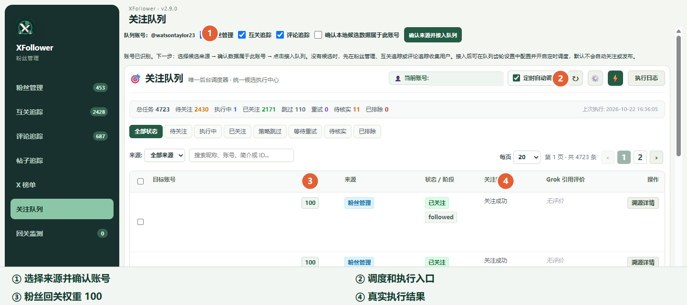

# 关注队列：核对来源、权重和执行结果

粉丝管理、互关追踪和评论追踪收集的候选人会进入统一关注队列。首次使用先核对顶部的队列账号，并勾选要接入的来源；确认来源后，列表才会汇总对应候选。

1. 在顶部确认当前登录账号以及来源选择，点击“确认来源并接入队列”。如果来源未勾选，先回到对应模块采集或选择来源。
2. 看“待关注、执行中、已关注、策略跳过、等待重试、待核实、已排除”统计。可按状态和来源筛选，也可搜索账号。
3. “权重”列可排序。现版确认待回关为 **200**，其他粉丝来源通常为 **100**；在可执行且符合安全条件的任务中，高权重优先，同权重按入队时间处理。上图是历史版本截图，权重口径以本段和现版提示为准，账号资料列已遮蔽。
4. 点“溯源详情”查看为什么入队；右上齿轮检查执行周期、看帖和账号筛选条件，再决定是否开启定时调度。闪电按钮用于手动启动一轮，可能在 X 上产生真实关注行为。
5. 有异常时先查看“执行日志”和任务状态；明确确认不存在或不可用的账号才进入相应终态。身份、关系或操作结果未知时保留待核实，不能据此判为不可用。明确尚未发送操作的中断任务可恢复为重试，已发送或阶段不明的任务不能盲目重放。

权重决定队列处理顺序，不保证每个高权重账号都会被关注。风险过滤、关系核实、频率限制和任务状态仍会影响实际执行。

三种创作形式、Cloudflare 配图、评价重试与“待回关放行”的现版截图和操作步骤见[近期功能图解教程](./61.%20近期功能图解教程_20261027_0919_wangsen.md)。
