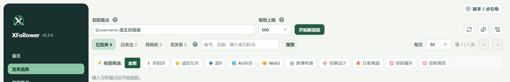
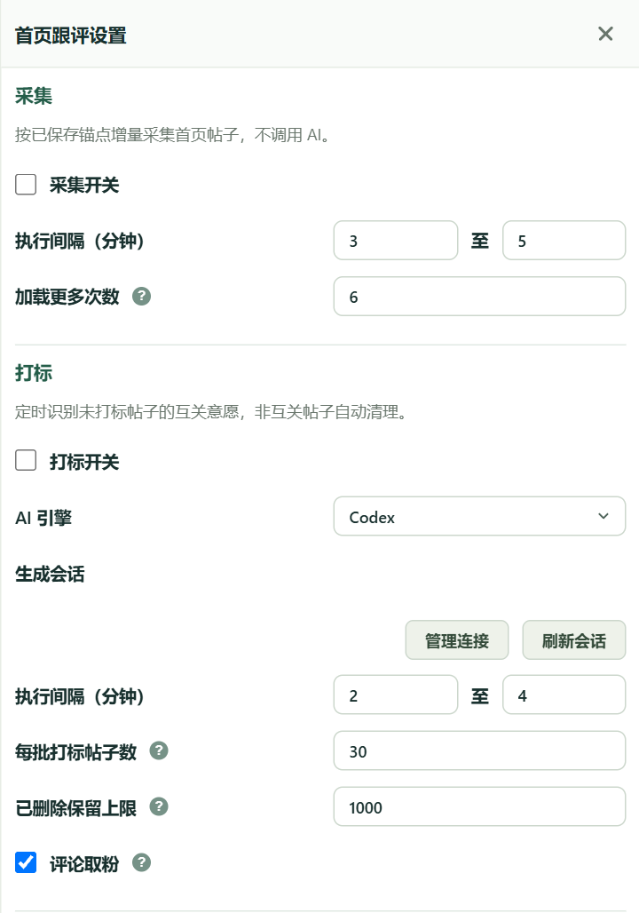
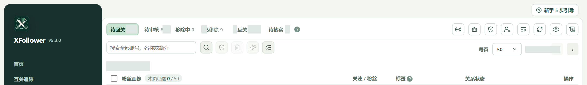
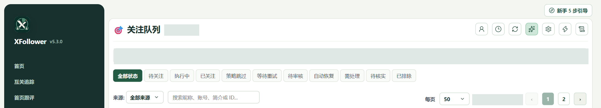
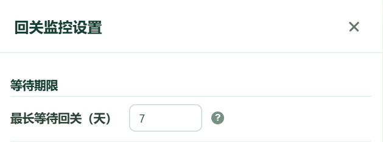

# XFollower 五步运营专栏文章（中文 / English）

> 在线阅读：中文专栏 [goodexts.com/zh/blog/xfollower-growth-loop](https://goodexts.com/zh/blog/xfollower-growth-loop) · English [goodexts.com/blog/xfollower-growth-loop](https://goodexts.com/blog/xfollower-growth-loop) · 方法来源：[Winston Wang 的 X 专栏](https://x.com/WatsonTaylor23/status/2118580622063239351)

---

# 从一个同行开始：用 XFollower 跑完 5 步 X 运营循环

你刚决定在 X 上用英文聊一个具体话题。简介已经写好了，也发了第一篇教程。打开首页，看到的却是几个完全不同的圈子。你想认识会讨论这个主题的人，却不知道先从谁开始，也不知道过一周该回头检查什么。

可以先做一次小规模循环。找一位相关同行，参与一场真实讨论，处理已经向你挥手的人，再审查值得关注的对象。最后留出一次复核。XFollower 把这些动作放在左侧连续的入口里，你可以随时停在某一步查看结果。

## 1. 用一个同行锚点缩小搜索范围

假设你做的是给小团队用的 WhatsApp 工具。比起搜 `follow back`，先看看谁在讲跨团队交接、社群管理或者联系人整理。你可以从「互关追踪」推荐种子开始，也可以在 X 的「最新」里同时搜主题与交流意图，例如 `"WhatsApp Business" "workflow"`。点开最近原创帖，看看评论里有没有从业者分享自己的做法。

挑一个观点、语言、受众都和你接近的账号，将其填入锚点。把第一批候选当作一份阅读清单。判断一条很简单：如果今天没有回关预期，你还愿意读这个人的下一条帖子吗？留下能清楚回答这个问题的人。

## 2. 在首页跟评发现人，再到评论提取核对来源

你可能已经关注了一批同行，首页里也会出现他们发起的交流帖。先开启采集与打标，看看「首页跟评」选中了哪些话题。在设置的「打标」区启用「评论取粉」后，符合条件的评论者进入候选流程，权重 180。打开「评论提取」检查记录。普通单帖提取独立记为权重 90。

内置 X Grok 可以帮你起稿。比如有人问“团队把联系人从群里整理出来后怎么交接？”你的评论可以具体到“我们在表格里保留来源群和最后接触时间，同名联系人先核对号码”。先检查这是你有经验支持的说法，再决定回复。读到评论的人应该能立即知道你能帮什么忙。

## 3. 看通知，再处理已经关注你的人

发帖之后，通知里可能出现新关注。「通知监控」让你看见这个信号。回到「粉丝跟进」的「待回关」，再核对对方是否已经关注你、你是否已经关注对方，以及你是否想在时间线上继续看到这个人。确认的待回关进入队列时权重 200。先处理已有明确互动意愿的人，通常比从陌生名单里挑更省时间。

## 4. 用关注队列审查四路候选，引用时补一条真实经验

四路候选在「关注队列」汇合。确认待回关 200，首页互关帖评论者 180，普通评论提取 90，互关追踪 80。把权重当作审查顺序。选中候选前先确认来源、主页及关系状态。有一条状态未核实，就查对应日志和原操作，再作决定。

关注只是开始。看到合适的原创帖时，用引用分享一个具体例子。例如“CSV 便于导入 CRM，但我会先把电话号码列设为文本，避免表格工具改变号码格式”。如果这条内容只剩互粉标签就失去意义，先回去想想你能补充什么。与主题无关或没有经验可分享时，阅读即可。

## 5. 在 7 天后复核关注，回到第一步

把 **7 天** 当作一次复盘的起点。在「回关监控」检查逾期项，保留你本来就愿意持续关注的客户、作者和合作方。只有在关系已核实、你也确实不打算继续关注时，才决定是否清理。默认期限与推荐值可能不同，设置时以界面为准。

回到「互关追踪」之前问自己三个问题：哪个锚点带来的讨论最相关？哪条评论让人追问？哪里最容易出现不确定状态？如果一个锚点带来太多无关账号，换同行。如果一个话题反复有人问，用「帖子追踪」保留原始反馈，查「X 榜单」找同领域内容参考，再把有效素材收进「知识库」。下一轮可以从一篇回答问题的新帖开始。

## 用第一次循环判断是否适合你

今晚只尝试三件事：挑一个锚点、审查一小批候选、留一条你愿意署名的评论。下一次打开面板时，看有没有真实同行回应、带来问题或成为你想长期阅读的人。等你对这些信号有了感觉，再考虑哪些步骤值得定期安排。

在 Chrome 安装 XFollower 后可从内置 X Grok 开始。需要本机 Codex、Antigravity 或 WorkBuddy 时，再连接 AgentRelay。安装流程和最新授权说明见 [XFollower 产品页](https://goodexts.com/zh/xfollower)。

---

# Start with one relevant account: A five-step X workflow with XFollower

You have a clear topic, an updated bio and your first useful post. But the X timeline still feels like five unrelated conversations. How do you find people who care about your work, and what should you check a week from now?

Try one small cycle. Start with a relevant account, contribute to a conversation, review people who have already followed you, and decide whom you want to keep reading. XFollower groups those actions into five steps. You can review what happened before moving on.

## 1. Start with a relevant account

Say you build WhatsApp tools for small teams. Search for the work those teams do: handing over customer chats, organizing group contacts or keeping support records. In X search, try `"WhatsApp Business" "workflow"` and sort by Latest. You can also start with a suggested account in Mutual Follow Tracking. Open a few recent posts and look at who is having useful conversations.

Choose one relevant account as your starting point. Review the candidate list as you would a reading list. Would you still want to read this person tomorrow if they never followed you back? Keep the accounts that pass that test.

## 2. Find ongoing conversations on your timeline

Start with collection and tagging in Home Timeline Replies and review the posts it finds. When you enable commenter discovery on mutual-follow posts, qualified commenters can enter the candidate workflow with weight 180. Review each source in Comment Discovery. A one-off extraction from an ordinary post carries weight 90.

Use X Grok to draft a reply and add something you can stand behind. If someone asks how to hand over contacts from a WhatsApp group, you might explain why you keep the group name and the date of the last customer interaction in separate columns. The details give readers a reason to ask a follow-up question.

## 3. Review people who already followed you

Notifications can surface new followers. Open Follower Review to confirm the relationship and see whether you already follow the person. Take a look at their recent work. Confirmed accounts awaiting a follow-back carry weight 200, so they come first for review.

## 4. Use the queue to decide whom to follow

Four sources meet in the queue: confirmed follow-backs (200), commenters on mutual-follow posts from the timeline (180), ordinary comment discovery (90) and mutual follow tracking (80). Review the source, relevance and account relationship before taking action. If a follow is still being verified, check the original task and its log before trying again.

When you find a good original post, use a quote post to add a practical detail. For example, set phone numbers to text before opening a contact CSV in a spreadsheet so the tool does not change how the numbers are displayed. Quote when you have a concrete point to add, and review the draft before publishing.

## 5. Review after 7 days and begin the next cycle

Use 7 days as a starting point for your follow-back review (starting in v5.3.1, 7 days is also the default follow-back deadline for newly configured accounts, while existing custom settings are preserved). Check overdue entries and keep authors, customers and collaborators you want to follow for their work. Confirm the relationship before taking action on an account you no longer want to follow.

Then ask which starting account led to relevant conversations and which replies sparked useful questions. Use Post Tracking to find the original feedback, look at examples from relevant accounts in the X Leaderboard, and save useful notes in the Knowledge Base. A question that came up twice is a good candidate for your next tutorial.

For your first cycle, choose one starting account, review a small group of candidates and write one reply you are happy to put your name on. Start with the built-in X Grok. You can connect AgentRelay later if you prefer Codex, Antigravity or WorkBuddy. See the [XFollower product page](https://goodexts.com/xfollower) for the Chrome installation steps and current activation options.
