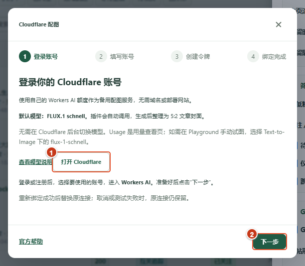
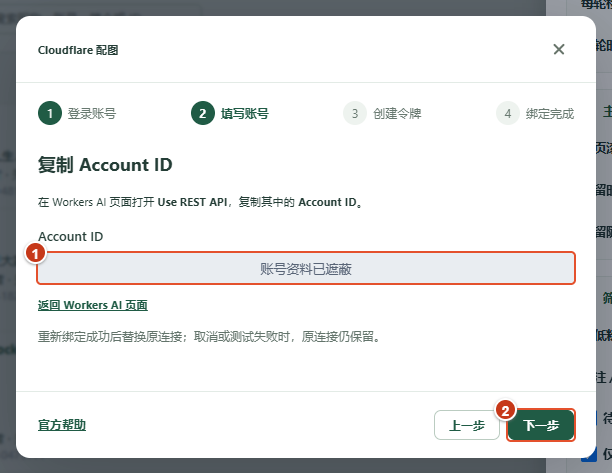
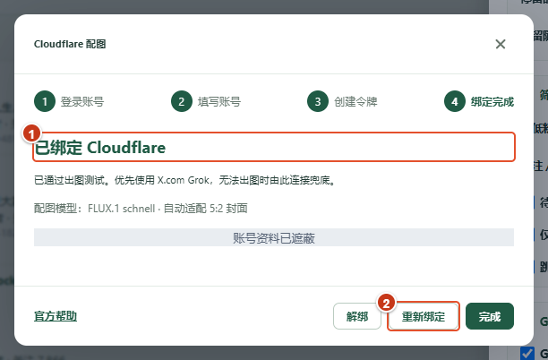
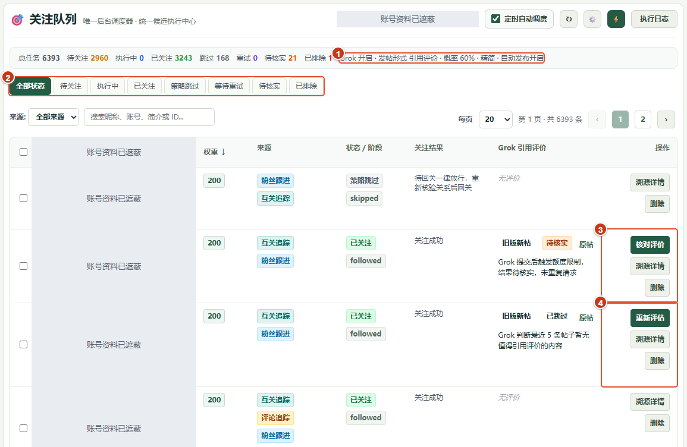
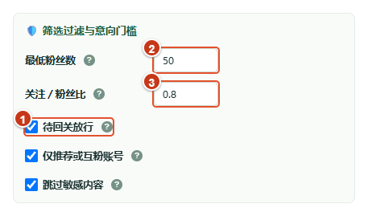
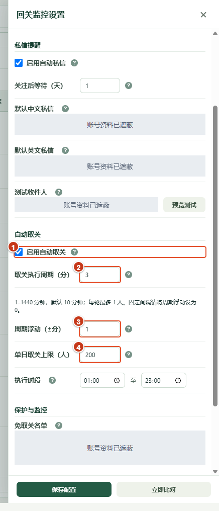
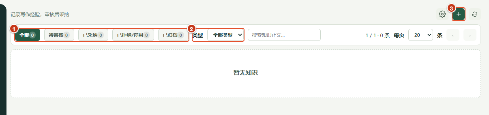

# 近期功能图解教程

适用版本：XFollower 3.2.7。截图时间：2026-10-27，作者：wangsen。

本教程介绍近期新增的创作形式、备用配图、评价处理、待回关放行、自动取关设置和知识库。图片来自 CDP 连接的真实扩展页面；红色编号对应下方步骤。账号资料、Account ID、私信文案及保护名单已遮蔽。图中数值和开关是现场已有配置，不是推荐值，也不是首次安装默认值。

| 想完成的事 | 从哪里开始 |
| --- | --- |
| 选择评论、引用评论或文章 | [配置创作](#配置创作) |
| 为文章增加备用配图服务 | [连接备用配图](#连接备用配图) |
| 判断评价为什么跳过、是否应重试 | [读取评价结果](#读取评价结果) |
| 让确认待回关的粉丝跳过普通筛选 | [使用待回关放行](#使用待回关放行) |
| 配置超时未回关处理 | [设置自动取关](#设置自动取关) |
| 保存有依据的写作经验 | [使用知识库](#使用知识库) |

## 配置创作

入口：左侧 **关注队列 → 右上角齿轮 → Grok 创作与发布**，设置抽屉可以向下滚动。

1. **Grok 自动创作**：开启后，关注成功的任务可按设置进入创作流程。开启创作不等于一定生成，每次还会受到参与概率、素材质量和服务额度等条件影响。
2. **发帖形式**：三选一。评论发在原帖下；引用评论附带原帖卡片；文章生成标题、分节正文、短描述与封面。新配置默认引用评论；选择引用评论不会同时调度文章，已有任务仍保留创建时的形式。
3. **配图入口**：未连接时显示“连接文章配图服务”；图中已连接，显示“Cloudflare 已绑定 · 管理”。文章优先使用 X 内置 Grok 配图，失败或额度不足时才使用已连接的 Cloudflare 兜底。
4. **创作概率**：决定是否参与本次创作。图中 60% 是已有设置；没有抽中时不会调用 Grok，抽中后仍可能因素材质量不足而跳过。
5. **篇幅**：按需要选择自适应、精简或深入；实际内容还会受发布校验约束。精简引用超长时最多尝试一次缩写，仍不合格则保留草稿。
6. **自动公开发布**：关闭时保存创作草稿；开启后，符合条件的任务可按选定形式直接公开发布。初次尝试建议先关闭，检查生成结果再决定是否开启。

调整完成后点击抽屉底部 **保存配置**，关闭并重新打开确认；再核对队列顶部的形式、概率、篇幅和发布状态摘要。尚未保存的选择不能视为后台已生效。截图采集没有修改或保存现场配置，也没有生成或发布内容。

文章依赖账号的 X Articles 能力与可用页面。标题、正文、描述、封面等条件未通过时，先读具体原因；不要用“有正文”判断发布已经成功。文章描述按 256 加权字符校验，和普通帖子的长度规则不同。

## 连接备用配图

入口：上图编号 3。只有需要备用配图时才接入；绑定成功后仍优先使用 X 内置 Grok。

1. 点击编号 **1“打开 Cloudflare”**，登录自己的账号，选择准备使用的账号并进入 Workers AI。无需域名或部署 Worker。插件指定使用 FLUX.1 schnell，再整理为 5:2 封面，无需在后台手动切换模型。
2. 回到扩展，点击编号 **2“下一步”**。

3. 在 Workers AI 的 **Use REST API** 中复制 Account ID，填入编号 **1** 的输入框，再点编号 **2“下一步”**。Account ID 应为 32 位账号标识，不能把 Token 填到这里；无效输入会在原处提示。截图中的输入区域已遮蔽。
4. 在接下来的“创建令牌”步骤，按页面说明创建 **Workers AI API Token**，账号范围选择刚才的账号，权限包含 Workers AI 的 Read 和 Edit。将 Token 填入密码框，点击 **测试并绑定**，按需授权域名访问。
5. 等待测试图和成功页出现，再关闭弹窗。测试会消耗 Workers AI 用量；额度与账号内其他 Workers AI 使用共享，付费计划可能产生费用。仅接口可访问或输入框有值，不代表绑定成功。

6. 再次打开后，编号 **1** 显示“已绑定 Cloudflare”；编号 **2“重新绑定”** 用于更换连接。重新绑定测试成功前保留旧连接，取消或失败不会替换它。“解绑”删除本机保存的连接；需要撤销令牌时还应前往 Cloudflare 操作。

本轮只展示现有连接管理、重新绑定前两步并取消，没有填写或导出 Token、点击“测试并绑定”、消耗出图额度或改变已有连接。“创建令牌”和实际测试出图步骤依据现行界面与实现说明，未在本轮重新执行；已绑定页反映此前的连接状态。

## 读取评价结果

入口：**关注队列**，结合“关注结果”“Grok 引用评价”和“操作”列阅读。兼容列标题仍称“Grok 引用评价”，行内会显示任务实际采用的形式。

1. 编号 **1** 是当前配置摘要；行内的“旧版新帖”等形式属于历史任务，不能仅凭顶部当前模式推断所有旧任务都已改变。
2. 编号 **2** 可按状态筛选。先定位“待核实”或“等待重试”，再读具体原因，不用反复手动启动整轮。
3. 编号 **3“核对评价”** 对应已提交但结果不明确的记录。图中为额度限制后的待核实记录；先核对已有结果，避免重复请求或重复发布。
4. 编号 **4“重新评估”** 对应素材质量跳过；确认确有新的素材或值得再评估后再使用。按钮会发起处理，不能当成纯查看入口。其他可重试失败可能显示“重试评价”，已有草稿可能显示“发布评价”，按行内实际状态处理。

| 看到的结果 | 如何理解和处理 |
| --- | --- |
| 未抽中概率 | 本轮未参与创作，不是 Grok 故障 |
| 已跳过，素材质量不足 | 查看跳过原因；需要时主动重新评估 |
| 正在读取、生成或核验等阶段 | 正在处理；留在当前行观察反馈，避免重复点击 |
| 待核实 | 已发送或阶段不明的动作不能盲目重放，先核对 |
| 等待重试 | 按失败原因和冷却状态等待后续调度 |
| 已关注、无评价 | 关注和创作是不同结果，不等于创作失败 |

3.2.7 会将**明确尚未发送操作**的中断任务恢复为可重试，并防止同一轮反复领取刚失败的任务；已发送或阶段不明的任务继续待核实。历史日志中的“待执行”只表示记录当时状态，以当前任务及后续记录为准。

截图使用真实历史结果，未点击核对、重试、重新评估或发布。本轮没有为了录制进度而额外调用 Grok；处理阶段的说明依据现行实现，不将静态截图当成全流程执行证明。

**3.3.1 恢复流程补充**：正文未保存、且记录确认只进入过生成阶段时，“核对评价”会保留历史并转为“待生成”，按钮改为“重新生成”。重新生成后先保留草稿，检查后再主动发布；不会因为账号开启自动发布而直接发布恢复稿。生成前额度不足时保留手动重试入口。已经有发布尝试或依据不足的任务仍需核对原结果，不会自动重发。溯源详情中的“恢复记录”可查看原状态、原因与次数。上图仍为 3.2.7 截图；此流程及 3.3.1 实机结果见[恢复验收文档](../互粉与粉丝管理/63.%20评价生成中断恢复与防重复发布_20261027_1050_wangsen.md)。

## 使用待回关放行

入口：**关注队列 → 齿轮 → 筛选过滤与意向门槛**。

1. 编号 **1“待回关放行”** 默认关闭。开启后，仅对粉丝跟进来源、且执行时确认“对方关注我、我尚未回关”的任务跳过普通关注筛选。来源、关系未核实的账号不能据此放行。
2. 编号 **2“最低粉丝数”**、编号 **3“关注／粉丝比”** 是普通筛选条件。放行不改变采集或入队，也不免除评论内容审核。
3. 特别注意比例例外：若精确数据确认 **关注数 > 粉丝数 × 10**，则不回关，而是在再次核验后通过 X 接口移除此关注者。恰好 10 倍不满足“超过”；数据缺失或只有缩写数量时待核实。这是产品规则，不是账号安全性或回关概率保证。

启用前先理解该例外会产生真实的移除关注者操作。图中开关为已有开启状态，本次未切换。队列权重中，确认待回关为 **200**，其他粉丝来源通常为 **100**；同权重按入队时间处理，执行仍受关系核验、过滤与任务状态约束。

## 设置自动取关

入口：**回关监控 → 右上角齿轮 → 自动取关**。

1. 先在抽屉上方检查等待回关期限，再决定是否启用编号 **1“自动取关”**。执行前会重新核实关系，并跳过保护名单与豁免账号；需保留绑定账号已登录的 X 页面。
2. 编号 **2** 是取关执行周期，界面允许 1–1440 分钟，每轮最多处理 1 人。需要固定间隔时，将编号 **3** 的周期浮动设为 0。
3. 编号 **4** 是单日上限，结合下方执行时段与免取关名单检查，再保存。上图中的 3 分钟、±1 分钟、200 人是现场原有设置，不是教程建议。
4. 保存后重新打开核对，回到列表检查“已取关”和执行日志。结果不明时先核实，不因历史计数或旧关系记录而重复取关。

“私信提醒”和“自动取关”是不同开关。图中私信文案与保护名单已遮蔽，本轮未执行预览发送、修改设置或取消关注。

## 使用知识库

入口：左侧 **知识库**。用于保存写作原则、常见陷阱及有适用条件的观察，而非把每次生成结论直接当成可靠规则。

1. 编号 **1** 按待审核、已采纳、已拒绝/停用、已归档等状态查看。编号 **2** 按知识类型筛选，可结合正文搜索。
2. 编号 **3“+”** 打开新增知识抽屉。截图是本机当前“暂无知识”的真实状态，没有填充演示记录。

3. 在新增抽屉中选择知识类型，写明核心结论及适用条件或反例。原始参考文本可以另存，避免把原文与自己的结论混为一谈。
4. 填写可选来源 X 帖子链接，再补主题、条件及备注。来源链接需为受支持的安全 X/Twitter 地址；有来源时可记录支撑、反例或范围局限关系。
5. 完成后点击“新增知识”，后续在待审核列表中审阅，再决定采纳、拒绝或归档。本轮只打开了空表单并取消，没有新增或采纳记录。

## 截图与核验说明

- 源码、dist 清单及真实扩展运行时均为 3.2.7；本轮为文档补充，不升级应用版本。
- 使用已有项目 CDP 连接工具及 Chrome 官方 `Page.captureScreenshot`，在单独创建的非激活面板标签中采集局部图片；编号与不透明遮蔽层仅用于本次截图。参考：[CDP Page 文档](https://chromedevtools.github.io/devtools-protocol/tot/Page/)。
- 8 张图片均已逐张检查。使用静态编号图解，便于在 README 与 GitHub 文档直接阅读；本轮未制作视频或 GIF。
- 本轮只验证页面入口与可见状态，没有重新执行关注、私信、取关、移除关注者、生成、测试出图、公开发布或知识保存。未保存配置；已有浏览器标签和账号数据保留。
- 实现与历史验收另见开发文档索引中的第 55–60 篇，不把历史成功记录算作本轮新执行的验收。

返回：[教程目录](./使用说明.md) · [关注队列基础教程](./08-关注队列.md) · [帖子追踪教程](./06-帖子追踪.md)。
