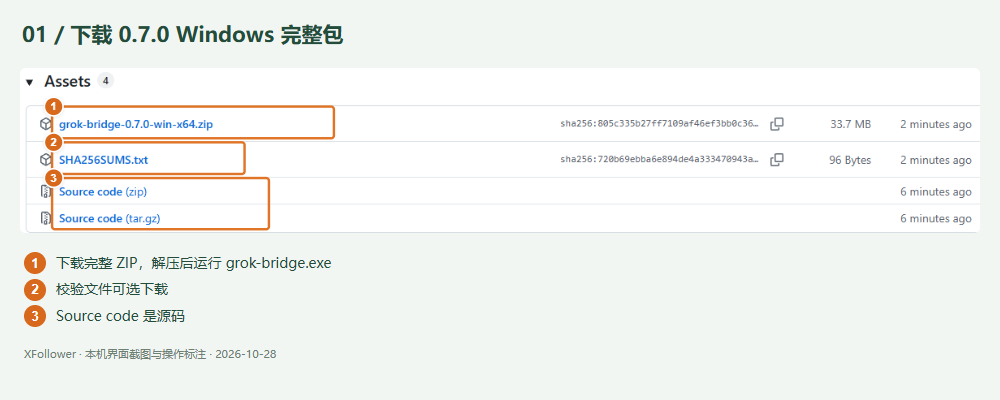
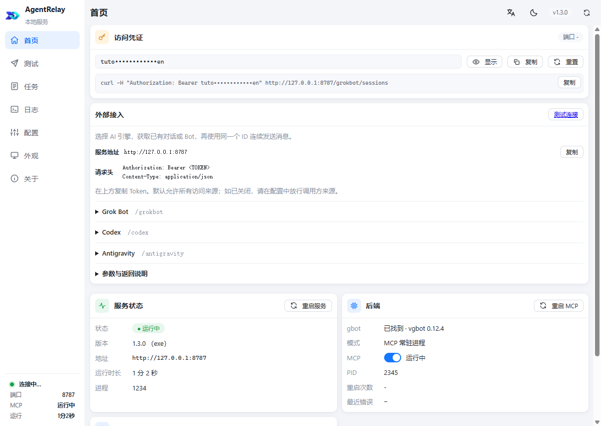
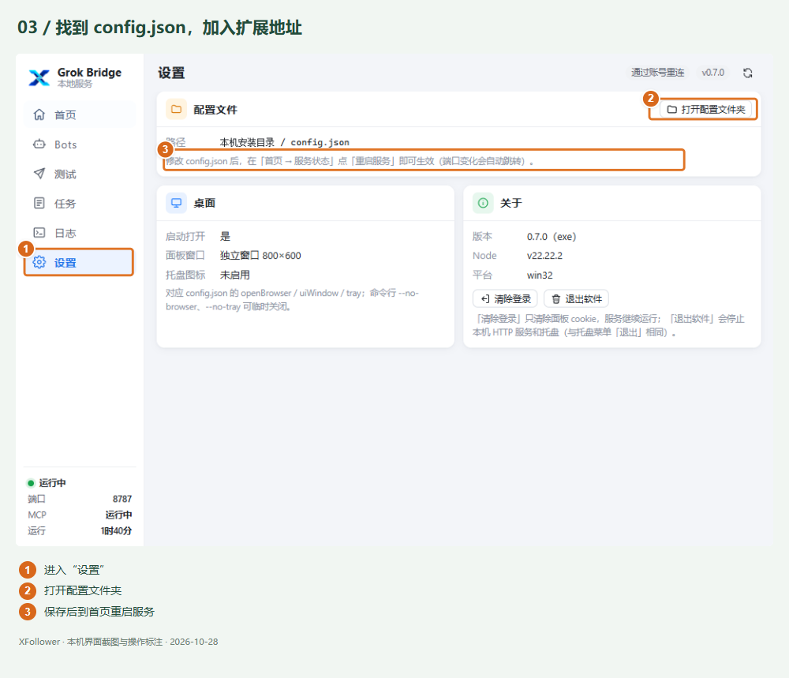
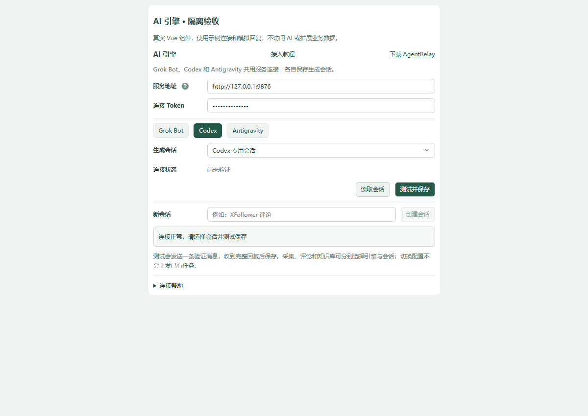
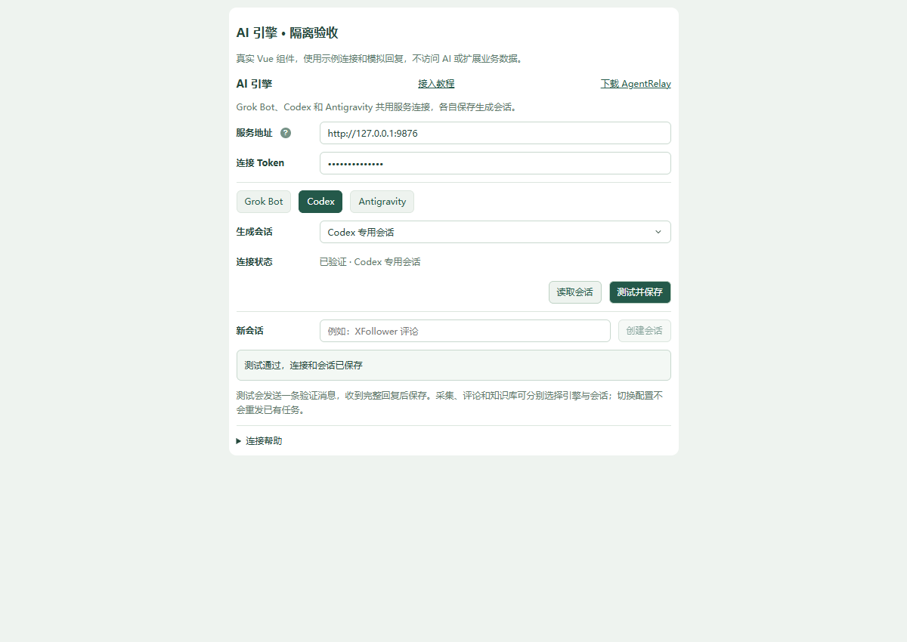
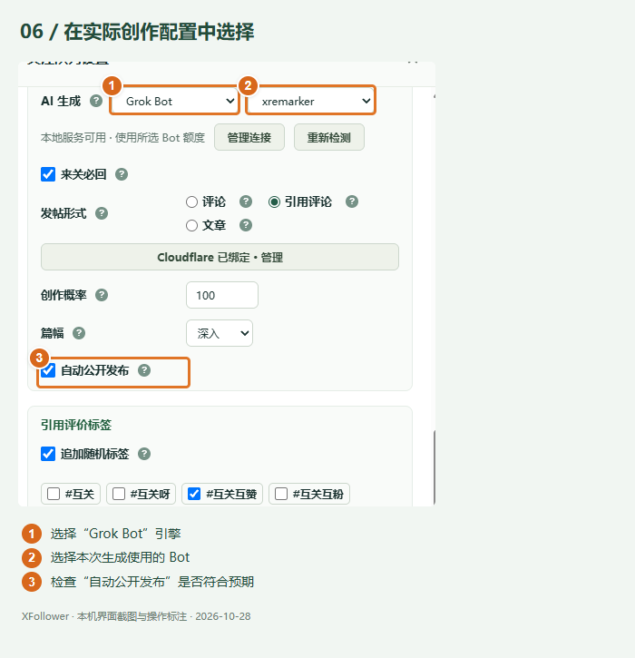

# Grok Bot 本地接入图解与分步引导

本次补充核验：2026-10-28 16:42。本文沿用本需求原编号，补齐 Grok Bridge 0.7.0 正式发布后的验收与交付状态。

用户教程入口：**系统设置 → Grok Bot → 图解教程**。构建后页面为 `grok-local-guide.html`，与现有 Webhook 教程使用相同排版、目录导航、原图查看和键盘焦点样式。

## 1. 下载并运行 Grok Bridge

先在 Grok Bot 桌面端登录，确认目标 Bot 可以对话。前往 [Grok Bridge 最新正式版](https://github.com/wangsen2020/grok-bot-bridge/releases/latest)，在 Assets 下载 Windows x64 程序，放到固定可写文件夹运行。

[Grok Bridge 0.7.0 完整 ZIP](https://github.com/wangsen2020/grok-bot-bridge/releases/download/v0.7.0/grok-bridge-0.7.0-win-x64.zip) 已于 2026-10-28 正式发布。完整解压后运行 grok-bridge.exe，保留服务 EXE 与三个 DLL，无需安装 Node.js 或 CLI。不要选择 Source code。

Bridge 首页应显示「运行中」，访问凭证区域提供端口和复制 Token。

## 2. 允许当前扩展连接

在插件的「授权」步骤复制当前扩展地址。在 Bridge「设置 → 打开配置文件夹」找到 `config.json`，向 `allowedOrigins` 数组追加该地址，保留其他地址、端口与 Token；保存后到 Bridge 首页重启服务。配置片段仅替换对应字段，不能覆盖整个文件。

教程从 `chrome.runtime.id` 读取当前地址，不写死开发版 ID。普通浏览器预览无扩展上下文时，显示明确的替换提示并禁用复制示例地址，避免误配。自动复制不可用时提供可选中文本。

## 3. 填写端口并选择测试 Bot

在插件「连接」步骤填写 Bridge 当前端口，粘贴首页复制的 Token，读取 Bot 列表并选择测试 Bot。浏览器本机访问授权由用户通过正常权限提示完成。

## 4. 测试通过后启用

点击「下一步：测试」，核对连接后点击「测试并启用」。测试实际发送一条消息，收到完整回复才启用。关闭设置后恢复已验证的连接；修改端口或 Token 后清除旧 Bot 列表，重新检测。

## 5. 在实际创作配置中使用

选择 Grok Bot 引擎及生成 Bot，核对创作概率、公开发布等设置并保存。测试 Bot 只验证连接，同一连接的测试不覆盖创作 Bot。首次接入停留下载步骤，已保存连接重开进入测试与管理步骤。

## 常见问题

| 现象 | 处理 |
| --- | --- |
| 401 | 从当前 Bridge 实例复制 Token，确认端口一致 |
| 403 | 追加当前扩展地址到 allowedOrigins 并重启服务；curl 成功不代表扩展已获允许 |
| 417 | 核对 Grok Bot 登录与对话状态，查看会话提示、必要时在任务结束后重启桌面端，再读取列表 |
| 通过账号重连 | Bot 列表与生成正常时属于正常提示 |
| 已接收、待确认 | 查询原任务，核对 Bot 会话，不重复提交 |
| 测试通过但使用其他 Bot | 回到实际创作配置，选择引擎与生成 Bot |

## 截图与验收边界

- 6 张图片均来自本次实际页面截图，使用编号框与图下注释标注，连接凭证与私密路径已遮盖；插件表单裁去无关账号与旧下载文案。
- Bridge 0.7.0 已正式发布；下载截图与链接均已更新为正式完整 ZIP。Downloads 已部署与正式 ZIP 完全一致的两份 EXE。
- 连接保存与创作配置截图反映本机已有的验证状态。初次制作教程未发生成消息；后续 0.7.0 发版验收经授权发送一条短 Bot 测试并测试重启，见下方发行记录。未保存创作配置或发布 X 内容。
- 教程与向导先在独立 Git Flow 分支构建，再同步到开发工作区；截至本次核验，教程源码、截图和测试已由本地集成提交 `346306e` 纳入。Grok Bridge 已正式发行；本地 XFollower 集成提交不代表扩展已经推送或发行，两者状态分开记录。
- 集成开发版 3.10.7：`npm test` 1283 项通过，`npm run test:build` 54 项通过；源码检查覆盖 153 个模块、182 个 JS/Vue 文件，构建与产物校验通过。
- 使用真实 Vue 组件进行隔离 UI 验收，7 项路径通过：首次下载、当前地址、列表不触发生成、测试与保存、重开管理、恢复 Token/Bot、凭证变更清空列表。测试使用明确的公开示例连接，未向真实 Bot 发消息。
- 初次教程验收通过现有 CDP 浏览器打开扩展内页面，验证六图加载、真实扩展地址读取、390px 窄屏无横向溢出；向导同宽验收通过。当时业务面板为 3.10.6，未为教程强制重载；新设置入口随正常重载生效，教程页面可单独打开。

### 0.7.0 新包依赖复核

用户指出本机 dist 已打包自包含版本后，复核新服务 EXE：移除测试进程 PATH 中所有含 Node 的目录，确认 where node 不可达，再由 grok-bridge-service.exe 通过 GROK_BRIDGE_RUN_SCRIPT 执行 Bot CLI，退出码 0，返回 gbot 0.12.4。此为 CLI 运行时验证，未重新发送生成消息。

发布前核查发现，当时 dist/release 中的 ZIP 与文件夹是 13:37 的旧产物，dist 根目录服务 EXE 是 15:55 的新构建，SHA256 不同。因此不能只凭 ZIP 的 0.7.0 文件名认定内容。本节记录发布前状态；随后已重新打包并发行，见下一节。

### 0.7.0 正式发布后教程更新

- [0.7.0 正式发行页](https://github.com/wangsen2020/grok-bot-bridge/releases/tag/v0.7.0)与 [SHA256SUMS.txt](https://github.com/wangsen2020/grok-bot-bridge/releases/download/v0.7.0/SHA256SUMS.txt) 已核对。发行不是草稿或预发行，两个附件状态均为 uploaded；ZIP SHA256 为 `805c335b27ff7109af46ef3bb0c36ee16e9370edceead7f17b90b926cdc88fdd`，与本地及 GitHub asset digest 一致。
- Grok Bridge master / 标签提交为 `d49ec30`，develop 为 `729dbff`，远程均同步。正式包由合并后源码重建，124 项测试通过。
- 实机结束主服务后约 3164ms 自动恢复；真实 developer Bot 返回完整“Grok Bridge 连接成功。”，总耗时 15859ms。独立服务在含空格目录且无系统 Node PATH 的条件下运行，退出后自己的浏览器进程清零。
- 新下载图对应 0.7.0 正式 Assets；正文与设置入口提供固定版本 ZIP，移除尚未发布提示和旧版 Node 安装主流程，明确两个 EXE、三个 DLL 和保留本地数据的升级步骤。
- 先前的开发包状态属于历史核查；本次正式 ZIP 已从最终合并源码重新生成，内容与 Downloads 部署文件一致。

## 关键文件与职责

| 文件 | 职责 |
| --- | --- |
| `src/grok-local-guide.html` | 用户教程正文、正式 ZIP 下载、配置片段位置及排错表 |
| `src/entries/tutorial/grok-local-guide.js` | 六图装载、真实扩展地址读取、复制与手动复制兜底 |
| `src/entries/tutorial/grok-local-guide.css` | 教程局部布局，复用 Webhook 教程的基础样式 |
| `src/entries/panel/components/GrokLocalSettings.vue` | 下载、授权、连接、测试四步向导；保留配置恢复和测试后启用规则 |
| `src/assets/grok-local-tutorial/` | 六张脱敏且带操作标注的截图，下载图对应正式 0.7.0 |
| `vite.config.js` | 将独立教程作为构建入口打入扩展 |
| `tests/grok-local-guide.test.js` | 核对教程章节、设置深链及六张图片资源，避免漏打包或链接失效 |
| `tests/fixtures/grok-local-settings-preview.html` | 真实 Vue 组件的隔离验收页面，使用公开示例配置，避免为界面检查发送真实消息 |

## 参数与验收结果的解释

- 新安装默认首次查询为 400ms、最大查询间隔为 3000ms、静默确认值为 1500ms。已有配置的显式值保留；本次 Downloads 配置仍为 `settleMs: 4000`，因此 15.9 秒是该配置下的一次真实请求耗时，不是新默认参数的性能对比。
- 当前真实 gbot 消息没有 `isStreaming` 字段。代码兼容该字段不等于实机可识别生成状态；实际使用静默窗口或显式 `endMarker`。需要严格结束界限时，应让 Bot 在完整回复末尾输出约定标记。
- 重启恢复验收是在队列为空、MCP 无进行中调用时结束主服务，验证外壳恢复服务。它不等于本轮再次验证了所有类型的进行中任务恢复；旧任务仍按原编号查询，不因等待而重发。
- 退出关窗验收使用隔离端口、含空格的专用目录与浏览器 profile，确认该 profile 的进程从 13 个降为 0，没有用关闭共享 Chrome 代替验收。
- 安装依赖判断必须核对要分发的包。本轮正式 ZIP 从合并后源码重新构建，不能用同名旧 ZIP 或开发目录里的新 EXE 冒充正式包。

## 正式版教程复验与交付状态

| 层级 | 已核实内容 |
| --- | --- |
| Grok Bridge 源码与发行 | master 与标签 `v0.7.0` 指向 `d49ec30`；develop 为 `729dbff`，本地和远程对应分支差异均为 0；特性与发行临时分支已收尾 |
| 正式 ZIP | 包内仅两个 EXE、三个 DLL、README.txt、公开配置示例，共 7 个文件；逐文件内容与最终构建一致，无真实配置、任务、日志或登录数据 |
| Downloads 部署 | 正式包两份 EXE 已部署；配置与 DLL 哈希保持，原有任务和日志目录保留；健康检查为 0.7.0 |
| XFollower 教程 | 源码纳入本地提交 `346306e`；发行后教程测试、构建与产物校验通过，54 项构建测试全部通过 |
| 浏览器实测 | 在扩展上下文读取当前扩展地址；页首与步骤中的下载链接均指向正式 ZIP；六图全部加载；390px 视口下内容宽度 375px，无横向溢出 |

Grok Bridge 的发布代码与验收过程已保存在其仓库第 9 篇发布文档。本次仅补充本需求已有教程记录及作者索引，不另建同主题验收文档，不修改运行配置，也不新增 Bot 请求。
