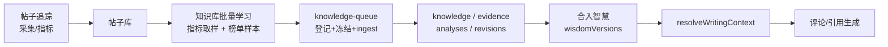
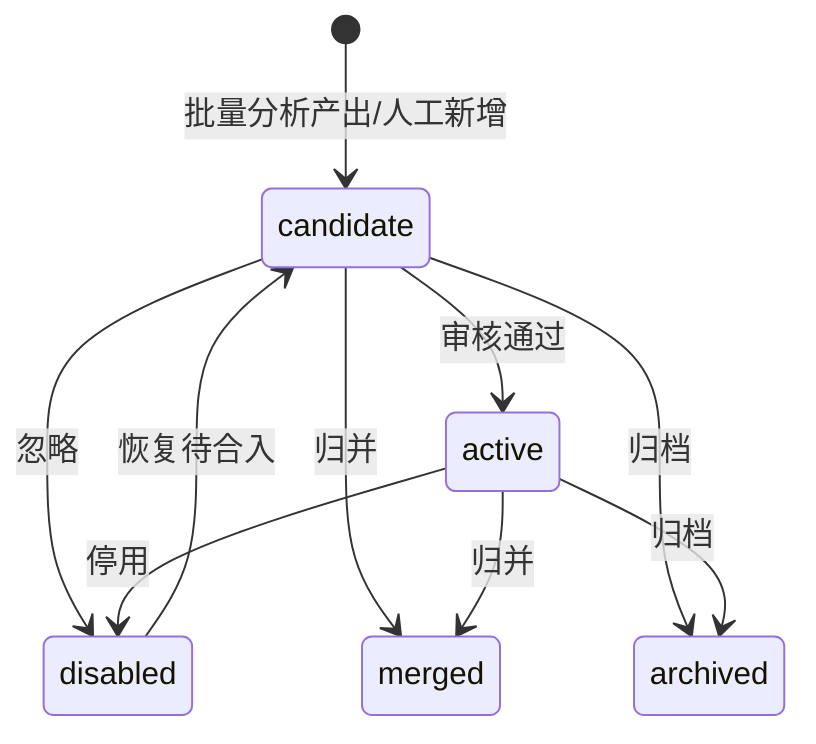

# 知识库与帖子追踪写作记忆合并改造方案

> 创建：2026-10-29 19:19，北京时间。作者：wangsen。
> 修订：2026-10-29 19:43，按用户评审意见修订：**产品尚未上线，旧写作记忆直接移除；帖子追踪连 Grok 二审一起删除；经验只来自知识库对批量数据的分析**。
> 实施：2026-10-29 20:51，版本 **4.4.0**（第 2 位变动）；代码已按本文 WP1–WP3 落地，单测与隔离构建测试通过；尚未做实机 CDP 验收，标注截图待更新。
> 关联：[82. 知识库定时学习与评论增强方案](./82.%20知识库定时学习与评论增强方案_20261028_1352_wangsen.md)、[9. 帖子追踪与博主排行榜迭代方案](./../帖子追踪与排行榜/9.%20帖子追踪与博主排行榜迭代方案_20261021_1812_wangsen.md) 第 20 节。
> 当前分支：`feature/follow-queue-scheduling`；`package.json` 4.4.0。本方案不再分“兼容期/移除期”，按一次直接移除实施。

## 1. 结论

### 1.1 已确定的产品口径

- **帖子追踪不再有任何 Grok 分析**：删除“分析优点”和“Grok二审”，删除单帖评分/保留建议、`grokReview` 字段和相关 UI。
- **旧写作记忆直接移除**：删除 `postWritingMemory` 的读写、`writing-memory.js`、`postLearningJob` 及相关 UI；不做迁移、不做只读备份、不做导出。
- **经验只来自批量数据**：知识库按账号批量取样自己的帖子（指标分位）和榜单样本，统一分析、入库、合入智慧。
- **生成只读当前智慧**：删除旧记忆注入；没有智慧就不注入，不再兜底。
- **产品未上线**：旧数据视为测试残留，不设计用户迁移/兼容路径。

### 1.2 一句话方案

帖子追踪只保留“采集 + 指标 + 保留/保护/删除”，删除全部 Grok 分析与写作记忆；知识库批量分析是经验的唯一生产者，生成端只读当前智慧。

### 1.3 决策状态

| 编号 | 决策 | 状态/推荐 | 说明 |
| --- | --- | --- | --- |
| D1 | 帖子追踪 Grok 分析 | **已定：全部删除**（分析优点 + Grok二审） | 不是保留单帖建议，而是整条链路删除 |
| D2 | 旧写作记忆 | **已定：直接删除代码/UI，不迁移、不备份、不导出** | 产品未上线，旧数据视为测试残留 |
| D3 | 旧记忆生成兜底 | **已定：不保留** | 生成只读智慧 |
| D4 | 生成开关位置与默认值 | **已落地：知识库设置唯一开关 `writingKnowledgeEnabled`，默认关；队列旧开关移除** | 首次合入自动询问未实现，需用户手动勾选 |
| D5 | 智慧注入是否要求本地 Bot | 推荐解耦：有智慧即可注入；Bot 只在批量学习/合入时需要 | 保持现状会让“已选智慧但没绑 Bot 就不生效” |
| D6 | 文章/原创是否注入知识 | 推荐不注入；后续单开文章增强 | 与 82 号文一致 |
| D7 | 版本号 | **已定：4.4.0**（用户 2026-10-29 要求第 2 位变动，不用 5.0.0） | 已通过 `version:set` 同步 manifest/package/握手 |

> D1/D2/D3 已由本次评审确定；D4–D7 仍需拍板。

### 1.4 不在本方案范围

- 不改变知识库批量学习的调度、预算、提示词协议和智慧合入流程（82 号文的产品模型不变）。
- 不删除 `requestGrokText`/`requestGrokComment`：榜单、面板评论、测试连接等仍在用。
- 不做向量语义去重；不纳入榜单日报迁移；不做云同步。
- 不为旧 `postWritingMemory`/`postLearningJob` 设计迁移、导出或只读页面。

### 1.5 为什么直接删，而不是迁移/退役

| 做法 | 问题 | 结论 |
| --- | --- | --- |
| 旧规则迁移成经验 | 仍是逐帖产物，没有批量样本；产品未上线，迁移成本没有收益 | 不做 |
| 旧记忆只读/导出/兜底 | 需要保留 UI、存储、开关和测试，继续制造“第二个知识源” | 不做 |
| 直接删除代码与 UI | 最干净；旧浏览器数据不读取即可，测试数据可丢弃 | 采用 |

产品尚未上线，没有真实用户数据需要保护；保留旧链路只会让“两个知识源”继续存在。

## 2. 现状与删除范围

### 2.1 帖子追踪的 Grok 链路（全部删除）

| 环节 | 现状 | 位置 |
| --- | --- | --- |
| 入口 | 选中 1–20 条，点“分析优点”或“Grok二审”；详情抽屉单条分析 | `PostTrackingSection.vue:25,78,173` |
| 执行 | `learn` 命令 → `createPostLearning` → `requestGrokText`（X Grok，120 秒） | `post-runtime.js:4,268`；`post-learning.js:14` |
| 业务结果 | 逐条写 `post.grokReview`（score/keep/reason） | `post-learning.js:20-23` |
| 经验结果 | 提炼“写作特点”到 `postWritingMemory`，可勾选进入生成 | `post-learning.js:25-31`；`writing-memory.js:1-19` |
| 注入 | `buildWritingContext` 拼进评论/引用/改写提示词 | `writing-memory.js:8-13`；`grok-comment.js:861` |
| UI | 工具栏、结果计数、写作记忆抽屉、行内“Grok建议保留”、详情“Grok二审” | `PostTrackingSection.vue:25,46,57-62,78` |

这条链路同时产出“单帖建议”和“账号级写作规则”，是当前冲突的根源。

### 2.2 知识库批量链路（保留）

| 环节 | 现状 | 位置 |
| --- | --- | --- |
| 经验来源 | 自己的帖子按指标分位取 low/high；榜单近 30 天 high 样本；每批最多 6 条，7 天内同帖不重复 | `learning-sources.js:12-22`；`learning-runtime.js:42-48` |
| 生产 | 本地 Grok Bot 生成 0–4 条经验；经 `queue.ingestAnalysisResult` 入库 | `learning-model.js:15-25`；`learning-runtime.js:51,90-97` |
| 存储 | `xef-knowledge-v1`（经验/证据/分析/修订）+ Dexie `xef-knowledge-learning-v1`（调度/来源/智慧） | `knowledge-store.js:1`；`learning-store.js:14-19` |
| 生效 | 经验合入智慧 → 新版本 → 选中版本进入生成 | `wisdom.js:57-75,94-101`；`learning-store.js:57-69` |

这条链路不依赖 `post.grokReview`；`learning-sources` 只用 `evaluatePost` 的 low/high（指标分位），手动二审结果不参与分档。

### 2.3 删除清单

| 类别 | 删除对象 | 处理 |
| --- | --- | --- |
| 文件 | `src/features/post-tracking/post-learning.js` | 整文件删除 |
| 文件 | `src/features/post-tracking/writing-memory.js` | 整文件删除 |
| 文件 | `src/features/knowledge/knowledge-migration.js` | 整文件删除（从未生产调用） |
| 文件 | `tests/post-learning.test.js` | 整文件删除 |
| 文件 | `tests/knowledge-migration.test.js` | 整文件删除 |
| 导出 | `src/features/knowledge/index.js:4` | 删除 migration 导出 |
| 运行时 | `post-runtime.js` 的 `createPostLearning`、`learn`、`saveMemory`、`state.learning` | 删除 |
| 模型 | `post-model.js` 的 `grokReview`、`review`、`contentScore` | 删除；旧记录字段不再读取 |
| UI | `PostTrackingSection.vue` 的分析按钮、结果计数、写作记忆抽屉、书本图标、行内 Grok 徽标、详情 Grok 区块、相关 CSS | 删除 |
| 文案 | “分析优点”“Grok二审”“写作记忆”“待二审复查”“低质帖” | 删除或改为“待复查”“低表现帖” |
| 帮助 | `post-help.js` 第 2、5 节及第 3 节“待二审”表述 | 改写 |
| 文档 | `docs/使用指南/06-帖子追踪.md`、`docs/使用指南/使用说明.md`、帖子追踪标注截图 | 更新 |
| 存储 key | `postWritingMemory:{ownerId}`、`postLearningJob:{ownerId}` | 代码不再读写；旧数据不迁移 |

### 2.4 不要误删的东西

- `requestGrokText`：`leaderboard-runtime.js:6`、`panel.js:27` 等仍在使用；只删除帖子追踪的调用。
- `requestGrokComment`：评论/引用/文章生成仍在用；只删除它对旧写作记忆的读取。
- `post-store`、指标采集、`evaluatePost`、低表现规则、`post-scanner`：批量学习仍靠这些数据。
- `knowledge-store`、`learning-store`、`knowledge-queue`、`wisdom`：批量分析与智慧链路保留。
- 帖子详情的保留/保护/删除：保留；删除的只是 Grok 分析区块。

### 2.5 删除后冲突如何消失

| 原冲突 | 删除后 |
| --- | --- |
| `experience.text` 非空则用智慧、否则 `loadWritingContext` 二选一 | 只剩 `resolveWritingContext`，不存在旧记忆分支 |
| 旧经验持续写入、没有迁移入口 | 不再写入，也不再需要迁移 |
| 同一帖两套分析、结论互不认 | 帖子追踪不再分析；批量学习独立按指标取样 |
| `rule.enabled` / `knowledge.status` / `wisdom.experiences` 三套语义 | 只剩审核状态 + 当前智慧 |
| 两条通道两套可靠性假设 | X Grok 不再用于帖子；本地 Bot 只做批量经验 |
| 入口/开关不一致 | 生成端只读知识库唯一开关 |

## 3. 目标模型

### 3.1 五条不变量

1. **经验唯一生产者**：只有知识库批量分析（自己的帖子按指标取样 + 榜单样本）可以产出经验。
2. **帖子追踪不碰知识**：没有 Grok 分析、没有 `grokReview`、没有写作记忆、没有知识入库。
3. **生成唯一知识源**：只有当前选中的智慧版本参与生成；没有智慧就不注入。
4. **单一注入入口**：生成端只允许一个 `resolveWritingContext()`；业务代码不得自行拼接记忆。
5. **无死代码/死字段**：删除 `grokReview`、`review`、`contentScore`、`postWritingMemory`、`postLearningJob` 的读写；旧浏览器数据不读取、不迁移。

### 3.2 目标数据流



帖子追踪到知识库的唯一通路是**帖子库里的批量数据**；没有任何 Grok 分析结果进入知识库。

### 3.3 目标状态语义

| 对象/字段 | 只表达 | 不表达 |
| --- | --- | --- |
| `knowledge.status` | 审核决定：待审核/已采纳/已停用/已归档/已合并 | 是否参与生成 |
| `wisdom.experiences` | 该版本包含哪些经验快照 | 经验是否审核通过 |
| `experienceSources` | 经验来自哪些批量样本/榜单/批次 | 经验是否已合入 |
| `uses` | 某次生成实际用了哪份智慧/哪些经验 | 经验质量 |

`post.grokReview` 不再存在。

### 3.4 目标注入矩阵

| 生成知识开关 | 有当前智慧 | 结果 |
| --- | --- | --- |
| 关 | 任意 | 不注入；记录 `source:none` |
| 开 | 有 | 注入当前智慧；`source:wisdom`，记录版本 |
| 开 | 无 | 不注入；提示“尚无智慧，本次不使用知识” |

文章/原创/测试连接：`purpose` 为 `article` 或 `test` 时，无论开关如何都不注入。

### 3.5 目标入口矩阵

| 入口 | `purpose` | 改造后 |
| --- | --- | --- |
| 关注队列 引用/回复 | `quote` / `reply` | 受统一开关控制；只读当前智慧 |
| 面板评论 | `comment` | 同上（修当前“完全不读智慧”的缺口） |
| 测试连接 | `test` | 不注入 |
| 文章/原创 | `article` | 不注入（与 82 号文一致） |

## 4. WP1：删除帖子追踪 Grok 分析与写作记忆

### 4.1 代码删除

- 删除 `src/features/post-tracking/post-learning.js`、`src/features/post-tracking/writing-memory.js`。
- `post-runtime.js`：
  - 删除 `import {createPostLearning}`、`const learning=...`；
  - 删除 `learn`、`saveMemory` 消息分支；
  - `getState` 不再返回 `learning`；
  - `mark` 只保留 `protected`/`retained`，删除 `score`/`reason`/`valuableDiscussion` 与 `post.review` 赋值。
- `post-model.js`：
  - `mergePost` 删除 `review`/`grokReview` 显式字段；注意 `{...previous}` 会带出旧字段，需先解构剔除，避免旧数据继续残留；
  - `evaluatePost` 删除 `contentScore` 的计算与返回；
  - 不改变 low/high 指标判定。
- `grok-comment.js`：删除 `loadWritingContext` import 与第 861 行兜底；改用 `resolveWritingContext`（WP2）。
- `knowledge/index.js`：删除 migration 导出；删除 `knowledge-migration.js`。
- 删除 `post-learning.test.js`、`knowledge-migration.test.js`。

### 4.2 字段与数据

- `post.grokReview`、`post.review` 不再读取、不再写入、不再展示。
- `post.evaluation.contentScore` 不再返回。
- 旧 IndexedDB 记录里的 `grokReview`/`review` 字段不迁移、不清洗；下次 `mergePost` 时按 4.1 的解构逻辑剔除。
- 旧 `postWritingMemory`/`postLearningJob` 不读取、不写入、不迁移；浏览器里的旧 key 作为测试残留保留。
- 不需要 schema 升级；没有数据迁移。

### 4.3 UI 删除

- 工具栏：删除“分析优点”“Grok二审”“写作记忆”和结果计数；保留“已选 N/20”“批量删除”。
- 行内：删除“Grok建议保留”徽标；保留“已保护/已保留/曝光停滞/表现突出/同龄低曝光/删除待对账”。
- 详情：删除“Grok二审”区块；保留指标、快照、保留/保护/删除。
- 抽屉：删除写作记忆抽屉、`openMemory`、`saveMemory`、`learningRunning`、`selectedAnalyzing`、`data.learning` 相关逻辑。
- 设置：删除“待二审复查”措辞，改为“复查”；“低质帖”改为“低表现帖”（只改显示，不改 `lowRules` key）。
- 旧的 `post-memory-*`、`post-learning-*` 样式清理。

### 4.4 测试

- 删除 `post-learning.test.js`、`knowledge-migration.test.js`。
- `post-tracking.test.js`：
  - 删除 `grokReview`/`review`/`contentScore` 断言；
  - 保留 `mergePost` 的快照、保护/保留、删除状态断言；
  - `mark` 测试只验证 `protected`/`retained`/`expectedText`，不再验证 score；
  - 删除 `learn`/`saveMemory` 相关 runtime 测试。
- 搜索全仓库 `grokReview|postWritingMemory|postLearningJob|post-learning|writing-memory|contentScore`，确认无残留引用。

### 4.5 验收

- 帖子追踪页没有任何 Grok 分析入口、写作记忆入口、Grok 徽标/详情。
- 选中帖子只剩批量删除；保留/保护/删除正常工作。
- 帖子记录不再出现 `grokReview`/`review`/`contentScore` 新写入。
- 旧浏览器 key 不再被读取或改写；删除代码后扩展可正常加载。

## 5. WP2：生成端单一注入

### 5.1 新模块与签名

新增 `src/features/knowledge/writing-context.js`：

```js
export async function resolveWritingContext({
  ownerId,
  purpose = 'comment',        // comment | quote | reply | article | test
  requestId = '',
  now = Date.now
}, deps = {}) {
  // deps: { settings, wisdom, recordUse }
  // return: { text, items, source, wisdomVersion, warning }
}
```

返回：

```js
{
  text: '',
  items: [],
  source: 'wisdom' | 'none',
  wisdomVersion: null,
  warning: ''
}
```

规则：

1. `ownerId` 不是稳定数字 ID → `source:'none'`。
2. `purpose` 为 `article`/`test` → `source:'none'`，不读取任何知识。
3. 账号级 `writingKnowledgeEnabled` 为 false → `source:'none'`。
4. 有当前智慧 → 注入智慧全文；不检查本地 Bot 是否连接（D5）；绑定信息可得则记录 `botName`。
5. 无智慧 → `source:'none'`；开关开着时给出“尚无智慧”提示。
6. 读取异常 → 不跨账号兜底，返回 `source:'none'` + `warning`。

### 5.2 开关

- `learningStore.settings` 增加 `writingKnowledgeEnabled`、`knowledgeSettingsVersion`。
- 迁移：若旧关注队列 `knowledgeEnabled===true`，新开关置 true；否则默认 false。
- 知识库“自动学习设置”新增“生成时使用当前智慧”开关，默认关，由用户手动开启；首次合入自动询问暂未实现。
- 关注队列页移除旧开关（`follow-queue-panel.js:2271`），只保留提示“在知识库设置中控制”。

### 5.3 入口改造

| 文件 | 改动 |
| --- | --- |
| `grok-comment.js:860-861` | 删除旧记忆兜底；改为 `resolveWritingContext({ownerId:writerAccountId,purpose,requestId:nonce})`，用 `knowledge.text` |
| `grok-comment.js:817` | 增加 `knowledgePurpose` 参数；返回值附 `knowledgeSource`/`wisdomVersion` |
| `follow-queue-runtime.js:1222` | 传 `knowledgePurpose:publicationMode`；不再传布尔开关 |
| `panel.js:2796` | 面板评论传 `knowledgePurpose:'comment'` |
| `panel.js:5481` | 测试连接传 `knowledgePurpose:'test'` |
| `post-writer.js:6` | 传 `knowledgePurpose:'article'` |
| `publication-writer.js:21,30` | 传 `knowledgePurpose:'article'` |

### 5.4 使用记录与降级

- `learningStore.uses` 记录 `{id,ownerId,at,source,wisdomVersion,contentHash,purpose,botName,items}`。
- 生成结束 `finishExperienceUse` 更新状态；无 job 时只留 `selected`。
- 读取异常不阻断生成；不跨账号；智慧为空视为无智慧。
- 生成前做长度预算检查；超限给明确错误，不静默截断。

## 6. WP3：UI、文案与文档

### 6.1 帖子追踪页

- 删除分析工具栏、写作记忆抽屉、书本图标、Grok 徽标/详情。
- 选中态只服务批量删除；保留“已选 N/20”和“批量删除”。
- 设置文案：
  - “待二审复查” → “复查”；
  - “待二审复查周期” → “复查周期”；
  - “低质帖” → “低表现帖”；
  - 帮助文案同步（`post-help.js` 第 2、3、5 节）。
- 保留/保护/删除按钮不变。

### 6.2 知识库页

- 增加说明：“经验来自批量分析（自己的帖子按指标取样 + 榜单样本）；帖子追踪不产生经验。”
- 渠道文案：
  - `low_analysis` 显示“低表现帖分析”；
  - `high_analysis` 显示“高表现帖分析”；
  - key 不变，只改显示。
- 生成开关与当前来源状态条：智慧 vN / 不使用。
- 保留“新增经验”人工入口；不增加旧记忆导入。

### 6.3 关注队列

- 移除 `knowledgeEnabled` 开关（`follow-queue-panel.js:2271`）与默认值（`:75`），改为“在知识库设置中控制”。
- 队列生成只传 `purpose`，由解析器读同一账号开关。

### 6.4 用户指南与截图

- `docs/使用指南/06-帖子追踪.md`：
  - 标题改为“帖子追踪：看表现、做保留与删除”；
  - 删除“Grok二审/分析优点/写作记忆”步骤；
  - 第 5 步改为“复查周期和低表现规则”；
  - 增加“经验由知识库批量分析生成”的链接。
- `docs/使用指南/使用说明.md`：
  - 目录标题、功能表同步去掉“Grok二审/写作记忆”。
- `docs/images/tutorial-post-tracking-annotated.png/.svg`：重新截图/标注，去掉分析按钮和写作记忆入口。
- `post-help.js`：删除第 5 节“批量学习与写作记忆”；第 2 节改为“指标初筛”；第 3 节改“待复查”。
- 历史文档 9/21 保留原文，不回写；91 号文作为当前方案。

## 7. WP4：回归与验收

### 7.1 单元测试

- 帖子模型：`mergePost` 不再保留/产生 `grokReview`/`review`；`evaluatePost` 不再返回 `contentScore`。
- 帖子运行时：`learn`/`saveMemory` 不存在；`mark` 只处理 protected/retained；状态不返回 `learning`。
- 解析器：开关关 → none；有智慧 → wisdom（不要求 Bot）；无智慧 → none + warning；article/test → none；异常不跨账号。
- 开关：旧 `knowledgeEnabled=true` 迁移；无旧值默认 false；用户在知识库设置手动开启后 true。
- 批量学习：帖子追踪的操作不再产生 knowledge/evidence/source；知识库批量流程回归通过。

### 7.2 集成与回归

- `npm test`、`npm run test:build`、`npm run check`、`npm run build`、`npm run build:check` 全绿。
- 关注队列评论/引用：能读智慧，记录版本。
- 面板评论：能读智慧（修缺口）。
- 文章/原创/测试连接：不注入。
- 删除代码后扩展可正常加载；无 `Cannot find module`/未定义引用。

### 7.3 CDP 实机验收

1. 打开帖子追踪，确认无“分析优点/Grok二审/写作记忆”，选中只显示批量删除；保留/保护/删除可用。
2. 打开知识库，执行一次批量“立即总结”或等待已有样本；确认经验来源为低/高表现帖分析；合入智慧。
3. 关注队列生成一条引用/回复草稿（不发布）；确认使用智慧 vN。
4. 关闭生成开关，再生成；确认不注入，界面显示“不使用”。
5. 测试连接、文章/原创：确认不注入。
6. 重载扩展；确认无旧分析入口、知识库数据保留、开关状态保留。

> 不发布、不删除、不关注；文章路径只生成草稿。

### 7.4 验收清单

- [ ] 帖子追踪无任何 Grok 分析/写作记忆入口。
- [ ] `grokReview`/`review`/`contentScore` 不再新增、不再展示。
- [ ] `postWritingMemory`/`postLearningJob` 不再读写；旧 key 不影响启动。
- [ ] 经验只来自知识库批量分析；帖子追踪不产生 knowledge/evidence/source。
- [ ] 生成端只读当前智慧；无智慧不注入；无旧记忆兜底。
- [ ] 面板/队列/文章/测试入口符合矩阵。
- [ ] 指南、帮助、截图已更新。
- [ ] 全量测试/构建/检查通过。
- [ ] CDP 步骤 1–6 通过。

## 8. 版本、发布与回滚

### 8.1 版本

- 已按用户要求使用 **4.3.0 → 4.4.0**（第 2 位变动），不采用 5.0.0。
- 不再有 4.4.0 兼容期 + 5.0.0 清理期的两阶段；本次直接移除。
- 版本已通过 `npm run version:set -- 4.4.0` 同步 `manifest.json`、`package.json`、background 与 panel 握手。

### 8.2 旧数据

- 不迁移、不清洗、不导出；旧 `postWritingMemory`/`postLearningJob` 留在浏览器里，代码不再读取。
- 旧帖子记录里的 `grokReview`/`review` 字段在下次合并时按解构逻辑剔除；不专门跑迁移。
- 如需开发环境清理，可提供一次性脚本/控制台操作，不进入产品 UI。

### 8.3 回滚

- 代码回滚到 4.3.x 可恢复旧链路；旧浏览器数据未被删除。
- 生成开关可随时关闭；关闭不影响帖子追踪和知识库数据。
- 没有用户数据迁移，因此回滚不涉及数据修复。

## 9. 代码改造清单

| 文件 | 改动 | 风险 |
| --- | --- | --- |
| `src/features/post-tracking/post-learning.js` | 删除 | 中：确认无其他分支引用 |
| `src/features/post-tracking/writing-memory.js` | 删除 | 中：同步删除 `grok-comment` 引用 |
| `src/features/knowledge/knowledge-migration.js` | 删除（死代码） | 低 |
| `src/features/knowledge/index.js` | 删除 migration 导出 | 低 |
| `src/features/post-tracking/post-runtime.js` | 删除 learning/learn/saveMemory/state.learning/mark score | 高：核心运行时 |
| `src/features/post-tracking/post-model.js` | 删除 grokReview/review/contentScore；mergePost 解构剔除 | 高：模型 |
| `src/features/post-tracking/post-help.js` | 删除第 5 节、改写第 2/3 节 | 低 |
| `src/features/grok/grok-comment.js` | 删除旧记忆 import/兜底；接解析器 | 高：全部生成 |
| `src/features/knowledge/writing-context.js` | 新增统一解析器 | 中 |
| `src/features/knowledge/learning-context.js` | 删除/改为 `finishExperienceUse` | 中 |
| `src/features/knowledge/learning-store.js` | 增加生成开关设置 | 低 |
| `src/features/knowledge/wisdom.js` | 渠道文案低/高表现 | 低 |
| `src/features/follow-queue/follow-queue-runtime.js` | 不再传开关；传 purpose | 中 |
| `src/features/follow-queue/follow-queue-panel.js` | 移除旧开关 | 低 |
| `src/entries/panel/panel.js` | 评论/测试传 purpose | 低 |
| `src/features/publishing/post-writer.js` / `publication-writer.js` | 传 purpose article | 低 |
| `src/entries/panel/pages/PostTrackingSection.vue` | 删除分析/记忆 UI；文案 | 中 |
| `src/entries/panel/pages/KnowledgeSection.vue` | 开关状态/渠道文案 | 中 |
| `src/entries/panel/components/KnowledgeLearningPanel.vue` | 开关 | 中 |
| `src/entries/background/background.js` | 解析器依赖/消息清理 | 中 |
| `tests/post-learning.test.js` | 删除 | 低 |
| `tests/knowledge-migration.test.js` | 删除 | 低 |
| `tests/post-tracking.test.js` | 删除 Grok/review/contentScore 断言 | 中 |
| `tests/knowledge-learning.test.js` | 开关迁移/入口矩阵 | 中 |
| `tests/knowledge-writing-context.test.js` | 新增 | 中 |
| `docs/使用指南/06-帖子追踪.md` | 改写 | 低 |
| `docs/使用指南/使用说明.md` | 目录/功能表 | 低 |
| `docs/images/tutorial-post-tracking-annotated.*` | 重新截图/标注 | 低 |

## 10. 风险

| 风险 | 影响 | 缓解 |
| --- | --- | --- |
| 删除 `post-learning` 影响其他分支 | 合并冲突/功能丢失 | 删除前确认统一集成分支和其他进程现场（第 12 节） |
| 删除 `grokReview` 后用户失去单帖内容判断 | 只能看指标+正文决定保留/删除 | 产品未上线；指标+正文足够；后续若需要，单开“内容评估”而不叫二审 |
| 旧浏览器数据残留 | 不影响功能；可能占少量空间 | 不读取；开发环境可手动清理 |
| 文案遗漏“二审/低质” | 用户误以为功能还在 | 全仓库 grep 二审、写作记忆、分析优点、grokReview、contentScore |
| 批量样本不足 | 新账号短期没有智慧 | 明确“无智慧不注入”；等样本成熟 |
| 开关迁移错误 | 用户以为智慧生效但实际关闭 | 首次读取迁移 + 合入后询问 + 状态条 |

## 11. 实施顺序与估算

| 阶段 | 内容 | 预估 | 可独立验收 |
| --- | --- | --- | --- |
| P0 | 删除清单确认、分支协调 | 0.5 人日 | 无引用残留 |
| P1 | WP1 删除帖子追踪 Grok/写作记忆 | 1 人日 | 页面无入口/模型无字段 |
| P2 | WP2 解析器 + 开关 + 入口 | 1.5 人日 | 注入矩阵/入口回归 |
| P3 | WP3 UI/文案/文档/截图 | 1 人日 | 页面/指南一致 |
| P4 | 回归 + CDP | 1 人日 | 全量验收 |

> 估算只用于排期参考；实际以评审后的范围为准。

## 12. 实施记录与剩余事项

### 12.1 已完成

- 版本：`4.3.0 → 4.4.0`，已同步 manifest、package、background 与 panel 握手。
- 删除文件：`post-learning.js`、`writing-memory.js`、`knowledge-migration.js`、`post-learning.test.js`、`knowledge-migration.test.js`。
- 帖子模型：`mergePost` 解构剔除 `review`/`grokReview`；`evaluatePost` 不再返回 `contentScore`。
- 帖子运行时：删除 `createPostLearning`、`learn`、`saveMemory`、`state.learning`；`mark` 只处理 `protected`/`retained`。
- 帖子 UI：删除分析按钮、写作记忆抽屉、书本图标、Grok 徽标/详情；选中态只保留批量删除；文案改为“待复查”“低表现帖”“低表现/高表现”。
- 生成端：新增 `writing-context.js`；`grok-comment.js` 删除旧记忆兜底，只读当前智慧；`knowledgePurpose` 覆盖 comment/quote/reply/article/test。
- 开关：知识库设置新增“生成时使用当前智慧”；关注队列移除 `knowledgeEnabled` 开关与设置字段。
- 文案：知识库渠道改为“低表现帖分析/高表现帖分析”。
- 文档：`06-帖子追踪.md`、`使用说明.md` 已改写。
- 截图：用 CDP 连接真实扩展的 4.4.0 临时构建，截取帖子追踪界面（含已选 2 条与批量删除），更新 `tutorial-post-tracking.png`、`tutorial-post-tracking-annotated.png/.svg`。

### 12.2 验证结果

- `npm test`：1336 项通过，0 失败。
- `npm run test:build`：55 项通过，0 失败。
- `npm run check`：159 个源码模块、192 个 JS/Vue 文件契约检查通过。
- 已用 CDP 在真实扩展的 4.4.0 临时构建上截取帖子追踪界面；未执行完整功能验收（生成、保留/删除、知识库批量流程）。
- 共享 Chrome 已加载当前分支构建的 4.4.0 `dist`，进入加载测试；4.3.0 原产物备份在 `scratch/dist-4.3.0-loadtest-backup-20261029-2133`，截图用 4.4.0 构建备份在 `scratch/dist-4.4.0-screenshot-20261029-2112`。

### 12.3 剩余事项

1. **实机功能验收**：4.4.0 已加载到共享 Chrome，按第 7.3 节确认无分析入口、知识库批量经验、开关与生成结果；截图已完成，但生成/保留/删除/批量流程尚未逐项验证。
2. **并行分支协调**：`feature/batch-retry`、`origin/develop` 等仍基于旧提交并引用 `post-learning`/`writing-memory`；合并时需同步删除，避免冲突或把旧功能带回来。
3. **旧浏览器数据**：`postWritingMemory`/`postLearningJob` 未读取、未清理；开发环境如需清理，用控制台/脚本，不进入产品 UI。
4. **批量取样**：仍按指标分位取样，未增加内容质量评分；如后续需要，单开方案。
5. **首次合入自动询问**：当前只提供知识库设置开关，未在合入成功后弹确认；按 D4 记录为未实现。

## 附录 A：删除速查

```text
删除文件：
  src/features/post-tracking/post-learning.js
  src/features/post-tracking/writing-memory.js
  src/features/knowledge/knowledge-migration.js
  tests/post-learning.test.js
  tests/knowledge-migration.test.js

删除引用：
  post-runtime.js: createPostLearning / learn / saveMemory / state.learning / mark score
  post-model.js:   grokReview / review / contentScore
  grok-comment.js: loadWritingContext / 旧记忆兜底
  knowledge/index.js: migration 导出
  PostTrackingSection.vue: 分析按钮 / 写作记忆 / Grok 徽标 / Grok 详情
  post-help.js: 第 5 节 / 第 2、3 节旧措辞
  docs/使用指南/06-帖子追踪.md
  docs/使用指南/使用说明.md
  docs/images/tutorial-post-tracking-annotated.*

保留：
  requestGrokText（榜单/面板）
  requestGrokComment（评论/引用/文章）
  post-store / evaluatePost / lowRules / post-scanner
  knowledge-store / learning-store / knowledge-queue / wisdom
```

## 附录 B：目标状态机



生效不在这个状态机里：只有 `wisdomVersions.experiences` 包含该经验快照时，才参与生成。帖子追踪不进入这个状态机。

## 附录 C：与现有文档的关系

- 82 号文定义知识库的最终产品模型（批量经验 → 智慧、每日/每周、单选使用）；本方案不改变该模型。
- 9 号文第 20 节是历史方案；本方案进一步明确：帖子追踪不生产经验，旧 `writing-memory.js` 直接删除，不做适配器。
- 9/21 号文中的“Grok二审/写作记忆”是历史实现记录，保留原文，不回写；当前实现以本方案为准。
- 用户指南 06/使用说明 需要同版更新，不能继续描述已删除的功能。

## 附录 D：评审时建议重点看的代码

| 关注点 | 位置 |
| --- | --- |
| 帖子追踪分析入口 | `src/entries/panel/pages/PostTrackingSection.vue:25,78,173` |
| 旧分析执行 | `src/features/post-tracking/post-learning.js` |
| 旧记忆注入 | `src/features/grok/grok-comment.js:861` |
| 旧记忆构造 | `src/features/post-tracking/writing-memory.js:8-19` |
| 模型字段 | `src/features/post-tracking/post-model.js:41,50-65` |
| 运行时路由 | `src/features/post-tracking/post-runtime.js:4,143,149,268-269` |
| 队列开关 | `src/entries/panel/follow-queue-panel.js:2271` |
| 帮助文案 | `src/features/post-tracking/post-help.js:2-26` |
| 指南 | `docs/使用指南/06-帖子追踪.md` |
