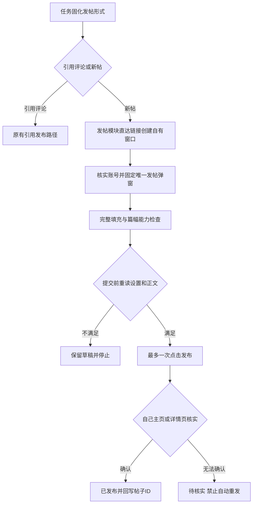

# 从引用评论到独立表达：关注队列新帖模式与发帖模块

创建时间：2026-10-26 13:14，北京时间。作者：wangsen。分支：feature/recent-feature-tutorials。

本轮是新的需求迭代，独立登记第 50 号。初版为 2.19.0，按用户后续要求收紧为直达链接与弹窗 DOM 后更新为 2.19.1，并完成一次真实发布及全文核验，详见第 8 节。用户随后明确授权更新共享 dist 和重新加载，现已应用 2.19.1，界面、安装清单和后台握手一致，详见第 9 节。工作区包含其他进程的未提交改动，保留其现场；本轮未提交、未推送、未发行。

## 1. 产品行为

关注队列的 Grok 创作增加“发帖形式”单选组：

| 形式 | 默认值与行为 | 内容要求 |
| --- | --- | --- |
| 引用评论 | 默认；附带原帖引用卡片，保持原有路径 | 围绕原帖给出具体补充，价值不足可以跳过 |
| 新帖 | 用户主动选择；作为独立帖子发布，不附带引用卡片 | 脱离原帖也能读懂，具有充分依据、独立分析、条件或局限 |

沿用默认 60% 的一次抽样、篇幅选择、Grok 开关和自动发布开关，不另外增加后台定时任务。概率仍控制进入创作流程的机会，不是必须完成的发帖比例。0% 暂停未提交的自动创作，关注结果保持独立。

配置改为中性文案：Grok 自动创作、创作概率、自动公开发布。单选组支持键盘操作和可访问提示，保存后回读。任务列表与详情显示各自的发布形式。

切换形式只影响新创建的任务。每条评价持久化 publicationMode，已有 pending、草稿、待核实及已发布记录保持原来的形式；旧记录缺字段按 quote 读取。禁止将已经写好的引用评论直接换成新帖发布，也禁止两种形式同时发送。

新帖不追加引用评论专用的互关标签候选池，模型可按主题给出少量相关标签。界面中的引用评价标签配置继续保留给引用评论使用。

## 2. 新帖的质量门槛

沿用一次 Grok 请求完成选题、评分、价值判断和成稿，不再为新帖追加一次自评调用。最近五条合格候选中没有足够信息，就正常跳过。

四项评分仍为证据具体度、新增分析价值、相关性、应用或讨论价值，每项 0—2 分：

- 引用评论：总分至少 6，证据和新增分析均不为 0。
- 新帖：总分至少 7，证据和新增分析必须各为 2，另两项至少各为 1。

这些是产品质量策略，模型自报分数不能独立证明真实质量提升。提示词额外要求新帖独立成篇，说明依据、机制、适用条件与局限；不能夸赞式水评、复述扩写、虚构数据或经历。使用独有观点或数据时说明来源名称，不添加 @ 提及和原帖 status 链接。

代码还检查空正文、整段照搬原文、可能形成引用卡片的 X 原帖链接和既有内容门禁。引用能通过的评分不一定能通过新帖门槛；复用草稿时再次检查，避免绕过。质量不足可以跳过或保留待复核草稿，不以长度代替质量。

## 3. 模块归属与复用

检查现有实现后，帖子追踪模块主要负责采集指标、判断表现、清理和写作学习，没有独立新帖发布器。新增发布功能放入 src/features/publishing，关注队列只调度和保存任务结果。

| 文件 | 职责 |
| --- | --- |
| publishing/original-quality.js | 新帖质量门槛、独立正文检查、编辑要求 |
| publishing/post-writer.js | 复用已有 Grok 传输与解析，生成新帖并执行更严格的判断 |
| publishing/post-page.js | 新帖入口、编辑器范围与账号检查、正文填充、提交前复核、发布证明读取 |
| publishing/post-publisher.js | 管理自建不抢焦点窗口、串联提交和结果核验、释放自建资源 |
| follow-queue/follow-queue-runtime.js | 根据任务固化的形式选择生成和发布路径，保留状态与防重 |
| follow-queue/follow-queue-store.js | 配置校验、旧值兼容、发布形式与尝试时间持久化 |
| post-tracking/post-runtime.js | 将成功新帖识别为 auto-original，引用帖仍为 auto-quote |

追踪页面新增“自动新帖”类型筛选；新帖记录的原始线索称为 reference，不伪装成引用卡片。后续指标仍由现有帖子追踪采集，不凭发布返回值捏造展示量。

复用评估：项目已有 twitter-text 3.1.0，用于标准文本规则；已核查其官方仓库和 Apache-2.0 许可证。本轮不新增字符库、数据库、调度器或模型代理。后台动画帧兼容直接复用既有 setQuoteFrameFallbackOnPage。新代码只覆盖项目尚缺的新帖页面操作、编辑判断和业务状态适配。

已查阅 X 官方的创建帖子接口与网页发帖说明。此次沿用项目现有的网页登录页面路径，没有新建接口凭据系统，也没有直接调用私有 CreateTweet mutation。没有把模拟点击或较低频率称作平台合规保证。

## 4. 真实页面发现的三个问题

### 入口地址不等于编辑器就绪

直接进入 /compose/post 时，首页输入框可能先出现。最初验收读到了背景首页编辑器，填入后又因信息流帖子出现而触发上下文检查。2.19.0 曾先打开首页、点击新帖入口，再接受弹窗内输入框；这一历史过渡路径已在 2.19.1 删除。当前直接打开发帖链接，并在 SPA 安排初始动画帧之前尽早安装现有渲染兜底，只接受唯一弹窗中的输入框。背景首页输入框不参与候选。

### 后台标签的动画帧暂停

非激活标签里，路由已切到 /compose/post，弹窗仍可能没有渲染。复用已有的临时 rAF 兜底，限定于本次自建标签，完成后恢复；不激活、导航或关闭用户已有标签。

### 原生插入导致正文重复

实机初次观察中，39 字正文变为 78 字，945 字正文变为 1890 字。DOM 同时出现原生文本节点和 Draft.js 的受控文本，不能因为“包含预期文字”就通过。

改为优先走 X 的粘贴处理，等待 React 更新；只有仍为空时才执行一次原生插入，不在部分成功时再次追加。填充后比较完整正文，再复查账号、上下文和按钮状态。实际再次验收得到 39 和 945 字，与输入一致。对应回归测试要求粘贴已处理时不能再执行原生插入。

测试清理使用填充回执中的实际正文，只有当前内容仍与该回执一致时才清除。已有草稿不会被覆盖，用户后来改动的内容不会被清除。

## 5. 提交与防重复边界

创建帖子前与提交前均调用队列提供的 guard；页面层再次核对当前账号、没有引用或回复上下文、正文一致、按钮可用。脚本返回丢失可能发生在点击之后，按结果不明处理，不能据此再次点击。

成功必须取得自己账号的帖子 ID、链接、时间范围与对应正文。时间线显示长帖预览时，还需进入其详情核实完整正文。未确认时保留 uncertain；后续重试先核实，不能因为暂时查不到就自动补发。

新帖草稿的本地编辑上限为 25,000 字符，实际能力取决于当前账号的编辑器和平台响应；未把蓝 V 当作唯一能力证明。按钮不可用时保留草稿，不截断或分线程。实机仅验证了下述有限长度，不代表 25,000 字符都已验证。

## 6. 验收结果

| 项目 | 结果 | 说明 |
| --- | --- | --- |
| Antigravity 设置与存储测试 | 63 通过，0 失败 | quote 默认、非法值、旧数据、形式不可变、单选和重开回读 |
| 初版完整单测 | 974 通过，0 失败 | npm test；含新帖门槛、模块分流、已有任务不改形式、脚本丢失与防重复；修订版见第 8 节 |
| 构建测试 | 54 通过，0 失败 | npm run test:build |
| 源码检查 | 通过 | 117 个源码模块，137 个 JS/Vue 浏览器调用契约 |
| 扩展隔离构建 | 通过 | scratch/build-tests/original-post-2.19.0，27 文件、15 ESM 模块 |
| 编译后设置页 CDP | 通过 | 默认引用、切到新帖后仍只选一项、保存重开保持 original，无页面错误 |
| 桌面与 375px 窄屏 | 通过 | 无横向溢出；单选标签最右约 208px，截图已人工检查 |
| 真实 X 页面填充 | 通过 | 39 字和 945 字均精确写入，按钮可用，没有提交 |
| 完整发布模块 dryRun | 通过 | 通过真实 Chrome tabs/scripting 调用模块，21 字和 880 字均就绪；提交次数 0 |
| 测试草稿清理 | 通过 | 两次模块 dryRun 结束均为空；只关闭自建标签，无剩余自建标签 |
| 公开发布 | 修订版已验证 | 2.19.1 按用户明确要求实发一次，取得真实帖子 ID、链接与全文；未验证流量优劣 |

本地证据包括 scratch/original-composer-live-cdp.json、scratch/original-publisher-live-cdp.json、scratch/original-mode-cdp.json 及对应截图。模型生成质量测试使用受控响应，没有为了验收消耗真实 X Grok 生成额度；Antigravity 开发调用与产品 Grok 调用须区分。

本轮沿用主工作目录的 feature/recent-feature-tutorials，按文件边界与 Antigravity 协作，没有创建独立 worktree。实际加载的 dist 仍为 2.18.1；初版隔离构建 2.19.0，修订版隔离构建 2.19.1。真实验收通过当前 Chrome 的 tabs、windows 与 scripting 执行修订后的发布模块，没有重载共享后台。

## 7. 参考资料

- [X 官方网页发帖说明](https://help.x.com/en/using-x/how-to-post)：编辑器与长帖能力说明，不以页面示例直接推断当前账号的能力。
- [X 官方创建帖子接口](https://docs.x.com/x-api/posts/create-post)：用于核对普通帖子和引用关系的概念，未在本轮新增该接口客户端。
- [twitter-text 官方仓库](https://github.com/twitter/twitter-text)：复用既有文本规则依赖，不重复实现通用字符解析。

## 8. 直达链接、固定弹窗与真实发布验收

用户随后明确要求：直接使用 https://x.com/compose/post，并只监听、操作发帖弹窗 DOM；同时要求一定实发验收。这是同一需求的入口与验收修订，更新本篇，版本递增为 2.19.1。

### 入口与 DOM 边界

- 删除“先到首页再点击新帖入口”的动作。直接通过既有临时窗口管理器打开发帖链接，窗口不抢焦点；发布完成关闭自己的窗口。
- 现有后台 rAF 兜底必须尽早安装。在等待页面 complete 之前先尝试 MAIN world 注入，使用 injectImmediately；页面完成后再补一次幂等注入。仅在 complete 后安装可能错过 SPA 初始弹窗的动画帧，表现为路由正确但弹窗不出现。
- 全局只发现可见 dialog，并读取登录账号用于身份保护；正文、引用／回复上下文、发布按钮均从固定弹窗根节点查询，不再全页搜索输入框或新帖入口。
- 首次找到唯一弹窗后，固定根节点、输入框和随机会话 token。MutationObserver 仅 observe 此根节点，不监听信息流或整页。
- 后续填充、清理、提交均携带同一 token；根节点断开、输入框被替换、会话变化或出现其他可见弹窗时停止，不能重新寻找另一个输入框继续发。
- 结束时断开监听，清理自建资源。账号核验在弹窗外只读执行，不属于发帖按钮或正文定位范围。

### 实发过程与结果

2026-10-26 13:30:39 北京时间，对当前绑定账号 WatsonTaylor23 执行一次真实发布点击。正文介绍本次实际排障得到的自动化边界与结果核验经验，没有引用卡片。随后在本人主页发现帖子，再进入详情，以完整正文与发布时间核实。

- [真实发布结果](https://x.com/WatsonTaylor23/status/2114590515882856511)
- 帖子 ID：2114590515882856511。
- X 显示发布时间：2026-10-26 13:30:40，北京时间。
- 真实提交次数：1。初次自动回查未确认时没有再次发帖；后续只读核实后更新验收记录为 posted。
- 详情页全文匹配通过，截图 scratch/direct-compose-published.png 已查看；独立证据 scratch/direct-compose-public-proof.json 记录 fullTextVerified。

首次尝试在提交前被现有关键词门禁拦截，命中技术语境中的“插入”，实际提交次数为 0。本轮未放宽内容规则，将正文改为等义的“输入”后再进行唯一一次真实提交。

### 实发暴露的中文长帖确认问题

原回查只在预期正文超过 200 字符时，才把时间线的截断正文当作长帖预览。此次中文正文在 200 字符以下，但平台已经折叠，因此帖子实际已发布，初次回查却返回 uncertain。

修复为使用 X 明确的 tweet-text-show-more-link 标记和正文前缀判定候选，再到详情核实全文，不再套用英文字符长度假设。新增中文正文不足 200 字符仍被折叠的回归用例，并保留账号、发布时间、完整正文的约束。该修复没有放宽“未核实不得重发”的规则。

修订版隔离构建位于 scratch/build-tests/direct-compose-2.19.1。此时完整单测 975/975、构建测试 54/54 通过；117 个源码模块语法与 137 个 JS/Vue 浏览器调用契约检查通过，隔离扩展构建完整性校验通过。该阶段没有切换共享后台；随后加载与新增回归见第 9 节。

## 9. 应用到当前插件与后台配置验收

用户明确授权“把 2.19.1 应用到当前插件，更新 dist 并重新加载，确认版本号、新帖和引用评论配置都已在后台生效”。本次将核验后的源码构建到 E:/WebstormProjects/x-each-follower/dist，并重新加载同一扩展 ID，不新建第二个扩展实例。

加载前实际版本 2.18.1。保存当前账号配置和队列状态，短暂关闭 Grok 与自动发布，防止形式切换验收期间生成额外帖子。旧 dist 备份在 scratch/build-tests/apply-2.19.1-previous-dist；没有清理账号数据、任务或历史错误记录。

### 集成验收发现的设置加载竞态

初次真实界面验收过快打开设置时，后台配置请求尚未完成，抽屉已经允许复制默认值；保存发帖形式时同时覆盖了部分原配置。终检通过升级前快照识别出间隔、批量人数、待回关放行和标签等字段的差异，立即恢复快照。

补充 settingsLoaded 保护：当前账号配置没有成功返回前，设置入口保持不可用，程序处理与保存按钮也拒绝保存；切换账号时清除就绪标识。已明确读取失败时仍可查看错误说明，但不能保存。新增延迟配置响应的回归，验证未加载时不能打开默认值抽屉，加载后切换形式不会覆盖账号原来的调度和筛选值。

完成修复后重新构建并加载本次 2.19.1，重新进行新帖、引用评论两次真实界面保存；每次均核对后台回读及关闭重开后的唯一选项。最终从完整升级前快照恢复原配置，再次刷新面板核对界面与后台一致。

### 最终生效状态

| 项目 | 已确认结果 |
| --- | --- |
| 实际安装目录 | E:/WebstormProjects/x-each-follower/dist |
| 扩展 ID | kmfgjedjeibcgnjnjffkgfkjpmgjmcfc，沿用原实例 |
| 安装清单、页面版本、后台握手 | 全部 2.19.1 |
| 扩展状态 | ENABLED；manifestErrors 与 runtimeErrors 均为空 |
| 新帖 original | 界面保存成功、后台回读 original、重开仅新帖选中 |
| 引用评论 quote | 界面保存成功、后台回读 quote、重开仅引用评论选中 |
| 最终保留形式 | 引用评论，quote |
| 创作概率与篇幅 | 60%、adaptive 自适应 |
| Grok 与自动发布 | 均开启，恢复升级前值 |
| 关注队列调度 | 仍暂停；间隔 15 分、浮动 5 分、单轮 15 人、检查 30 人保持原值 |
| 标签、筛选、待回关放行等 | 与升级前快照逐字段相同 |
| 取关与私信模块设置 | 完整嵌套对象比较一致 |
| 队列记录 | 6328 条，与加载前一致；running 为 0 |

最终完整单测 976/976、构建测试 54/54 通过；源码语法与浏览器调用检查通过。共享 dist 构建成功并通过 27 文件、15 ESM 模块完整性校验。此轮进行的是配置生效验收，没有额外调用真实发布动作。

本地证据：scratch/apply-2.19.1-before.json、scratch/apply-2.19.1-modes.json、scratch/apply-2.19.1-final.json、scratch/apply-2.19.1-installed-final.json、scratch/apply-2.19.1-live-settings.png。最终 settingDifferences 为空，originalQueueSettingsPreserved 和 otherModuleSettingsPreserved 均为 true。当前面板保留关注队列设置页面供用户检查。
