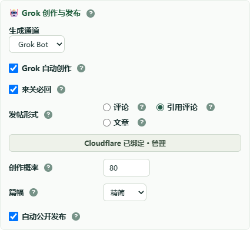
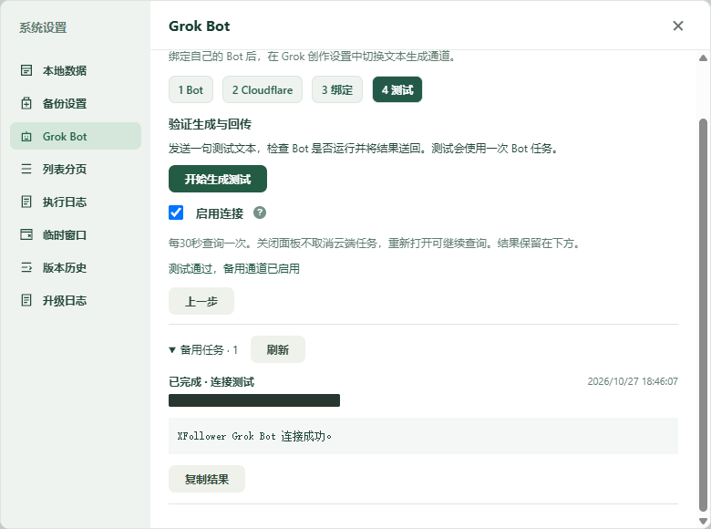

# Grok 通道切换与集成验收

> 3.7.4 额度结论更正：本通道统一称为 Grok Hook，通过 Grok 自动化 Webhook 生成，仍使用 Grok 用量，不代表独立 Bot 额度。本文原有 Bot 称呼及独立额度设想仅保留为历史背景；回传成功不能证明独立额度生效。

## 目标与交互

Grok 创作设置新增“生成通道”，提供 Grok 和 Grok Bot。选择立即保存至扩展本机设置，并供面板与后台共同读取。Grok 使用 X.com；Grok Bot 直接使用已验证的 Webhook 中转，不先请求 X.com。

未绑定、未通过生成测试或已暂停的 Bot 不写入选择，立即打开系统设置内的 Bot 绑定向导。用户完成生成测试后自动完成本次切换；关闭向导取消切换意图。解绑或暂停连接回到 Grok。

已有 Bot 任务使用已保存的 relayJobId 查询原任务，优先于当前通道选择。网络错误、等待回传和切换操作均不重新提交未知任务。文章配图仍使用现有独立配图链路，文本通道选择不替代图片配置。

## 实施与合入

将 feature/grok-webhook-fallback 的已验证实现逐项集成至主工作区现有 feature/release-readme-workflow，保留工作区其他未提交改动。此处为文件级集成，未执行 Git 分支合并提交、推送或发行。主工作区版本从 3.5.3 更新为新增功能版本 3.6.0。

复用原有 Dexie、Vue、系统设置弹窗和 Bot 引导组件。新增 grok-provider.js 负责持久化及统一路由，useGrokProvider.js 协调未绑定引导和完成后的切换；不新增通用基础设施或依赖。

解决集成冲突时保留既有 20 帖选题、质量门禁、生成恢复和待回关逻辑。Bot 待回传记录只恢复原任务查询，不进入传统“重新生成”路径。

## 验收记录

- 完整单元测试：1134 项通过，0 失败。
- 构建成功，源码语法和浏览器接口检查通过。
- 构建测试：53 项通过，1 项失败。失败来自工作区原有根目录临时脚本 grok bot.js，违反源码集中在 src 的布局规则；为保留其他任务现场未移动或删除该文件。
- 实际加载扩展版本：3.6.0。已验证通道选项、未绑定自动打开向导、未验证时不覆盖原选择以及关闭后重新打开。
- 实际 Worker 绑定与生成回传：用户允许精确域名访问后，测试任务被接受，并回传“XFollower Grok Bot 连接成功。”；随后自动将选择保存为 grok-bot。已实测切回 Grok、再切回 Bot、重新打开后仍保留选择；已绑定时不再弹出向导。

服务端 54 项测试全部通过。实际页面在 390px 宽度无横向溢出。截图只截取配置区域，任务编号等私密信息已遮盖。教程更新为十一张截图，并替换生成测试截图。

## 额度证据边界

网页展示独立的 Grok Bot 用量项目，Webhook 运行和回调已经实测。尚未取得单次请求扣费账本，不将整数百分比用量界面当作精确扣费证明。

## 2026-10-27 真实引用发布与3.6.1修正

用户将创作概率调为100%，保持引用评价和自动发布开启，并要求运行完整流程。本轮按既有配置启动一轮，检查16人，新增关注8、策略跳过2、已排除6，达到原有单轮8人上限。未重抽旧概率决定，未清空历史不确定记录。

第一条Bot生成任务在插件120秒等待结束后才回传。Worker按原jobId收到完整英文引用评价，Grok运行状态为SUCCESS；通过原任务续查完成发布，实际X详情页核对了正文及引用原帖。发布地址：https://x.com/WatsonTaylor23/status/2115041373330247930 。队列记录为posted、channel=grok-bot，且保留原relayJobId。用户也在界面观察到后续中文结果。收到正文与成功发布分开记录：中文Tim评价因发布按钮不可用保留为uncertain，不盲目重复发布。

实测发现两处缺口，已在3.6.1修正：

- 后台原本只选pending，迟到Bot结果停在bot_pending不再继续。现在只对带原relayJobId、无正文且无任何发布证据的bot_pending任务自动续查；继续按原任务读取，切换通道也不重发生成。有发布时间、帖子ID/URL、文章草稿或发布阶段记录的任务不自动重放。
- 用户指出评论及引用评论应直接写作。实际保存的请求证实已由程序选定唯一原帖、不再要求质量评分，但仍包含旧ARTICLE_CONTENT_BOUNDARIES跳过指令。已从评论和引用评论提示词移除该段，保留1:3:3:3综合分选帖、唯一来源、语言、长度及输出标记要求；程序本身现有筛选不变。文章提示词不在本次修改范围。

验证：1143项单元测试全部通过；新增迟到续查、重启后查询、通道切换后查询、发布证据禁止自动重放以及两种写作提示词不含跳过/评分指令的回归测试。构建与源码检查通过，实际加载3.6.1，Bot连接及通道选择保持。发布前后截图不包含连接Token或签名密钥。

实际新请求复核：3.6.1后台为fxw2010提交了新Bot任务，读取其本机保存的真实prompt确认以1:3:3:3综合分选定唯一原帖，hasSkipDirective=false、asksScoring=false。此次核对来自真实生成请求，非仅源码断言。

## 3.6.2 等待时间调整

按用户明确要求，Bot单次生成等待改为300秒，评论外层任务与手动评价外层计时统一为360秒，保留30秒查询。通用文本调用继续保留X页面原有等待配置，但不再把其90秒默认值传给Bot；Bot使用独立300秒预算。连接测试仍立即返回任务、由向导轮询。单次HTTP请求的20秒连接保护不变。超时后保留原任务并由后台续查，不重发生成。

1146项单元测试全部通过，新增虚拟时间推进至第300秒才返回结果且只提交一次、通用文本不受X超时覆盖，以及外层360秒配置的回归。构建和源码检查通过。
重载验收：实际扩展版本3.6.2，Grok Bot选择保留，评论调度恢复为每分钟一次；原有100%创作概率、引用评价及自动发布设置保留。

## 3.7.2 已有Bot正文到队列引用发布验收

本次复用已完成的Bot任务 `5a248b18-d700-4b51-920e-573bb8541f35`，为关注队列中的 `pilipinas_kong` 发布既有评论，没有重新生成正文。原帖为 `https://x.com/pilipinas_kong/status/2114703848376000798`，它本身也是引用帖。

排障发现：原帖背景中也有“引用”标签、原作者和原帖链接，原有编辑器判断会把背景普通回复框列为候选。X进入 `/compose/post` 后，真正引用弹窗尚未挂载时，背景回复框已经能被误判为引用编辑器。真实故障现场为弹窗正文为空、背景回复框出现评论、引用发送按钮不可用。不能把此现象解释成最近有人移除了弹窗监听：Git历史显示原识别与输入逻辑主要来自10月16日至17日，当前未提交改动此前未修改该段。

修复统一覆盖打开、就绪检查、发布三个阶段：优先使用弹窗内的编辑器；仅在独立compose路由且容器具有引用发布按钮 `tweetButton` 时允许非弹窗编辑器，背景的普通回复按钮不能满足条件。未点击发送的按钮不可用结果携带 `attempted:false`，队列保留为draft；真正发送后无法确认的结果仍保持uncertain。

验收结果：

- 主工作区1217项测试全部通过，源码检查及dist完整性检查通过，实际加载3.7.2。新增覆盖原帖自带引用卡片、路由先变化而弹窗延迟挂载、背景回复容器更小，以及明确未发送保留草稿的回归。
- 使用关注队列 `followQueueRetryEvaluation` 的 `automatic:true` 和 `publish:true` 处理原任务，复用现有text，保留原relayJobId及失败审计；未重放关注步骤。
- 实际引用帖：[2115104396656980293](https://x.com/WatsonTaylor23/status/2115104396656980293)。已通过实际X详情页核对评论正文、发布账号和嵌入的Idol_BINI原帖，队列状态为posted并保存同一URL。
- 该记录的grokCalls仍为1，generationAttemptedAt仍为1793113012343，原Bot任务仍completed、updatedAt未变。再次请求处理同一已发布队列任务，返回“该引用评价已发布，无需重复执行”。
- 测试创建的浏览器窗口已清理。当前工作区已有的其他改动保留；本次没有提交、推送或发行。
