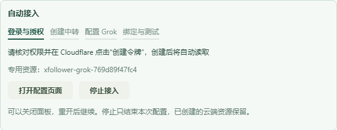
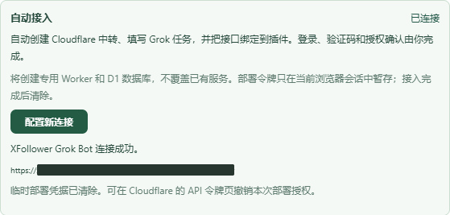
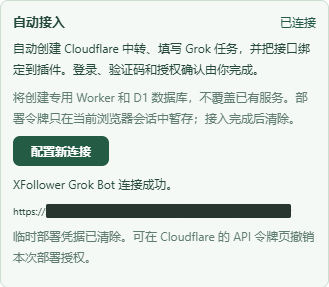

# Grok Bot 自动接入向导方案

> 3.7.4 额度结论更正：本通道统一称为 Grok Hook，通过 Grok 自动化 Webhook 生成，仍使用 Grok 用量，不代表独立 Bot 额度。本文原有 Bot 称呼及独立额度设想仅保留为历史背景；回传成功不能证明独立额度生效。

## 目标和当前基线

当前3.6.2具备分步教程、手工绑定、生成测试和持久化任务。新一轮迭代把创建Cloudflare中转和配置Grok网页自动化串成可恢复的向导。用户仅在注册登录、邮箱或验证码、安全验证、选择授权账号与授权确认时操作；正常部署不要求复制代码、Account ID、数据库ID、Worker地址或连接Token。

在现有feature/release-readme-workflow继续这一功能的集成，保留其他任务全部暂存及未暂存改动，不提交、推送或发行。master生产基线及develop不直接修改。新增功能完成后使用version:set升级minor版本。

## 用户流程

1. 在Grok Bot设置点击“自动接入”，说明会读取本次配置页面和创建专用资源。用户点击开始构成该向导的自动操作授权。
2. 请求访问Cloudflare控制台和官方API的可选站点权限。只创建向导自己的标签页，记录tabId；不借用或关闭用户既有标签页。
3. 打开Cloudflare登录或账号选择页。未登录、验证码、邮箱验证时展示“请完成登录/验证”，保留现场；检测到登录后自动继续。多个账号时用户选择要授权的账号。
4. 打开官方API Token模板链接，预填名称、账号资源范围、Workers Scripts编辑、D1编辑和账号读取。用户核对权限并确认创建；向导只读取这个专属页面中新生成的Token，绝不从整个账号搜集既有密钥。不读取Cookie或登录凭据。
5. 通过官方API校验Token和账号，生成本次唯一Worker/数据库资源名。展示部署清单供用户确认授权，然后创建D1、初始化schema、上传预打包Worker、绑定数据库、取得workers.dev地址。若首次开通Workers需要接受条款或选择子域，打开该页面等待用户完成后继续，不自动接受法律或付费条款。
6. 生成独立CLIENT_TOKEN，健康检查前先使用尚未接入Grok的占位绑定，不触发付费生成。部署阶段Worker允许保存未完成配置，但健康检查明确报告未就绪。
7. 打开Grok网页自动化，创建本次专属任务，自动填写名称和固定指令、选择Webhook触发器；在网页真实保存/创建动作后立即读取首次显示的端点和签名密钥。自动化操作只针对向导创建的任务。Grok登录、验证及浏览器授权由用户处理。
8. 把端点、签名密钥、PUBLIC_BASE_URL和CLIENT_TOKEN写入本次Worker，完成协议健康检查，并自动将origin与CLIENT_TOKEN交给已有连接服务。旧的可用连接保留到新连接生成测试通过。
9. 自动发起一次连接测试，每30秒查询原jobId，5分钟等待预算；后台任务6分钟保护。收到真实结果才显示“接入完成”。遇到迟到回传继续查询原任务，不能重复生成测试或用HTTP202冒充成功。
10. 清除临时Cloudflare部署Token和Grok签名密钥的本机会话副本。日常仅保留Worker地址和专用连接Token。显示本次资源名称、撤销入口和结果记录。

## 技术划分与依赖选择

- 复用Chrome MV3 tabs、scripting、permissions、storage.session；不引入CDP/debugger权限、远程脚本执行或AI代理依赖。网页适配以语义标签、输入框关联和明确成功状态为依据，不靠固定像素坐标，不发送模拟登录凭据。
- Cloudflare资源操作使用官方REST接口。现有项目没有Cloudflare SDK；该功能仅需少量固定接口，使用已有fetch能力构建小型业务适配层，避免为部署引入Node专用SDK、Wrangler或通用浏览器控制框架。
- 复用已有打包Worker、SQL、Standard Webhooks、Dexie连接与任务存储。Worker代码来自仓库固定构建产物，禁止从外部下载后动态执行代码。
- 页面自动化在扩展隔离世界执行；不得把密钥放在DOM自定义事件、全局window变量、页面postMessage或URL参数中。返回结果只通过chrome.scripting的扩展通道传回。
- Webhook表单若为受控输入，使用原生setter与input/change事件；不以DOM文字“看起来改了”作为保存成功。保存后重新读取任务或表单确认持久化结果。
- 页面适配器识别明确的登录、验证、授权和就绪状态；不确定时停在该步并给出可执行说明，不猜按钮、不反复点击“创建”。保留手动教程作为网页改版后的恢复入口。

## 状态、恢复与资源保护

非敏感检查点记录setupId、阶段、所拥有tabId、账号ID、资源名、D1 ID、origin和测试jobId。临时部署凭据只存storage.session默认可信扩展上下文，设有效期；关闭浏览器后凭据丢失，重新授权后使用原资源检查点继续。Token和签名密钥不进入local、业务备份、诊断日志、异常正文或截图。

向导用setupId关联资源，生成唯一资源名。创建数据库POST前保存意图，网络不确定时先按资源名检查实际结果，再决定继续；不能盲目重复POST。重试上传只覆盖本次确认拥有的Worker，不覆盖同名外部资源。取消不删除已创建云端资源，展示其名称和清理入口。多面板或重开不能同时推进同一会话。

API错误只展示步骤、HTTP状态和有限错误码，不拼接原始响应或请求中的秘密。只请求明确的HTTPS官方站点与当前Worker origin；所有tab URL均核对协议、hostname、路径、tabId和任务归属，导航到其他站点立即停止读取。已有绑定失败不覆盖。连接测试失败保留旧连接和新部署检查点。

## 分工

Antigravity：仅负责Cloudflare官方REST部署适配器与对应单测。按照独立接口合同实施，不修改UI、版本、后台入口或其他业务文件。Codex负责本方案、状态编排、网页引导与提取、Vue界面、差异审查、集成测试和CDP实机验收。跨进程不修改同一文件，不操作共享dist。

## 验收标准

- 模拟接口覆盖Token无效、账号不匹配、权限不足、资源创建响应丢失后恢复、上传失败重试、已有同名资源保护及秘密不回显。
- 真实网页适配器覆盖中英文按钮/标签、受控输入、保存确认、验证码等待、未授权站点、用户旧标签页不读取、只读本次新Token与Webhook密钥。
- 向导覆盖开始、取消、关闭重开、凭据过期、部署阶段恢复、旧连接保护、单次测试去重、成功清理临时凭据。
- npm test、构建、源码检查；实机检查宽屏与390px、真实可选权限确认、用户登录/验证接力、自动创建与回填、测试结果及重载后设置保留。
- 新建独立测试资源，不修改现有实验任务或生产Worker。自动化失败时明确记录未验证部分，不把模拟测试或旧手工配置成果当作新向导实机成功。

## 官方依据

核对时间：2026-10-27。Token模板允许预填短权限键与账号范围；部署使用官方Worker上传、D1创建及查询接口。网页布局仍需现场验证，不把文档推断当作DOM事实。

- [Token模板链接](https://developers.cloudflare.com/fundamentals/api/how-to/account-owned-token-template/)
- [创建API Token](https://developers.cloudflare.com/fundamentals/api/get-started/create-token/)
- [上传Worker模块](https://developers.cloudflare.com/api/resources/workers/subresources/scripts/methods/update/)
- [创建D1数据库](https://developers.cloudflare.com/api/resources/d1/subresources/database/methods/create/)
- [Grok Webhook协议](https://docs.x.ai/grok/automations/webhooks)

## 实施与验收结果

已完成方案先行、自动接入状态编排、Vue向导、Cloudflare官方REST适配器、网页适配器、后台路由和30秒调度，以及会话凭据清理、权限等待、单任务测试、取消与重开恢复。Antigravity负责官方REST模块，Codex完成审查和恢复保护修正。

首轮测试：1186项单元测试全部通过；构建成功；146个源码模块与171个浏览器调用文件检查通过。覆盖首次Token权限预填、最终创建按钮保持人工确认、只读本次新Token、站点归属、并发开始去重、生成测试精确标记恢复、30秒查询和临时凭据清理。

首轮3.7.0已加载并打开自动接入入口，曾停在Chrome首次站点授权。用户完成明确要求手动处理的授权后，继续了真实部署、Grok保存与回传验证，最终结果见下节。

Grok现场差异：当前登录账号的新建触发菜单一度只显示定时触发器，Webhook目录未正常加载。页面适配器在缺少Webhook时停止，不选定时触发器代替。验证通过且目录完成加载后，已使用真实入口完成新建和回传验收；旧连接的已有回传不计入本次向导结果。

已完成真实授权后的创建、读取、部署、回填与生成闭环，以及390px验收和最终重载。未提交、推送或发行。

### 最终验收-2026-10-27 22:03

已完成真实自动接入闭环，当前运行3.7.0，最终重载后仍为completed，Grok Bot通道选择保留。测试结果为“XFollower Grok Bot 连接成功。”，新连接enabled且testedAt有效，origin与本次部署一致，无待替换连接。Cloudflare临时部署Token、Grok签名密钥与会话CLIENT_TOKEN副本已清除；日常连接Token按原设计仅在扩展私有数据库保留。向导调度已停止，评论调度已恢复。仅关闭向导自己创建的Cloudflare和Grok配置标签页。

真实过程中，用户只处理了安全验证、站点访问授权、Cloudflare创建部署令牌确认和新Worker访问授权；无需复制Account ID、数据库ID、端点、密钥或代码。新建专用Worker与D1，未覆盖原有资源。自动读取令牌后通过官方API校验、创建和初始化D1、部署Worker、开通worker子域；自动填写Grok名称和指令、选择Webhook并保存，再自动接收端点和完整签名密钥、写入Worker并绑定插件。

发现并修正的现场兼容点：

- Cloudflare预填后移除URL查询参数：同时以专属名称输入框确认归属；新令牌实际显示在select-all文本块，加入该区域的明确读取支持。
- Grok页面与触发器目录异步加载：等待页面与Webhook选项，不把定时触发器当作替代。Radix下拉菜单会把父弹窗aria-hidden，先确认专属任务归属并处理菜单，再判断父弹窗。
- Grok默认缩略显示签名密钥：仅对本次新建任务的两个明确复制控件，在MAIN上下文短暂接收clipboard.writeText参数，通过扩展通道返回；不读系统剪贴板，不执行原系统写入，finally恢复原方法，不在window或DOM事件中留存密钥。已加入成功与异常恢复、旧任务拒绝读取的测试。
- 点击Grok保存前先持久化创建意图；响应丢失后只检查原任务，不盲目再次创建。
- 生成测试有专属requestTag，可在中断后精确恢复；向导每30秒查询，普通Bot设置轮询跳过向导拥有的测试，避免重复查询。

真实测试约6分多钟后回传，等待期间始终查询同一个jobId，未重复生成。5分钟是一般Bot调用的一轮等待预算，不取消云端任务；向导后台继续查询迟到结果。测试通过后才提交新连接并清除临时部署凭据。

最终验证：1197项单元测试全部通过；构建成功，146个源码模块和171个浏览器调用文件检查通过；构建测试53通过、1项原有失败，原因仍是工作区根目录已有grok bot.js违反源码布局规则，保留用户原文件，未删除或移动。宽屏与390px自动接入、授权等待及完成状态均无横向溢出。截图中的实际域名已遮盖，截图后自动移除所有临时遮罩。教程更新为13张截图，新增自动接入说明，保留手动代码作为备用。

范围说明：本次真实账号已登录且已开通Workers。首次注册、邮箱验证与首次Workers条款/子域界面未用新注册账号实测；向导对可识别的空子域输入框预填建议值，保留用户已有选择，只等待用户确认开通授权，无法识别的页面会停留提示。不能据此次验收宣称所有账号与页面版本均可无人工接入。未提交、推送或发行。
