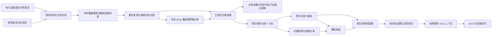
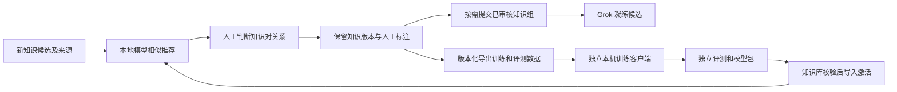

# 帖子追踪与博主排行榜迭代方案

创建时间：2026-10-21 18:12；维护者：wangsen。

本方案从第 7 篇架构文档的下一轮交接内容拆出。2.0.0 架构与发行记录留在原文，本轮需求、实现进度、问题和验收证据统一维护在本文，避免不同版本持续混写。

## 一、背景与当前状态

已按用户要求通过 Git Flow 创建并切换到 feature/post-tracking-leaderboard，基点为 develop 的 21aedcb，创建时与 2.0.0 代码树一致。该分支用于本轮独立迭代。2026-10-21 18:12 整理时，工作区已出现 PostTrackingSection.vue、src/features/post-tracking/、网络适配及相关测试等开发改动；本次仅拆分文档，未审查实现完整性或运行专项测试，不能据此标记功能完成。实际版本号与发行状态以本轮验收记录为准。

用户已明确的目标：将自己关注的流量博主加入排行榜，监测每日粉丝增长，追踪并发现优质爆帖。新功能与现有“评论追踪”用途不同，实施时保留其入口和既有能力。

## 二、需求与实现边界

以下为目标要求，实施完成情况需逐项核实：

1. 从已关注账号中选择监测对象，支持添加、移除及查看采集状态；用稳定用户 ID 关联账号，改名不切断历史。
2. 保存粉丝数快照及真实采集时间。日净增依据相邻有效日快照计算，首次采集显示“基线建立”；缺失日期不得伪造零增长或补造历史，明确跨日间隔与统计时区。
3. 保存帖子 ID、原帖链接、发布时间与互动快照，展示新增内容及点赞、回复、转发变化；浏览量不可获取时标记缺失，不当作零。
4. 首版优先提供可核实的涨粉排序与帖子指标排序；爆帖判断结合互动率、发布时间和博主自身历史基线，样本不足不输出伪精确结论。具体阈值与采集周期在实施方案中确定。
5. 沿用 src 分层与现有平台适配，先核实真实页面或接口字段及限流表现，再定调度与存储结构；监测功能不附带自动关注或公开评论。

## 三、验收要求

添加真实已关注博主 → 首次采集并落库 → 后续采集形成可追溯差值 → 排行榜与帖子详情显示 → 重载后数据保留。同时覆盖断网、缺失指标、重复采集及账号改名。跨日真实增长需要持续观察，单次模拟或单测不能冒充跨日实机验收。

## 四、进度记录

- 2026-10-21：已创建 feature/post-tracking-leaderboard，基于 2.0.0 同代码树的 develop。
- 2026-10-21 18:12：独立归档本方案；发现工作区已有开发改动，当前状态为开发中、待专项验收。未在本次文档操作中修改、提交或发布业务代码。

## 五、帖子追踪本地验收补充 — 2.1.1 至 2.1.2

2026-10-21：本节记录自己的帖子追踪交付；前述博主排行榜仍为待实现目标，不将其计为本轮完成。

2.1.1 补齐每页 20/50/100 条、页码与省略号、上一页/下一页及页码跳转。筛选或切换视图回到首页。界面使用 flex 对齐、显式 margin/padding，普通间距为 10px；筛选与分页控件统一 32px 高，标签 24px 高。CDP 在 1920、1280、960 宽度核对实际布局，无页面横向溢出，工具栏与分页控件对齐。

2.1.2 完成用户明确批准的单帖真实删除验收：账号 @WatsonTaylor23，帖子 ID 2111419288313802775，正文为“币茫茫都开始发‘出汗了都’，这波行情的热度连今天的太阳都比不上。有关必回”。原帖链接：https://x.com/WatsonTaylor23/status/2111419288313802775 。授权只涵盖这一条。

- 面板核对账号、ID 与完整正文，勾选确认并执行最终确认；捕获到一次 DeleteTweet POST，请求变量只有目标 tweet_id，响应 HTTP 200，data.delete_tweet.tweet_results 为空对象，无 GraphQL errors。没有重发该删除请求。
- 独立新建的非激活 X 标签显示“唔...该页面不存在”。详情请求 HTTP 200，同一焦点 entryId 为 tweet-2111419288313802775，TimelineTweet 的 tweet_results 为空。
- 实测发现旧核验仅识别明确删除墓碑，因此保持“待对账”。修复为：明确成功的删除回执与完全匹配该帖子 ID 的空焦点详情共同成立，且未发现目标 Tweet 时，才核验完成。页面不存在、无关帖空条目、错 ID 回执或单独空响应都不能判定成功。
- 此次删除发生在 2.1.1，旧实现未保存成功应答标记。根据已捕获且严格核对唯一请求/响应的事实，仅补齐该条本地记录的 serverAcknowledged、acknowledgedPostId 与 receiptSource=captured-response，再进行只读核验；未重新删除。
- 最终帖子记录与对应 intent 均为 verified，verification=acknowledged-focal-empty。新打开的扩展面板重新读取 IndexedDB 和列表查询，确认状态持久化、精确 ID 搜索返回 0 条；原记录作为审计依据保留。未清除原发布来源记录。

验证结果：479 项核心测试、43 项构建测试通过，60 个源码模块语法检查通过，dist 构建与资源完整性检查通过。回归覆盖缺少回执、错误帖子回执、无关空焦点、正确组合核验及 intent 对账，确认核验过程不重发删除。

当前为 feature/post-tracking-leaderboard 本地 2.1.2，已在既有登录态 CDP 扩展验证；未提交、推送、合并或发布。封禁、关注、取关未执行真实写操作，长周期监控效果仍需实际运行积累。

## 六、分批定时检测 — 2.1.3

更新时间：2026-10-21 19:33；维护者：wangsen。

原实现虽有后台小时闹钟，但每次按整段日期读取，max_results=1000，最近30条不足时扩窗，还可能再次补采历史；面板可见时每15分钟也发起同步。该设计不能满足“每次约100条、循环更新”的请求控制要求。

### 实测接口约束

通过已有登录态 CDP 查询 contentPageQuery，用户结果只有 tweets_results，没有分页 cursor。设置 max_results=100、query_page_size=100 后，一次14天请求仍返回168条，一次24小时请求返回131条。因此不能把 query_page_size 当作应用层分页游标，也不能保证服务端严格返回不超过100条。改用时间窗口持久化续扫；不编造未知 cursor 字段。

### 调度与存储

- 默认每15分钟一批，可选30或60分钟。每个批次只发送一次分析 GET，参数 max_results 与 query_page_size 均为100；不在同一任务中连续翻页、扩窗或失败重试。手动“检测下一批”也遵守同一截止时间，不能通过快速重复点击绕过。
- 轮换最近30条、待二审复查、历史轮巡、新帖快速检测。新帖快速检测每轮重新读取最近6小时；最近30条按已知发布时间覆盖至少24小时，并逐窗推进；待二审复查优先24小时未更新、满72小时且为自动引用或低价值候选的未保护帖；历史按所选范围及已知历史继续，最长90天。缺少复查候选时让出该轮给历史扫描。普通四批轮换在15分钟间隔下约一小时，不能声称所有历史每15分钟更新。
- 普通窗口为6小时。返回达到或超过100条时，本批不当作完整覆盖、不落入截断后的部分集合，保留窗口并二分，后续定时批次继续；恰好100条也保守拆分。完成上半窗再处理下半窗，边界精确衔接，避免人为截取前100条漏掉其余帖子。小到1秒仍满批时停止推进并报错，不能假装完成。
- 扩展源 IndexedDB 的 meta.scanner 保存版本、轮换阶段、各类窗口、待拆分窗口、历史游标和累计批次；posts 保留审核、保护、删除审计及原有快照。扫描完成后列表以已保存数据分析低价值候选，每条帖子展示自己的数据更新时间；未扫到的数据保留旧快照，不能冒充本次更新。
- 批次开始前持久化至少2分钟防重截止时间；成功后保存完整检测间隔。失败按15分钟起指数退避，自动退避最长6小时；401/403/429至少冷却1小时，并遵守更长的 Retry-After。失败不推进已保存窗口。
- 使用一次性 Chrome alarm，按持久化 nextBatchAt 和 retryAfter 恢复；暂停清除闹钟，保留进度。扩展重启不把原截止时间不断顺延。面板每30秒仅重新读取本地状态，不发分析请求。切换日期范围只保存新范围，下一批生效。
- 定时批次使用独立非激活 X 首页标签和已捕获的分析模板，不导航账号分析页，避免该页面原生发出一次1000条全量查询。缺少模板时提示用户先在 X 打开一次账号分析页面；不会自动打开全量页作为定时检测前置动作。

关键实现：src/features/post-tracking/post-scanner.js 负责窗口与轮换；post-runtime.js 负责单批请求、进度、冷却与闹钟；PostTrackingSection.vue 展示间隔、批次窗口、下次检测和数据更新时间。删除仍需具体确认，不随检测自动执行。

### 验证证据与边界

- 486项核心测试、43项构建测试通过；61个源码模块语法检查及 dist 构建和产物完整性检查通过。新增回归覆盖每批一次请求、重复触发拦截、满批拆分及完整边界、窗口恢复、复查优先级、Retry-After、暂停与截止时间恢复，以及范围变更延后生效。
- CDP 实际点击“检测下一批”与实际 Chrome alarm 各触发一批，捕获恰好两次分析 GET，均为100/100请求参数；每次HTTP200返回91条并落库。立即再次请求被下次检测时间拦截。为在一次验收中观察闹钟触发，仅临时将本地下一批截止时间置为到期并触发一次闹钟；结束后已由成功路径恢复正常15分钟调度，不能把此验收当作自然等待15分钟的证据。
- 面板重载后保留2个批次、历史窗口游标、15分钟设置及下次检测时间；最终2.1.3扩展重载后再次核对批数、游标与定时器截止时间均恢复一致。1920、1280、960宽度下无页面横向溢出，容器 padding=10px，新增间隔选择框和按钮高度均32px。
- 实机未故意制造429或无效登录，退避分支由回归测试验证；尚未完成90天全量自然轮巡及长期运行观察。低价值区仍为规则候选加人工二审，不声称已接入自动语义分析。分批和退避降低请求压力，不能保证平台不限制账号。

本地版本2.1.3，仍在 feature/post-tracking-leaderboard；未提交、推送、合并或发布。本轮未执行任何删帖、关注、取关或封禁请求。

## 七、配置与界面收敛 — 2.1.4 至 2.1.9

本轮迭代继续在当前功能分支完成：分页移至列表右上；曝光、点赞、评论、转帖表头可切换降序/升序；常驻解释移入帮助弹窗；定时设置收进可复用的右侧 ActionSettingsDrawer。列表只显示当前账号、监控数和倒计时。仅追踪 X 分析接口返回的当前登录账号自己的帖子，不提供手动切换追踪账号入口；检测到身份变化时隔离游标并使原删除确认失效，不混用记录。

2.1.9 新增配置：每批上限为10至100的整数，默认100；待二审复查周期为12、24或48小时，默认24。原检测间隔仍为15、30或60分钟。配置在抽屉保存后生效，关闭未保存的草稿不写入。服务端校验拒绝小于10、大于100、非整数的批量值及非法复查周期；仅修改其他设置时保留已保存值。

每批上限同时传入 max_results、query_page_size，并作为满批拆分判断阈值，不能只改变展示或请求参数。进度记录保存本批使用的 limit；修改配置后继续未完成窗口。复查周期控制满72小时的自动引用或低价值候选，在上次采集经过多久后进入优先复查轮次，不承诺恰在该时刻完成。最近30条集合不随复查配置改变。

界面正文12px、辅助时间11px、常规控件28px高；容器与普通间距继续保持10px。设置按钮28×28、SVG图标固定16×16且禁止伸缩，外形改为对称齿轮，避免狭长或挤压。标签保留24px高度。

验证：490项核心测试、43项构建测试通过，源码与dist检查通过。CDP在1920、1280、960宽度核对图标16×16、按钮28×28、正文12px、容器padding10px且无页面横向溢出。实机设置50条与12小时后重开、重载均保留；实际单次请求的两个数量参数为50，服务端返回59条时按50阈值拆分并保留窗口，未当作完整覆盖落库。测试后恢复原有配置100条、24小时及原来的启停状态。未制造真实限流，未更换浏览器登录账号，相关分支由回归测试验证。

当前本地版本2.1.9；未提交、推送、合并或发布。

## 八、批量 Grok 特点学习与写作记忆 — 2.2.0

2026-10-21 20:18：实现“批量选帖 → 分析优点或缺点 → 审核采用特点 → 后续评论生成复用”的闭环。这里保存账号级写作偏好，不训练 Grok 模型权重，也不保证曝光增长。

### 使用与界面

列表增加逐条选择与本页全选，每次1至20条；跨页保留选择，切换价值视图清空，超出20条拒绝选择。仅选中帖子或分析中时显示批量工具栏。点击“分析优点”或“分析缺点”，通过现有 X 内置 Grok 通用文本通道提交一次分析，不发布帖子。

右上角书本图标打开“写作记忆”抽屉，数字为已启用/全部特点。每条包含借鉴或回避类型、可编辑正文、分析依据及可点击的来源帖子ID；可勾选、停用或移除。新特点默认待采用，勾选保存后进入后续生成。保留30px控件与行高、16px图标、10px间距，三个桌面宽度实测无外层横向溢出。多行特点编辑框使用独立行高与滚动区域。

### 数据与接入点

- writing-memory.js：分析提示词、严格JSON解析、账号级规则读取及有界写作上下文；仅启用规则进入提示词，事实、安全、语言和长度约束优先。对固定口号、互关收尾、emoji等表面共性增加明确限制，不能因样本高曝光就推广为质量规则。
- post-learning.js：后台任务、选中样本快照、任务ID/类型/证据ID匹配、失败状态、去重及规则编辑。结果不完整、任务不匹配、引用非样本ID或格式不合法时不写入记忆；空结果可正常完成，不编造特点。
- chrome.storage.local 使用 postWritingMemory:ownerId 与 postLearningJob:ownerId。每类最多20条，合计40条，特征正文最多240字；生成上下文有总长度上限且不从规则中间截断。编辑保留原始文字与来源信息；按revision检查并发更新，分析中不允许覆盖记忆。账号与帖子仍由后台核验，不信任面板提交的其他账号。
- 分析任务先持久化再提交，运行中拒绝重复提交；失败不自动重试。服务重建后，超过4分钟的无活动运行记录标记中断，需人工重新发起。
- grok-comment.js 的 requestGrokComment 共用入口读取写作记忆，生成与超长改写均传给 buildGrokCommentPrompt。面板、后台评论和关注队列沿用此入口；关注队列明确传入自己账号的 accountId，不能用被评论账号查询写作偏好。其他路径依据已识别的当前账号读取；未识别时不注入其他账号记忆。

### 验收与实际边界

499项核心测试、43项构建测试、64个源码模块检查及dist构建验证通过。新增覆盖：完整任务及证据解析、正负规则隔离、重复提炼去重、外部/删除样本拒绝、并发版本保护、编辑/停用/移除、账号隔离、共用生成函数的实际提示词注入、中断及重复提交防护。

CDP实机在高价值视图选择5条、低价值视图选择3条，分别提交真实X Grok分析，共返回6条候选特点，保留任务与样本依据。实测发现Grok会把固定收尾口号当成优点，又在低质量分析中指出类似问题，因此候选不能自动固化成规则；本轮在此发现后增加默认待采用和更明确的分析约束。不能把“高价值视图”中的曝光表现直接等同内容质量。

实机全选20条、跨页尝试第21条被拦截，切换价值视图清空选择。临时在抽屉启用1条特点并保存，使用真实存储和实际共用 requestGrokComment 函数，配合受控 asker 捕获提示词，确认启用规则进入、其余未启用规则排除；该步骤未再次调用Grok生成评论，也未发布。验收后恢复全部6条为待采用，重载后记录与状态保留。实际评论质量、曝光改善及长期迭代效果尚未验证，不据此宣称模型本身变得更聪明。

本地2.2.0，未提交、推送、合并或发布；本轮没有删帖、关注、取关或公开评论。

## 九、首次初始化恢复与立即更新 — 2.2.1

2026-10-21 20:41：修复新浏览器没有追踪账号或分析请求模板时，页面持续停在“待识别账号 / 待同步”的初始化缺口。此前进入页面仅读取本地数据，检测又依赖预先捕获的分析模板，首次错误也没有在无账号状态下呈现。

首次进入且没有账号时自动尝试一批检测；已有记录仍只读取本地，不因面板刷新连续请求。缺少模板时创建自己的非激活分析标签，携带一次性标识、配置的10至100条上限及最多6小时窗口。document_start 的 network hook 仅对该受限标签改写原生 contentPageQuery，并防止重复分析请求；普通分析标签不受影响。后台按一次性标识与 tabId 匹配回执，使用本次原生响应识别当前账号并落库，不追加第二次同批查询，结束后关闭自己的标签并清理匹配回执。这里的请求上限仍不是服务端返回条数保证，满批继续使用已有窗口拆分机制。

标题右侧新增30×30px的立即更新图标，图形16×16。手动检测遵守上次尝试起至少两分钟间隔及限流冷却；后台定时检测继续遵守15、30或60分钟的下一批截止时间。失败不会绕过退避：初始化HTTP错误、GraphQL限流和Retry-After进入共用失败处理；无账号时也显示实际错误，允许冷却后重试。帮助说明同步更新，不再要求用户手动打开一次分析页面。

验证：506项核心测试、43项构建测试通过，源码检查、构建及产物完整性检查通过。新增回归覆盖无模板初始化、回执标签不匹配、初始化超时、429及Retry-After、手动最小间隔与定时截止时间、受限原生请求改写及重复请求防护，普通分析页不改写。

CDP在已有登录态下使用独立非激活标签验证初始化引导：仅发出一次100/100参数、最近一小时窗口的分析请求，HTTP200，返回6条并识别WatsonTaylor23。随后实际点击立即更新按钮，累计批次4增至5，数据时间更新且无错误，按钮进入两分钟冷却；两个独立动作合计两次分析请求。按钮实测30×30px，原有6条写作记忆未变。

另一个浏览器未直接附加验收。临时重置真实浏览器追踪状态的冷启动测试被自动审批以“blocked by policy”拦截，操作未执行，也未换通道重试。完整空状态自动启动由隔离测试覆盖；实机证据覆盖受限原生初始化请求和现有账号的按钮更新，不能据此声称另一个浏览器完整冷启动已实机通过。

本地版本2.2.1，未提交、推送、合并或发布；本轮没有删除、关注、取关或公开评论。

## 十、低质帖数字规则配置 — 2.2.2

2026-10-21 20:50：追踪设置抽屉整理为“定时监测”和“低质帖”两组。第一组保留启停、检测间隔、每批上限及复查周期；第二组将现有数字判断标准提取为可保存配置，长说明放在帮助弹窗与字段悬停提示中，原执行状态详情仍可从使用指南查看。

低质帖默认值沿用旧逻辑：观察时长72小时、人工内容低分上限3分、同龄样本至少20条、曝光后20%且低于中位数25%、停滞观察48小时、增量不超过5次与历史曝光5%两者较大值、删除建议帖龄7天。所有字段单位明示；共享post-rules.js定义字段、默认值、范围与校验，旧配置缺失时回落默认，保存非法、空值或小数时拒绝整组写入。

配置持久化到ownPostTracking.lowRules，列表重新读取即重算候选，定时复查选择也使用同一组规则。高价值仍沿用原来的评分与曝光要求，修改低曝光样本下限不改变高价值样本门槛。普通夸赞与重复正文规则保留；保护、有效历史证据及有价值讨论的约束仍生效，低曝光不能单独产生删除建议，实际删除仍需单独确认。修改规则只更新本地判断，不额外拉取X数据或自动删除。

509项核心测试、43项构建测试、65个源码模块语法检查及dist构建通过。回归覆盖九个阈值、默认兼容、即时重算、配置保留与运行实例重建、定时复查接入、无效值拒绝及保护条件。CDP实测两组标题、全部数值/选择控件高度与行高均30px，无抽屉横向溢出；通过真实输入事件将观察时长72改96，点击保存后重载仍为96，随后恢复72。原6条写作记忆保留，未调用Grok、删帖或公开评论。

当前本地2.2.2，未提交、推送、合并或发布。

## 十一、批量删除替代取消选择 — 2.3.0

2026-10-21 21:06：原批量栏“清空”仅取消勾选，容易被理解为清空记录或删帖。按用户要求替换为“批量删除”，最多使用现有跨页选择的20条帖子；保留固定占位与30px按钮，不因选中改变表格位置。原本的取消选择仍可通过逐条或表头勾选完成。

点击批量删除仅准备确认，不发出删除请求。弹窗列出账号、数量、全部帖子ID、链接及完整正文；确认项默认未勾选，最终按钮禁用。取消关闭弹窗并保留选择。实际确认后由后台串行执行，复用单帖deleteConfirmed及networkDeleteOwnPost、实时身份/正文核验和删除结果核验，不在面板另写接口逻辑。

后台prepareBatchDelete拒绝空集合、超过20条、重复或非法ID、外账号、保护帖及已有删除任务；先验证全部记录，再持久化一次性批次与每条具体意图。确认绑定账号、绑定nonce、正文摘要和目标集合，10分钟过期，调用者不能在确认阶段添加目标；执行前再次检查整组，之后逐条实时核验。批次运行前先持久化running，每条结果独立保存，任一未核验成功或异常立即停止，不继续其余帖子；两条之间至少等待3秒。批次与单条确认均不自动重放，中断后需先核验已有不确定结果，对其余目标重新确认。

结果弹窗区分已核验删除、未发出、待核验及未继续执行的数量。完成项在列表隐藏，原始审计记录保留；不会将HTTP200或无异常直接当作删除成功。没有增加自动删除或自动重试动作。

验证：514项核心测试、43项构建测试、65个源码模块检查、dist构建与完整性验证通过。回归覆盖精确批次确认、整组变更预检、成功逐条核验与隐藏、拒绝重放、账号nonce变化、过期、非法集合、保护帖、429/未发送失败停止及实时身份不符。CDP实际选择2条、打开完整目标清单，确认按钮默认禁用，勾选后启用，最终取消；消息仅prepareBatchDelete，没有confirmBatchDelete，未发送真实删除请求，取消后保留2条选择，表格Y坐标始终249px。本轮批量真实删除未验收，未扩大以前单帖授权范围。

本地2.3.0，未提交、推送、合并或发布。

## 十二、批量删除请求等待与延迟核验修复 — 2.3.1

2026-10-21 21:33：用户实测批次前两条已核验，第三条提示“未取得当前X分析请求”。排查发现删除前withPage要求每个新分析标签都产生时间戳更新的原生contentPageQuery；即便本地已有有效请求格式，只要页面复用缓存或未产生该请求，也会等待超时。这不是实时账号与正文核验的必要条件。改为使用加载完成的独立X主页和已捕获请求格式，再主动发送实时分析读取以验证当前账号与具体正文；不依赖每条重新打开分析页面产生原生请求。详情核验同样允许复用格式，实际结果仍通过本次接口读取，不复用旧响应。

### 授权实机中发现的第二个问题

用户明确授权“全流程随机删几个阅读量少的帖子”。从当前账号WatsonTaylor23的低价值候选中随机选择3条：均为已观察超过72小时、未保护、没有删除任务、已记录显式曝光5次的帖子。实际通过面板勾选、查看全部正文、勾选确认、点击批量删除执行。第一条删除接口HTTP200且带成功回执，但立即读取的详情尚未确认消失，原保护逻辑正确停止另外两条。随后独立公开链接显示页面不存在，HTTP200详情中目标焦点结果为空，再次只读核验完成；没有重新发送第一条删除。

因此补充有界的只读复核：成功写入后立即核验，仍未确认时分别等待2秒、5秒再次读取，最多3轮。只读请求遇到非200或异常即停止；无论何种情况都不重发删除写入。三轮仍不确定则保留待核验并停止后续目标。更新代码后，只对原集合尚未执行的两条重新准备具体确认，两条均在同一批次完成并独立核验，未增加额外随机目标。

### 本轮真实删除证据

| 帖子ID | 验收前记录曝光 | 最终结果 |
| --- | --- | --- |
| 2111657057736921238 | 5 | 已核验删除，成功回执与精确空焦点详情一致 |
| 2111656445322445204 | 5 | 已核验删除，成功回执与精确空焦点详情一致 |
| 2111663118191657305 | 5 | 已核验删除，成功回执与精确空焦点详情一致 |

最后用独立非激活标签逐条打开三个公开链接，均显示页面不存在，对应原生TweetDetail均HTTP200且只有该目标的空焦点结果；本地三条审计均为verified、serverAcknowledged=true、acknowledgedPostId与本条ID一致。没有重复删除第一条，没有操作用户截图中已删除的两条。验收仅关闭自己创建的标签。

518项核心测试、43项构建测试、65个源码模块语法检查及dist构建通过。新增覆盖旧时间戳模板且完全没有新的原生捕获时连续3条删除、缺模板仍拒绝写入、实时身份核验仍保留、延迟可见时只重读不重删、复核最多三次后仍停止批次。

当前本地2.3.1，未提交、推送、合并或发布。

记录时间：2026-10-21 22:23 Asia/Shanghai

## 十三、指标初筛与Grok保留建议 — 2.4.0

本节替代旧版人工二审流程，以右侧详情抽屉为基础，按用户要求改为“指标初筛 → 用户拿不准时批量Grok二审 → 仅展示有依据的保留建议 → 用户保留、保护或确认删除”。本轮不增加自动删帖，也不把定时指标检测变成持续自动调用Grok。

### 初筛与人工决定

初筛只依照观察时长、有效同龄样本数量和相对曝光阈值；旧人工评分、重复正文及Grok建议均不改变指标初筛。高价值数据区仍依据同龄曝光表现。曝光停滞作为指标信号展示，不自动生成删除建议；原人工内容低分与删除建议帖龄配置退出当前规则，旧存储字段不再参与判断。用户仍可按正文直接决定删除，无需先让Grok评分。

详情抽屉完全移除人工评分、审核依据与讨论勾选输入，只展示数据和Grok结果。底部固定保留、保护保留、删除入口：保留设置retained，暂时排除低价值候选并可取消；保护另外阻止删除，解除后才可确认删除。Grok建议不会设置这些人工决定字段。删除仍先展示具体账号与正文，只有最终确认按钮发出删除请求。

### Grok提示词和结果契约

列表“分析缺点”改为“Grok二审”，支持所选1至20条，包括任何用户拿不准的帖子；详情也可单条分析。“分析优点”继续提炼正向特点，同时返回逐条二审结果。低质提示词明确：初筛或用户分组不是已验证的内容低质结论；逐条分析具体信息价值，只有有据可查的保留理由才输出建议，没有保留依据时不发表针对该帖的建议，不劝删、不编造优点。缺少被引用原帖等上下文时不得补造事实。写作特点另行提炼为可借鉴/应回避的普遍规则，区别于针对某帖的处理建议。

schemaVersion=2的任务仍使用完整开始/结束标记与taskId/kind匹配JSON，增加reviews数组。必须恰好覆盖全部样本、ID唯一且属于样本，每条score为0至10整数、keep为布尔值。keep=true必须带具体reason；keep=false的reason在保存前强制清空。展示端仅对keep=true显示“建议保留、评分、依据、时间”；其余显示已分析、暂无保留建议，不展示负面处理建议或低分。任何格式、任务或证据不匹配均拒绝写入。

逐条结果保存为帖子grokReview，带来源、analysisId和分析时间。写入使用IndexedDB读写事务中的局部更新，不覆盖同时发生的保护/保留操作；原文字变化或进入删除流程的样本跳过，相关失效证据不进入新写作特点。后续采集发现正文变化时使旧Grok结果失效；单纯指标更新保留建议。迟到结果和失败不会覆盖已替换的新任务。

### 写作记忆

同轮优缺点继续按账号存入写作记忆，含来源帖子和理由、去重及总量约束。新特点默认待采用，用户启用保存后才进入后续评论生成与改写提示词，不自动训练模型权重。某类特点达到20条时跳过新增特点并提示，不妨碍有效的逐条二审结果保存。失败/中断不自动重发，定时复查仍只更新指标。

### 实机与自动化验收

525项核心测试、43项构建测试、65个源码模块检查及dist构建通过。新增覆盖完整逐条结果、非法/缺失/重复ID、分数与依据约束、不保留时清空建议、记忆满额不阻塞二审、迟到任务隔离、原文变化及删除样本排除、并发人工决定保留；同步替换原人工分数驱动的规则测试。

真实CDP两轮Grok共5条自己的帖子：第一轮3条全部无保留建议，新增2条回避特点；第二轮2条中1条得到7分及明确保留理由，另1条无建议，新增2条正向特点。不是构造的模型返回值。最终写作记忆由6条增至10条，全部待采用；模型结果没有自动保留、保护或删除帖子。

实机正向样本2111532505472045089展示评分7/10、具体建议和时间；无建议样本2111493735699890626不展示3分或负面文字。实际打开两种详情均为0个输入框，1920/1280/960宽度均靠右、按钮30px、无抽屉横向溢出。实机临时保留再取消、保护再解除，保护时删除按钮禁用；结束恢复为未保留、未保护，Grok建议保持。详情删除入口正确关闭抽屉并打开具体确认弹窗，最终取消，没有发送删除请求。重载后建议、空建议和10条待采用记忆保留。本轮未删除帖子、关注、取关或发布评论。

当前本地2.4.0，未提交、推送、合并或发布。

## 十四、删除串行链路性能收敛 — 2.4.1

用户反馈接口删除理论上应很快但实际等待较久。源码确认旧流程每条新开一次X主页，成功后每轮详情核验又单独新开帖子页；最多3轮复核、重复页面冷启动和请求签名初始化，加上每次删除都重新读取客户端main脚本解析DeleteTweet操作ID，最后再额外固定等待3秒。因此不能把界面等待时间等同删除POST耗时。

### 修改

- 同一批次只准备一个自己的非激活X执行页，所有逐条实时账号/正文核对、删除写入和详情复核复用该页。已有TweetDetail模板时不再为核验导航；首次缺模板才用独立帖子页取得，取得后复用。单条删除也复用其执行页完成核验。
- DeleteTweet操作ID在页面中按精确main脚本URL缓存；脚本URL变化时重新读取，失败不缓存。只缓存操作元数据，每次请求仍独立签名，不复用交易签名，不自动重发写入。
- 批次按条目启动之间至少3秒调度，已消耗的前置核验、写入和结果复核时间计入；如果本条已处理超过3秒，下一条不再额外等待3秒。保持串行、确认意图绑定、逐条实时核验、失败即停和不重放。
- 每条审计增加pageReadyMs、preflightMs、mutationMs、verifyMs、totalMs；共享网络层记录metadataMs、signatureMs、requestMs、totalMs，批次记录共用页面准备时间。下次真实确认删除可以区分页面、签名、写入与核验耗时，不能用总耗时冒充接口耗时。

### 验证边界

528项核心测试、43项构建测试、65个源码模块检查和dist构建通过。新增覆盖同批只新增一个执行页、所有目标仍分别核验且各一次写入、处理已超过3秒不追加等待、耗时审计落库、精确客户端脚本URL缓存及变化后失效、逐次独立签名。

本轮CDP只读验收在现有登录态创建一个自己的非激活X主页，页面准备5520ms；对之前已删除的三个明确目标读取TweetDetail，HTTP200。三个请求的网络耗时分别756/458/506ms；首次签名1393ms，后两次0ms。首次完整叶子调用2150ms，后两次458/507ms，结束仅关闭自己的测试页。这个实测说明页面冷启动和签名初始化是明显开销，但不是优化后的DeleteTweet POST测速。

本轮没有新增删除。新的真实删除端到端时间尚未实测，不能声称删除POST已达到某个毫秒数；保留原先确认门槛，由下一次具体授权删除的审计提供数据。当前本地2.4.1，未提交、推送、合并或发布。

### 单条删除复用现有页面与再次实测 — 2.4.2

用户再次反馈慢，并明确只需要dist，不需要ZIP。先确认实际面板与后台均运行2.4.1。读取用户最近两条真实审计：总耗时6404/8925ms，其中页面准备3066/5090ms、实时初核2255/2902ms、删除调用375/431ms、结果核验708/502ms；写入网络本身359/420ms。说明不是未构建，而是2.4.1只优化了批内复用，单条仍每次冷启动一个页面。

2.4.2为删除执行页增加显式复用选项：只从https://x.com已加载完成的标签中选取，优先非激活主页。仅执行接口请求，不导航、不修改草稿、不夺取焦点；借用页在成功与失败后均不关闭。没有可用页时才创建自己的非激活页，结束只关闭自己创建的页。实时账号、正文、保护、一次性确认和删除后核验继续保留。定时监控等其他withPage调用没有启用该选项。

按本轮再次实测的要求，仅对当前账号两条未保护、未保留、无删除任务且曝光分别4/5的帖子执行真实单条确认。两次都通过实际搜索、打开具体确认弹窗、核对账号/ID/完整正文、点击最终确认；每个ID仅发起一次删除。第二条第一次定位按钮时页面尚在加载，测试脚本在点击最终确认前失败；改为等待目标行和可用按钮后继续，第一条未重复操作。

| 目标ID | 点击确认至界面返回 | 页面准备 | 实时初核 | 删除调用 | 结果核验 | 删除POST网络 |
| --- | --- | --- | --- | --- | --- | --- |
| 2110608122704450013 | 3611ms | 4ms | 2435ms | 376ms | 684ms | 361ms |
| 2111432869717717104 | 1956ms | 4ms | 965ms | 444ms | 460ms | 442ms |

两条均为HTTP200成功回执、精确空焦点详情与verified审计一致。结束后独立非激活标签再次打开两个公开链接，均显示页面不存在，对应原生TweetDetail HTTP200且目标焦点为空。当前数字来自本轮实测，不保证所有网络环境、首次签名或服务端延迟都达到同样时间；保留账号核对和独立核验，因此完整流程不会等同单个POST耗时。

530项核心测试、43项构建测试、65模块源码检查通过；新增覆盖单条与批量复用现有页面不新开、不关闭用户标签，以及验证失败不写入且仍保留借用页。dist已构建并在实测浏览器重载2.4.2，没有生成ZIP，未提交、推送、合并或发布。

## 十五、1000条请求实测与设置立即执行 — 2.4.4 至 2.4.5

每批检测上限从10至100放宽为10至1000，默认100不变。前端输入与校验、后台设置校验、扫描器归一化、两个实际请求数量参数、无模板首次初始化URL及document_start受限请求校验一并更新。每批仍只发送一次分析请求，满批拆分和进度续扫不变，未把上限1000解释成服务端保证返回1000条。2.4.4的533项核心测试覆盖300/1000保存与请求传参、1000首次初始化及网络钩子只发一次请求。

设置抽屉原“检测下一批”要求先保存，用户不容易立即看到配置效果。2.4.5改为“立即执行”：使用当前草稿，验证全部字段，有修改时先保存，再按新配置执行一批，重新读取列表和低价值结果。原“保存配置”继续只保存。立即执行过程中禁用重复点击，抽屉保持打开并显示简短结果；两分钟最小间隔及限流冷却保留，未绕过后台调度约束。

### 真实1000请求验收

通过实际设置抽屉把100改为1000，直接点击立即执行，未先点击保存。第一次请求确为max_results=1000、query_page_size=1000、HTTP200，但原进度落在一个from与to相同的1毫秒边界窗口，返回0条。这不能证明数据更新成功，因此保留进度并遵守两分钟间隔，再执行自然轮换的下一批，没有重置游标或伪造截止时间。

第二次实际执行历史6小时时间窗口：仅一次contentPageQuery，两个数量参数均1000，HTTP200返回71条。批次数18增至19，记录limit=1000、received=71、split=false，数据更新时间推进且无错误。对网络响应逐条解析，再与IndexedDB当前记录比对：71条指标值、数据状态和采集时间均匹配，71条采集时间刷新、2条指标发生变化，没有新增帖子。保护/保留字段保持。

低价值计数由0变1。使用独立数值计算，按现有观察时长、同类型同龄样本、后位百分位、中位数比例及人工保护/保留状态重算全部记录，也得到1条；实际低价值视图显示1条，抽屉反馈“已更新71条 · 低价值1条”。本轮约6.67秒，1000是请求上限，实际窗口只有71条，不能表述为抓取1000条。

验收后只恢复原有每批100配置，保留真实采集数据和新扫描进度。两批各一次请求，未调用Grok、未删帖。2.4.5的dist已构建并在实测浏览器重载；43项构建测试及65模块源码检查通过。未生成ZIP，未提交、推送、合并或发布。

## 16. 历史补齐与数量口径 — 2.5.0

2026-10-22 00:21，wangsen；当前 feature/post-tracking-leaderboard，本地开发，未提交、推送或发布。

### 根因与入口

列表数量受范围、类型、搜索和已核验删除状态过滤，并不代表账号终身总数。原有每批上限10–1000只限制请求条数，定时任务每次仍只请求一个通常为6小时的时间窗口，不能通过提高上限立即补齐历史。截图中的349条也不能直接等同于本次CDP配置文件中的数据：验收配置文件原本有706条本地记录，扣除14条已核验删除后可见692条。

设置抽屉新增“补齐90天”，手动发出一次最近90天、max_results和query_page_size均为1000的分析请求。共用网络公共层、当前登录身份校验、任务互斥、两分钟手动间隔和错误退避。该入口不用于后台定时任务；缺少当前账号或请求模板时先要求普通立即更新，不将90天参数错误发送到只允许6小时窗口的首次引导。

历史导入复用合并逻辑，保留审核、保护、保留、Grok建议、已核验删除记录和原有扫描游标。日常每批上限保持原值，成功后列表范围切至90天，刷新恢复已保存范围。若原始返回达到1000，明确提示历史尚未补齐；不把触顶结果声称为完整历史。此入口覆盖最近90天，未实现账号全生命周期导入。

### CDP真实验收

先只读探查90天接口，HTTP200返回811条原始记录，请求约1.35秒。随后在dist 2.5.0实际设置抽屉点击“补齐90天”：

- 只发出一次分析请求，HTTP200，时间跨度90天，上限和分页大小均1000；全流程约7.13秒，含加载执行页面和写入。
- 本轮原始返回812条，其中780条为可解析Tweet，20条只有TweetWithVisibilityResults标识，12条没有result；后32条缺少正文和指标，计为数据不可用，不编造内容或零指标。
- 已解析780条全部写入，逐条比较指标无差异、采集时间无过期；本地记录706→795，新增89条，可见列表692→781，保留14条删除审计并继续隐藏。
- 原有保护、保留、删除和Grok建议无丢失；定时scanner前后完全一致，每批上限仍100。当前低价值0、高价值86，随新指标重新计算。
- 实际页面显示90天、最新帖子781、共781条；刷新后范围仍为90天。不能将812条原始返回或781条可见数解释为账号终身帖子总数。
- 回归测试536项、构建测试43项、语法检查65模块通过；dist已构建，不生成ZIP。

证据在本机C:/jtmp/xef-history-import-before.json、xef-history-import-after.json、xef-history-import-network.json、xef-history-import-validation.json及xef-history-import-live.png；临时证据不纳入源码仓库。

## 17. 2.5.0 发版检查与收尾

2026-10-22 00:30:12，wangsen；用户授权按Git Flow发行。

发行范围为自己的帖子追踪、最新与低价值及高价值视图、带时间锚点的分批监控、90天历史补齐、Grok二审与写作记忆、确认后单条及批量删除，以及统一X网络接口层。博主排行榜未实现，本版本不以其作为已交付功能。

发版审查修复了采集与Grok完成之间的竞态：原采集使用发请求前的旧记录批量合并，可能覆盖请求等待期间刚写入的二审建议。现改为IndexedDB单条读写事务中读取最新值并合并，数据不可用标记也采用相同方式。新增回归覆盖普通检测及历史导入两条路径，确保并发建议、保留和保护不被覆盖；同步修订过时帮助按钮名称。

最终537项核心测试、43项构建测试、65模块语法检查与dist完整性检查通过。最终dist实机点击补齐90天，单次HTTP200返回814条原始记录，782条完整Tweet全部写入，32条缺正文；逐条指标比较无差异、无过期采集时间、无审核标记丢失。新增2条，当前可见783条，scanner前后完全一致。当前用户配置的日常每批上限1000保持原值；刷新后90天范围保留，设置按钮实际高度均30px。未新增任何真实删除或发布帖文。

交付使用2.5.0版本标识；仅构建dist，不生成ZIP安装包、不操作Chrome商店。Git Flow发行在隔离工作区完成，保留原工作区独立SEO技能与文档改动，功能分支因原工作区仍承载未提交独立资料而保留。正式远端状态以[2.5.0发行页](https://github.com/wangsen2020/x-each-follower/releases/tag/2.5.0)为准；此前各小节“未发行”为对应阶段历史记录。

## 18. 全量归并与2.5.1发行

2026-10-22 00:41:30，wangsen；用户要求合并全部剩余改动并按Git Flow发版。

2.5.0已完成正式发行：master为14dab82，develop为3eeb184，标签2.5.0指向14dab82；[正式发行页](https://github.com/wangsen2020/x-each-follower/releases/tag/2.5.0)已发布。

本轮全量盘点没有新增运行逻辑，剩余内容是第4篇历史方案、第7篇2.0.0发行记录、文档时间索引、第8篇GSC排障材料与对应仓库技能。本次全部纳入版本管理，修复第8篇技能相对链接，并标明历史方案与现有实现的区别。GSC内容作为原有历史材料归档，本轮不重新声称其外部数据、权限或因果结论已核验。

2.5.1为文档与技能归并发行，应用行为沿用2.5.0，仅同步版本标识。使用Git Flow完成feature finish、release start及release finish，再推送master、develop和标签，并建立正式GitHub Release；仅构建dist，不生成ZIP、不操作商店。此前各小节“未提交、未发行”均为对应阶段历史记录，不能当作当前发行状态。

2.5.1最终检查：537项核心测试、43项构建测试、65模块语法检查与dist校验通过；6个变更Markdown文件中的54个本地链接均有效，未发现明文私钥或访问令牌。CDP加载2.5.1后显示最新帖子783条、90天范围、10条写作特点，设置按钮高度30px；本轮未调用外部删除、发帖或Grok分析。

## 19. X 榜单与优质帖子日报技术方案 — 2026-10-22

本节是待实施方案，不改变上文已发行功能的状态。用户提供的榜单截图只用于表格布局和视觉参考，截图中的账号、数值及指标不作为本扩展已取得数据的证据。用户已确认：入口位于 X.com 各用户的帖子旁；日报范围为昨日涨粉前 10 名账号，**每个账号最多 30 条昨日帖子**，全量上限 300 条，而非 10 人合计 30 条。本节以“帖子作者可加入”为准，覆盖第二节旧方案中“只能从已关注账号选择”的入口限制；不要求当前账号已关注该作者。

### 19.1 目标、入口与交互

- 在 X.com 帖子操作区加入自绘的 X 字母 SVG 小图标，语义是“将这条帖子的作者加入 X 榜单”。未加入为灰色，已加入为金色；悬停或键盘聚焦显示“加入 X 榜单”或“移出 X 榜单”，按钮使用 `aria-label` 与 `aria-pressed`。点击先解析帖子作者的稳定 User Rest ID，再按当前登录账号保存监控关系；不能把帖子作者与转帖人、引用者或当前登录账号混淆。添加失败恢复灰色并说明原因，重复渲染、虚拟列表复用、改名和刷新后仍按稳定 ID 显示真实状态。移出为可撤销的监控关系操作，不删除历史快照和日报。
- 图标复用现有 `src/entries/content/tweet-comment-button.js` 的帖子定位与增量注入方式，但作为独立操作控制，不让评论提取按钮的逻辑或 CSS 状态决定榜单成员资格。自绘 SVG 不依赖截图图像或远程资源；按钮维持现有操作区的尺寸与约 10px 常规间距，灰色和金色均检查亮暗主题对比度，不能只用颜色表达状态。
- 扩展面板新设“X 榜单”视图，与“自己的帖子追踪”分开。榜单按“昨日涨粉（快照差）”默认降序，支持点击可用数值列排序、搜索账号、查看最后采集时间及失败原因。行内显示头像、昵称、`@handle`、粉丝数、昨日净增、昨日发帖、昨日评论、可用的帖子公开浏览量与 7 天最高单帖；点击账号打开 X 主页。数据缺失显示“—”和原因，绝不当作 0。移动端或窄面板先保留账号、涨粉和更新时间，其余指标收进可展开详情，避免横向挤压。
- 榜单标题旁增加“帖子分析”图标；点击后右侧抽屉显示按日期保存的“优质帖子日报”：分析日期、取样时间、有效前 10 名、每人采到/分析的帖子数、优质帖子卡片、Grok 的可核对结论和原帖链接。允许在榜单行查看该作者的日报片段；抽屉明确标注“完整”“部分完成”“暂无有效快照”“分析失败”，历史日报不因当天数据变化被悄悄改写。图标动作是查看已有日报，手动重跑须另设显式入口及防重提示。

### 19.2 指标口径与真实数据可得性

| 指标 | 计算与展示 | 不满足条件时 |
| --- | --- | --- |
| 粉丝总数 | 已监控作者最新一次真实 Profile 快照的 `followers_count`，附采集时间 | 保留上次值但标“过期”；从未取到显示“—” |
| 昨日涨粉 | 以 Asia/Shanghai 统计日界附近的两次有效快照相减：今日基线减昨日基线，可为负数。界面标注“快照净增”及两次实际采集时间；这是近似日界差，不冒充 X 官方精确自然日统计 | 首次入库、任一基线缺失、采集间隔异常或换账号时显示“基线不足”，不补造历史、不补 0 |
| 昨日发帖、昨日评论 | 以帖子 `created_at` 落在昨日当地 00:00–24:00 为准；原帖、转帖、引用帖与回复按明确类型分别计数，默认“发帖”不含回复，“评论”只含回复 | 时间窗口未扫全或结果触顶时显示“至少 N”及覆盖不足，不当作完整总量 |
| 昨日帖子浏览量 | 只在真实第三方帖子响应中确认存在公开 `view_count` 时展示，并说明它是采样时累计公开浏览量；不命名为作者私有分析后台的“昨日推文曝光” | 字段不可用、隐藏或只有自己账号分析数据时显示“不可用” |
| 7 天最高单帖 | 最近 7 天已完整覆盖的候选帖中，按可用公开浏览量取最大，附原帖链接与采集时间 | 数据未覆盖或字段缺失时显示“样本不足”；不得宣称全站峰值 |

现有 `contentPageQuery` 是当前登录账号的私人帖子分析入口，不能直接推广成第三方作者的曝光数据。现有 X 网络层已有 `UserByScreenName`、`UserTweets`、`UserTweetsAndReplies` 查询入口，但第三方粉丝字段、公开浏览量、回复覆盖、分页游标与速率限制仍须在已登录 CDP 实机逐项核对。若所需字段不可稳定取得，首版删去该列或明确降级，不能以估算值填充截图的“昨日推文曝光”“7 天站内曝光”。榜单默认排序只使用可信的粉丝快照净增，快照不完整的作者排在有效数据之后。

### 19.3 存储、采集与调度

- 在 `src/features/` 下建立独立的榜单领域模块和持久化存储，与 `xef-own-post-tracking-v1` 的“自己的帖子”记录分离。成员键为 `(ownerUserRestId, creatorUserRestId)`；作者 handle 是可变展示属性。分别保存成员/扫描状态、带真实 `capturedAt` 的粉丝快照、帖子及互动快照、日期窗口覆盖进度、Grok 任务和不可变日报。所有读写都带当前登录账号 ID；切换账号后只展示该账号自己的成员与报告，未核实身份时暂停写入。
- 用户点金色图标加入时立即采一次 Profile 建立基线，随后由 Chrome alarm 按有限批次轮询。日界附近优先采粉丝快照，日内低频轮询作者最近帖子；每日完成昨日窗口的帖子补采，再计算有效榜单并排入日报任务。实际调度间隔、每批账号数、帖子页数和存储保留天数须在接口能力探测后配置为安全上限；首版不承诺精确分钟级更新。离线、浏览器关闭或限流后保持原计划与游标，恢复时补采可得范围；缺失历史仍标缺失。
- 每个作者的昨日帖子窗口使用稳定 User Rest ID 和时间范围过滤，保存来源请求、覆盖边界及分页完整性。返回触顶、游标失效、受保护/已删除帖子及响应缺字段时保留“部分覆盖”状态；绝不从第一页截取 30 条就声称昨日全集。资料、帖子和互动快照各自记录新鲜度；重复请求按账号、作者、帖子 ID 和时间窗去重。扫描与既有自己的帖子追踪、关注队列分开调度，限流/401/403/429 遵守共享冷却与 `Retry-After`，不做高频并发冲击。
- 单个统计日的粉丝基线按固定时区和真实采集时间选取，允许负增长。若昨天或今天的有效日界快照缺失，日榜只能列“待形成基线”，日报不把该作者误放入前 10。成员移出后停止新扫描，历史日报留作可追溯记录；再次加入不虚构停用期间的变化。

### 19.4 昨日优质帖子日报与 Grok 任务

1. 每天在昨日的帖子窗口与今日粉丝基线稳定后，取**有有效昨日快照净增**的作者前 10 名，按净增降序并用稳定用户 ID 解决并列。记录入选时的排名、两次粉丝快照和帖子覆盖状态，避免稍后采样变化导致同一日报暗中换人。少于 10 名时按实际人数生成并标注。
2. 对每位作者抓取昨日窗口内的帖子，最多选 30 条供 Grok 分析；若候选超过 30 条，先按可验证的公开互动、发帖时间与该作者近期基线做可解释的初筛，并保留被排除数量与规则。回复是否进入“优质帖子”候选首版默认不纳入，仍单独统计评论数；原帖和引用帖允许入选，转帖无作者原创内容时排除。不同粉丝规模的作者不能直接用绝对点赞数混排。质量评估不把作者涨粉归因于某一帖。
3. 最多 300 条分成每批 15–20 条的有界 Grok 任务，逐批发送帖子 ID、作者、发布时间、文本片段、原帖链接和已验证指标。批次结果要求结构化返回来源 ID、可复核亮点、依据和不确定性；逐项核对 ID 在本批、字段长度与完整结束标志。失败批次独立重试且遵守冷却，不重发已成功批次。全部有效结果再做一次有界归并，产出跨账号写法观察和每人代表帖；归并失败时仍可显示已完成的单批结果并标“部分完成”。Grok 对 300 条的吞吐与上下文成本须先实测，再决定默认启用条件和可配置的预算上限。
4. 日报记录 `ownerId + 统计日 + 方案版本`、前 10 名快照、候选/采样/成功数量、每个批次状态、完成时间和原帖证据。状态为待采集、分析中、部分完成、完成、失败；扩展重启按检查点续跑，同一天同一方案版本不重复生成报告。Grok 结论只是对已取样公开帖的分析，不是效果保证；不能编造帖文、指标、因果关系或“全网最佳”。报告显示样本、模型和数据截至时间，便于人工判断。

### 19.5 实施顺序与验收门槛

1. **接口能力探测**：在已有登录态 CDP 中选取少量明确可访问的第三方公开账号，只读核对作者身份、粉丝字段、昨日帖子及回复分页、公开浏览量、错误与限流响应；记录可用字段和采集成本。若核心粉丝快照不可得，先修订方案，不进入榜单数值实现。
2. **成员与榜单**：实现 X.com 帖子旁灰/金图标、作者稳定 ID 去重、当前账号隔离、Profile 基线、定时快照及榜单；补齐重复注入、作者改名、移出再加入、跨账号、离线和限流测试。修改核心模块按仓库规范补单测并运行 `npm test`，版本号通过 `npm run version:set -- x.y.z` 同步；新功能按 minor 版本演进，具体版本在实施时结合当时版本确定。
3. **帖子与日报**：在真实接口已证明分页覆盖的前提下加入昨日窗口、每人最多 30 条采样、15–20 条 Grok 分批、归并与日报抽屉。覆盖 10 人×30 条上限、返回不足、触顶、单批失败/续跑、重复闹钟、日期跨界、空报告和报告不可变性。
4. **真实端到端验收**：用现有 CDP 会话从真实 X 帖子点击灰色图标，核对金色状态与数据库成员；重载、改名和移出/重加后复核；观察实际后台请求、响应解析、快照落库、榜单展示；选已具备两天真实基线的监控作者，核对实际前 10 排序、每人最多 30 条、Grok 分批结果、日报抽屉及原帖链接。可控时钟测试只能验证跨日算法，不能替代两次真实跨日采集。未完成这条闭环之前只能称“方案/局部实现”，不能宣布实机验收通过。

### 19.6 现有模块盘点与统一边界 — 2026-10-22 11:51

以下结论来自当前 `feature/x-leaderboard-plan` 上的 2.5.1 源码检查，是架构建议而非已实施改造。目标是把**传输、采集口径、任务执行**等共性能力集中，同时让引用评论、自己的帖子二审和榜单日报各自保留明确的业务规则。

| 能力与现状 | 证据入口 | 建议 |
| --- | --- | --- |
| X 网络传输已经统一 | `src/platform/x/network-client.js` 集中请求模板、签名、白名单、状态、`Retry-After` 与基本 `profile/userPosts/ownAnalytics` 方法；`src/features/relationships/network-api.js` 是业务转发层 | 继续以这一层为唯一 X 请求通道，不再为榜单自写 fetch、签名或错误解析；把通用 API 的对外入口逐步移到 `src/platform/x/`，保留旧导出兼容到调用方迁完。读写权限必须仍分开，删除/关注不能混进只读采集器 |
| 用户与帖子解析尚未形成可复用的领域模型 | `network-api.js` 的 `parseNetworkUsers`、`mergeRecentPosts` 偏互关用途；`post-model.js` 的 `parseOwnAnalytics` 只认 `viewer_v2` 和私有 `organic_metrics_total`；`page-reader.js` 的 `readProfileBundle` 只取可见 DOM 样本 | 抽出稳定 ID、作者、帖子类型、来源、指标可用性、采集时间及覆盖状态的规范化模型；保留 `parseOwnAnalytics` 私有口径，另写公开帖解析器，DOM 样本单列为 `visible-sample`，绝不把三者拼成“完整昨日帖子” |
| 主页采集编排重复 | 面板的 `readProfileBundleInBackground`、后台的 `readProfilePosts`、关注队列的主页读取均自行开非激活页、等待、注入同一个 `readProfileBundle`、滚动和关闭 | 抽出共享的“已存在/自建 X 页面租约 + 等待就绪 + 只读 DOM 采样”执行器，明确只关闭自建标签；各业务保留自己的停留时间、滚动轮次、缓存时效与是否允许采样。榜单日统计优先走可证实覆盖的公开 API，不以可见 DOM 采样补造全量 |
| Grok 已共享部分入口，但传输与业务仍耦合 | `grok-comment.js` 同时承载评论候选、安全筛选、X Grok 页面驱动、`requestGrokText` 及引用发布；`grok-session-manager.js` 另有 grok.com 常驻会话入口。自己的帖子二审经 `post-learning.js` 调 `requestGrokText`，互关/队列则调 `requestGrokComment` | 建立一个有界的 `GrokTaskClient` 负责会话、通道选择、互斥、完成判定、超时与错误类型；引用评论、帖子二审、榜单日报分别做任务适配器，自己生成和校验提示词与结构化结果。引用发布仍是独立的显式写操作，日报分析不得经过发布链 |
| 调度、冷却和任务持久化各有实现 | `post-runtime.js` 有自己的 Chrome alarm、`withPage`、重试截止时间；`post-learning.js` 保存分析任务；关注队列也有独立检查点和账号校验 | 提取小型共享的“账号绑定、请求预算/冷却、任务检查点”基础件，供各业务接入；闹钟名称、扫描游标和领域状态仍各自独立。共享的是同一登录会话的限流事实，不强迫所有任务使用同一频率或数据表 |

尤其要避免误判“已有 API 就能直接复用”：`network-client.js` 的操作白名单包含 `UserTweets` 和 `UserTweetsAndReplies`，`src/entries/main-world/net-hook.js` 也能识别它们，但 `network-api.js` 中旧的 `GRAPHQL_OP_RE` 只覆盖部分操作。实施前应确认各模板捕获、恢复与调用路径到底使用哪一套匹配规则，用真实 CDP 响应补齐一致性；目前不能由白名单推断昨日第三方帖子可完整分页。

### 19.7 建议的独立 API 契约

- **`XReadClient`（平台层，只读）**：对外提供 `getProfileByHandle`、`getPublicPostsPage`、`getPostDetail`、`getOwnAnalyticsWindow` 四个语义明确的方法。统一返回 `{ok, data, source, capturedAt, coverage, error:{kind,status,retryAfter}}`；`coverage` 区分完整、触顶、仅可见样本和未知。公开帖子分页必须带稳定作者 ID、请求窗口/游标和返回游标；自己的分析数据仅供当前登录账号，不与公开浏览量同字段名。底层仍委托现有 `createXNetworkClient`，不复制请求签名。
- **`XEntityNormalizer`（纯解析）**：`normalizeUser(raw)` 和按来源分开的 `normalizePublicPost(raw)`、`normalizeOwnAnalyticsPost(raw)`、`normalizeVisiblePost(raw)`。规范字段至少有 `userRestId`、`postId`、`authorUserRestId`、`handle`、`createdAt`、`kind`、`metrics`、逐字段 `metricState`、`metricBasis`、`source`、`capturedAt`。无法确定的 ID、作者或数值返回缺失/错误，不以 handle、DOM 文本或 0 猜测；Snowflake Tweet ID 不得当作 User Rest ID。UI、跟帖、关注队列及榜单各从模型中取自己需要的投影。
- **`XPageLease`（执行资源）**：`withAuthenticatedXPage({purpose, allowReuse, expectedOwnerId}, fn)` 统一页面所有权、来源检查、就绪等待、超时和清理。沿用当前“已加载页面可借用、自建页只关闭自己创建的”规则，不导航借用标签、不抢焦点、不触碰草稿。DOM 主页采样由独立 `sampleVisibleProfile` 调用此资源；X 网络请求也可使用租约，但业务代码不直接管理窗口和脚本注入。
- **`GrokTaskClient`（任务传输）**：`run({taskType, ownerId, prompt, timeoutMs, channelPolicy, idempotencyKey})` 统一返回 `{status, text, channel, completedAt, error}`，只保证本轮提交/完成/错误的事实，不负责“评论是否该发”或“帖子是否优质”。现有 X Grok 与 grok.com 常驻会话接入为可选择通道，切换通道前检查是否已接受提交；结果不明时先核对原会话，不能自动把同一任务再次发送。共用 Cloudflare 超时终止、草稿保护、账号绑定和串行预算。
- **Grok 业务适配器**：`QuoteCommentTask` 继续使用最多 5 条候选、安全门禁、结束标记和 280 加权字限制；`OwnPostReviewTask` 继续使用 1–20 条自己的帖子、保留建议与写作记忆校验；`LeaderboardDigestTask` 才使用前 10 名×各最多 30 条、15–20 条分批、来源 ID 核对和日报归并。三者可以共用有界 JSON/结束标记校验辅助函数，但保留各自的 schema、提示词和结果存储，不能把日报结论写进自己的帖子删除/保留决策。
- **`TaskBudget` 与检查点**：共享 X/Grok 的账号级冷却、`Retry-After`、最大并行度和最近失败事实；领域任务记录 `ownerId + taskType + date/window + version`、输入摘要、已接受的批次、完成批次和结果版本。切换账号、中断、重启或迟到响应时均先验证绑定与任务 ID，再落入各自存储。统一预算不意味着混用关注队列、帖子追踪与榜单的业务优先级；已有待回关任务的优先保障由原队列继续决定。

模块边界建议为 `src/platform/x/` 存放网络/页面资源与纯解析，`src/features/grok/` 存放 Grok 传输和通用任务执行，`src/features/post-tracking/` 继续负责自己的帖子，新增 `src/features/leaderboard/` 负责榜单快照、排名和日报。跨域只通过上述接口交换规范化数据，不互相读取对方的 IndexedDB 内部表或导入页面组件。`background.js` 只做消息、闹钟路由与权限检查，不在其中扩写新榜单采集算法。

### 19.8 渐进迁移与回归验收

1. 先给现有网络与 Grok 路径加契约测试/真实响应样本，固定账号 ID、Tweet ID、公开/私有指标和错误语义；验证模板捕获覆盖 `UserTweets` 系列。此阶段不改变旧业务行为。
2. 抽 `XPageLease` 与规范化解析器，先让一个现有主页采集调用方接入，再逐个迁移面板、后台与队列；每迁一个都核对读到的资料和帖子样本、是否新开/关闭标签、账号变化与超时路径。不要一次搬动几千行面板逻辑。
3. 抽 `GrokTaskClient` 时先包裹现有 `requestGrokText` 和评论任务，让原提示词、结束标记、跳过与失败语义保持等价；再接入榜单日报。用受控响应测试证明任务只提交一次、失败可续跑、迟到结果不覆盖、评论不会误发；实机按已授权范围分别核对 X Grok 与 grok.com 通道。
4. 榜单建立在这些接口之上，再做 19.5 的两天真实快照和最多 300 条分批日报验收。每一步运行 `npm test`、构建与 CDP 真实调用链检查，并记录旧业务回归结果；是否继续抽取以实际复用和测试收益为准，避免为单一调用者制造空泛框架。

### 19.9 2026-10-22 实施与验收进度

已在 `feature/x-leaderboard-plan` 实现 X.com 帖子操作栏的灰/金 X 图标、面板榜单视图、按当前登录账号和稳定 User Rest ID 存储的成员及每日首个粉丝快照，并将 `UserOriginalsTimeline`、`UserRepliesTimeline` 接入共享 X 网络请求层。公开用户与帖子由独立纯解析器处理；第三方公开浏览量明确标为采集时累计样本，不混用当前账号的私有分析数据。昨日帖子窗口按作者增量采集并持久化进度，每人最多取样 30 条，Grok 每批最多 20 条，结果按帖子 ID 校验后保存，完整日报不自动覆盖。

CDP 在既有登录态 `@WatsonTaylor23` 上，用隔离加载的 2.6.0 构建点击 `@cfenghub` 帖子的灰色 X：图标变金色，后台记录真实作者 ID `2107876943718981632` 与粉丝基线 2150；随后手动扫描从公开时间线取得 22 条响应记录，面板呈现该账号及采样帖子数据。扫描口径将昨日已见的 13 条发帖和 2 条回复标成“至少”，因为窗口尚未完整覆盖；公开浏览量为采样时累计值。没有任何历史粉丝快照可用于昨日净增时，日报返回 `baseline_missing`，未调用 Grok，也未捏造增长数。

当前仍缺两次真实跨日粉丝基线，因此“昨日涨粉前 10 名 → 每人最多 30 条 → Grok 分批 → 完整日报抽屉”的真实端到端验收尚未完成。需要在未来真实日界后的正常扫描中核对排序、分页覆盖、分批结果与日报存档；受保护或缺失的公开数据继续显示不可用或部分覆盖。源代码已通过单元测试与隔离构建，但本节记录的是阶段性实施，不等于提交、推送或发布。

### 19.10 三分支及 2.6.2 本地集成 — 2.7.0

统一集成分支为 feature/x-leaderboard-plan。follow-back-priority 的两次提交已快进纳入，post-action-icons 独立分支通过合并保留提交历史；queue-page-errors 工作区尚未提交的 2.6.2 错误页恢复、诊断上下文、通知去重及测试同步纳入，原工作区现场保留。版本冲突通过 version:set 统一为 2.7.0。后续各进程可以独立开发，但应在小阶段完成后及时集成；共享浏览器只加载统一分支构建。

修复昨日净增日期错位：排名与昨日分析任务均使用今日首个基线减昨日首个基线，昨日帖子仍按昨日自然日窗口筛选。新增三天不同增量的回归测试，防止误用前天至昨天的增量。

本轮 CDP 在原扩展 ID 和既有登录态加载 2.7.0，实点 cfenghub 帖子灰色 X 后，同作者按钮同步转金色；真实 Profile 返回粉丝 2150，公开时间线返回 22 条记录。榜单显示昨日已见 12 条帖子、2 条回复与 2350 公开累计浏览样本，未覆盖完整窗口的数量标为“至少”。扩展重载后成员和原始快照时间保持不变。原关注队列 3437 条记录可读，已回关条目的 priority=100 保留，未为本次回归额外发送关注请求。

日报抽屉展示 2026-10-21 和“暂无有效快照”；分析入口返回 baseline_missing。按用户要求，跨日真实净增排序、前 10 作者每人最多 30 条以及完整 Grok 日报链路留待真实快照齐备后验收，本轮不伪造历史数据。保留此真实监控成员供后续快照积累。当前仅本地集成，不推送或发布。

表格布局追加验收：长帖文、基线时间、覆盖情况与完整异常信息进入“作者详情”抽屉，表格仅保留有界数值和详情入口。CDP实测1677、1280、768、390像素视口，表格容器的scrollWidth均等于clientWidth，页面无横向溢出，详情按钮可见，完整帖文在抽屉内换行。帖子追踪的详情和删除图标已核对为合并分支的图标与悬停说明。562项核心测试、43项构建测试、73模块源码检查及正式dist构建通过；本轮未触发删帖或额外关注。

### 19.11 2.9.0 发行候选的监控与界面验收

2026-10-22，`feature/x-leaderboard-plan` 已进一步合入粉丝与关注列表各自独立的每轮上限，默认各 1000 人；粉丝监控使用 10 分钟间隔与轮换游标。关注队列按来源权重执行待回关任务，列表增加独立权重列与可切换升降序的跨页索引。榜单设置入口统一为齿轮，设置抽屉支持每轮 1–50 位作者，长内容继续留在详情抽屉。

发行前对关注队列旧库的升级增加回归：原有任务在新权重索引下仍可查询，优先级及降序键均已补齐。现有登录态 CDP 面板加载 2.9.0 后，榜单显示 6 位真实监控作者，设置抽屉读到每轮 50 位；队列显示 4693 条，权重降序首页为 100，切换升序后首页为 10，总数保持 4693。该检查只读取并切换界面排序，没有发送关注、Grok、删帖或发布请求。

当前 6 位作者的昨日净增均为“基线不足”。跨日两次真实快照、昨日涨粉前 10 名及每人最多 30 条帖子的完整 Grok 日报流程仍待日界后的真实数据验收；本版本只交付缺基线时的明确状态和已有采集/分析能力，不能把完整日报写成已通过验收。

## 20. 统一知识库产品与技术方案 — 2026-10-22

编写时间：2026-10-22 16:38；最近修订时间：2026-10-22 20:58，维护者：wangsen。状态：统一异步分析队列和“相似推荐→人工标注→训练数据积累→独立训练→新模型导入”方向已确认；尚未实施，本轮只更新文档。

本节承接第八节写作记忆和第十九节榜单日报，将两者的可复用经验抽成独立领域。按同主题文档融合规范保留在本篇，但产品入口、存储及服务均独立，不能继续以“帖子管理附属记忆”作为长期模型。

### 20.1 产品目标与首版决策

建立账号级统一知识库：从自己的帖子和榜单作者的帖子吸取经验，保存为有来源、有适用条件、可审核的知识，供 Grok 在后续生成任务中按需使用。一次提炼、多入口引用，同一经验不会因为出现在不同日报或功能里而不断复制。

这里的“Grok 知识库”是 XFollower 管理并按任务提供给 Grok 的持久知识，不表示 Grok 官方云端知识库、模型训练或依赖会话永久记忆。首版采用本地存储，未来如需同步或其他模型消费，可复用领域接口。

建议确认的默认产品决策：

1. 新增一级“知识库”入口，包含分析任务队列与知识管理；帖子管理与榜单决定业务目标和样本范围，知识库统一取数、安排分析、交付业务结果并维护可复用结论。
2. 分析产生的有效知识自动进入“待审核”，用户采用后才用于生成；不为每一条入库再调用一次 Grok。
3. 每条知识保留来源帖子、原始样本版本、分析任务、提炼依据和适用范围；同一知识可以关联多个来源。
4. 精确重复自动合并来源，语义相似只提出合并建议；相反结论保留为冲突，不靠出现次数表决真伪。
5. 压缩的对象是给 Grok 的表达和重复知识结构，原始证据及历史关系不随压缩丢弃。
6. 首版完成持久队列、两入口接入、缓存复用、审核、来源查看和统一调用；相似预判只推荐候选并记录人工关系标签，不以向量分数自动合并。将可追溯标注积累与版本化导出纳入知识库设计；训练客户端另做。后续再做 Grok 辅助凝练，云同步不作为首版前置条件。

### 20.2 当前代码事实与需要修正的边界

以下为本次读取 2.9.0 源码得到的事实，不代表本轮重新完成实机验收：

| 位置 | 已有能力 | 统一知识库需要解决的问题 |
| --- | --- | --- |
| `src/features/post-tracking/writing-memory.js` | 账号级 `postWritingMemory:ownerId`、启用规则拼接、分析提示词和结果校验 | 领域归属绑定帖子管理，生成上下文只理解 high/low 写作特点 |
| `src/features/post-tracking/post-learning.js` | 选帖快照、Grok 二审、默认待采用、并发 revision、正文去空白及小写去重 | 每类最多 20 条；重复规则仅合并最近 20 个帖子 ID，无法保全每次提炼及完整来源链 |
| `src/features/leaderboard/leaderboard-digest.js` | 逐帖 takeaway、日报 conclusions 与 evidencePostIds | 观察留在日报，缺少统一审核和生成复用入口 |
| `src/features/leaderboard/leaderboard-runtime.js` | 批次 jobs、日报 reports、coverage 和 partial 状态 | 日报与知识入库需要可恢复的交接；部分结果不能冒充完整统计 |
| `src/features/grok/grok-comment.js` | `requestGrokComment` 读取写作上下文，生成及超长改写复用 | 改为统一知识检索入口，避免各业务自行拼接不同记忆 |
| `src/features/post-tracking/post-store.js` 与 `src/features/leaderboard/leaderboard-store.js` | 各自独立 IndexedDB，保存原始帖子、分析任务与报告 | 业务事实仍归原模块；跨模块可复用知识只在新库维护 |

额外需要补严的来源校验：现有日报汇总提示词只提供最多 60 条 high 结果，但 runtime 向 `parseDigestSummary` 传入全部 job.items 的 ID。接入知识库时必须校验“本次实际提交的汇总样本集合”，不能仅检查“曾出现在任务中”。此项为源码观察，尚未修复。

当前工作分支为 `feature/recent-feature-tutorials`，HEAD 为 `86852b3`，与已核对的远端 develop 一致；master 与远端 master 均为 `3212e82`，对应 2.9.0 发行合并，HEAD 与 master 代码树无差异。本次复用当前文档功能分支，不切换或覆盖工作区中的教程截图。本轮未读取共享浏览器实际加载版本；开发实施前须重新检查分支、任务和加载目录，不能沿用第十九节的历史集成分支名称作为当前事实。

### 20.3 什么进入知识库

| 内容 | 归属与处理 |
| --- | --- |
| 可复用写法、应避免的问题、有条件的方法经验 | 生成知识候选，注明支持证据与适用范围 |
| 某条帖子的评分、保留建议、删除审计 | 继续留在帖子管理，不当作长期知识 |
| 日榜排名、涨粉数、昨日发帖统计 | 继续留在榜单和日报，作为时间相关事实或证据 |
| 日报归纳的可借鉴经验 | 通过同一入库服务形成候选；保留日报引用 |
| 仅复述原文、口号、无法说明依据的泛泛建议 | 不入库，记录跳过原因；允许零候选 |
| 对某主题的事实性主张 | 首版只记为“来源中的观点/观察”，不升级为已验证事实；需有效期与验证状态才能考虑未来通用事实知识 |

首版知识类型为 `writing_principle`、`pitfall`、`conditional_observation`，分别对应可借鉴原则、应回避问题、有条件观察。人工编辑保留原版本及来源；无来源的自由笔记不混入“帖子经验”，首版不开放通用笔记入口。

例子仅用于说明数据形态，不是已验证经验：“面向开发者解释排障时，先交代可复现现象，再给出操作步骤”。一条知识可同时引用自己的帖子 A 和榜单帖子 B，分别保存观察时的正文、指标与局限；它不能被压缩为“所有帖子都应先写故障”。

### 20.4 入口与用户流程

一级“知识库”页面默认展示待审核和已采用数量，另设“相似待判断”与“模型和数据”入口，支持按状态、类型、来源入口、主题、更新时间筛选和文本搜索。列表只展示结论摘要、状态、适用范围、来源数及更新时间；长依据和完整来源进入详情抽屉。

详情按“知识 → 为什么得出 → 来源 → 使用记录 → 修订历史”组织。来源项展示作者、帖子链接、采集时间、当时正文与指标、缺失字段、样本截断提示、关联分析任务或日报。用户可以编辑、采用、停用、归档、查看疑似重复并确认合并。页面状态和实际参与生成的状态必须一致。

帖子管理原“写作记忆”入口改为打开统一知识库并筛选“自己的帖子”；不再维护一套独立规则编辑状态。分析完成显示“新增 N 条候选、补充 M 条来源、跳过 K 条”，点击直达对应记录。榜单日报保留原文观察，并显示“已关联知识”；再次查看日报不会重复入库。日报本身不随知识编辑而回写，保证当时报告可追溯。

状态建议为：`candidate` 待审核、`active` 已采用、`disabled` 已停用、`archived` 已归档、`merged` 已并入其他知识。冲突、待复核、来源不完整作为单独标记，不制造组合状态爆炸。采用、编辑、合并都记录操作者与时间；实质编辑结论或适用范围后回到待审核，用户可在同一次保存时明确重新采用。

界面沿用现有抽屉和列表风格：flex 配合明确 margin/padding，常规间距约 10px；标签 12px 字体、24px 高；1280、960 和窄屏实际检查布局，知识正文不能撑宽列表。

### 20.5 领域架构、队列职责与业务边界

新建 `src/features/knowledge/`，背景运行层为队列和知识的唯一写入方，Vue 页面只通过消息请求读写。推荐划分 model、store、queue、data-provider、analysis-cache、ingest、context、migration 与 runtime，后续增加 consolidation；本地语义计算可单独封装 similarity。这是建议模块边界，不是本轮已创建文件。

沿用现有 Grok 文本请求和会话管理，禁止再造第二套 Grok 窗口、登录检测或完成判断。替代上一版“帖子二审仍由 post-learning 独立执行”的安排：post-learning 变为业务适配器，提交请求并应用二审结果；leaderboard-runtime 保留采集、排序、样本选择与报告展示，分析执行交给统一队列。两者不再自行调度分析用的 Grok 调用。`writing-memory.js` 在过渡期仅作为兼容门面，最终删除重复存储与拼接逻辑。

| 部分 | 负责 | 边界 |
| --- | --- | --- |
| 帖子追踪 | 自己帖子采集、指标初筛、选帖、二审业务口径、保留/删除操作、结果展示 | 不独立运行分析队列或维护知识；收到建议不自动执行删除 |
| 榜单 | 作者监控、统计日、增长排名、采样与覆盖情况、日报展示 | 不把样本不足交给模型猜测，不重复维护经验 |
| 知识库任务队列 | 接单、依赖调度、取数、输入固化、缓存、合批、预算、执行与结果交付 | 不改变业务排名/二审规则，不执行公开发布、关注或删除 |
| 知识管理 | 候选校验、去重、来源、审核采用、检索及凝练 | 不把每条业务评分存成长效知识 |
| 共享数据与 Grok 服务 | 提供规范化样本、受限补采和既有请求通道 | 不依赖页面打开，不另建各业务的采集实现 |

业务规则以有版本的分析规格提供，例如 own_post_review、leaderboard_post_analysis、digest_summary。队列调度规格执行，但不自行修改评分标准。一次请求可返回 businessResults 与 knowledgeCandidates；零候选是正常成功结果。知识审核、相似度计算和后续凝练不阻塞业务结果交付。

#### 20.5.1 任务契约与状态

统一入口建议为 `enqueueAnalysis({clientRequestId, producer, sourceRefs, analysisSpec, requestedOutputs, dataPolicy, priority})`，返回稳定 requestId；查询使用 getAnalysisRequest，取消使用 cancelAnalysisRequest。后台核验当前账号并填入 ownerId，引用只能解析到该账号允许读取的资料。

sourceRefs 含稳定帖子/样本集 ID、输入版本、统计日期与 coverage；analysisSpec 含分析类型及规则版本；requestedOutputs 指定业务结果、知识候选或日报总结。producer 只标识来源，不能成为跨入口复用的障碍。clientRequestId 用于重复点击防重，不替代输入语义缓存键。旧分析结果通过单独的 importAnalysisResult 接入，经同样校验后入库，不为迁移重跑 Grok。

区分“业务请求”和“执行任务”：多个请求可订阅一个执行任务，每个订阅独立记录交付状态。只有同账号、兼容规格和相同输入语义的任务才能共享。取消一个订阅不取消其他订阅；全部取消且尚未提交时才撤销执行。已提交不能宣称远端调用已取消或额度已退回，晚到结果可保存但不得交付给已取消请求。

执行状态为 queued → resolving_data → ready → submitted → result_saved → completed；旁路状态为 waiting_data、waiting_budget、retry_wait、uncertain、failed、cancelled。completed 表示本次分析结果已可靠保存；业务交付和知识入库各有独立 pending/delivered/failed 状态，界面同时显示，不能用一个完成标记掩盖交付失败。面板关闭不取消任务，后台恢复后从持久 checkpoint 继续。

共享 Grok 通道默认并发 1；手动分析优先于后台日报，凝练优先级最低。手动任务不强制等待凑满批次；后台兼容任务可以短时合批，建议初始最长等待 60 秒并允许老任务逐步提升优先级。当前运行任务不抢占。首版先可靠实现相同执行任务共享，跨请求动态合批作为可关闭的后续优化。

#### 20.5.2 数据获取与快照冻结

数据服务通过适配器读业务存储，不让队列直接理解各库表结构。顺序为读取已有快照 → 检查字段与时效 → 按策略补采必要字段 → 固化实际输入 manifest。补采复用已有 X 客户端、页面租约和限流机制，不为了知识库重新建立全量采集器。

dataPolicy 明确区分 pinned 与 latest：用户选帖默认 pinned，入队时保存/固定可用正文与指标版本，排队期间帖子变化不替换输入；定时分析可用 latest，并设置最大陈旧时间和是否允许联网。latest 取数完成后冻结，执行重试不悄悄换输入。固定样本丢失时返回 waiting_data 或失败，不能用新内容冒充旧快照。

缺少引用原帖、图片说明等上下文时，按规格决定停止、降为部分分析或允许明确受限结论。统计口径必需的基线缺失不得交给 Grok 推测。补采只查目标对象，受每任务请求上限、统一平台冷却和账号权限约束；耗尽后等待或标 partial，不循环追抓。所有用于模型的裁剪文本、截断标记、时间和指标缺失状态写入 inputManifest。

#### 20.5.3 Grok 额度与输入规模控制

队列本身不节约额度，只有减少重复执行和无价值输入才会。按“本地校验 → 复用已完成结果 → 合并在途请求 → 必要时调用”执行；一次分析同时输出业务结论与知识候选，不新增一轮“判断是否值得入库”的 Grok 调用。现有自己的帖子二审及榜单逐帖分析已具备双输出雏形，应保留。

日报综合归纳与逐帖分析是不同规格。需要跨帖自然语言总结时，单独一次汇总同时返回日报和候选知识；只展示既有结论时直接本地组织，不必调用汇总。不得仅为知识入库再重复阅读日报全部原帖。

预算配置包含每日自动任务调用上限、全部任务调用硬上限、输入字符预算、单次输入上限、冷却时间；建议初始共享并发 1、兼容批次最多 20 条，但还必须按输入长度拆批。具体每日额度不假定为 Grok 套餐真实配额，实施时由用户配置并展示；未配置自动预算时不启动新增后台自动分析，手动任务仍受显式硬上限。手动任务也不能绕过硬上限，用户需主动调整。

按实际 Grok 登录账号/通道汇总预算，不能仅按 X ownerId 分开计数而超用同一 Grok 账号。提交前持久预留次数和输入规模；提交确定未发生才释放，结果未知按已尝试计入。恢复、补分析和备用通道的真实重发均计入；仅解析/投递/本地相似度失败不触发新调用。已有评论生成与分析共享通道限流，接入统一预算计数，不能让两条路径分别认为额度充足。

每日计数按 Asia/Shanghai 自然日，平台提示的冷却或额度恢复时间单独尊重，日界不解除平台限流。遇到额度不足、限流或验证失败保存任务并冷却，不快速切换备用通道反复提交。超时但可能已提交时进入 uncertain，先对账；不能承诺远端请求恰好一次。

任务页显示排队原因、取数状态、缓存命中、实际调用次数、输入字符数、结果及交付状态；字符数只作本地资源指标，不能冒充 token 或剩余额度。统计节省时报告“复用避免的执行次数”，不编造节省百分比或平台费用。

### 20.6 存储模型与来源链

建议新增扩展源 IndexedDB `xef-knowledge-v1`，数据库 version 与记录 schemaVersion 分别维护。正文、关系和任务进入 IndexedDB；chrome.storage.local 只保留轻量开关、账号迁移指针。全部数据按稳定的 ownerId 隔离，作者 authorId 与知识拥有者 ownerId 不能混用，不以 handle 作为主键。

| 对象仓库 | 主键及主要字段 | 作用 |
| --- | --- | --- |
| knowledge | `[ownerId,id]`；type、statement、scope、status、revision、fingerprint、canonicalId、createdAt、updatedAt | 当前知识与状态；scope 含主题、语言、任务类型和必要条件 |
| evidence | `[ownerId,id]`；platform、postId、authorId、handleAtCapture、url、text、textHash、capturedAt、metrics、metricStates、truncated、availability | 分析当时实际可见的不可变证据快照；无正文时明确标识 |
| analyses | `[ownerId,id]`；producer、sourceJobId、reportDate、inputEvidenceIds、inputHash、promptVersion、parserVersion、channel、model、coverage、status、createdAt | 每次提炼的来源与输入边界；未知模型记 unknown，不推测 |
| knowledgeEvidence | `[ownerId,knowledgeId,evidenceId,analysisId]`；relation、reason、limitations | 多对多来源关系；relation 区分支持、反例和限定条件 |
| revisions | `[ownerId,knowledgeId,revision]`；原文、适用范围、状态、变更原因、操作者、parentRefs | 修订、合并、压缩前后可回溯 |
| jobs | `[ownerId,id]`；kind、executionKey、analysisSpec、inputManifest、lease、checkpoint、inputRevisions、status、error | 分析、入库、迁移、凝练的可恢复执行 |
| requests | `[ownerId,id]`；producer、clientRequestId、jobId、requestedOutputs、deliveryStatus、cancelledAt | 多业务订阅同一执行，独立交付与取消 |
| analysisCache | `[ownerId,cacheKey]`；resultRef、inputHash、capabilities、specVersion、expiresAt | 复用已验证结果，包含零候选成功结果 |
| embeddings | `[ownerId,knowledgeId,revision,modelVersion]`；vector、inputHash、pooling、normalization | 本地语义向量；模型或知识更新后重建，不跨模型比较 |
| similaritySuggestions | `[ownerId,queryId,queryRevision,candidateId,candidateRevision,modelVersion]`；score、rank、status、generatedAt | 保存本地候选与展示状态；模型推荐不是人工真值标签 |
| relationLabels | `[ownerId,id]`；pairSnapshotIds、relation、reviewer、reviewedAt、supersedesId、reason | 人工判断的不可变知识对快照及修订链；供当前整理与未来训练导出 |
| modelRegistry | `[modelId,version]`；manifest、hashes、runtime、status、evaluatedAt、activatedAt | 已验证模型包登记、激活与回退，不保存训练过程 |
| exportJobs | `[ownerId,id]`；schemaVersion、labelCutoff、selectionHash、splitSeed、status、fileHash、createdAt | 标注导出快照与复现元数据，不自动上传 |
| budgetLedger | `[grokAccountKey,channel,day,attemptId]`；reserved、submitted、inputChars、outcome | 共享通道用量账本，归属 Grok 资源账号，禁止作为跨 owner 的内容查询入口 |
| contextUses | `[ownerId,requestId]`；taskType、knowledgeRefs、revision、字符数、选择/跳过原因、生成结果标识、createdAt | 记录本次真正使用了哪些知识，不把“被使用”算作效果提升 |
| meta | `[ownerId,key]`；schemaVersion、migrationVersion、activeStore、容量与维护状态 | 切换、迁移、容量统计 |

索引至少覆盖 owner/status/updatedAt、owner/type、owner/fingerprint、owner/postId、owner/sourceJobId、owner/knowledgeId；索引查询分页，不在每次面板刷新读取全部正文。来源数按唯一帖子统计，同时另外显示分析次数；同一帖反复分析不能伪装成多份独立证据。

证据快照按账号、平台、帖子、实际样本内容及观测指标/时间生成确定性身份。相同分析输入被两入口重复传入时复用快照；同帖后来编辑或指标更新则形成新观测，不覆盖旧证据。业务库继续维护“当前帖子”，知识库仅复制已用于提炼的必要样本，允许这份为追溯所需的受控快照。

来源追溯链固定为：知识及版本 → 来源关系 → 分析记录 → 实际输入快照 → 原帖链接。网络原帖删除、改名或榜单移除不让旧知识凭空失去证据；标记不可访问或已删除，仍显示当时快照。历史数据没有的正文、时间、任务与作者 ID 记缺失，不拿现在的正文冒充当时样本。

首版不按 40 条上限静默丢弃知识；上下文大小与知识库存储量分开限制。容量不足时保留已有库、拒绝本次事务并明确提示，允许导出后人工维护。导出需包含 schema、知识、来源、版本和关系；只有悬空且无引用的临时失败任务可按策略清理。压缩不自动删除证据。

### 20.7 入库、幂等、去重与冲突

入库顺序：完成标记和 JSON 校验 → 核对账号/任务/输入集合 → 建立快照引用 → 精确去重 → 原子写入知识及关系 → 回写业务交接状态。

`ingestAnalysis({sourceJobId, producer, inputManifest, candidates})` 是队列内部结果处理接口，ownerId 由持久任务和执行时身份校验，不能直接相信面板字段。每条候选必须引用本次实际送入 Grok 的证据；不同任务、其他账号或未提交样本的引用一律拒绝。榜单汇总保存其实际选中的 high 样本清单，不能用全部 job.items 代替。

幂等键由 ownerId、producer、稳定任务 ID、批次/结果版本与候选序号组成。一次事务内写入 knowledge、evidence、analyses、关系、修订及任务 checkpoint；同样的结果重放只返回原结果。事务中不等待网络或 Grok。

精确去重使用 type + 规范化 statement + 规范化 scope 的指纹。仅做 Unicode/空白等保守规范化，不删数字、否定词、条件词，不把 high 与 low 混为一条。命中时增加来源关系并保留原状态与人工编辑，不覆盖既有结论，不自动重新启用已停用项。来源很多时使用分页关系表，不再截断为最近 20 个帖子 ID。

近似文本、不同表述和跨语言同义只标记“疑似重复”。用户确认后选择主记录、统一适用范围，旧记录变 merged 并指向 canonicalId；合并前版本和来源全部保留，禁止循环合并。范围不一致或结论相反不得自动合并；“适合技术教程”与“不适合情绪短帖”可以并存，未解决的同场景冲突默认排除出生成上下文。

#### 20.7.1 分析任务去重与缓存

分开三类标识：请求幂等键拦重复提交；执行/缓存键用于跨入口共享分析；知识指纹及语义向量用于结果沉淀。不能用知识的近似语义相似度直接复用分析任务，避免把不同输入当作同一事实依据。

缓存键包括 ownerId、分析规格/提示词/结果格式版本、实际输入内容与相关上下文、输出能力集合、语言及必要统计窗口。来源模块不作为强制隔离项，但自己的私有分析指标与第三方公开指标不能混算。输入签名由规格声明依赖字段：纯写法分析不因点赞数变动失效；二审若使用指标则必须包含对应指标及窗口，不能为了省调用忽略其真实依赖。

同一输入且已有结果覆盖全部 requestedOutputs 才复用；缺能力时只为缺失能力规划必要分析。跨样本比较结果绑定完整样本集合和顺序语义，不能从一次批评估中任意拆出单帖结果复用。首版优先复用完全一致输入，能力包含复用须由规格显式声明可投影。新请求在执行提交后到达，只能订阅已覆盖的输出，不能追加修改在途提示词。

内容分析缓存按输入/规格版本有效，统计分析另设时效与窗口；取数失败、Grok 未完成、格式无效和权限错误不当作成功缓存。“未发现可沉淀知识”作为成功结果缓存，避免反复重试找经验。用户显式重新分析建立新 attempt，展示会消耗调用预算，不静默绕过缓存。入库缓存命中不会重复计为新证据或新知识。

#### 20.7.2 本地语义相似度与保守合并

用户指出 Grok 同一经验的措辞会变化，因此不能仅靠字符串相等查重。建议使用本地句向量模型：`@huggingface/transformers` 配合多语言 embedding 模型，将知识表达转成向量，计算余弦相似度；不请求 Grok 或其他收费 embedding API。候选基线为 `Xenova/paraphrase-multilingual-MiniLM-L12-v2`，须用本项目中文经验样本验证后选定，不把候选模型视为已经验收的选型。

Transformers.js 提供浏览器推理与扩展示例，候选模型有兼容的 ONNX 权重；基础模型输出 384 维句向量。来源：[Transformers.js 官方仓库](https://github.com/huggingface/transformers.js)、[浏览器扩展示例入口](https://huggingface.co/docs/transformers.js/en/tutorials/browser-extension)、[ONNX 模型卡](https://huggingface.co/Xenova/paraphrase-multilingual-MiniLM-L12-v2)、[基础多语言模型卡](https://huggingface.co/sentence-transformers/paraphrase-multilingual-MiniLM-L12-v2)。资料核对时间为 2026-10-22；未安装、下载或实测模型。

流程：精确指纹去重 → 同账号知识向量召回 top-K → 比较类型、适用场景、条件、否定与数字 → 标记相似组或合并建议。不要用严格关键词重合做前置门槛，否则会漏掉同义改写；宽泛语义召回后再检查范围。额外保存结构化 action、target、conditions、exceptions、polarity 和 quantities，可让 Grok 在原分析同一次输出中提供，不额外增加一次调用；这些字段仍可能不准确，不能视为真值。

示例：“先给出结论，再解释原因”与“开头点明观点，随后展开依据”可能是同义；“不要先下结论，要先给证据”可能同样取得较高相似度，却是相反建议。因此余弦分数不是同义概率。不能直接设一个 0.9 阈值就宣称自动合并安全，也不能只凭未找到否定词证明等价。

首版精确重复自动合并；语义相似只形成可折叠的待判断候选组，保留独立版本与来源。用户确认两两关系后再决定是否合并、保留互补或标记冲突，不把“在同组”当作“同义”。未来模型升级仍仅改变推荐排序，不自动扩大合并权；A 似 B、B 似 C 不代表 A 似 C，不能用连通分组直接把整链合并。

本地向量只对新增或编辑版本计算一次，IndexedDB 保存并复用。几千条规模先评估线性余弦扫描，不为此先引入向量数据库；若用 384 维 Float32，1 万条纯向量约 15.36 MB，不包含索引、正文和模型内存，实际延迟仍需测量。知识正文与适用范围分别编码或使用明确字段组合，冻结 tokenizer、pooling、归一化与模型版本；超出模型长度时分段并保留条件，不静默截掉尾部否定。

运行 JS/WASM 资源随扩展打包；模型权重的分发、校验和缓存方式在实施前核实，固定版本与内容校验值。首次模型资源下载量、峰值内存、冷启动时间与 CPU 开销需实测，不能承诺轻量或所有电脑流畅。评估受控 Worker/扩展推理宿主，Service Worker 只负责持久调度；面板关闭和宿主终止后可恢复本地任务。优先验证 WASM 路径，WebGPU 作为可选加速而非硬依赖。

模型不可用时保留候选并标“待语义检查”，精确去重和业务交付继续；不得自动改用收费云端模型。严格“无模型、只有字符串算法”的方案只能处理近似措辞，难以可靠识别同义，故仅作为辅助召回。实施验收需要覆盖中文同义改写、同主题不同观点、否定、数字、条件、跨语言与长句；分别评估召回、误合并和性能，先以误合并风险约束阈值。

#### 20.7.3 中文本地模型验证结果 — 2026-10-22 18:02

结论：本次 q8 多语言 MiniLM 只能作为语义相近候选的辅助工具，不通过自动等价合并验收。否定、条件和数量不同的经验经常比真正同义改写得分更高；提高单一阈值不能解决。保持“相似候选可分组，是否合并需确认”的边界，不将模型相似度作为知识自动归并或任务缓存命中的依据。

本次在仓库外 `C:/jtmp/knowledge-embedding-lab-20261022` 安装依赖并运行实验，不修改项目 package、lock、src 或 dist。使用 Node 22.22.2、Transformers.js 4.3.1、onnxruntime-node 1.30.0，CPU 为 i5-14600KF，系统物理内存约 31.8 GiB。模型为 Xenova/paraphrase-multilingual-MiniLM-L12-v2，q8、CPU 原生后端、mean pooling、L2 normalize，逐句计算后点积获得余弦相似度。不是 Chrome/WASM/WebGPU 测试，不能据此声称扩展内存或后台宿主兼容已通过。

模型仓库当时 revision 为 `2c4055b12046f11709e9df2c122e59ffbdc2f900`；实际 q8 权重 SHA-256 为 `66FC00F5F29AFCAFF34092E1BDD20008CA3918265A82FB9695A551E510CC4EBC`。下载读取 main，当时 revision 单独留档，后续复现应固定 revision 并校验上述实际文件哈希。完整样本、每对分数、进程测量与复现脚本正文保存在 docs/实验数据/知识去重-MiniLM中文验证_20261022.json，索引提供可点击入口。

**样本与方法。** 推理前固定人工构造的 44 对中文诊断样本，共 58 个不同句子：10 对同义、10 对否定变化、10 对适用条件/对象变化、4 对数量或比较方向变化、10 对无关内容。标签为本次人工预设，非真实知识库标注集；条件组含范围收窄及条件反转，统一定义为“不应直接等价合并”。先空缓存运行，再另起进程复测已有模型缓存；两次所有句对分数一致。阈值扫描用于揭示问题，不是训练或生产阈值校准。

| 类别 | 对数 | 最低相似度 | 最高相似度 | 平均相似度 |
| --- | --- | --- | --- | --- |
| 同义改写，应可合并 | 10 | 0.6414 | 0.8170 | 0.7561 |
| 否定变化，不应合并 | 10 | 0.5739 | 0.9156 | 0.7543 |
| 条件/对象变化，不应直接合并 | 10 | 0.4105 | 0.9239 | 0.7281 |
| 数量/比较方向变化，不应合并 | 4 | 0.6485 | 0.9831 | 0.8438 |
| 无关内容 | 10 | 0.0567 | 0.5007 | 0.2215 |

| 如果大于等于阈值就合并 | 正确命中同义 / 10 | 错误合并非同义 / 34 | 其中否定 / 条件 / 数量 |
| --- | --- | --- | --- |
| 0.70 | 9 | 16 | 7 / 6 / 3 |
| 0.75 | 6 | 12 | 5 / 4 / 3 |
| 0.80 | 1 | 10 | 4 / 3 / 3 |
| 0.85 | 0 | 9 | 3 / 3 / 3 |
| 0.90 | 0 | 4 | 1 / 2 / 1 |
| 0.95 | 0 | 1 | 0 / 0 / 1 |

关键反例：

- “每批最多分析二十条帖子”与“每批至少分析二十条帖子”：0.9831，不能合并。
- “样本不足时，应明确说明结论的局限”与“只有样本充足时，才应明确说明结论的局限”：0.9239，条件不同。
- “针对新手的教程需要解释专业术语”与“针对专家的教程需要解释专业术语”：0.9055，对象不同。
- “先给出结论，再解释原因”与“不要先给出结论，应先解释原因”：0.8626；其真正同义改写“开头点明观点，随后展开依据”只有 0.7472。

**下载与存储。** 实际缓存文件如下，字节数来自文件系统，不包含 npm 运行库、HTTP 开销或扩展打包资源。

| 文件 | 字节数 |
| --- | --- |
| model_quantized.onnx | 118,308,126 |
| tokenizer.json | 17,082,913 |
| config.json | 673 |
| tokenizer_config.json | 496 |
| 合计 | 135,392,208，约 135.39 MB / 129.12 MiB |

**性能与内存。** RSS 为整个实验进程占用，不是模型权重大小或 JS heap。阶段数据来自 process.memoryUsage，峰值来自操作系统累计的 process.resourceUsage().maxRSS；峰值可能发生在加载过程，不能只取采样点最大值。没有强制 GC，已缓存的第二次进程仍可能因分配与回收时机比首次阶段采样更高。

| 指标 | 空缓存首次进程 | 已有缓存的新进程 |
| --- | --- | --- |
| 导入运行库前 RSS | 37.94 MiB | 37.81 MiB |
| 导入库后、加载模型前 RSS | 57.02 MiB | 56.46 MiB |
| 模型加载后 RSS | 459.59 MiB | 499.44 MiB |
| 58 句推理完成后 RSS | 440.49 MiB | 517.75 MiB |
| 操作系统记录的进程峰值 RSS | 544.34 MiB | 517.94 MiB |
| dispose 后即时 RSS | 320.91 MiB | 399.56 MiB |
| 加载耗时 | 45.84 秒，包含下载 | 0.779 秒，已有文件缓存 |
| 首句推理 | 30.15 毫秒 | 8.15 毫秒 |
| 全部 58 句平均每句 | 19.68 毫秒 | 3.85 毫秒 |

dispose 后并未立即回到初始内存，不能承诺“闲时释放模型就恢复几十 MB”。以上仅两次进程的观测，不是延迟分布或跨机器基准；首次下载速度依赖网络。没有测试 fp32 对照，不能断言误判由量化导致，也没有证明换模型即可解决。长文本截断、真实知识库 top-K 召回、跨语言和 Chrome 宿主的内存/恢复尚待专项验证。

**对方案的调整。** 不将此模型作为首版自动去重的依赖：精确去重照常；本地语义模块可选启用，只对人工审核推荐候选并保留原文。否定、条件或数量不同的内容仍可能值得一起审核，用于发现冲突或适用范围差异，不应在推荐阶段一律排除；这些字段用于帮助审核者理解差异，不因未检测到冲突就自动认定等价。后续按真实人工标注评估 top-K 候选价值，再考虑换模型或另做训练客户端；不为相似度检查新增 Grok 调用。本轮没有接入业务，也没有执行真实数据迁移。

#### 20.7.4 知识库相似预判、人工标注与模型改进闭环

本节定义当前知识库负责的流程，训练客户端是后续独立产品/模块，不纳入本轮业务代码或首版分析任务队列。目标是先找出值得一起看的知识，再让人确认它们之间的关系；人工审核同时留下可复用的训练与评测样本。

**预判触发与范围。** 新候选保存或已有知识正文/适用条件发生修订后，后台为该版本生成向量，并在同一 ownerId 的候选和已采用知识中检索 top-K。默认建议先展示 5 条，可展开更多；该数量是交互起点，需用真实知识库评估。精确同文仍走既有幂等逻辑。不同模型版本的分数不混排；模型不可用时保留待判断状态和手动搜索，业务分析结果照常交付。候选包含分数、双方原文和适用条件、证据链接、模型版本、命中的原因提示及否定/数字/条件差异提示。差异提示不能代替人工结论。

**人工审核单位为知识对。** 审核者逐对选择 `same_meaning` 同义、`complementary` 相关互补、`conflicting` 同一问题但观点冲突、`different_scope` 对象/场景/时间/数量条件不同、`unrelated` 不相关、`unsure` 暂不能判断。可填理由，并可对一个候选组选取多个已核对的关系。`same_meaning` 只是关系标签，不自动执行合并；合并仍是另外一次显式动作。互补、冲突及条件差异均可留在知识库供以后查找和有条件的凝练。`unsure` 不进入确定标签导出。

候选未展示、展示后未点击、被排序挤出 top-K、被跳过或超时，都不是 `unrelated` 标签。模型分数、Grok 提炼结果和程序提示均不是人工标签。人工可以主动搜索并比较模型未推荐的知识对；记录这些“漏召回”样本，避免训练数据只包含模型原先能找到的对。人工修正已有判断时新增一条 supersedes 修订，旧标签仍可审计，导出只取指定截止时间有效的最终判断。

**标注快照与来源。** 审核时固定两侧知识 ID、revision、原文、类型、适用条件、否定/数量字段、当时证据引用与来源可用状态；保存推荐模型版本、分数、展示位次、审核时间、操作来源及可选理由。当前知识之后被改写、合并、凝练或删除显示入口，不改变旧样本正文和标签。不同账号的知识不能相互比较；账号级导出只包含该账号有权限的数据。相同知识对的重复确认要幂等，反向顺序视为同一对，但修订版本变化形成新待审关系。

**人工整理后再凝练。** 人工可以把已判断为同义或互补且适用条件明确的知识放入凝练组；`conflicting` 和 `different_scope` 只有在明确保留各自条件、例外及原文时才可一同提交，未解决的冲突不得由 Grok 擅自选边。任务冻结知识及人工关系版本，复用第 20.9 节的来源校验与候选预览；无实质新内容、仅补充同类来源或只有一条无需改写时不启动 Grok。凝练结果属于新知识版本或派生记录，**不反向制造“人工同义”训练标签**。用户确认凝练文本的动作，只证明该文本被采用，不等于对组内所有两两关系作出标注。

**积累与导出。** 知识库显示各关系类别、主题、来源入口、人工审核与待审数量，以及被模型漏召回后由人工主动建立的关系数。导出包含 schema/标签定义版本、模型与归一化版本、导出时间、训练目标、所选标签快照、原始知识和证据引用、来源可用性、审核修订链 ID 及文件哈希；原始标注档与按目标生成的训练样本分别保存。任何 PII 或帖子正文都不自动上云，导出由用户主动在本机执行并可预览范围与大小。训练客户端应由用户选择本地导出文件，知识库不直接调用训练程序。

训练目标必须写在导出清单：相似推荐可以把同义、互补和观点冲突视作“值得审核的相关对”，`different_scope` 是否算相关取决于具体任务；训练可合并性判断时只有同义可作正例，其他确定关系不能粗暴混成一个负例。先保存细分类别，导出时用有版本的映射生成不同数据集。未知和模型未推荐项不自动补负例；数量不平衡、来源重复、同一主题多次改写都需展示。

导出前按知识来源簇/原帖及其改写关系划分训练、验证、测试集，防止同一经验的不同版本分别出现在训练与测试中造成虚高结果。固定划分种子和成员清单，后续新增样本保持独立测试集；去除同一知识对反向重复，检测相互矛盾的人工标签并送人工复核。标注达到何种数量才值得训练，取决于关系覆盖、难例数量和独立测试表现，不能只设“满 N 条”就自动训练。

**新模型导入边界。** 独立客户端输出模型文件和 manifest，至少包含训练目标、基础模型、版本、tokenizer/pooling/归一化配置、输入长度、量化与运行时要求、各文件哈希、训练数据导出 ID、未参与训练的测试集结果、已知失败案例。知识库只导入兼容的推理包，不接收任意可执行脚本；本地校验 schema、哈希、所需资源和现有宿主兼容性，再在隔离环境做加载及小样本推理。若候选模型需要无法满足的内存或运行时能力，拒绝激活并保留旧模型。

模型切换先用固定中文审核集及真实历史标注重放，比较 top-K 召回、审核列表污染率、否定/条件差异能否仍被推荐、冷启动、常驻内存与失败率。预判目标是“值得人工看的候选”，不沿用第 20.7.3 节的自动合并阈值作合格线。结果可供人工核实后激活；激活记录 modelId/version、时间及评测证据，旧模型保留可回退。新旧向量和分数不能混用，按知识版本分批重建索引；重建未完成时标明覆盖比例，未覆盖知识继续可检索或由旧模型独立展示，不能假装全库已完成。模型切换不改旧人工标注、知识来源或已经采用的结论。

**本阶段验收口径。** 知识库预判验收以实际候选 top-K 和人工操作链路为准：同义改写应被推荐；否定、条件或数量变化若被推荐，应能被标注为冲突或不同范围且不会自动合并；未推荐的人工搜索对可标注为漏召回；修订知识后旧训练快照仍可复现；导出与重导出的清单/哈希可核对；新模型导入后分数来自同一版本，回退与重建状态可见。必须同时报告审核时间、候选相关率和漏召回，不能只报告模型相似度。

### 20.8 Grok 如何消费知识

统一接口建议为 `selectKnowledgeContext({taskType, language, topicHints, requestId})`，后台解析当前 ownerId，返回正文和 `knowledgeId + revision` 清单。当前引用评价生成与超长改写共用同一份选择快照，避免改写时突然换一套经验。

候选先按 active、账号一致、适用任务/语言过滤，再按主题匹配、用户优先级、来源完整性和最近审核排序。同一主知识只出现一次；被合并的旧项、停用项、未审核项、未解决冲突项不能进入。已采用但历史来源不完整的旧规则标明 legacy 状态，迁移时维持原行为；新提炼候选不走该例外。

首版建议知识片段预算最多 12 条、正文合计不超过 3000 字符，作为可调试的起始值，最终需实际任务验证；字符数不是 token 数。连同当前帖子、系统约束和其他上下文一起检查总预算；按整条舍弃，不能截掉否定条件或来源标识。当前任务没有合适知识时返回空，不塞无关经验。

注入内容使用短结论、适用条件、局限与知识引用 ID，完整证据按需查看，不把整份历史库塞进提示词。明确事实、安全、用户本次要求、语言与长度约束优先；知识与来源正文是参考资料，里面的指令不执行。不能把第三方观点转述成已证实事实。

知识提炼任务默认不注入旧知识，避免模型反复复述已有结论、制造自我佐证；凝练任务只显式读取选定知识与来源。首版仅接通现有引用评价链路，未来独立发帖等任务按 taskType 接入，不先宣称所有 Grok 请求已经受益。

记录 contextUses 后可从生成记录回看使用知识。停用在下一次任务生效；正在生成的任务使用已记录快照，若用户要求立即撤销则取消任务，不静默换提示词。知识服务读取失败时提示降级并记录原因，可沿用现有无记忆生成流程，不跨账号兜底。

### 20.9 压缩与凝练设计

区分三种操作：精确去重只合并来源；上下文压缩只为本次任务选短表达；知识凝练生成新的总结版本。三者不能混成“清理旧数据”。

二期“凝练知识”由用户选择同主题已采用知识发起。固定 inputRevisions，Grok 返回更短原则、保留的条件/反例、逐条父知识引用与来源引用；解析器验证引用闭包且不得加入新事实。预览展示输入条数与字符数、输出字符数、被省略的细节、保留的来源和冲突。

压缩结果默认为候选。用户采用后创建新知识或新版本，并标明 supersedes/derivedFrom；原知识设为被替代或停用，证据不删除，生成只选择一个层级。父知识在任务期间被编辑时结果标 stale，重新审核；以后父项或证据被撤回，依赖摘要立即标记待复核并停止注入，不能继续传播旧结论。保留来源图可逐层展开到原帖，不仅指向另一个摘要。

不使用“压缩率越高越好”作为质量标准；保留适用条件、反例和来源完整性优先。摘要不得参与增加独立样本数，也不得把同一原帖的多个摘要算成多次验证。首版先预留这些关系字段和版本能力，二期再上线 Grok 凝练按钮。

### 20.10 迁移、跨库一致性与失败恢复

1. 按账号扫描旧 postWritingMemory，保存原始备份与迁移清单。high/low 映射到 writing_principle/pitfall；保留 ID 映射、enabled、原文、originalText、reason 和 evidencePostIds。已启用映射 active，其余 candidate；来源缺失增加 legacyIncomplete 标记。
2. 从能找到的旧 job.samples 恢复当时证据；旧任务键只保存当前/最近任务，不能保证恢复全部历史。只能找到当前帖子时标成“迁移时补采”，不能标成原分析快照。人工编辑的历史只记录能证明的版本，不虚构每一次编辑。
3. 旧日报采用可恢复的分批导入：完成且有有效 takeaway/conclusion 的记录入 candidate；partial 报告仅导入输入及对应分析均有效的局部候选，保留 coverage/limitations，不能推广为完整日结论。无基线、空结果和失败批次不产生知识。
4. 逐账号核对规则数量、状态、正文、来源 ID 集合与缺失清单，提交迁移 checkpoint 后切 activeStore 到知识库；旧键保留只读备份。切换前旧路径可用，切换后不双写两个权威库。重新打开或重跑迁移不会重复导入。
5. 业务库和知识库无法依赖同一个跨库事务。新任务先在业务库持久化待提交请求，再幂等 enqueue 并记录 requestId；队列先保存已验证结果及业务交付/知识入库两个检查点，再分别执行。业务端按 resultId 幂等应用并回执；重启只补投递或本地入库，不重新请求 Grok。晚到结果应用前检查原账号、正文版本及删除状态，不覆盖已变化的业务事实。旧分析结果迁移才使用 pendingKnowledgeIngest → imported 的兼容路径。
6. Service Worker 中断通过持久 lease/checkpoint 恢复。Grok 结果未知时标 interrupted/uncertain，用户检查后重试，不把网络不确定直接当作可重发。账号切换停止旧会话后续提交，结果不能写到新账号名下。
7. 并发编辑使用 revision 比较，合并/采用/归档在事务内校验。跨标签只允许后台统一写，晚到任务不能覆盖人工新版；显示冲突后由用户重载处理。
8. 回滚分为切换前和切换后：切换前可继续旧库；切换后先停写并导出新库，不能简单恢复旧键导致新增知识消失。若需要回旧版，显式转换兼容的已采用规则并报告旧版 40 条容量造成的无法映射项，新库原件继续保留。

### 20.11 分期实施与验收标准

| 阶段 | 交付 | 验收门槛 |
| --- | --- | --- |
| 一：领域与迁移 | 数据模型、持久队列、请求订阅、预算账本、旧记忆迁移、知识库入口 | 多账号隔离；旧启用状态与正文不变；来源缺失可见；重跑和重启无重复 |
| 二：双入口统一 | 两业务提交请求、统一取数/缓存/执行、独立结果交付与入库，相似预判与人工关系标注 | 相同执行只调用一次；来源累积；零候选不重试；语义推荐不自动合并；未推荐对仍可人工标注 |
| 三：生成闭环 | 按任务选择、预算、使用记录、生成及改写接入 | 实际 Grok 输入包含已采用适用知识；停用/候选不出现；详情可追溯到原帖 |
| 四：凝练与数据积累 | 人工审核组按需提交 Grok 凝练、标注快照与版本化数据导出 | 条件/反例保留、来源闭包完整；旧审核快照不随知识编辑改变；导出集无反向重复或训练测试泄漏 |
| 五：模型导入 | 接收独立客户端产出的模型包、评测、激活和回退 | 文件及配置校验通过；只用单一模型版本评分；重建覆盖率可见；旧模型可回退 |

一期交付范围为前三阶段，其中第二阶段的相似预判允许降级为精确搜索和人工手动建关系，但标注数据结构应一起落地；第四、五阶段单独验收。训练客户端是知识库之外的独立后续项目，知识库只负责导出与导入边界。版本在用户确认实施后按当时基线通过 version:set 管理，新增知识库按 Minor 迭代，本轮不预占版本号。

必须补充的自动化测试：精确重复合并不截断来源；异 scope/否定/数字不误自动合并；未知证据及汇总输入集合错配拒绝；跨账号拒绝；旧记忆缺来源迁移；幂等重放与事务中断；revision 冲突；partial 日报边界；预算完整条目裁剪；停用和合并项排除；人工标签修订与知识快照不变；未点击候选不被标负例；导出按来源簇隔离且可复现；模型 manifest/哈希/版本拒绝错误导入及回退；凝练引用环和父版本失效。修改核心模块后执行 npm test，并完成源码检查、构建测试和产物校验。

队列专项测试必须覆盖重复入队、多订阅取消、缓存版本/指标依赖/零结果、pinned 与 latest、补采上限、提交前与提交后崩溃、预算预留及跨日、共享通道并发、交付重放和账号切换。不能通过无限自动重发让恢复测试看似通过。

实机验收必须走“真实点击分析 → 队列持久化 → 获取并冻结样本 → Grok 返回 → 业务结果显示及知识候选落库 → 相似推荐 → 人工标注关系 → 审核采用 → 实际生成请求 → 使用记录 → 来源查看 → 重载恢复”。分别从帖子管理与榜单提交兼容重复请求，核对实际调用次数和来源；验证关闭面板/重启后台后的恢复、缓存命中不发请求、相似预判不发 Grok 请求。另以确定样本实测人工判断后的版本快照、训练数据导出、模型导入校验与回退；本轮方案不声称这些步骤已完成。榜单跨日基线不足时只能验收缺数据状态，不能伪造完整日报，需继续等待真实样本。生成验收读取实际提交给 Grok 的上下文和真实输出，不以受控 asker 或单测代替完整链路；该验收不要求公开发布。

验收同时记录重复记录数、无来源知识数、单任务上下文字符数、来源追溯成功率、入库失败/恢复次数。目标是同幂等输入重复为零、新候选无来源入库为零、已采用记录可追溯率 100%（历史缺失单列）。这些是正确性目标，不是已达成数据；曝光或涨粉效果需要后续样本观察，不能由知识采用次数推出。

### 20.12 方案阶段交付状态 — 2026-10-22

本轮将相似推荐、人工逐对标注、训练数据积累/导出、新模型导入使用的边界补入方案；训练客户端另做。先前的本地模型独立实验见 20.7.3，本轮没有重新跑模型。未修改业务运行代码、未迁移真实数据、未调用 Grok、未运行业务功能测试或 CDP 验收，未构建共享 dist、未变更版本号、未提交、推送或发行。

### 20.13 知识库人工审核首段落地 — 2026-10-23 02:14

本阶段版本为 2.10.0。Antigravity 在 `feature/grok-knowledge-base` 独立工作区实现界面与审核服务，Codex 修正导入路径、延迟加载、账号重新核验、原始文本保留和数据覆盖风险后，将已检查文件集成到当前主工作目录 `feature/recent-feature-tutorials`。共享 `dist` 已构建，保留该目录原有修复；未提交、推送或发行。

**可用流程。** 左侧知识库入口 → 手动创建候选 → 按状态、类型、正文筛选 → 查看来源与原始参考文本 → 人工采纳、拒绝或停用 → 查看历史修订 → 刷新后恢复。录入支持主题、适用条件、可选来源链接与备注；审核支持理由。相同知识指纹拒绝重复新增，类型或适用范围不同的记录分别保留。没有旧知识自动导入，因此首次进入可以为空。

**数据边界。** 新功能使用独立 `xef-knowledge-v1`，不改旧帖子、榜单或粉丝库的结构和读取入口，不运行迁移工具，不启动分析队列，不调用 Grok。只在进入知识库时加载；每次写入重新读取稳定数字账号 ID，拒绝旧页面跨账号提交。创建与审核使用同一 IndexedDB 事务保存记录及修订；ID 冲突、版本冲突和历史快照冲突不覆盖旧数据。连续点击不会重复创建或重复增加同一次审核修订。

**来源诚实性。** 手工粘贴链接只是引用，显示“手动引用，未抓取核验”；未输入原文时不以知识结论充当原帖正文。没有链接的手动候选显示无关联证据，属于明确的人工录入，不计作自动分析来源完整率达标。手动录入允许此例外，后续自动生产者仍必须附带来源。页面“已采纳”仅指审核状态，不代表已进入 Grok 提示词。

**验收证据。** 主目录全量 688 项单测、45 项构建测试、87 个源码模块检查及正式构建通过。使用既有 `C:\jtmp\xfollower-cdp-profile` 启动 CDP，动态确认扩展加载路径为 `E:\WebstormProjects\x-each-follower\dist`。真实页面操作验证了候选新增、来源链接与原文展示、审核理由保存、通过及停用、候选拒绝、连续点击不重复、版本历史和页面重载持久化；适用条件与原始文本空白也已检查。两条带验收标识的测试记录及关联证据/修订已按精确 ID 清理，知识库恢复为空，未清理旧业务记录。

升级前后原始记录库为 12,177 条。关注队列、帖子与榜单部分记录在后台运行期间增长，不能据此声称所有数据库完全静止或逐字段相同；本阶段没有对旧库进行迁移、删除、重放。此 CDP profile 与用户日常浏览器资料目录不同，日常浏览器应重载同一 `dist` 后确认入口。

**尚未交付。** 帖子/榜单自动提交知识任务、运行中的分析 worker、本地模型相似推荐、知识对关系标注、训练数据导出、模型导入和 Grok 消费知识均未接入。当前状态审核记录不是关系标注训练集。既有队列、预算和迁移模块属于有单测的基础实现，不能等同于完整自动分析链路验收。
