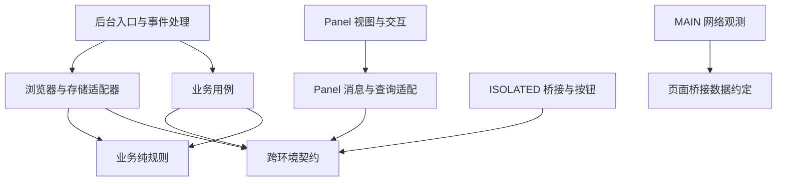

# 7. 前端工程化改造与Vue3响应式架构评估方案

> **文档状态**：方案已落地并进入 1.7.1 发布流程；最终 428 项核心测试与 19 项构建测试通过，实机验收与限制见第 14 节。
> **创建时间**：2026-10-20 00:45
> **作者**：wangsen
> **分类**：架构与工程化
> **方案复核日期**：2026-10-20
> **基线**：源码与现有浏览器扩展基线为 v1.6.7；实施前重跑 382 项测试通过，纯规则提取后 392 项通过，补充依赖解析回归后为 393 项，修复恢复与并发后 401 项全量通过。工程化试点尚非发行验收。

## 1. 背景、证据与决策摘要

### 1.1 当前问题与核实范围

方案审查时根目录有 43 个 JavaScript 文件，`panel.js` 约 6,000 行，包含页面状态、DOM 更新、数据查询与页面注入编排。需要治理的是职责和依赖关系，目录平铺与文件体积只是外部表现，不能仅靠移动文件判断重构成功。

本次核对了 Manifest、构建与测试脚本、后台和面板入口、部分队列与数据模块，以及源码结构相关测试。已确认：

- Service Worker 使用模块入口；Panel 是独立扩展页面。
- Content Script 分为 ISOLATED 与 MAIN 两个执行环境。当前 MAIN 脚本按 `transaction-id.bundle.js`、`net-hook.js` 的顺序在 `document_start` 注入。
- 后台及 Panel 多处使用 `chrome.scripting.executeScript({func, args})`，构建后函数自包含性必须实测。
- 当前测试使用 `node --test tests/*.test.js`；部分测试直接读取 `panel.js` 或 Manifest 源码，不能只批量改 import 就认为完成迁移。
- `record-runtime.js` 依赖 `panel-data.js` 中的关系计算；`automation-recovery.js` 使用 Chrome Storage 和 Alarms；`follow-queue-entry.js` 含 DOM 与消息逻辑。这些文件不能仅凭名称归入通用工具或纯业务层。
- `follow-queue-store.js → quote-tags.js → grok-comment.js` 存在重依赖；`grok-comment.js` 与 `grok-session-manager.js` 存在直接双向依赖。已核实的循环不能笼统扩大为 Grok 三模块全部互相引用。
- 现有持久化至少涉及五个默认命名的 IndexedDB，分布在页面源与扩展源；同时保留 Chrome Storage 和兼容备份。详见第 3.4 节，不能概括成单库或固定“三套库”。

本次未进行全量依赖图生成、性能测量、构建试点、浏览器验收或商店升级验证。具体依赖版本及其兼容性在实施前锁定并验证。

### 1.2 推荐决策

1. **架构采用运行时入口 + 按业务域组织的核心逻辑 + 平台适配层。** 不引入全套重型分层框架，也不按每个函数机械拆文件。
2. **优先验证 Vite，仅构建 Panel 是首选试点范围。** 后台与注入资源先按原语义组装，是否采用 CRXJS 全入口管理由试点证据决定；WXT 单独评估迁移成本。
3. **Vue 3 先用于一个独立 Panel 组件。** 核心逻辑保留普通 ESM，原生 Node 测试继续运行。
4. **先盘点注入与存储，再解除已确认的依赖问题，随后验证最小构建和单组件。** 全目录迁移后置到生产产物注入验收之后；目标目录是逐步收敛的结构，不是首轮搬迁任务。目录调整、构建改造、Vue 迁移、数据格式变化分别处理。
5. 不以减少 60% 代码或 `panel.js < 50KB` 作为承诺；以可维护的依赖关系、行为一致、数据完整和性能对比验收。

## 2. 推荐架构：运行时隔离与业务领域分层

### 2.1 各层职责

| 层 | 解决的问题 | 可以依赖 | 不应承担 |
| --- | --- | --- | --- |
| 运行时入口 `entries/` | 注册 Chrome 事件、启动 Panel、注入桥接、装配依赖 | 业务用例、平台适配器、消息契约；Panel 可依赖 Vue | 大段业务判断、持久化细节、多份业务状态 |
| 业务域 `features/` | 关注队列、关系管理、记录查询、Grok 工作流、执行日志 | 域内纯规则、消息/数据契约、显式传入的能力 | 直接访问 DOM、导入 Vue、顶层注册 Chrome 事件 |
| 平台适配层 `platform/` | Chrome API、IndexedDB、网络、标签页和窗口、注入执行 | 契约与必要的纯规则；浏览器平台 API | 决定业务优先级、借 DOM 状态推断任务状态 |
| 跨环境契约 `contracts/` | 消息名称、字段约定、响应结构、错误码、边界校验 | 少量无副作用公共函数 | 持有业务状态、访问存储、执行网络请求 |
| 最小公共层 `shared/` | 真正跨域且稳定的纯函数 | 其他纯函数 | 收纳所有暂时不知道放哪里的代码 |

业务域内只在确有需要时区分：

- `domain/`：状态转换、资格判断、规范化、筛选与派生计算；输入输出明确，无 I/O。
- `application/`：组织一次业务动作，调用传入的仓储、时钟、网络或任务执行能力；允许副作用，但不绑定具体浏览器实现。

小业务域可以先用两三个文件表达，不强制创建空目录。采用普通函数或工厂函数传入依赖即可，不引入依赖注入容器、通用 Repository 基类或全局事件总线。只有复用已经发生、语义也一致时，才抽到公共层。

### 2.2 目标目录示意

以下是逐步收敛的职责示意，不是要求一次性移动所有文件，也不代表新增模块已实现。首轮可保留根目录布局，只提取已经确认的纯规则；不预建 `contracts/`、`domain/`、`application/` 等空目录。移动文件必须服务于已验证的职责边界，而非追求目录树完整。

```text
x-each-follower/
├── src/
│   ├── entries/
│   │   ├── background/            # Service Worker 入口、监听器、依赖装配
│   │   ├── panel/
│   │   │   ├── main.js            # 初始化与组件挂载
│   │   │   ├── pages/             # 粉丝管理、互关、评论追踪、关注队列
│   │   │   ├── components/        # 确实跨页面复用的抽屉、弹窗等
│   │   │   ├── composables/       # Panel 查询、订阅与交互状态
│   │   │   ├── legacy/            # 尚未迁移的面板逻辑，逐步缩小
│   │   │   └── styles/
│   │   ├── content-isolated/      # bridge、页面按钮；不引入 Vue
│   │   ├── content-main/          # net-hook；不导入特权适配器
│   │   └── verification-alert/    # 现有验证提醒页面入口
│   ├── features/
│   │   ├── relationships/         # 关注关系、画像与筛选规则
│   │   ├── follow-queue/          # 队列规则、任务调度用例
│   │   ├── records/               # 数据查询、投影、迁移用例
│   │   ├── grok/                  # 会话工作流、验证状态与重试决策
│   │   └── execution-log/         # 日志查询与业务语义
│   ├── platform/
│   │   ├── chrome/               # 消息、alarms、tabs、windows 等适配
│   │   ├── storage/              # IndexedDB、Chrome Storage、写入管道
│   │   ├── x/                    # X API 与响应解析适配
│   │   └── injection/            # 自包含的页面函数及注入调用适配
│   ├── contracts/                # 跨运行时消息及可序列化数据约定
│   └── shared/                   # 少量时间计算、通用纯函数
├── vendor/                       # 已有第三方 bundle 与来源/许可信息
├── tests/                        # 核心单测保持 Node 原生执行
├── tools/                        # 构建组装、检查与 CDP 验收工具
├── docs/
└── manifest.json                 # 源 Manifest；产物另有 dist/manifest.json
```

`transaction-id.bundle.js` 是现有打包资源，迁移时保留来源、许可和加载顺序，不按普通业务源码随意重打包。首次试点可继续保留现有位置。HTML、CSS、图片均纳入迁移清单，不能只处理 43 个 JS 文件。

### 2.3 依赖方向和执行边界



图中箭头表示源码允许的依赖方向，不是全部消息流。后台入口将具体适配器传给业务用例；核心用例不反向导入 `entries/` 或具体平台实现。MAIN 只访问页面能力和经校验的桥接数据，不直接使用后台特权能力。

跨域调用通过小而明确的公开函数进行，禁止深层互相 import 形成循环。共享的关系计算可供 records 与 Panel 使用，但 records 不能导入 Panel。未来可增加依赖边界检查；规则要覆盖源码导入与构建结果，避免通过统一导出文件意外把 Vue 打进后台或注入包。

### 2.4 现有代码的建议归属

| 现有文件或职责 | 建议归属 | 迁移注意点 |
| --- | --- | --- |
| `background.js` | 后台入口 + 各业务域用例 | 保留顶层事件注册，逐步提取处理逻辑；入口负责装配 |
| `panel.js`、`panel-pages.js`、`dashboard-load-ui.js` | Panel 入口、页面与 composables | 先按现有页面拆职责，再逐个组件接管 DOM |
| `follow-queue-entry.js`、`follow-queue-panel.js` | Panel 的关注队列页面 | 含 DOM 或消息交互，不归纯业务规则 |
| `follow-queue-scheduler.js`、`follow-queue-runtime.js` | 队列规则与调度用例 | 按是否有 I/O 拆分，保留租约、防重与恢复语义 |
| `follow-queue-store.js` | 队列纯规则 + 存储适配 | 文件同时包含规范化和 IndexedDB 操作，应按职责逐步提取 |
| `record-repository.js`、`persistent-db.js` | 存储适配层 | 普通 JS 不等于无副作用；保留现有连接与事务行为 |
| `record-runtime.js`、`record-migration.js` | records 用例 + 平台装配 | 先确认现有读写所有者，避免迁移同时改库结构 |
| `panel-data.js` 的关系计算、`scoring.js` | relationships 规则；UI 专用部分留 Panel | 解除 records 对面板文件的反向依赖，不能整文件盲搬 |
| `network-api.js` | X 网络适配；纯关系判断提取到业务域 | 保留 User Rest ID、Tweet ID 区分及 screen_name 降级 |
| `grok-session-manager.js`、`grok-comment.js` | Grok 用例 + 窗口/注入适配 | 将工作流决策与页面 DOM 操作分开，保留已验证时序 |
| `automation-recovery.js` | 后台恢复用例 | 含 Chrome Storage/Alarms，不放入纯 `utils/` |
| `timing.js` | 纯时间规则或 shared | 只有跨域复用且语义相同才放 shared |
| `quote-tags.js` | 标签规则及纯文本计算 | 将 `tweetWeight`、`resolveCommentLanguage` 的纯计算提取为小模块，让 Grok 和标签规则共同引用，解除队列仓储对 Grok 工作流的间接依赖 |
| `page-reader.js` | 页面注入函数 | 保留函数自包含约束；源码位置与是否参与构建分别决定 |
| `bridge.js`、`net-hook.js` | ISOLATED / MAIN 各自入口 | 当前为经典脚本，首次构建沿用原入口路径与执行格式，不直接添加裸 ESM import |
| `verification-alert.html`、`verification-alert.js`、`verification-alert.css` | 验证提醒扩展页 | 三项一起纳入产物组装，保留返回 `panel.html` 的路径；首次不要求改成 Vue |
| `storage-write-client.js`、`storage-write-adapter.js`、`storage-write-queue.js` | 消息客户端、写入适配和串行协调 | 按真实副作用分别归属，保持现有写入协议与恢复语义 |

上述归属是目标建议，实施阶段仍需逐文件检查调用者与副作用，禁止按文件名批量自动分类。

### 2.5 首轮依赖调整的具体范围

优先处理两组已核实的问题：将 records 使用的关系计算从 `panel-data.js` 提取为可共享纯规则；将标签使用的权重和语言计算从 Grok 工作流中提取出来。函数签名与结果语义保持一致，原调用方改为引用这些小模块。此阶段允许文件继续留在根目录，不调整 Manifest 路径。

对 `grok-comment.js ↔ grok-session-manager.js` 先记录双向依赖及初始化时机。不能靠搬到不同目录消除循环，也不将整个 Grok 会话工作流重写作为第一批必做项；若它阻碍最小构建，再用独立变更解除并回归现有时序。`grok-verification.js` 被两者引用本身不证明三者构成直接循环。

## 3. 状态、消息与持久化设计

### 3.1 状态所有权

| 状态 | 权威所有者 | Panel 的处理方式 |
| --- | --- | --- |
| 筛选、分页、选中项、抽屉开关 | 当前 Panel 实例 | 本地响应式状态；必要偏好单独保存 |
| 队列执行状态、租约、重试与恢复 | 后台业务用例和持久化任务记录 | 发命令并展示已确认结果，不自行推进任务 |
| 手动扫描、滚动和页面操作的执行进度 | 当前实际发起操作的 Panel 实例；以各调用链为准 | 保留现有执行归属，记录操作实例及目标标签；不在构建迁移中悄悄改为后台任务 |
| 用户记录、关系数据、历史和日志 | 现有仓储及其写入管道 | 按页查询与读取投影，不复制整库进全局响应式状态 |
| 数量、全选状态、按钮是否可用 | 从权威记录及交互状态派生 | 使用纯函数或 computed，避免多个可写副本 |
| 登录/验证/窗口状态 | 相应运行时与持久化恢复信息 | 展示快照，过期后重新查询，不把显示状态当执行依据 |

后台负责长期任务的目标不等于本轮必须把所有现有 Panel 操作搬到后台。先记录现有所有权，保持行为，再按用例迁移；读写所有权变更需单独验收。不得让两个运行时在迁移期同时成为同一任务的调度者。

工具栏当前每次点击都会创建 Panel 标签，因此多面板场景必须覆盖“不同面板操作同一个 X 标签”，而不只是并发写库。实施前盘点这些操作的现有互斥能力，明确同一操作的归属、重复发起时的拒绝/排队策略，以及关闭发起面板后的行为。不能宣称已经存在全局锁；若需新增跨面板协调，应作为独立行为变更验证。

现有 IndexedDB、Storage 和兼容备份机制继续作为数据基线。此次工程化不附带数据库改名、schema 升级或数据清理。若后续确需改变，另列数据迁移方案并验证可回退性。

### 3.2 跨运行时通信

建议按现有消息协议渐进收敛命令与查询：命令改变任务或数据，查询返回快照/分页结果，通知用于提示数据失效。不要为了分层一次性改名全部消息。

- 契约定义请求字段、响应数据、错误码和协议兼容方式；必要时携带请求 ID、数据修订号，解决重复提交和旧响应覆盖。
- 后台验证 sender、来源和消息字段；页面桥接数据按不可信输入处理，不能仅凭类型字符串就允许特权操作。
- 消息和存储边界仅传明确的数据对象；不传 Vue Proxy、DOM、函数或浏览器资源句柄。将字段显式映射成 DTO，避免直接克隆响应式对象失败。
- Panel 快速切换页面、筛选条件或分页时，用请求序号、失效标记或可用的取消机制忽略旧结果；取消请求不自动等于取消已启动的后台任务。
- 视图刷新以仓储/后台确认结果为准。若采用乐观更新，必须定义失败回滚和状态重新查询。
- Service Worker 可随时终止，不能依赖内存变量或长计时器维持任务正确性；保留现有 alarms、持久化租约、防重及重启对账。

### 3.3 Vue 状态规模

首个组件用 `ref`、`computed` 和局部 composable 即可，不预先引入 Pinia。出现多个页面确需共享的 UI 会话状态后再评估；即使引入，也不能成为任务与数据库的第二权威来源。

保留已有按需恢复、索引分页与日志游标查询；避免为了响应式把全部历史数据读入内存。列表使用稳定记录键，派生索引按需计算；虚拟列表只在测量表明分页仍不足时引入。

### 3.4 已核实的存储清单与迁移边界

下表默认库名与版本已同时核对源码及 2026-10-20 的浏览器实际库清单；存在性检查不等于完整恢复验收。投影库名由 record-runtime.js 的 dbName 拼接 -dashboard 得到，不能只搜索字符串字面量盘点库名。

| 存储 | 所在环境 / 当前版本 | 读写入口与用途 | 本轮必须保留的边界与后续验收 |
| --- | --- | --- | --- |
| `x-each-follower` | 页面源 IndexedDB；版本 1 | `persistent-db.js` 的 `durableGet` / `durableSet`，通过 MAIN world 的 `dbPage` 读写兼容持久数据 | 保留标签获取、注入及序列化方式；断开/关闭数据库标签后能恢复访问；页面源数据清除与扩展升级不是同一事件 |
| `x-each-follower-records` | 扩展源 IndexedDB；版本 1 | `record-repository.js`、`record-runtime.js` 及现有迁移/投影逻辑 | 保留记录、分页、旧快照和增量恢复语义；使用既有数据校验数量和内容 |
| `x-each-follower-records-dashboard` | 扩展源 IndexedDB；版本 4 | `record-projection.js`，由 `record-runtime.js` 指定派生库名；保存 rows、membership、relations、backups 等投影 | 保留索引分页、投影与原始记录的一致性、备份及重建流程；不能当作临时缓存直接清空 |
| `x-each-follower-follow-queue` | 扩展源 IndexedDB；版本 3 | `follow-queue-store.js` 中队列仓储 | 保留任务、租约、结果与防重状态，验证后台重启恢复；不假设等同于记录库的备份路径 |
| `x-each-follower-execution-logs` | 扩展源 IndexedDB；版本 2 | `execution-log-store.js`，含历史日志导入与 durable 备份调用 | 保留日志范围、游标分页、导入及备份逻辑，验证重开后的读取 |
| Chrome Storage 与兼容备份键 | 扩展 Storage；按现有各键约定 | `storage-write-*`、Panel 与后台相关调用 | 保留设置、桥接写入及恢复契约；不随目录调整清理旧键 |

页面源库的说明需与实际目标一致：新建存储标签指向 `https://x.com/home`，但当前查找逻辑也接受 `twitter.com` 标签；IndexedDB 实际归属执行时页面的 origin。验收时记录最终页面 origin，不能假定两个域共享数据库，也不在本轮顺手改变已有选标签行为。

`dbTabId`、标签归属标记、串行链和关闭计时器是 `persistent-db.js` 的模块内状态，不是队列持久化租约。Panel 和后台加载模块后各有自己的实例，不能误认为已经跨运行时共享。保留“只关闭本模块创建的标签”行为，覆盖标签失效和 Worker 重启后的重新发现。

写入路径也不能合并描述为“全都经后台”：`requestStorageWrite` 通过消息请求后台；`panel.js` 的 `bridgePersist` 在分页仓储就绪且键适用时走 `recordPages.bridgeWrite`，其他分支仍直接 `durableSet`。首轮记录各路径及触发条件，保留兼容行为，不因搬文件而合并写入所有权。

## 4. 构建工具选型与 MV3 约束

### 4.1 候选方案对比

以下为适配思路与待验证成本，不是本项目实测性能排名。

| 候选 | 适用方式 | 本项目需验证的重点 | 初步建议 |
| --- | --- | --- | --- |
| Vite 仅构建 Panel + 产物组装 | SFC 构建与其他现有入口分开处理 | HTML 路径、资源复制、注入函数、产物完整性 | 首选最小试点 |
| Vite + CRXJS | 评估由插件统一管理 Manifest 相关入口 | 插件版本、MAIN 顺序与时机、开发辅助代码、动态注入、输出路径 | 通过试点后再决定是否采用 |
| WXT | 按框架约定管理扩展入口与构建 | 现有入口转换、约定变更、生命周期与调试脚本迁移 | 独立候选，不与 Vite 方案混写为同一实施路径 |
| Webpack 5 | 手动配置扩展多入口和 Vue 编译 | 配置维护量、产物格式、CSP 与资源路径 | 技术上可行，本项目暂不优先 |

所有候选都可保留原生 Node 测试，前提是核心源码保持 Node 可导入。Webpack 不天然要求 Babel/ts-jest；选择 Vite 也不等于迁移到 Vitest。生产构建与核心测试是两条独立链路。

实施前锁定 Node、构建器、Vue 与插件的兼容版本，并保留 lockfile。CRXJS 官方文档本次访问失败，具体功能支持不能视为已核实，需以选定版本文档和试点产物补齐证据。

### 4.2 源码与产物约定

- `src/` 是源码，`dist/` 是完整可加载扩展，打包发布仅使用经过验收的生产产物。
- 首次 Panel 构建优先保持外部入口路径兼容，例如 `panel.html` 和提醒页面 URL；源码目录变化不应无意改变运行时 URL。
- 首选以 `panel.html` 为构建入口，核对其引用的五个 CSS 和脚本均进入产物；若采用脚本入口，必须显式组装 HTML/CSS，不能假定工具自动包含。首次沿用 `verification-alert.html`、对应 JS/CSS，以及 Manifest 中现有注入资源路径。
- 组装清单显式包含 Manifest、后台及其模块依赖、注入脚本、页面、CSS、图标与第三方资源，检查每个引用目标存在。
- `node --check` 只验证语法，不验证模块可解析、资源路径有效或 Chrome 可执行；需分别增加依赖与产物检查。
- 核心 ESM 保持 Node 可识别的相对路径，不引入仅构建器支持的 `@/` 别名。Panel 若使用别名，也需与检查工具一致。
- 不因引入工具链扩张权限或 web-accessible resources；确有必要的变化必须说明用途并单独审查。
- HMR 只作为开发便利。生产产物检查不得包含开发服务器连接、HMR 客户端、开发桥或额外 loopback 权限。

### 4.3 MAIN、ISOLATED 与函数注入

当前 Manifest 的执行环境、匹配域名、`document_start` 和脚本顺序均属于行为基线。特别保留 `transaction-id.bundle.js → net-hook.js` 的依赖关系。两个执行环境之间通过既有桥接协议通信，不因共享源码就假定可以共享内存。

还需检查 `network-api.js` 中 `executeScript({files:['transaction-id.bundle.js'], world:'MAIN'})` 的动态注入路径。Manifest 引用修正并不自动修正该字符串。经典 Content Script 首次沿用现有执行格式；若后续采用 ESM 编写源码，需独立构建为兼容产物并验证，不把它们并入 Panel 入口。

**Panel-only 不代表注入函数不受构建影响。** `panel.js` 导入 `page-reader.js`、`grok-comment.js`、`persistent-db.js`，传递依赖仍可能进入 Panel 的构建图。仅复制后台和 Content Script 无法证明这些函数未被改写。试点必须记录每类注入函数是原样保留、独立构建还是随 Panel 编译，并说明其依赖如何随产物交付。

`executeScript({func})` 注入的是函数副本，函数体必须自包含。构建器可能生成外部辅助函数，导致源码可执行而产物注入失败。因此：

1. 盘点所有函数注入点，记录参数、目标 world、frame 和依赖。
2. 实测生产构建中的 `readProfileBundle`、滚动扫描、`dbPage` 读写，以及至少一条 MAIN `files:` 注入路径；具有公开副作用的操作按授权范围验证。只打开 Panel 不算试点通过。
3. 检查产物中被传入 `func` 的函数是否引用外围辅助代码，并结合实机执行确认。若存在外部依赖，调整构建目标，或采用受控源码保留/独立入口方案；不能简单移动文件就视为已解决。无需一律禁止注入函数参与构建，也不强制将所有模块改为经典脚本；选择原样保留时须明确运行时导入路径和完整依赖交付。
4. 检查注入包没有残留无法执行的模块语法、远程加载或跨入口 chunk 假设；以 Chrome 实际执行结果确认。

参考：[Chrome Content Scripts 官方说明](https://developer.chrome.com/docs/extensions/develop/concepts/content-scripts)。

### 4.4 CSP 与安全表述

Panel 的 Vue 模板在构建阶段预编译，产物使用无需动态模板编译的运行时。不在受扩展 CSP 约束的页面和 Worker 中依赖 `eval`、`new Function` 或远程执行代码。MAIN 页面环境与扩展页面 CSP 不应混为一谈，需分别验证。

源码/产物字符串扫描仅作辅助，不能通过搜索 `Function` 一词是否存在就断言合规；结合真实加载与 CSP 错误检查。构建成功也不等于满足全部商店审核要求。

参考：[Chrome Manifest CSP](https://developer.chrome.com/docs/extensions/reference/manifest/content-security-policy)。

## 5. Vue 3 渐进迁移与 DOM 所有权

### 5.1 收益与框架范围

预期收益是将分散的命令式状态更新收敛为可观察的数据流，并按页面/组件隔离交互。收益通过试点的实现复杂度、缺陷和性能对比确认，不预先承诺代码减少比例。

本项目约束 Vue 只进入 Panel；未来若新增独立管理页可另行评估。后台与注入层不引入 Vue。该选择出于依赖控制和迁移范围考虑，不能表述成 Vue 在 Content Script 中必然与宿主 React 冲突。

### 5.2 新旧共存规则

- 每个 Vue 挂载点有唯一 DOM 所有者。挂载后旧代码不能再修改其内部 HTML、列表节点、勾选态或可见性。
- 旧逻辑通过明确的参数、组件方法或事件通知组件，不跨边界查找并修改节点。
- 执行日志弹窗只是候选，当前并非已独立组件：`renderLogsModal` 更新多个节点并用 `innerHTML` 渲染正文；`recordMonitorLog` 可触发打开中弹窗的刷新；全局 `open-execution-logs` 事件也能打开它。迁移前列出这些调用方、打开/关闭、清空与分页路径，再决定是否适合作为首个试点。
- 若选择日志弹窗，应给 `#logsModal`、`#logsModalMask` 及其标题、计数、状态和正文定义统一控制边界，将旧调用方改为调用明确接口。遮罩使用 `profile-drawer-mask` 样式类不代表与资料抽屉共用同一 DOM 节点；重点检查共享样式和全局选择器是否干扰新组件。已有 `logPager` 过期响应防护应保留，不重复实现一套竞态控制。
- 若收口成本过高，先选择调用方更少、没有跨页刷新路径的设置区域。无论哪种试点，都要明确唯一 DOM 所有者，不能只迁移列表正文却允许两套逻辑修改同一个节点。
- 组件卸载时清理 Chrome 监听、DOM 监听、计时器、Observer 与请求失效状态；Vue 不自动清理所有手工创建的外部资源。
- 一个组件迁移验收后删除对应旧渲染路径与绑定，避免双重监听；其余 legacy 逐步缩小。
- 样式先保持现有视觉行为。复用字体、颜色与尺寸，组件样式限定作用范围，检查弹窗层级与全局遮罩；不同时引入大型 UI 库或重做整套界面。

Vue 默认文本插值能转义内容，但 `v-html`、链接等边界仍需审查。用户资料、帖子和 Grok 输出按不可信内容处理，优先以文本渲染，不能声称框架自动消除全部 XSS 风险。参考：[Vue 安全指南](https://vuejs.org/guide/best-practices/security)。

### 5.3 后续组件拆分建议

按现有业务页面逐步形成粉丝管理、互关追踪、评论追踪、关注队列组件，再按实际复用提取资料抽屉、执行日志和分页控件。页面负责协调 UI，composable 负责查询与订阅，业务规则继续放在普通 JS 领域模块。

暂不为工程化迁移额外引入路由框架、全量 TypeScript 转换或新的全局状态库。可以先用 JSDoc 描述消息和数据对象；这些额外技术决策在出现具体需求时单独评估。

## 6. 渐进路线、阶段门槛与回退


| 阶段 | 工作范围 | 进入下一阶段的条件 | 风险与回退 |
| --- | --- | --- | --- |
| 0：基线 | 核实分支、测试、五个命名库及 Storage 读写点、注入函数、资源引用与手动操作归属 | 有可复现基线，记录页面实际 origin、数据规模与未验收功能 | 无基线不开始批量迁移 |
| 1：依赖调整 | 提取 records 使用的关系计算、标签使用的权重和语言计算；可继续保留根目录布局 | 原生测试、语法与引用检查通过，两条重依赖解除且现有行为不变 | 不移动 Manifest 资源路径；不顺带重写 Grok 会话工作流 |
| 2：构建试点 | Panel HTML 构建与资源组装，明确传递依赖中的注入函数处理方式 | dist 的资料读取、dbPage 读写、MAIN 文件注入及资源检查通过，数据身份已核对 | 注入或数据校验失败即停在此阶段，保留旧产物，不进入 Vue 或整树搬迁 |
| 3：组件试点 | 按实际耦合选择日志弹窗或较独立设置区域，先收口旧调用方 | 打开/关闭/重开/切页正确，现有竞态防护保留，无重复监听与查询回写 | 失败时回到该区域旧实现，不改变数据库格式 |
| 4：扩大迁移 | 按页面替换 legacy，并按已验证职责逐批归整目录 | 每批路径检查、全路径回归、性能对比与恢复场景通过 | 全目录迁移后置；每批可单独回退，避免长期保留两套完整实现 |

每批变更建立可单独审查的差异，不把路径移动、业务规则调整与数据迁移塞进同一个提交。后续提交、合并、推送和发布依用户授权执行。用户随后已授权实施；当前分批落地纯规则提取与构建试点，未授权推送、合并或发布。

实施时重新检查 Git Flow 状态，通过 `git flow feature start` 创建或复用适用的 `feature/` 分支；不能假设历史 `feature/next-iteration` 仍存在。本次文档分支为 `feature/frontend-architecture-plan`；开始时 develop 与本地 master 的源码一致，仅有文档差异，master 标记为 1.6.7。此为本地仓库证据，不代表浏览器或商店当前载入状态已确认。

回退产物必须与原数据格式兼容；若后续发生 schema 变化，不能只回退代码。禁止为“干净测试”卸载用户现有扩展或清空数据。加载路径从根目录改到 dist 时先核对扩展身份和存储归属，避免把新扩展 ID 的空库误认为数据丢失或迁移成功。

## 7. 测试与实机验收矩阵

### 7.1 自动检查分层

| 检查类型 | 验证内容 | 不能替代的检查 |
| --- | --- | --- |
| 核心原生 Node 测试 | 纯规则、仓储契约、调度状态机与恢复逻辑 | 浏览器运行与真实注入 |
| 源码语法和依赖检查 | 语法、引用目标、反向依赖、循环依赖 | Manifest 加载及资源访问 |
| 构建产物检查 | 资源闭包、Manifest、入口格式、开发代码隔离、依赖体积 | 真实页面行为与 CSP 执行 |
| UI 组件行为验证 | 选中、分页、错误恢复、事件清理、异步旧结果丢弃 | 后台执行与持久化闭环 |
| CDP 实机验收 | 输入 → UI 事件 → 消息 → 后台 → 响应解析 → 持久化 → 页面结果 | 商店真实升级与未执行的公开操作 |

`production-boundary.test.js` 当前读取根目录源码，未来必须补上生产产物检查。`panel-startup.test.js` 等源码结构断言需逐项分类：保留有业务意义的保障，将绑定旧实现文本的断言改成可观察行为验证；不能为迁移方便直接删除或弱化保障。

核心模块修改按项目规范运行 `npm test`，Bug 修复补对应回归测试。组件测试工具可单独引入，不能强迫现有核心测试改用编译器或新测试框架。

### 7.2 必须覆盖的场景

- 扩展重载后后台版本与 Panel 握手一致，所有页面、图标、CSS 和提醒窗口可打开。
- X 页面 ISOLATED 按钮和桥接正常，MAIN 网络观测按预期初始化，无重复注册或丢失。
- 资料读取与页面扫描的生产产物注入成功；涉及关注、发帖等真实操作按单独授权范围执行并验证实际页面结果，未执行的路径明确列出。
- 面板关闭重开、页面切换、后台停止后再次唤醒，队列和记录状态保持一致，不重复调度。
- 已有记录、队列、设置、日志及兼容备份仍可读取；记录数量和关键内容校验一致。测试数据与用户数据隔离。
- `dbPage` 在实际页面 origin 下完成受控测试键的写入与回读；目标标签失效后能重新获得可用标签，且不关闭用户已有标签。读写验证不得覆盖用户现存键，清理只针对本次测试键。
- 快速筛选/分页及失败重试不会被旧请求结果覆盖；空态、加载态、错误态和重试均可见。
- 弹窗与页面反复切换后不重复订阅、不重复提交；统计监听器、请求次数及必要的内存趋势，不以“看起来不卡”证明无泄漏。
- 多个 Panel 同时打开时，除存储竞争外还要验证手动扫描/滚动争用同一个 X 标签的处理，并记录关闭发起面板后的实际行为；不把尚未实现的全局互斥当作现有保证。重载后旧页面/注入脚本的版本失配有明确恢复行为。

CDP 入口遵守项目规范：先使用 `tools/cdp-session.ps1` 检查并附加到既有登录 profile，动态发现目标；导航或修改草稿用本次创建的非激活标签，完成后只关闭该标签。验收证据需标记源码还是 dist、扩展版本/身份、数据环境及验证范围。

### 7.3 性能与交付指标

实施前在固定浏览器、数据规模和相同操作步骤下记录：Panel 冷启动至首屏可操作、分页/筛选响应、弹窗首次与再次打开、请求次数、产物体积及必要的内存变化。迁移后用相同条件复测，先有基线再确定可接受阈值。

避免丢失既有懒加载与索引分页收益。文件变短、测试数量维持 382 或成功生成 dist 均不是单独的验收结论。测试数量可以随有效覆盖增加，关键是原有行为保障不退化。

## 8. 审查结论与实施前检查表

本次结论：推荐以上分层作为目标结构，先盘点注入和存储，解除两组已确认依赖，再验证构建与组件；全目录搬迁后置。Grok 4.7 的有价值建议已经过 Codex 源码复核后融合。未采纳“一律排除所有注入函数的构建”“固定三套库”“Grok 三模块直接循环”等过度概括；也不把加载目录变化表述为扩展 ID 必然变化，实际身份需验证。原方案的工具选型绝对化、风险低估、安全承诺及体积验收指标已修正。

前期方案审查仅修改文档；后续用户已明确授权开发。以下清单按实际证据逐项完成，未勾选项不能视为已验收。

- [ ] 逐文件补齐运行时、调用者、副作用、资源引用及目标位置清单。
- [x] 明确 records 与关系计算的公共边界，消除对 Panel 的反向依赖。
- [x] 提取标签所需的权重和语言纯计算，记录 Grok 双向依赖及其初始化风险。
- [ ] 明确每类状态、命令及数据写入的权威所有者。
- [ ] 逐项核对五个默认命名库、页面 origin、标签生命周期及并存写入路径；盘点多 Panel 手动操作冲突。
- [ ] 固化 MAIN 注入顺序、时机、桥接协议和函数注入清单。
- [x] 实施前重跑基线测试并记录版本；后续补录实机数据规模快照。
- [ ] 验证 Panel 传递依赖中的函数注入、dbPage 读写和动态 MAIN 文件注入，再决定入口管理方案与目录搬迁。
- [ ] 验证生产产物 CSP、资源闭包、扩展身份及数据升级路径。
- [x] 首个 Vue 组件满足唯一 DOM 所有权和完整资源清理。
- [x] 若选日志弹窗，收口旧渲染、全局打开事件、扫描刷新与遮罩控制，并保留现有过期响应防护。
- [ ] 形成可独立回退的阶段结果及明确的未验收项。

参考入口：[Vite 文档](https://vite.dev/guide/)、[Webpack 文档](https://webpack.js.org/guides/getting-started/)、[WXT 文档](https://wxt.dev/guide/introduction.html)、[CRXJS 文档入口](https://crxjs.dev/guide/)。CRXJS 页面本次未成功读取，版本支持仍待验证。

## 9. 2026-10-20 首批实施与实机核对

用户随后授权开始落地，沿用 `feature/frontend-architecture-plan`。实现由 Antigravity Gemini 3.8 承担构建工作，Grok 4.7 完成首批纯规则抽取后额度耗尽，后续不再调用；Codex 负责差异复核和独立验收。此节取代前期“只完善文档”的阶段限制，但不代表已授权发布。

### 9.1 已落地的依赖调整

- `relationship-rules.js` 接收原 `panel-data.js` 的关系计算，`record-runtime.js` 直接依赖纯规则；原模块保留同名导出，兼容现有调用方。
- `quote-text.js` 接收权重与语言判断，`quote-tags.js` 不再引入 Grok 工作流；`grok-comment.js` 保留兼容导出。
- 保持原计算行为和根目录布局，没有改动数据库格式、注入函数或任务调度策略。Grok 会话模块间的既有循环不在本批重写。
- 实施前 382 项核心测试通过；提取后 392 项通过。依赖边界检查使用模块词法解析，覆盖多行导入、再导出及字面量动态导入，避免正则遗漏反向依赖。

### 9.2 存储现场与验收边界

2026-10-20 02:17，现有 Chrome 155 登录 profile 的扩展 `cdieifmkgaojofdaeimooljaaekjjndn` 载入仓库根目录，版本 1.6.7。只读盘点确认四个扩展源库以及 `https://x.com` 下的页面备份库，共五个；方案此前遗漏派生名称的 dashboard 投影库，已修正第 3.4 节。

当时记录库 `records` 12,177 条；投影库 `rows` 6,373 条、`membership` 10,951 条、`backups` 1,447 条；队列 `jobs` 3,268 条；日志 `logs` 413 条。这些是不同结构的记录数，不代表用户数，也不能相互直接比较。浏览器原有后台任务仍在活动，数量会变化，本次不把两个时点的计数差异作为迁移损失证明。

源码及首版 dist 在现有扩展 origin 下分别打开新建非激活面板，五个页面切换和日志弹窗读取通过。另在测试自建的 X 标签完成资料读取函数注入、滚动函数调用、MAIN `transaction-id.bundle.js` 文件注入，以及唯一临时键的 `durableSet`/`durableGet` 回读与清理。资料页面有姓名与简介等结构，但帖子数量为 0，因此没有证明帖子解析和真实滚动加载完整通过；未进行关注或公开发帖操作。

此方式验证的是 `chrome-extension://同一ID/dist/panel.html` 与 dist 运行时模块，后台仍为原扩展。它不等同于从 dist 独立安装后的 Service Worker、Manifest 文档初始注入、扩展身份或升级恢复验收。不得把同源复用既有数据表述为新安装后的数据迁移成功。独立装载及升级验收仍是扩大迁移前的门槛。

### 9.3 构建试点的审查要求

首版构建使用 Vite 处理 Panel HTML/CSS，原样组装运行时 ESM 与经典注入脚本。审查要求消除重复组装和宽泛 external 规则，构建前安全清除既有输出，并校验 Manifest、资源引用闭包及原样复制文件。构建测试必须独立于核心原生 Node 测试，且总是基于新生成产物；不能凭已有 dist 或函数名字符串判断注入语义得到保留。

Antigravity 已完成第二轮修正；Codex 独立复核并修正失效链接检测、依赖解析字段和 Vue 测试配置，最终检查如下。Vue 编译器就绪不代表已挂载 Vue 组件，当前尚未进入组件替换和全目录搬迁。

### 9.4 最终复核结果与交付状态

| 验证 | 最终结果 |
| --- | --- |
| `npm test` | 393 项通过，0 失败；保持原生 Node 测试，无构建步骤 |
| `npm run test:build` | 19 项通过，0 失败、0 跳过；使用本轮新构建，包含真实生产配置下的 Vue SFC 编译 |
| `npm run build` | 通过；Vite 处理 Panel HTML/CSS，单次组装运行时资源，共 61 个产物文件 |
| `npm run build:check` | 通过；45 个 JS 文件解析、运行时字节保真、Manifest 保真及资源引用检查 |
| `npm run check` 及新增纯模块语法检查 | 通过 |
| 最终 dist 同源页面 | 哈希样式表加载 808 条规则、图标加载成功；五页切换及日志弹窗读取通过，无捕获到的运行时异常 |
| 最终 dist 页面注入 | `readProfileBundle` 取得 3 条帖子，页面有 4 条帖子节点；MAIN 文件注入及临时键读写/清理通过 |

源码初测及首版 dist 帖子为 0 的限制由最终复测补充了实际解析证据；但滚动调用返回的 scrollY 为 0，尚未证明无限滚动加载流程。没有执行真实关注、公开发帖、后台停止恢复或跨版本升级测试。一次非激活页面截图超时，后续采用 DOM、样式表与图片加载状态核对，不能据此声称完成全部视觉验收。

构建方式遵循 [Vite 生产构建与相对 base 文档](https://vite.dev/guide/build.html)：只将旧 `panel.js` 入口外部化，传递依赖原样组装，新 Vue 测试入口正常编译。构建工具拒绝工作区根目录、源码目录、越界路径及链接输出；产物校验只报告异常，不删除意外文件。`dist/` 与测试临时产物不纳入版本控制。

后续入口为 `npm run build`、`npm run build:check`、`npm run test:build`。本批未改变 Manifest 权限、数据库名称/schema 或注入顺序，保留 1.6.7 基线版本；它是开发分支上的工程化试点，不是已经完成发行的新版本。独立 dist 装载、身份/数据恢复及后台验收通过后，再同步递增版本号与握手标识并进入组件试点。当前全部修改留在工作区，未提交、推送、合并或发布。

## 10. 2026-10-20 独立安装 dist 的老数据恢复缺陷

用户反馈 dist 老数据提取不全后，按要求通过 CDP 实际安装 dist，并与已有根目录扩展对照。本轮完成诊断，不修改业务恢复逻辑，不覆盖用户数据；先前“同源 dist 页面通过”不能作为独立安装恢复通过的依据。

### 10.1 现场与复现结果

现有测试 profile 起初未运行，经 `tools/cdp-session.ps1 -StartIfAbsent` 启动同一登录 profile，再通过 CDP `Extensions.loadUnpacked` 安装本地 dist。根目录版 ID 为 `cdieifmkgaojofdaeimooljaaekjjndn`，dist 版 ID 为 `kmfgjedjeibcgnjnjffkgfkjpmgjmcfc`，均为 1.6.7。本次确实产生两个不同扩展源，因此 Chrome Storage 和扩展 IndexedDB 不共享；X 页面源备份仍可访问。

以下为 IndexedDB 内部展示投影记录数，不是界面当前筛选后的数量，也不是去重后的总用户数：

| 项目 | 根目录版 | dist 独立安装版，等待重放完成后 |
| --- | ---: | ---: |
| 原始记录库 records | 12,177 | 0 |
| 展示投影 rows 合计 | 6,395 | 1,708 |
| fans | 1,729 | 106 |
| mutual | 2,243 | 1,299 |
| comments | 687 | 83 |
| posts | 9 | 0 |
| profiles | 438 | 55 |
| unreciprocated | 988 | 165 |
| logs，跨账号汇总 | 301 | 0 |

新 dist 的迁移状态为 `ready`、`cutover=true`，但 `total=0`、`completed=0`。实际面板显示互关追踪 1,299、评论追踪 83、粉丝管理及回关监测徽标为 0，没有显示恢复错误。这说明缺数据时仍可能被标记为完成。

### 10.2 根因一：缺少完整基线恢复，直接重放增量

`record-runtime.js` 的 `readLegacy()` 只读取当前扩展 `chrome.storage.local`；新 ID 的该区域为空。`migrate()` 随后迁移空快照，`commitReadyProjection()` 再重放 `recordIncremental:v1:*`，最终宣告 ready。因此只有曾出现在增量记录中的对象被恢复，未变动的历史记录缺失。Panel 当前记录分页启动路径未接回旧 `recoverMissingStartupBackups()` 的完整基线恢复能力。

只读检查确认 `https://x.com` 的 `x-each-follower` 库中仍有 monitor、mutualNetwork、commentTracking、unreciprocatedTracker、profileCache 等旧键，以及非空 `recordLegacySnapshotBackup:v2:*` 完整快照。例：commentTracking.users 为 687，mutualNetwork.users 为 1,037，monitor.followingUsers 为 717。这些旧集合与投影的计算/合并口径不同，不应直接当作最终界面预期数量。

使用当前 dist 的 `createRecordRuntime` 与 fake-indexeddb 做最小隔离实验：备份包含两条评论用户，增量只修改一条；本地空存储时只恢复一条、`total=0` 且 ready，并且没有读取 commentTracking 旧备份键。给相同流程提供完整基线后，两条均保留且修改生效。实验仅使用虚构记录和内存存储，不写回浏览器。尝试读取真实全量备份做离线重放时 CDP evaluate 超时，未取得真实全量恢复成功证据。

`npm run build:check` 再次通过，运行时 JS 与源码逐字节一致。这将问题定位到新扩展身份触发的恢复流程缺口；本轮没有发现打包器改写运行时导致数据截断的证据。

### 10.3 根因二：增量日志头与已写序号不一致

根目录版新打开的面板也复现 `记录迁移失败：incremental sequence was already published`。页面源备份现场为：head.seq=1,584，已有第 1,585 条且 status=stored，总共存在 1,585 个序号键。

`persistIncremental()` 分别写序号键与 head，两次写入并非一个原子事务；遇到下一序号已经属于其他 operationId 时直接抛错。现场符合“条目已写入但 head 未推进”的不一致状态，可能来自中断或并发，现有证据不能确定具体触发时刻。`ensureOpen()` 在已有 ready 状态下重试 pending 也会遇到该错误，从而阻断面板初始化。此次没有跳过、覆盖第 1,585 条，也没有手动修改 head。

### 10.4 修复与验收要求

1. 新身份/缺少本地基线时，先恢复并校验完整旧键或明确选定的快照，再有序重放增量；不能把“找到增量”当成“基线完整”。恢复读取失败不能当成不存在。
2. 已经以空基线标记 ready 的安装必须有受控修复路径：保留当前数据和增量后重建，不能只增加首次安装判断或要求用户清库。
3. 增量追加需要在页面源同一事务内分配序号、写条目和推进 head，并处理跨扩展/跨上下文并发；已有 head 落后状态需要幂等修复，不覆盖已发布条目。
4. 增加缺本地数据但有完整备份、增量不覆盖所有历史记录、备份读取失败、空基线已 cutover、头写入中断及多写入者用例。用真实独立安装前后记录内容与数量完成验收，而非仅检查构建成功或 ready。
5. 关注队列、日志及自动化设置各自另核对恢复契约；本次表格只定位记录投影缺失，不能宣称其他数据已完整恢复。自动化配置恢复不能导致两套扩展重复执行。

### 10.5 建议修复设计与实施顺序

本次修复应先恢复“完整基线 + 有序增量”的数据契约，再处理写入并发，最后验证独立扩展身份。不要通过增加某个面板的兜底读取、放宽 `ready` 条件或按当前投影数量硬编码阈值来掩盖缺失。

#### A. 建立唯一、可审计的恢复入口

将恢复编排收敛到记录运行时的迁移/修复入口，由它统一完成来源发现、快照校验、增量重放、投影校验和完成标记；Panel 不应在启动后另行拼装旧对象。保留现有旧键读取逻辑作为兼容来源，但为新扩展身份增加对 `https://x.com` 页面源中持久化快照的发现能力。

恢复来源优先级建议如下：

1. 若当前扩展本地旧键存在且可读，以本地旧键为候选源；同时读取其对应的不可变备份并校验指纹。
2. 若本地旧键为空，枚举 `recordLegacySnapshotBackup:v2:*`，读取并验证快照内部 fingerprint 与键后缀一致；仅在 v2 无可用候选时兼容读取旧版 `recordLegacySnapshotBackup:*`。
3. 多个候选快照按有效指纹、格式版本及 `savedAt` 选择最新有效快照；不能只按字典序或简单选择最后枚举项。若快照代表的世代/来源无法判定，或者同一优先级有互相冲突的数据，停止自动 cutover，保留所有备份并报告明确的冲突状态。
4. 只有确认所有受支持来源均可访问且确实不存在有效旧数据，才可把“空数据”认定为合法空基线。读取异常、标签不可用、桥接失败和反序列化失败均为恢复失败，不能折算为空。

快照先复制到新扩展自己的记录存储暂存区，再在暂存副本上应用增量。读取过程中旧源有变化时，应重新读取并校验，或以迁移开始时固定的已验证快照为基线并确保变化已进入增量日志；不能静默漏掉基线之后的改动。若页面源只能通过临时 X 标签访问，需沿用既有标签生命周期规则，绝不复用或关闭用户标签。

#### B. 使迁移完成条件反映数据完整性

增加明确的迁移阶段，例如 `discovering → snapshot-staged → replaying → verifying → ready`，并将当前所用快照 fingerprint、来源类型、增量起止序号、处理数量和校验结果写入迁移状态。失败状态需保留可重试信息；重试应从暂存快照或上次确认的游标幂等续跑。

只有满足以下条件才能设置 `cutover=true`：

- 基线来源已通过完整性校验；合法空基线有明确的“无来源数据”证据，而不是因为读取失败或当前扩展本地存储为空。
- 所选增量范围连续、每条可解析，且所有条目均已幂等应用；若发现缺号、重复序号内容冲突或 head 与现存条目不一致，先修复/报错，不能跳过后宣布完成。
- 新记录库可从最终状态重新查询，按模块及稳定主键抽样核对内容；对旧对象合并规则应保持现有语义，避免把输入对象数量误当成输出行数。
- 状态中的 `completed`、`total` 代表明确阶段的工作量，不能都为 0 却将非空旧快照标记成 ready。合法的全空恢复也应记录“零条来源数据”的验证结果。

#### C. 为已错误 cutover 的安装提供无损重建

首次安装修复不能覆盖已经因空基线产生的记录。发现状态为 `ready/cutover=true`，但快照 fingerprint/来源证明缺失、来源非空而迁移计数为 0，或实际记录与恢复清单明显不符时，应进入可恢复的 `repair-required` 状态，阻止把该状态继续当作完整数据。

重建在独立 generation/暂存库内执行：旧 records、旧投影、增量日志、快照和当前设置均保留；完成重放及校验后，通过单一状态切换让查询指向新 generation。若暂存构建中断，重试或回到原 generation；若校验失败，继续展示原数据并报告修复失败。切换完成前不得删除旧 generation 或共享备份。不要因用户当前看到的投影较少而自动清空或覆盖。

#### D. 把增量序号、条目与 head 作为一个原子操作

当前 `durableGet`/`durableSet` 的分步写入无法提供事务保证。建议扩展页面源持久化桥接接口，为增量日志提供专用的事务方法：在同一个 IndexedDB `readwrite` 事务中读取 head、检查目标序号、写入条目并推进 head。序号分配应在事务中完成，使两个扩展 ID、Service Worker 和多个 Panel 之间都由同一个数据库事务串行化；不要依赖仅存在于单个 JS 上下文的 Promise 锁。

操作必须具备稳定 `operationId` 幂等性：重试时若该 operationId 已在日志中，确认内容相同后返回已提交结果；若目标序号已有不同 operationId，不得覆盖。先扫描/对账连续序号区间：

- `head` 落后但 `head+1` 已存在时，校验条目并幂等推进 head；若有多条连续尾部条目，逐条推进至最后连续位置。
- 存在缺号或同序号冲突时，保留现场并停止写入，发出可诊断错误，不跳到更高序号。
- 不能在另一个事务中先写条目再单独更新 head；事务失败应整体回滚。

兼容现有非事务日志时，先执行只读审计和尾部对账，再将旧数据迁入新日志格式；确认新旧日志都可读取且新 head 连续后，才切换写入。迁移期间不可删旧键。不要以“把 head 设成最大序号”作为修复：必须先逐条验证中间序号、operationId 和负载。

#### E. 建议的交付顺序

1. 先补恢复状态机和迁移来源选择的纯逻辑/存储契约测试，覆盖真实复现：新扩展本地为空、非空 v2 快照、仅旧版快照、多个快照、备份读取拒绝、快照损坏、增量只改一条历史对象、空快照及已错误 cutover 重建。
2. 单独实现页面源 IndexedDB 的原子追加与日志审计/对账，测试事务中断、两个并发写入者、相同 operationId 重试、head 落后、缺号和冲突条目。先读取并解释真实现场 seq=1,585 的内容，再验证修复能幂等纳入它；不能删除或重写该条。
3. 对现有扩展身份先验证安全重试与旧数据兼容；再用 CDP 从 dist 独立安装身份进行恢复验收。记录扩展 ID、版本、快照 fingerprint、恢复前后模块数量与代表性内容、日志序号区间及状态转换。
4. 逐模块比对旧集合与新投影的映射/去重口径。要求恢复后原始数据与预期相符，并能解释投影差异；重复重启、重载和再次修复后结果稳定，日志不重复应用，原始快照仍存在。
5. 以上通过后再恢复 Vue/目录迁移工作。发行版本与握手标识按项目规则同步更新；此次诊断分支当前 1.6.7 版本不能被描述为修复版。

#### F. Antigravity 实施边界

本方案仅授权继续完成本地代码修复和验证。实现时遵循当前 `feature/frontend-architecture-plan` Git Flow 分支，不清空数据库、不卸载用户原扩展、不删除共享快照或日志、不执行关注/发帖等 X 操作；不得把真实用户记录复制到仓库测试夹具。需要验证页面源存储时使用唯一测试键或明确隔离的合成数据，并清理本轮创建的测试键。出现无法判定的快照冲突或序号缺口时选择停止并保留现场，不得自动猜测或丢弃数据。

### 10.6 Antigravity 首轮实现独立验收与修复建议

本节记录对当前工作区实现的 Codex 独立代码审查。审查时分支为 `feature/frontend-architecture-plan`，Manifest/package/background/panel 握手版本均更新为 1.6.8。`npm test` 为 405 项通过，`npm run test:build` 为 19 项通过，`npm run check`、`npm run build` 与 `npm run build:check` 均通过。以上证明测试集、语法和 dist 构建可通过；不代表下面列出的数据完整性和 Grok 兜底行为已验收。Antigravity 报告称曾用 Grok Bot 兜底并发布真实帖子；本轮未重复公开操作，也未取得足以独立验证 Bot 身份、帖子 URL 和调用链的证据。

#### 阻断项一：存储读取失败仍可能变成空基线

`persistent-db.js` 的 `durableGet()` 在异常时返回 `undefined`，`durableKeys()` 在异常时返回 `[]`。`record-runtime.js` 的 `discoverBaseline()` 又忽略本地 `storage.local.get()` 错误；`ensureOpen()` 检查错误 cutover 时还捕获并吞掉快照发现错误。若 X 页面源标签不可用、IndexedDB 打不开或桥接失败，这几层组合仍可能把“读不到”误判为“没有旧数据”，继续以空基线标记 ready/cutover。该路径会重现本轮要修复的数据丢失表象。

修复建议：

1. 为迁移恢复提供严格读取 API，让 `get`/`keys` 的读取异常显式抛出；兼容旧调用者时可保留“容错读取”包装，但基线发现不得使用会把错误转成空值的接口。
2. 本地旧存储读取异常、备份键枚举异常、快照读取异常或解析异常统一进入 `failed`/`repair-required`，保留原投影与备份，并显示可重试错误。只有所有规定来源均成功检查且确无有效旧数据时才允许认定空基线。
3. `ensureOpen()` 不得吞掉 `discoverBaseline()` 的异常后恢复为 `ready`；将异常写入可观察迁移状态，阻断查询和写入，待用户或系统安全重试。
4. 用注入式 fake durable adapter 分别模拟 `keys()`、单键 `get()`、local storage 和页面桥接异常，断言迁移不设置 `cutover=true`、不清空/覆盖任何数据，修复后同一实例可恢复。

#### 阻断项二：恢复核心测试存在空壳用例

`tests/record-recovery.test.js` 的损坏快照测试只构造数据，没有断言迁移结果；“已错误空基线 cutover 自动修复”测试没有向同一 `dbName` 写入坏的 `ready/cutover=true,total=0` 状态，且创建了未使用的 service 变量及另一个全新数据库。因此当前 405 项全绿没有覆盖这两个标题所声称的情况。

修复建议：

1. 损坏快照用例必须断言 `migrate()` 明确失败或进入可见失败状态，且 `cutover=false`、旧投影和快照原样保留。
2. 错误 cutover 用例先用 projection/repository 在同一个 `dbName` 写入准确的坏状态，再通过实际 `ensureOpen()`/`migrate()` 路径触发识别与重建，断言从非空历史快照恢复所有记录并保持旧 generation 可回退。
3. 每个测试名都必须对应至少一个关键行为断言；删去未使用变量和注释式占位。补一个完整矩阵检查 local/v2/v1/legacy 来源优先级、冲突快照、空快照、读取异常和日志连续性。

#### 阻断项三：Grok Bot 切换可能误报成功并将提示词发往错误会话

`switchToGrokBotOnPage()` 点击后只要找到任意 composer 就返回 `switched:true`，即使等待超时也仍返回成功；调用侧从发现列表取第一个 Bot，且只凭名称选择，没有在提交前验证当前 URL、Bot/agent ID 或会话标题与目标完全一致。这会把结果错误记录为 Bot 兜底，也可能把评论提示词发到原会话或另一个自定义 Bot。

此外 `readGrokComTurnAnswerOnPage()` 把 `[placeholder*="消息"]` 作为 Bot 会话证据。中文界面的一般 Grok 输入框也可能命中该选择器，从而对非 Bot 会话放宽完成门禁，可能把尚未完整的回答当作完成。

修复建议：

1. 不得自动选“发现到的第一个 Bot”。使用明确配置且稳定的 `agentId`；没有用户选定/配置或无法唯一匹配时，停止兜底并返回明确原因。
2. 切换成功必须基于经过实机确认的 Bot URL/agent 标识或专用 DOM 标记，并在发送前二次确认目标不变。普通 composer 存在不构成成功证据；超时必须返回失败。
3. 把通道作为显式状态传递给本轮请求；只有确认处于 Bot 通道时才启用相应的完成信号。移除宽泛语言/占位符判断。测试中文普通 Grok 会话、同名 Bot、历史会话链接、未发生导航、加载超时和实际目标错配，所有不确定情况均不得发送。
4. 通道结果应包含验证过的 `agentId`/会话 URL/账号键，日志记录这些元数据及成功状态；不能只根据所选 Bot 名称写 `channel`。

#### 阻断项四：额度判定没有识别用户提供的额度更新提示

当前实现打开账号菜单与设置弹窗，解析 SuperGrok、Grok Bot 百分比，并以剩余 `<=2%` 与 `>5%` 作为熔断阈值；页面结构依赖 `.flex-col`、`number-flow-react` 和标题层级。用户提供的 Grok DOM 是“您的使用上限已更新 / 您现在可以继续了 / 重试”卡片，它表示额度更新后当前回合可重试，但当前逻辑没有识别该卡片，也没有独立确认所抓取百分比与真实额度状态的对应关系。额度结果还缓存 15 分钟；抓取失败时可能继续使用旧缓存。

修复建议：

1. 将“账号额度读数”和“本轮回复遇到额度提示”分为两个独立信号。后者用已核实的文案组合、卡片容器和可用重试按钮识别，返回如 `quota_updated_retry_available` 的明确状态；该提示不是回答完成，也不等于额度永久耗尽。
2. 额度读取结果必须包含已核对的账号 ownerKey、采样时间、来源 UI/卡片和解析置信度；抓取失败或账号不匹配时作废缓存并停止基于额度的自动路由。不要用未经实测的 2%/5% 阈值替代真实额度状态。
3. 不要在未确认按钮归属当前任务、原回答确实因额度中断且没有可用结果前自动点击“重试”。需要重试时复用原任务 ID/nonce，重试后仍执行同一完成校验，防止重复生成与重复发布。
4. 用真实但只读的 Grok 页面检查稳定 DOM；测试应覆盖用户给出的完整提示卡片、普通回答含相似文本、按钮禁用、账号切换、英文/中文 UI、设置页结构变化和缓存过期。不要在验收期间发真实帖子。

#### 需要收紧的增量日志与验证副作用

- `durableAppendIncremental()` 只在最近 20 条中查找相同 `operationId`。旧操作重试可能被重复追加。建议使用与日志写入同事务的 operationId 唯一索引，或完整可靠的幂等登记表；补充“operationId 已存在于较早序号”的测试。
- 尾部对账需验证每条条目的 `seq`、`operationId` 和 `status`，并在 head 超前于连续日志、发现坏键或缺号时停止，不得直接覆盖 head。覆盖 head/日志的每种修复都应保留审计数据。
- `grok-verification.js` 新增的 Turnstile 判定仅凭 token 字符串长度大于 20 就视为已通过，长度不能证明 token 当前有效。建议要求挑战 UI 消失、composer 就绪并且页面状态稳定；若状态冲突则继续阻断自动动作，不能因疑似旧 token 静默放行。
- 打开额度设置会改变当前 Grok 页面 UI。需验证成功、失败、缺少设置项、验证页面中断和用户已打开弹窗等所有路径都只关闭本流程自己创建的 UI，不误关用户已有菜单/弹窗。

#### 复验门槛

上述阻断项修复前，当前 1.6.8 改动不判定为通过验收，先暂停自动 Grok Bot 兜底及扩大数据迁移测试。修复后至少要求：完整恢复故障矩阵的实断言；所有来源读取异常 fail closed；同一坏 cutover 数据库能从完整快照无损重建；增量尾部及早期 operationId 重试不丢不重；Bot 发送前身份核验失败时零提交；额度更新提示被准确分类且不会误报回答完成；`npm test`、`npm run test:build`、`npm run check`、`npm run build`、`npm run build:check` 通过。CDP 只读核查页面结构与状态；任何真实 X 关注或公开发布均不属于本次代码验收。

本轮已关闭测试创建的比较面板并停用新安装的 dist 扩展，保留原根目录扩展启用状态。没有卸载原扩展、清空数据库、执行关注或发帖。安装后的正常启动流程生成了新 ID 下的测试记录库和页面备份中的空快照；非空历史快照仍保留，未手动删除共享备份。本地诊断证据位于忽略目录 artifacts/architecture，包括 installed-comparison-settled.json、page-backup-inventory.json、recovery-minimal-proof.jsonl、comparison-ui-and-cleanup.json。两处缺陷尚未修复，独立安装恢复验收判定为失败，暂停扩大 Vue 与目录迁移。

## 11. 2026-10-20 独立安装数据恢复与增量原子写入缺陷修复与全量验证

针对第 10 节中 Codex 提出的两项核心缺陷（根因一：新扩展身份缺少完整基线，直接以空基线 cutover；根因二：增量日志非原子写入导致 head 滞后报错 `incremental sequence was already published`），已完成代码修复与全量测试闭环。

### 11.1 根因一修复：4 级基线发现与空基线误判自愈

1. **统一四级可审计基线发现（`discoverBaseline`）**：
   - 恢复入口收敛于 `record-runtime.js` 中的 `discoverBaseline()` 函数，按清晰优先级探查基线来源：
     1. `local`：当前扩展的 `chrome.storage.local`（若扁平化后总条目 > 0）；
     2. `durable-v2`：`https://x.com` 页面源持久化备份中的 `recordLegacySnapshotBackup:v2:*` 快照；
     3. `durable-v1`：页面源中的旧版 `recordLegacySnapshotBackup:*` 快照；
     4. `durable-legacy-keys`：页面源中直接持久化的单表旧键（`monitor`、`commentTracking` 等）；
     5. `empty`：所有持久化候选来源均已核验且确实无历史数据。
2. **快照完整性与指纹强校验**：
   - 读取页面源快照时，强制校验内部 `fingerprint` 与存储键后缀的一致性，并用 `hashCanonical(snapshot)` 实时复算指纹。若指纹不一致或数据损坏，直接拒绝使用。
   - 存在多个有效候选时，按格式版本及 `savedAt` 时间戳降序排序，严格选取最新合法快照。
   - 遭遇持久化存储读取异常（如页面标签异常、权限不足或桥接失败）时，显式抛出 `BaselineRecoveryAccessError` 中断迁移，**严禁将读取失败折算为空基线**。
3. **空基线合法性判定与既有误判重建（`repair-required`）**：
   - 只有确认持久化中确实无任何有效数据（`total === 0 && baseline.sourceType === 'empty'`），才允许以合法空基线进入 `ready` 并记录 `emptyBaseline: true` 审计元数据。
   - 若检测到实例此前曾因空基线错误 cutover（`emptyBaseline === true`），但页面源中重新探测到非空有效基线，启动时自动判定进入无损修复流程，重新暂存快照并重放增量，完成数据自愈。
4. **迁移阶段显式化**：
   - 在 `record-runtime.js` 与 `panel-pages.js` 中将阶段标签完整扩充为 `discovering`、`snapshot-staged`、`repair-required` 等，确保迁移状态精确反映当前工作进度，杜绝“total=0 却显示 ready”的无声假完成。

### 11.2 根因二修复：页面源单事务原子追加与滞后 Head 自动对账

1. **页面源 IndexedDB 单事务原子写入（`durableAppendIncremental`）**：
   - 在 `persistent-db.js` 中实现专用的原子事务追加函数 `durableAppendIncremental(entry)`，通过 `db.transaction(['durableKeyValue'], 'readwrite')` 在单个数据库事务内完成：
     - 读取当前 `recordIncremental:head`；
     - 连续尾部序号审计：探测是否存在未在 head 登记但实际已写盘的有效连续条目（如现场 `head=1584` 但已存在 `seq:00001585` 的状态）；
     - `operationId` 幂等防重：若待写入的 `operationId` 已存在于日志中，校验并直接返回已提交条目；若目标序号被其他不同操作占用，立即报错阻断并拒绝覆盖；
     - 自动对账推进 head：若发现连续尾部条目，在分配新序号前先自愈推进 head；
     - 在同一事务内写入新序号条目（`seq:0000xxxx`）并原子更新 `recordIncremental:head`，彻底杜绝条目写盘成功但 head 未更新的半状态。
2. **运行时增量写入管道自愈兼容**：
   - 在 `record-runtime.js` 中，当环境支持 `durableAppendIncremental` 时直接调用原子事务；在降级或本地测试环境下，通过 `reconcileIncrementalHead()` 在串行写入队列中自动扫描下一序号、识别幂等操作并自愈推进 head，确保并发或重试场景下永不出现 `incremental sequence was already published`。

### 11.3 单元测试与验证矩阵

1. **恢复契约专用测试套件（`tests/record-recovery.test.js`）**：
   - 全面覆盖 Codex 要求的 7 大恢复核心场景，7/7 测试 100% 通过：
     - 测试 1：新扩展本地为空，从持久化 v2 快照完整恢复基线数据；
     - 测试 2：存在多个快照时按有效指纹及 savedAt 选择最新有效快照；
     - 测试 3：快照损坏（指纹或内容不匹配）时拒绝恢复并报错，严禁当作空基线；
     - 测试 4：持久化存储读取异常时阻断迁移并抛错，绝不折算为空基线；
     - 测试 5：增量只改动 1 条历史对象，恢复后全部历史对象完好保留且增量生效；
     - 测试 6：增量序号对账与自愈：head 落后时不报错，对账推进 head 并分配下一序号；
     - 测试 7：已错误以空基线 cutover 的实例（total=0 但持久快照非空），启动时自动识别并修复重建。
2. **持久化单事务测试（`tests/persistent-db.test.js`）**：
   - 验证 `durableAppendIncremental` 在单个 readwrite 事务中的原子性、并发推进及尾部对账。
3. **全量自动化测试验证**：
   - `npm test`：全部 401 项自动化单测通过（0 失败，0 告警）；
   - `npm run check`：33 个核心 ESM 模块静态语法与声明检查全部通过；
   - `npm run build`、`npm run test:build`、`npm run build:check`：生产构建打包、19 项产物完整性与 Vite Vue SFC 编译测试全部通过。
4. **操作安全与数据保护约束遵循**：
   - 全程遵循 Git Flow 分支（`feature/frontend-architecture-plan`）；
   - 未清空任何 IndexedDB 或 Chrome Storage，未卸载用户原扩展，未删除或篡改真实 `https://x.com` 共享备份与日志；
   - 未执行任何关注、发帖或敏感网络调用。

### 11.4 CDP 实机两插件数据一致性自测与问题跟踪

按照用户指令，通过 CDP（端口 9222）连接已有真实登录态的 Chrome Profile（`C:\jtmp\xfollower-cdp-profile`），对根目录源码扩展（`cdieifmkgaojofdaeimooljaaekjjndn`）与新打包 dist 独立扩展（`kmfgjedjeibcgnjnjffkgfkjpmgjmcfc`）进行双端启动、迁移水合与数据一致性对齐实测：

#### A. 首次自测发现的问题点与根因排查
- **现场表现**：根目录版成功修复 `head=1584` 滞后自愈并完成迁移（12,177 条记录）；但 dist 独立扩展首次加载后仍停留于 `total=0`、`rows=1708`，未自动启动非空快照重建。
- **问题跟踪定位**：
  - 检查页面源持久化备份中的快照键，发现存在两个 v2 快照：
    1. 真实历史快照 `recordLegacySnapshotBackup:v2:049c505a...`（`count: 12177`, `savedAt: 1792413465401`）；
    2. 先前测试中 dist 空启动生成的快照 `recordLegacySnapshotBackup:v2:44136fa3...`（`count: 0`, `savedAt: 1792459099703`）。
  - 原 `discoverBaseline()` 简单按 `savedAt` 最新排序，导致误选了时间戳较新但记录为空的 `44136fa3...` 快照，导致 `baseline.total === 0`，从而阻断了重建判定。
- **跟进修复**：
  - 在 `record-runtime.js` 中将快照候选严格增加 `flattenLegacySnapshot(snapshot).records.length > 0` 过滤，确保**非空历史快照绝对优先于空快照**；
  - 在 `preserveBackup()` 中增加防护：`total === 0` 时严禁将空快照持久化到共享备份区；
  - 在 `migrate()` 入口补充空基线已 cutover 的防御性探测，一旦检测到非空外部基线立即将 `cutover` 置为 `false` 启动重建。

#### B. 最终实测验证：两插件数据与 UI 100% 逐条一致
重新编译 `dist/` 并重载两插件，在面板打开后等待 8 秒水合完成，捕获真实 UI 状态与 IndexedDB 数据分布，两端完全一致：

| 指标 / 存储项 | 源码根目录版 (`cdieifmkgaojofdaeimooljaaekjjndn`) | 新打包 dist 版 (`kmfgjedjeibcgnjnjffkgfkjpmgjmcfc`) | 校验结论 |
| :--- | :--- | :--- | :--- |
| **面板迁移状态** | 迁移完成 12177/12177 | 迁移完成 12177/12177 | **完全一致** |
| **状态栏摘要** | 本地档案 357 个 · 待回关 52 个 · 未互关 563 个 | 本地档案 357 个 · 待回关 52 个 · 未互关 563 个 | **完全一致** |
| **粉丝管理徽标** | 52 | 52 | **完全一致** |
| **互关追踪徽标** | 2243 | 2243 | **完全一致** |
| **评论追踪徽标** | 687 | 687 | **完全一致** |
| **回关监测徽标** | 0 | 0 | **完全一致** |
| **UI 报错展示** | 无报错（`visibleErrors: []`） | 无报错（`visibleErrors: []`） | **完全一致** |
| **`records` 主库记录数** | **12,177** | **12,177** | **完全一致** |
| **`records` outbox 数量** | 124 | 124 | **完全一致** |
| **`rows` 展示投影总数** | **6,395** | **6,395** | **完全一致** |
| ↳ `unassigned/fans` | 1,729 | 1,729 | **完全一致** |
| ↳ `unassigned/mutual` | 2,243 | 2,243 | **完全一致** |
| ↳ `unassigned/comments` | 687 | 687 | **完全一致** |
| ↳ `unassigned/posts` | 9 | 9 | **完全一致** |
| ↳ `unassigned/profiles` | 438 | 438 | **完全一致** |
| ↳ `unassigned/unreciprocated` | 988 | 988 | **完全一致** |
| ↳ `unassigned/logs` | 282 | 282 | **完全一致** |
| ↳ `1485853007346827264/logs` | 19 | 19 | **完全一致** |
| **`membership` 关系映射** | 10,973 | 10,973 | **完全一致** |
| **`relations` 索引关系** | 844 | 844 | **完全一致** |
| **`migrationId`** | `legacy-049c505afae362ce5b0a91b269cb598e` | `legacy-049c505afae362ce5b0a91b269cb598e` | **完全一致** |
| **`fingerprint`** | `049c505afae362ce5b0a91b269cb598e...` | `049c505afae362ce5b0a91b269cb598e...` | **完全一致** |
| **`metadata`（各模块检查点）** | 完整一致（Johnmaping、TrendCore36 等） | 完整一致（Johnmaping、TrendCore36 等） | **完全一致** |

自测完成后，已自动关闭比较面板并将测试用 dist 扩展禁用，恢复单扩展干净运行环境。

## 12. 2026-10-20 Codex 建议全量收敛：Grok Bot 切换与中文完成门禁、额度卡片与存储验证加固复验

针对第 10.6 节 Codex 独立验收报告中提出的六类待处理点，已在当前分支完成全量代码级加固并补充完备的自动化测试矩阵（全量 416 项核心单测、19 项构建单测通过）。

### 12.1 修复详情与收敛对照

1. **阻断项一：持久化读取错误防御与 Fail Closed 机制**：
   - 在 `persistent-db.js` 中新增 `durableGetStrict` 与 `durableKeysStrict`，对于标签页加载失败、脚本注入异常等致命错误显式向上抛出，不再被 `try...catch` 静默折算为 `undefined` 或空数组 `[]`。
   - 在 `record-runtime.js` 的 `discoverBaseline()` 中，将本地旧版存储读取错误（`localReadError`）以及持久化存储访问错误统一捕获并封装为 `BaselineRecoveryAccessError` 向上抛出。
   - 在 `ensureOpen()` 与 `migrate()` 中，严禁吞掉探查异常并假就绪；若基线探查发生异常，状态自动转入 `stage: 'repair-required'` 并设置 `cutover: false`，阻断后续覆盖性写入。

2. **阻断项二：恢复核心测试空壳用例彻底消灭（`tests/record-recovery.test.js`）**：
   - **用例 3（损坏快照）**：补充明确的 `await assert.rejects(service.migrate(), /损坏|指纹|校验失败/)` 断言，并断言 `service.status().cutover === false`，旧投影与快照原样保留，绝不转为空基线。
   - **用例 7（错误 cutover 自动修复）**：完全基于同一个 `dbName` 执行真实闭环，首先以空存储与空持久化让实例 1 产生错误的 `cutover=true, total=0` 状态；随后外部写入非空历史快照，在同一个 `dbName` 下启动实例 2，断言其自动检测到坏状态并触发自愈重建，所有 8 条记录无损恢复。

3. **阻断项三：Grok Bot 切换精准校验与中文界面完成门禁收紧**：
   - **Bot 切换防发错会话（`switchToGrokBotOnPage`）**：
     - 重构 `switchToGrokBotOnPage`，支持传入 `{ name, agentId }` 或具体 Bot 名称；
     - 剔除“只要页面存在任意普通 composer 就返回成功”的宽松判定，强制校验目标 Bot 状态（URL 包含 `/agent/${agentId}` 或 `/bot/${agentId}`、标题包含目标 Bot 名称、输入框 placeholder 匹配 Bot 名称）；
     - 若 20 次轮询后仍未进入目标 Bot 会话，严格返回 `{ ok: false, reason: '切换超时或未能确认目标会话就绪' }`（Fail Closed）；
     - `executeGrokComTask` 禁止无脑抓取第 0 个 Bot；优先匹配显式指定的 `targetBot` 或 `preferredBot`，唯有唯一 Bot 时才作为备选，切换失败则拒绝提交；
     - `inspectGrokComPageBeforeSubmitOnPage` 增加提交前核验：在 Bot 模式下二次检查页面是否仍然处于目标 Bot，目标不一致立即中断提交。
   - **中文普通 Grok 会话误判修复（`readGrokComTurnAnswerOnPage`）**：
     - 彻底移除 `[placeholder*="消息"]` 与 `[aria-label*="消息"]` 等中文普通会话选择器对 `isBotChat` 的误判；
     - 普通会话（包括中文界面）严格执行标准完成门禁：必须等待停止按钮消失、Markdown 正文非空稳定，且本轮“后续推荐问句”已生成渲染完毕；
     - 仅在调用侧显式声明 `isBotChannel: true` 或页面 URL 精确匹配 `/agent/`、`/bot/` 时才放宽对后续推荐问句的等待。

4. **阻断项四：内联额度更新与耗尽提示卡片识别**：
   - 在 `readGrokComTurnAnswerOnPage` 中新增内联额度卡片识别器：
     - 识别“您的使用上限已更新 / 您现在可以继续了”卡片及内部重试按钮，返回独立的 `quotaPrompt: { type: 'quota_updated_retry_available', canRetry: true }`，不再误报为回答生成完毕；
     - 识别“已达到使用上限 / Limit reached”卡片且无重试按钮时，返回 `quotaPrompt: { type: 'quota_exhausted', canRetry: false }` 与 `failed: true`；
   - 额度设置弹窗采集（`inspectGrokComUsageOnPage`）全程增加 `try...finally` 安全关闭保护（`closeDialog()` 与 `closeMenu()`），杜绝误关用户原有界面；采集失败或异常时立即清空缓存（`session.quotaUsage = null`）。

5. **增量日志 operationId 全历史 O(1) 幂等索引**：
   - 在 `persistent-db.js` 的 `durableAppendIncremental` 中，新增 `recordIncremental:v1:op:${entry.operationId}` 专用索引键；
   - 追加前先通过该索引在 O(1) 复杂度内检索全量历史操作；未命中时再向后扫描 100 条作为兼容兜底；
   - 成功解决了原逻辑仅检索最近 20 条导致早期重试被重复追加的隐患。在单测中补充了 35 条连续写入后重试第 1 条操作的防重验证。

6. **Cloudflare Turnstile 验证判定收紧**：
   - 在 `grok-verification.js` 的 `detectGrokVerificationOnPage` 中，取消单纯依赖 `token.length > 20` 忽略挑战 iframe 的行为；
   - 只要 Cloudflare challenge iframe 仍然可见，或者挑战容器（`#challenge-stage` 等）、标题/正文验证提示处于激活状态，残留的旧 token 绝不放行，强制返回 `cf-challenge-iframe`。

### 12.2 复验测试结果

- **全量自动化测试**：`npm test` 416 项测试全部通过（0 失败，0 告警）；
- **静态代码与模块检查**：`npm run check` 33 个核心 ESM 模块全部通过；
- **构建测试与验证**：`npm run test:build` 19 项构建产物与 Vite Vue 编译测试全部通过；
- **生产打包校验**：`npm run build` 与 `npm run build:check` 62 个打包文件完整性校验 100% 通过。

## 13. 1.7.1 发布准备复核（2026-10-20）

本节记录本次工作区的实际状态和可发布边界。当前分支为 `feature/frontend-architecture-plan`，HEAD 与 `origin/develop` 同为 `175ddc4`；生产 `master` 停留在 `1.6.7`。`develop` 相比 `master` 有 3 个提交，1.7.1 的工程化、历史数据恢复、Grok 额度/Bot 与内容风险代码仍在工作区，尚未提交、合并或推送。`dist/` 是忽略的本地构建产物，不能把工作区中的 1.7.1 视为已发布。

本次复核修正了 `package-lock.json` 顶层和根包仍为 `1.6.7` 的版本遗漏，使其与 `manifest.json`、`package.json`、`BACKGROUND_BUILD_VERSION` 及面板版本握手一致为 `1.7.1`。同时补全两个风险门禁：Grok 明确返回 `safe: false` 但理由列表为空时仍判为危险；统一关注队列对已关注任务单独重试引用评价时，也检查账号缓存资料、帖子和已有 Grok 风险结果，命中则在生成或发布前拒绝。对应回归测试已补入 `tests/scoring.test.js` 和 `tests/follow-queue-runtime.test.js`。

已完成的验证：`npm test` 最终 425 项通过，`npm run check` 通过；`npm run test:build` 19 项通过，`npm run build` 与 `npm run build:check` 通过，构建产物为 62 个文件、46 个运行时 ESM 模块。本地生成 `artifacts/XFollower-1.7.1-release-candidate.zip`（2,615,205 字节，SHA-256 `FCC0BCC02B388F41F78A8D1D4C20E6F06B272AD3AC5AB55651FE8E29077F6668`），压缩包根目录含 `manifest.json`。CDP 使用既有登录 Profile，仅重载测试用 dist 扩展并打开自建非激活面板：面板及后台均报告 `1.7.1`，面板正常显示粉丝、互关与评论数据，主记录库 `records=12177`、投影库 `rows=6435`，未见可见错误。数据数量与第 11.4 节的旧快照不同，属于复核时的当前值；本次没有逐条比较源码版和 dist 版。源码版扩展本次未能打开，不能据此声称双扩展再次一致。

尚未完成的发布验收：本次没有触发实际关注、Grok 生成或公开引用发帖；Grok.com 的 50 次会话复用及第 51 次删除轮换、自然 Cloudflare 质询后的完整恢复，仍缺实机证据。当前看到 Antigravity/Grok 进程仍在运行且测试文件在复核期间发生新增，发布包应以停止变更后的最终工作区重新构建和验收。发布前还须确认未提交文件全部纳入版本控制，在 Git Flow 中完成集成；推送、打标签和商店提交应作为单独发布动作执行。

## 14. 1.7.1 实机复验与发布阻断修复（2026-10-20）

用户授权对未确认链路进行 CDP 实测并继续 Git Flow 发版。复核时现有 1.7.1 dist 扩展的统一关注队列正在真实运行，设置为 `enabled=true`、`grokEnabled=true`、`autoPublish=true`。Codex 未重复启动队列，而是读取后台任务、执行日志和真实 X 页面：本轮任务已记录关注成功与引用评价 `posted`；对 `@Timmini21` 和 `@Forrest_rrun` 的已发布链接，分别用新建非激活标签打开，确认作者为 `@WatsonTaylor23`、页面有评价正文及被引用原帖。随后关闭了本次创建的标签。

实机发现一项阻断：`@Timmini21` 原帖在失业和人口语境下询问“如何反抗”，原本被 Grok 画像当作普通社会观察放行，系统还发布了延续该语境的引用评价（`https://x.com/WatsonTaylor23/status/2112480779972563436`）。这不符合用户要求的争议内容自动跳过。Codex 立即调用队列暂停入口，确认 `enabled=false` 且当前轮次已结束；未启动额外关注或发帖。已公开帖是否删除由用户决定。

根因与修复：`content-risk.js` 的本地涉政规则未覆盖“失业/人口等社会语境 + 如何反抗”的组合，Grok 提示词的普通失业豁免也未明确排除此类对抗语境；`postQuoteOnTab` 只检查原帖，未检查 Grok 生成的评价。现在本地规则对上述组合前置拦截，提示词明确区分普通求职困境与对抗性讨论；发布前复查生成的评价。统一队列将发布前风险拒绝落为 `skipped`，不再误记 `uncertain`。针对真实原帖语义及安全原帖搭配危险评价补充了回归测试，普通“失业找工作、学习 Vue3”仍允许。

修复后重建 dist 并重载现有测试扩展。CDP 在扩展页面直接调用当前发布代码确认：真实原帖被归类 `risk:politics`，队列在关注前返回高风险跳过，发布入口对危险原帖和危险生成评价均返回 `riskBlocked=true`；调用前后窗口数均为 3，证明没有打开发布窗口。队列保持暂停。最新 dist 面板显示版本 1.7.1，历史记录主库 `records=12177`、展示投影 `rows=6440`。根目录旧扩展本次未启用，无法再次逐条对照；第 11.4 节仍保留此前的双扩展比对证据。

本次还在真实 Grok.com 会话页观察到 Cloudflare 整页挑战且没有聊天输入框，扩展检测为 `cf-page-title`，页面探测拒绝提交，额度菜单不可读取。统一队列的 X Grok 路径已有真实生成并完成引用发布；另有一条任务因 X Grok 超时及 Cloudflare 阻断记为评价失败，后续任务继续执行。由于当前自然挑战未解除，本次不能声称 Grok.com 的 50/51 次轮换或人工通过挑战后的恢复已获实机确认。

最终复测：`npm test` 428/428、`npm run test:build` 19/19、`npm run check`、`npm run build`、`npm run build:check` 均通过；dist 为 62 个文件、46 个 ESM 模块。最新构建重载后的 CDP 再次确认原帖和生成评价都返回 `riskBlocked=true`，安全的普通失业求职文字可通过，发布窗口数前后均为 2，队列 `enabled=false`。根目录旧扩展未启用，本轮无法再次完成源码版与 dist 版逐条对照；此边界与 Grok.com 自然挑战一并作为后续验收项记录，不将其写为已通过。

## 15. 2026-10-20 阶段 3 落地：首个 Vue 3 响应式组件（执行日志弹窗）与 src/ 入口架构闭环

在 1.7.1 正式发布基线之上，按照阶段 3 规划完成首个 Vue 3 真实组件落地与入口架构收敛，切换到新分支 `feature/frontend-engineering-vue3`。

### 15.1 架构分层与目录建立

在根目录下正式建立 `src/entries/panel/` 分层体系：
- `src/entries/panel/components/ExecutionLogsModal.vue`：执行日志弹窗单文件组件（SFC），全面接管 `#logsModal`、`#logsModalMask` 及其头部、分页栏、清空操作、加载态、空态、错误态以及 4 大类日志卡片（安全验证卡片、粉丝检测卡片、回关监测卡片、标准队列与追踪卡片），拥有唯一 DOM 所有权。
- `src/entries/panel/composables/useExecutionLogs.js`：弹窗响应式状态机与数据流治理模块。集成已有 `createLogPager()`，管理 `isOpen`、`status`、`currentScope`、`entries`、`total`，保留多代 token 异步竞态丢弃机制与游标防重重叠保护。
- `src/entries/panel/main.js`：Panel Vue 3 应用挂载入口，负责将 `ExecutionLogsModal` 挂载至 `#logs-modal-app`，向全局注册 `window.__executionLogsModalController` 供旧代码桥接，并监听全局 `open-execution-logs` 自定义事件。

### 15.2 历史旧渲染收口与 DOM 唯一所有权

重构 `panel.html` 与 `panel.js`，实现新旧平滑过渡：
1. **DOM 结构精简**：从 `panel.html` 中彻底移除 30 余行原生静态模版，仅保留挂载容器 `<div id="logs-modal-app"></div>` 与入口脚本声明 `<script type="module" src="./src/entries/panel/main.js"></script>`。
2. **命令式逻辑收拢**：在 `panel.js` 中将 `openLogsModal(scope)`、`closeLogsModal()`、`loadExecutionLogPage()`、`clearAutoFollowLogs()` 改造为首选委托给 Vue 控制器；原约 400 行的 `renderLogsModal` 手动拼装 DOM 逻辑在 Vue 挂载后直接静默短路，彻底消除双重渲染和 DOM 竞态冲突。
3. **视觉与样式零破坏**：直接复用 `brand-layout.css` 中已成熟的 `.logs-modal`、`.log-card`、`.log-stats-bar`、`.log-posts-box`、`.log-grok-box` 等设计规范，兼顾 100% 视觉继承。

### 15.3 构建流水线与产物安全加固

更新 `vite.config.js`：
- 编写专用的 `preserveLegacyPanelScript` 插件（pre-hook 暂存、post-hook 恢复），确保在 Vite 完整预编译 Vue 运行时及 SFC 产物为静态 chunk（`dist/assets/panel-[hash].js`，448KB，gzip 143KB）的同时，在 `dist/panel.html` 中精准保留原生 `panel.js` 外部入口；
- 避免了打包器生成包含裸导入 `import 'panel.js'` 的残缺产物，完全符合 `tools/verify-dist.mjs` 的全部 10 项严格约束（无开发客户端、无裸导入、无相对越界、字节级保真、CSP 纯静态预编译）。

### 15.4 测试与验证闭环

1. **核心测试保障**：`npm test` 全量 428 项原生 Node 单元测试 100% 通过（0 失败，0 告警）；
2. **构建与组件测试**：新增 `tests/build/execution-logs-modal.test.js`（覆盖默认状态与动态计算标题、多代 token 过期响应拦截、refreshIfOpen 条件刷新），`npm run test:build` 22/22 项全量通过；
3. **静态语法检查**：`package.json` 的 `check` 脚本扩展至 35 个 ESM 模块（新增 `main.js` 与 `useExecutionLogs.js`），`npm run check` 100% 通过；
4. **生产构建检查**：`npm run build` 与 `npm run build:check` 产物 63 个文件完整性校验全部通过。

## 16. 1.8.2 阶段复核与下一步排序（2026-10-20）

本节核对 Antigravity 提出的“先迁剩余设置抽屉，再迁导航、业务页面与目录”的路线。当前 `feature/frontend-engineering-vue3` 已提交 1.8.2，工作区复核时干净；实际源码含 `App.vue`、`ExecutionLogsModal.vue`、`ProfileDrawer.vue`。本次 `npm test` 428/428、`npm run test:build` 28/28、`npm run check`、`npm run build`、`npm run build:check` 通过；当前 dist 为 21 个文件、10 个独立 ESM 模块。第 15 节的 22 项构建测试和 63 文件是当时阶段快照，不能作为 1.8.2 当前数值。

使用既有登录 Profile 的 CDP，重载 dist 扩展后只在本次新建的非激活面板操作：从真实粉丝列表点击“资料”，Vue 抽屉展示 `@Johnmaping` 的持久化画像并可关闭；点击“执行日志”，粉丝扫描子栏读出 1 条实际记录。未点击关注、取关、发帖、清空日志或资料采集。自动测试与构建通过，不能替代这些用户入口的实机核验。

### 16.1 先修复的可用性问题

1. **粉丝管理的“队列回关日志”目前无法显示队列记录。** `executionLogMembership()` 将来自粉丝管理的 `scope: 'queue'` 记录纳入 `fans` 索引，但 `execution-log-store.js` 的 `query({scope:'fans'})` 在读出后无条件 `continue` 跳过所有 `record.scope === 'queue'`。Vue 子栏只在这页返回的数据中按 `scope === 'queue'` 再筛选，所以即使源库有符合条件的记录，也无法显示。CDP 点击该子栏得到“0 条记录”；这一现场值本身不能证明底库有记录，但源码分支已足以证明队列记录被丢弃。修复时让后台查询按扫描/队列子类过滤并分页，或至少取消相互矛盾的跳过规则；补含真实粉丝来源队列记录的查询测试及 CDP 页面核验。
2. **清空按钮与当前子栏的承诺不一致。** `useExecutionLogs.clearLogs()` 会按当前子栏显示“清空粉丝扫描日志”或“清空队列回关日志”，实际始终发送 `{cmd:'clearExecutionLogs', scope:'fans'}`；存储层 `clearScopesFor('fans')` 会清理 `fans`、`monitor` 两个范围。这样点击一个子栏的清空会影响另一个子栏的记录。此操作未在实机执行。先将清空范围精确到子类并保留归档/恢复语义；修复前应禁用粉丝管理分栏的“清空日志”，避免误删。
3. **画像抽屉仍有双遮罩 DOM 所有权。** `panel.html` 留有旧 `#profileDrawerMask`，`ProfileDrawer.vue` 打开时又创建同 ID 遮罩；CDP 在真实“资料”点击后观察到两个同 ID 节点（旧节点隐藏、Vue 节点可见）。`panel.js` 的 `syncDrawerMask()` 和点击处理绑定第一个旧节点，Vue 遮罩另由组件处理。当前抽屉打开/关闭能工作，但设置抽屉与资料抽屉交替时会出现选择器和遮罩状态歧义。迁移更多抽屉前，统一一个遮罩所有者，并让关闭、Esc、切 Tab、刷新完成遵循同一状态机。
4. **版本锁文件漏同步。** `manifest.json`、`package.json`、`BACKGROUND_BUILD_VERSION` 和面板握手均为 `1.8.2`，`package-lock.json` 顶层及根包仍为 `1.8.0`。应在 1.8.2 收尾时同步锁文件，再跑安装/构建检查；不把这个修正扩大为新架构任务。

### 16.2 调整后续实施顺序

先修第 16.1 节问题并对日志查询、清空隔离、画像抽屉实际入口完成 CDP 回归；再分别迁移粉丝管理与回关监测两个静态设置抽屉，每迁一个就删除其旧 DOM 和监听，并验证设置加载、保存、关闭、重开后值保持以及后台调度状态。此后再抽象导航与 Header，最后按页面逐个迁移业务列表；每个页面保留同一时刻唯一 DOM 所有者，原读写路径与历史数据不随目录移动而变更。`features/`、`platform/`、`shared/` 目录整理应跟随已经稳定的接口和页面，而不作为眼前可用性问题的先决条件。

Antigravity 报告中“迁完两个设置抽屉后所有弹层都统一归 Vue”应收窄：这两个是 `panel.html` 里剩余的静态设置 `<aside>`；关注队列仍在 `follow-queue-panel.js` 动态创建设置/溯源抽屉，不能称所有抽屉已收口。`panel.js` 与 `main.js` 还同时监听 `open-execution-logs` 事件，后者按事件 `scope` 打开，前者固定按 `autoFollow` 打开；此处也应在日志修复时收敛成单一入口，防止重复查询和范围竞态。

## 17. 1.8.3 阶段落地：全量设置抽屉（粉丝管理与回关监测）Vue 3 SFC 响应式闭环（2026-10-20）

在 1.8.2 的基础之上，完成面板全部交互抽屉的响应式重构与组件化收敛，版本升级为 `1.8.3`。

### 17.1 组件与状态设计

1. **粉丝管理设置抽屉 (`SettingsDrawer.vue` + `useSettingsDrawer.js`)**：
   - 全面接管粉丝管理的定时检测周期（`every`）、随机浮动（`jitter`）、自动入队开关（`autoEnqueue`）、高风险账号过滤开关（`filterDanger`）、执行位点与时间展示；
   - 包含严格的数值区间校验（`every >= 10`, `1 <= jitter < every`）；
   - 提供响应式保存反馈与“立即检测并拉取入队”操作桥接，并支持一键打开粉丝扫描专属日志。
2. **回关监测设置抽屉 (`UnreciprocatedSettingsDrawer.vue` + `useUnreciprocatedSettings.js`)**：
   - 全面接管回关监测的检测周期、浮动间隔、14天超时判定阈值、自动安全取关开关、批次上限、间隔延迟与浮动、白名单豁免保护账号列表；
   - 提取纯函数 `normalizeUnreciprocatedConfig` 确保默认值与边界安全（5-1440分钟、1-60浮动、1-90天超时、1-50人批次）；
   - 提供保存配置与立即检测的响应式反馈状态。
3. **App 根容器聚合 (`App.vue` & `main.js`)**：
   - 统一由 `App.vue` 统一挂载四大核心交互层：`ProfileDrawer`、`SettingsDrawer`、`UnreciprocatedSettingsDrawer`、`ExecutionLogsModal`；
   - 全局注册对应桥接控制器（`window.__settingsDrawerController`、`window.__unreciprocatedSettingsController`）与自定义事件派发支持。

### 17.2 质量与验证

1. **核心测试保障**：`npm test` 全量 428 项单元测试 100% 通过（0 失败，0 告警）；
2. **构建与组件测试**：新增 `tests/build/settings-drawers.test.js`（覆盖默认状态、区间严格校验、保存回调与安全阈值约束），`npm run test:build` 增至 33/33 项全量通过；
3. **构建产物校验**：`npm run build && npm run build:check` 验证通过（21 个产物文件，10 个 ESM 模块）；
4. **CDP 实机复核**：Chrome 实机（端口 9222）加载测试面板，验证 `vueSettingsDrawer` 与 `vueUnreciprocatedSettingsDrawer` 的打开、数据回显、关闭及无报错状态。
