# 3. 多维标签体系与多标签筛选架构设计方案

- **作者**：`wangsen`
- **创建时间**：`2026-10-16 17:20`
- **状态**：`设计方案（待评审）`
- **目标版本**：`v0.26.0`
- **涉及模块**：`scoring.js`、`panel.html`、`panel.js`、`grok-comment.js`、`network-api.js`、`persistent-db.js`、`brand-layout.css`

---

## 一、方案背景与核心痛点

在当前的 XFollower 系统中，候选账号的画像与标签体系相对单薄：
1. **标签维度单一**：仅有二元的“互粉 / 无”以及“推荐 / 不推荐”，无法区分账号的垂直赛道、粉丝量级、活跃周期与互动风格；
2. **打标来源缺乏分层**：单纯依赖前端粗粒度关键词匹配与单次 Grok 简单回填，无法支持“本地轻量正则 + Grok 深度语义 + 人工自选修正”的三级融合；
3. **缺少标签组合筛选能力**：现有的列表仅支持单一关键字搜索（`#mutualSearch`），用户面对上千个候选账号时，无法按“蓝V + AI赛道 + 高回关率”等复合特征快速筛选目标；
4. **自动化与回评缺乏个性化依据**：自动化看帖关注和 Grok 回评时，如果能获取多维标签（如语言偏好、擅长赛道、互动风格），回评内容将更加精准，回关率能显著提升。

本方案旨在设计一套**结构化、可扩展、多层级**的多维标签引擎，并提供直观易用的**标签胶囊过滤与复合筛选器**。

---

## 二、多维标签体系全景架构（Taxonomy）

我们将账号标签体系解耦为 5 个核心正交维度，采用 `维度:标签键`（`namespace:key`）的标准化结构定义：

```mermaid
graph TD
    User["目标账号 User Profile"] --> D1["1. 互粉信誉与回关质量 (Reputation)"]
    User --> D2["2. 身份与影响力梯队 (Identity & Tier)"]
    User --> D3["3. 垂直领域与行业赛道 (Niche & Domain)"]
    User --> D4["4. 活跃度与发帖偏好 (Activity & Behavior)"]
    User --> D5["5. 用户标记与业务状态 (Custom & State)"]
    
    D1 --> T11["⚡ 秒回/高回关"]
    D1 --> T12["🤝 诚信互关"]
    D1 --> T13["⏳ 慢热观察"]
    D1 --> T14["⚠️ 骗关风险 (差距>1/5)"]
    
    D2 --> T21["🔷 蓝V认证 (Verified)"]
    D2 --> T22["🌟 行业KOL (>10k粉)"]
    D2 --> T23["🌱 活跃新苗 (500~3k)"]
    D2 --> T24["📢 营销/导流号"]
    D2 --> T25["🤖 机器/机器人"]
    
    D3 --> T31["💻 AI/科技/出海SaaS"]
    D3 --> T32["🪙 Web3/Crypto/空投"]
    D3 --> T33["📈 跨境电商/出海商业"]
    D3 --> T34["🎨 设计/创意/摄影"]
    D3 --> T35["☕ 泛生活/日常闲聊"]
    
    D4 --> T41["🔥 日宽高频 (>3条/天)"]
    D4 --> T42["💬 互动达人 (多回评/常串门)"]
    D4 --> T43["💤 沉睡僵尸 (>30天无更新)"]
    
    D5 --> T51["⭐ 重点标星"]
    D5 --> T52["🛡️ 白名单 (免取关)"]
    D5 --> T53["🚫 黑名单/排除"]
```



### 2.1 维度与标签规格明细表

| 维度（Namespace） | 标签 ID | 显示文案 | 视觉风格 | 判别依据与算法规则 |
| :--- | :--- | :--- | :--- | :--- |
| **信誉回关** (`reputation`) | `quick_back` | `⚡ 秒回关` | 绿底胶囊 badge-green | 主页匹配 `秒回`、`有粉必回`、`必回`、`ifb`、`instant follow back` |
| | `mutual_credit` | `🤝 诚信互关` | 青底胶囊 badge-teal | 关注数 >= 粉丝数 × 0.8（1/5 推荐标准）且无骗关特征 |
| | `slow_back` | `⏳ 慢热回关` | 黄底胶囊 badge-yellow | 关注数介于 50%~80% 之间，有互粉意愿但频次较低 |
| | `high_risk` | `⚠️ 骗关风险` | 红底胶囊 badge-red | 关注数 < 粉丝数 × 0.8（差距 > 1/5）或命中营销割韭菜特征 |
| **身份梯队** (`identity`) | `blue_v` | `🔷 蓝V创作者` | 蓝底胶囊 badge-blue | 带有 Twitter Blue 认证标识，或 Bio 包含 `蓝V`、`Blue Check` |
| | `kol` | `🌟 行业KOL` | 紫底胶囊 badge-purple | 粉丝数 >= 10,000，且推文平均互动率 > 1% |
| | `rising` | `🌱 潜力新苗` | 浅绿胶囊 badge-mint | 粉丝数在 500 ~ 5,000 之间，互粉意愿高，活跃度高 |
| | `marketer` | `📢 营销号` | 橙底胶囊 badge-orange | Bio 或推文包含电报群链接、`加V`、私域导流、高频推广 |
| | `bot` | `🤖 疑似Bot` | 灰底胶囊 badge-gray | 发帖模式机械，短时间大量纯转发，无原创内容 |
| **赛道领域** (`niche`) | `ai_tech` | `💻 AI/科技` | 靛青胶囊 badge-indigo | 命中 `AI`、`LLM`、`ChatGPT`、`Claude`、`独立开发`、`出海`、`代码` |
| | `crypto_web3` | `🪙 Web3/Crypto` | 琥珀胶囊 badge-amber | 命中 `Web3`、`Crypto`、`BTC`、`ETH`、`空投`、`Airdrop`、`NFT` |
| | `ecommerce` | `📈 跨境电商` | 墨绿胶囊 badge-forest | 命中 `亚马逊`、`Shopify`、`TikTok Shop`、`外贸`、`跨境` |
| | `creator` | `🎨 创意设计` | 品红胶囊 badge-magenta | 命中 `设计`、`摄影`、`插画`、`UI/UX`、`视频剪辑` |
| | `lifestyle` | `☕ 泛生活` | 浅灰胶囊 badge-muted | 未命中专业领域词，日常闲聊随笔、碎碎念 |
| **活跃行为** (`activity`) | `hyperactive` | `🔥 日更高频` | 橙红胶囊 badge-coral | 近 7 天发帖 >= 10 条，且最近一条发帖在 24 小时以内 |
| | `engager` | `💬 互动达人` | 碧绿胶囊 badge-emerald | 含有 `多评论`、`多串门`、`常互动`、`互赞`、`点赞大队` |
| | `dormant` | `💤 沉睡低频` | 烟灰胶囊 badge-dim | 最近一条推文时间在 30 天以前 |
| **自定义** (`custom`) | `starred` | `⭐ 标星关注` | 金黄胶囊 badge-gold | 用户前台手动点击收藏/标星 |
| | `whitelist` | `🛡️ 白名单` | 钢蓝胶囊 badge-steel | 加入免取关保护白名单 |
| | `blacklist` | `🚫 黑名单` | 深红胶囊 badge-crimson | 手动排除账号，自动化流程永不跟进 |

---

## 三、三层融合打标流水线（Labeling Pipeline）

为了在**执行效率（毫秒级）**与**语义深度（精准画像）**之间取得平衡，设计“三层渐进式”打标架构：

```mermaid
flowchart TD
    Raw[新账号 Profile & 最近推文] --> L1[第一层: 本地规则引擎 (L1 Rule Engine)]
    L1 --> Cache1[实时生成基础标签: 蓝V / 赛道词 / 诚信互关]
    
    Cache1 --> Choice{是否需要深度解析?}
    Choice -- 否/已满足门槛 --> Store[(持久化到 IndexedDB)]
    Choice -- 是: 点击Grok分析/自动化入池 --> L2[第二层: Grok 语义分析引擎 (L2 Grok Engine)]
    
    L2 --> GrokJSON[Grok 返回结构化 JSON 标签]
    GrokJSON --> Merge[置信度加权合并]
    Merge --> Store
    
    Store --> L3[第三层: 人工标注与覆盖 (L3 Manual Override)]
    L3 --> Final[最终生效标签集合]
```

### 3.1 第一层：本地规则引擎（L1 毫秒级运算）
- **触发时机**：粉丝列表获取、主页资料读取或推文流抓取后立即在客户端本地计算；
- **计算逻辑**：
  - 基于关注数/粉丝数比例算术计算（`1/5 推荐` 规则）；
  - 预编译的正则表达式词库（中英文双语 Niche 词汇典 + 互粉热词表）；
  - 最近推文的时间戳计算活跃度（近 24 小时、近 7 天、沉睡期）。
- **特点**：零 API 成本、100% 离线可用、支撑千级数据瞬间打标。

### 3.2 第二层：Grok 深度语义解析（L2 智能识别）
- **触发时机**：用户在列表勾选账号后点击「Grok 分析」，或后台自动化看帖入池后按需精细分析；
- **提示词升级（Prompt）**：
  要求 Grok 不仅返回是否互粉，而是以标准 JSON 输出结构化标签：
  ```json
  {
    "reputation": "quick_back",
    "niche": "ai_tech",
    "role": "creator",
    "intent": true,
    "confidence": 0.92,
    "summary": "AI独立开发者，日更新模型评测，主页明确说明求关注互粉"
  }
  ```
- **融合策略**：Grok 标签对同维度规则标签进行**覆盖或提升置信度**，若规则判为 `泛生活` 但 Grok 识别出为隐晦的 `Web3 开发者`，以 Grok 深度语义为准。

### 3.3 第三层：人工管理与白名单覆盖（L3 绝对优先级）
- **交互位置**：账号列表行内标签区、右侧「资料抽屉」头部；
- **能力**：
  - 用户可点击标签旁的 `+` 快速追加任意系统标签或自定义文本标签；
  - 用户可点击已有标签的 `×` 移除误标的标签；
  - 支持一键标记「🛡️ 白名单（免取关）」和「⭐ 重点跟进」；
  - **优先级**：人工标记具有最高优先级（`source: 'manual'`），后续规则重算或 Grok 批量更新均不得覆盖人工标记。

---

## 四、多标签筛选与组合检索系统（Filter UI/UX）

### 4.1 UI 布局规范：标签筛选工具条（Tag Filter Bar）

在三大模块（互关追踪、粉丝管理、评论追踪）的搜索框下方，新增专门的**可折叠多维标签筛选栏**，整体高度与间距严格遵循 Codex 规范：

```
+-----------------------------------------------------------------------------------------------+
| [互关追踪] [已互关 (412)] [已关注 (388)] [待回关 (117)] [无关系 (100)]               [⚙ 设置]   |
+-----------------------------------------------------------------------------------------------+
| [🔍 搜索账号/简介/推文...] [🏷️ 展开标签筛选 (已选 2) ▾]  [一键重置]         [批量更新] [Grok分析] |
+-----------------------------------------------------------------------------------------------+
| ┌ 标签筛选面板 (可折叠) ──────────────────────────────────────────────────────────────────┐ |
| │ 信誉: [全部] [⚡秒回关 (45)] [🤝诚信互关 (310)] [⏳慢热 (28)] [⚠️有骗关风险 (15)]       │ |
| │ 赛道: [全部] [💻AI/科技 (180)] [🪙Web3 (95)] [📈跨境电商 (40)] [🎨设计 (32)] [☕生活]   │ |
| │ 身份: [全部] [🔷蓝V认证 (120)] [🌟行业KOL (25)] [🌱活跃新苗 (310)] [📢营销号 (8)]      │ |
| │ 筛选模式: ◉ 满足任一选中标签 (OR)    ○ 同时满足所有维度标签 (AND)   [☑ 自动排除骗关/营销] │ |
| └─────────────────────────────────────────────────────────────────────────────────────────┘ |
| [ ] 账号与简介        | 标签画像 (多维胶囊)             | 粉丝 | 关注 | 关注记录   | 操作      |
| [✓] @tech_runner      | [🤝诚信互关] [💻AI] [🔷蓝V]     | 4.2k | 4.8k | 10-16 已回 | [资料]    |
+-----------------------------------------------------------------------------------------------+
```

### 4.2 筛选引擎设计与运算逻辑
- **维度内与维度间运算**：
  - **默认模式（智能兼顾）**：
    - 同一维度内多选为 `OR`（如赛道勾选了 `AI` 和 `Web3`，命中任一赛道即可）；
    - 不同维度间为 `AND`（如选了 `🤝诚信互关` 且 选了 `🔷蓝V认证`，必须两个特征同时具备）；
  - **高级开关**：
    - 提供「一键排除骗关/高风险号」复选框，即 `AND NOT high_risk AND NOT marketer`；
    - 提供 `AND / OR` 切换单选按钮，满足灵活度需求。
- **高性能内存倒排索引（Inverted Index）**：
  - 针对面板内存中的 `rows` 列表（通常千级），在加载和过滤时维护标签索引字典：
    ```javascript
    const tagIndex = {
      'reputation:quick_back': Set(['alice', 'bob', ...]),
      'niche:ai_tech': Set(['alice', 'david', ...]),
      'identity:blue_v': Set(['charlie', ...])
    };
    ```
  - 用户勾选或取消标签时，直接通过 `Set` 的交集（Intersection）与并集（Union）运算，在 **< 5ms** 内完成过滤并刷新分页表格，毫无卡顿感。

---

## 五、底层数据结构升级与向下兼容方案

### 5.1 数据模型扩展定义

在当前账号对象（`User Object`）中，扩展标准化的标签容器：

```typescript
interface AccountUser {
  handle: string;
  name: string;
  bio?: string;
  followersCount: number;
  followingCount: number;
  
  // === 原有字段（保持完全向后兼容） ===
  mutualTag?: string;           // 兼容旧版: '互粉' | '无'
  recommendLabel?: string;      // 兼容旧版: '推荐' | '不推荐'
  recommendReason?: string;
  
  // === 新增多维标签体系 ===
  tags: string[];               // 标准标签数组: ['reputation:mutual_credit', 'niche:ai_tech', 'identity:blue_v']
  customTags?: string[];        // 用户自由文本标签: ['老乡', '出海交流群', '待合作']
  tagDetails?: {
    [tagKey: string]: {
      source: 'rule' | 'grok' | 'manual'; // 打标来源
      confidence?: number;                // 置信度 (0~1)
      assignedAt: string;                 // 打标时间 ISO
      reason?: string;                    // 打标依据
    }
  };
}
```

### 5.2 向下兼容与平滑迁移策略
1. **老数据无感知升级**：
   - 当读取既有存储中的数据时，如果账号对象没有 `tags` 数组，系统自动调用迁移适配器 `normalizeAccountTags(user)`，将旧版的 `mutualTag` 与 `recommendLabel` 转换为 `['reputation:mutual_credit']` 等初始标准标签；
2. **渐进式打标填充**：
   - 首次升级后，系统利用本地闲置时间对已有缓存数据运行 L1 本地规则引擎，逐步回填全量账号的基础标签，不需要消耗网络请求和 Grok 额度；
3. **IndexedDB 存储安全**：
   - 数据依然通过 `persistent-db.js` 的 `durableSet` 统一存取，数据格式为平铺 JSON，无 Schema 破坏性变更风险。

---

## 六、与现有核心业务的深度联动

多维标签不仅是静态展示，更是整个工具流的**智能化引擎**：

1. **与互关追踪自动关注联动**：
   - 在互关追踪的自动关注设置抽屉中，原有的二元选择“仅关注有互粉标签用户”，升级为**“目标人群精准定位”**：
     - 支持指定：仅自动看帖并关注包含 `[⚡秒回关]` 或 `[💻AI/科技]` 或 `[🔷蓝V]` 的高潜力用户；
     - 自动排除包含 `[⚠️骗关风险]` 或 `[📢营销号]` 的账号。
2. **与 Grok 自动回评深度联动**：
   - 在 `grok-comment.js` 装配 Prompt 时，将识别出的领域和身份标签注入给 Grok：
     > *“目标博主标签为 [💻AI/科技]、[🔷蓝V创作者]，请以同行独立开发者的真诚视角，针对其推文撰写共鸣深刻的互动评论。”*
   - 大幅避免千篇一律的机械套话，显著提高推文回复的质量与博主回关转化率。
3. **与回关监测超期取关联动**：
   - 拥有 `[🛡️白名单]` 或 `[⭐重点标星]` 标签的用户，受到最高等级保护，回关监测无论超过多少天，绝对不会自动触发取关。

---

## 七、实施路线图与阶段规划

| 阶段 | 周期/里程碑 | 交付内容与目标 |
| :--- | :--- | :--- |
| **阶段 1：规则引擎与数据模型** | v0.26.0 | 1. 在 `scoring.js` 中建立标准化标签字典与 L1 规则打标器；<br>2. 补充数据模型迁移适配器与单元测试覆盖；<br>3. 在资料抽屉和列表展示初版多维标签 Badges。 |
| **阶段 2：交互面板与复合筛选器** | v0.26.1 | 1. 在 `panel.html` 与 `brand-layout.css` 落地标签筛选抽屉/折叠条；<br>2. 实现内存倒排索引与毫秒级复合筛选引擎（AND/OR/排除）；<br>3. 支持用户手动增删自定义标签。 |
| **阶段 3：Grok 深度语义融合与自动化联动** | v0.26.2 | 1. 升级 Grok 分析 Prompt 输出结构化 JSON 标签；<br>2. 互粉追踪自动关注配置支持多维标签目标人群设定；<br>3. 回关监测白名单标签免疫联动。 |

---

> [!TIP] 总结建议
> 该方案优先通过本地轻量规则引擎解决 80% 的高频分类与秒级筛选需求，保持零成本与高性能；针对疑难或关键账号按需由 Grok 注入深度语义；UI 交互完全对齐 Codex 紧凑排版规范，为后续账号精细化资产运营构筑坚实基石。
