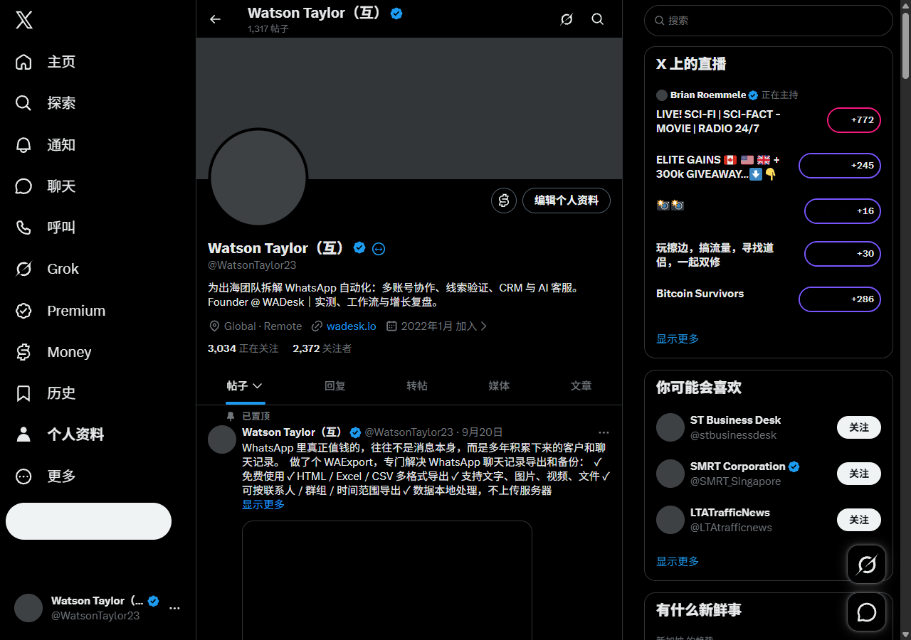

# X主页回关比例风险图标与悬停解释

创建时间：2026-10-26 11:23，Asia/Shanghai。初始准备版本：2.17.0；当前准备版本：2.17.1。文档整理更新：2026-10-26 11:41。

## 目标与范围

在 X 个人主页姓名及原有蓝V之后，注入一个24px的比例参考图标。直接读取主页的正在关注与粉丝人数，以颜色和符号表达分档；悬停使用浏览器原生 title 提示，键盘可聚焦并通过 aria-label 读取同一解释。

仅注释页面，不查询 X 接口、不发送消息、不读写用户存储、不修改关系、队列和自动化设置。未修改面板中既有画像标签或关注排序算法。

## 比例与边界

比例为正在关注人数除以粉丝人数。分档参考2026-10-26单账号858人成熟比较样本，不是全平台结论、个人回关概率、安全或诚信评价。

| 关注除以粉丝 | 颜色 | 回关风险参考 |
| --- | --- | --- |
| 小于20% | 红 | 高 |
| 20%至不足50% | 橙 | 偏高 |
| 50%至不足80% | 黄 | 中等 |
| 80%至不足120% | 绿 | 较低 |
| 达到120% | 蓝 | 需观察 |
| 数据缺失或粉丝为零 | 灰 | 待确认 |

原生提示包含人数、比例、分档解释、样本来源和局限。缩写人数标为近似值。零关注在粉丝大于零时是有效比例零；零粉丝不强行除零，也不归为高风险。

## 复用与方案选择

现有 InfoTip 和 InfoTipLayer 为面板 Vue 组件，不直接挂载到 X 主页；既有主页读取逻辑提供了精确匹配本人 following、followers、verified_followers 路径的可靠方式。本功能复用这一读取约束，排除帖子、UserCell及推荐模块，核对路由用户名与主页头部用户名，避免 SPA 切换期间错配。

评估 [Floating UI](https://github.com/floating-ui/floating-ui) 及其 [定位文档](https://floating-ui.com/docs/computeposition)：MIT许可、适合自定义悬浮定位，但本需求只需文本解释，原生 title 已满足悬停要求，因而不新增依赖或自研定位系统。数字文本解析只保留经典内容脚本所需的最小业务适配，支持中英文缩写与明确零值。

## 文件与生命周期

- src/entries/content/profile-followback-badge.js：经典隔离世界内容脚本、比例模型、本人主页读取、幂等注入及清理。
- src/entries/content/profile-followback-badge.css：颜色、24px尺寸、键盘聚焦轮廓与行内展示。
- src/manifest.json 与 tools/runtime-resources.mjs：脚本、样式声明及构建映射。
- tests/profile-followback-badge.test.js：路由、数值、边界、未知状态及提示局限。

MutationObserver合并页面变更，模型不变时不重复改DOM，避免自身注入造成刷新循环。重复加载保持单图标；destroy可断开监听及移除图标。图标只附加在姓名文本行末，保持原蓝V的位置和行为。

## 验证

- npm test：935/935通过，包含5项新测试。
- npm run test:build：54/54通过。
- npm run check：112个源码模块、132个JS/Vue文件调用约束检查通过。
- npm run build 与 build:check：27个产物文件、15个ESM模块验证通过。
- 专用已登录CDP profile新建非激活测试页，真实读取7,404与4,050，得到182.8%、蓝色需观察；图标右边位置与蓝V保持5px间距。
- 1280和800宽度截图确认姓名、蓝V、图标及按钮未互相遮挡；重复注入仍为1个图标，键盘可聚焦。
- 测试页仅修改展示DOM，验证六档自动转换：0.1、0.3、0.6、0.9、1.3、缺失分别对应红、橙、黄、绿、蓝、灰；没有修改X账号数据。
- 测试页模拟路由与头部不一致后图标数量为0，恢复后为1。

## 当前交付状态

源码与dist当前准备为2.17.1，未提交、未推送、未发行。保留统一集成分支 feature/recent-feature-tutorials 上原有未提交改动。本次doc调用仅整理文档，没有重新执行构建或改变运行状态。

首次启用时观察到实机扩展后台加载2.16.10，本轮功能实施没有主动重启扩展。为立即显示，使用当时扩展的scripting权限注册会话级内容脚本 xef-profile-followback-badge-preview，persistAcrossSessions=false，并向用户当前查看的主页注入已构建脚本及样式。当时Chrome会话新开X页面也能生效；正式重新加载扩展后由manifest中的静态声明接管。静态与动态重复进入时由幂等守卫防止双图标。用户之后是否自行重新加载，当前doc调用未查询，不能把首次观测的后台版本当作实时版本。

此次不改用户关注/取关、消息、队列或后台任务配置。只关闭本次新建的验收标签。

## 同一需求补充：2.17.1图标完整显示

用户反馈原仪表图标看起来没有完全显示。实机检查24px容器与22px SVG没有超出姓名行，但原绘图只占SVG上半区域，视觉上像被截断。因此将上半圈仪表改为完整圆环，保留等级符号；显式设置中心对齐及盒模型。

CDP回归逐一渲染感叹号、波浪号、勾号、双向箭头及问号，以getBBox核对实际字体包围盒均在24×24视口内；圆环含描边也完全在视口内。真实主页截图确认完整显示，已向当前打开的主页热更新，没有重启后台。

源码和dist准备版本2.17.1；935项自动化测试、54项构建测试、源码检查及构建验证通过。原有分档、颜色、悬停内容与用户数据不变，仍未提交或发行。

上述为本轮已执行的最近一次功能验收结果，doc调用没有重复跑测试。比例分档的分析来源与样本局限见第45篇，图标没有把统计建议直接写入关注权重。
