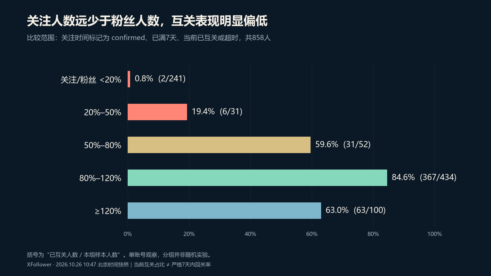
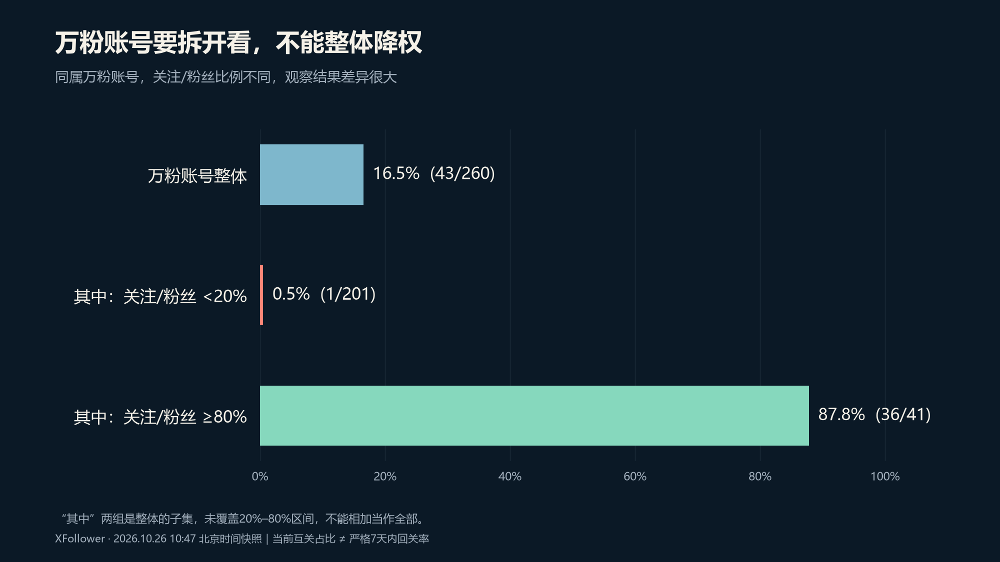
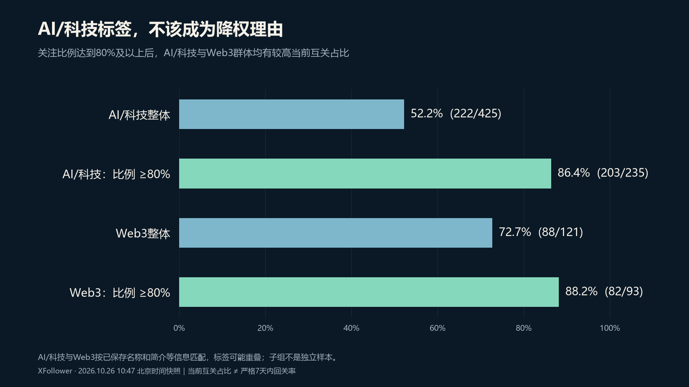
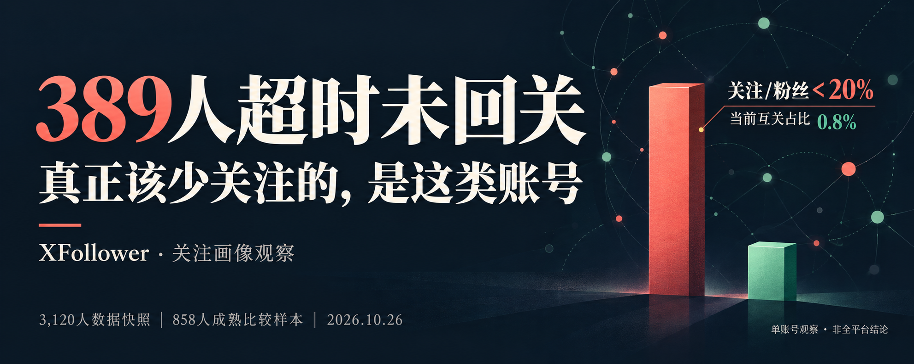

# 回关超时画像分析与X文章交付

创建时间：2026-10-26 11:41，Asia/Shanghai。作者：wangsen。

## 背景与交付边界

用户要求分析回关超时群体，识别互关表现偏低的画像，为以后选择关注对象提供依据；随后要求形成X文章，配5:2封面、正文图表和关注建议。

本需求已完成只读分析、图文报告、X文章草稿及说明文字；没有把建议自动应用到关注队列，没有修改真实关系或设置。主页比例图标属于后续独立功能，其实施与2.17.1显示修正见第44篇。发文全局技能另见第46篇，不能将三项需求合并成同一次算法变更。

## 数据来源与分析方法

- 快照：2026-10-26 10:47，北京时间；直接读取已登录扩展当前面板使用的IndexedDB投影库 x-each-follower-records-dashboard 的 rows。
- 先检查数据库、投影状态和面板设置，排除了旧迁移主库快照与实时面板数据混用。没有为了统计追加X关系请求。
- 按handle去重，3,120条记录对应3,120人。
- 超时门槛为当前设置的7天，是此次业务口径，不是平台规则或回关义务。
- 主要比较人群：关注时间来源标记confirmed、距关注已满7天、当前状态为mutual或overdue，共858人。
- 当前互关占比＝组内当前已互关人数÷组内可比较人数，不等于严格7天内回关率，也不是未来个人回关概率。

| 当前状态 | 人数 |
| --- | ---: |
| 已互关 | 2300 |
| 等待回关 | 395 |
| 超时 | 389 |
| 记录为已取关 | 32 |
| 关系待确认 | 4 |
| 合计 | 3120 |

主要样本858人中，469人当前已互关，389人超时，当前互关占比54.7%。关注时间来源estimated的1,519人不纳入主要比较，另有5人时间来源未知。

## 关键发现

关注比例定义为对方正在关注人数除以对方粉丝人数。

| 关注比例区间 | 比较人数 | 已互关 | 超时 | 当前互关占比 |
| --- | ---: | ---: | ---: | ---: |
| 小于20% | 241 | 2 | 239 | 0.8% |
| 20%至不足50% | 31 | 6 | 25 | 19.4% |
| 50%至不足80% | 52 | 31 | 21 | 59.6% |
| 80%至不足120% | 434 | 367 | 67 | 84.6% |
| 达到120% | 100 | 63 | 37 | 63.0% |

低于20%群体贡献239名超时用户，占389名超时用户的61.4%，是优先减少选择权重的观察信号；并非比例越高越好。

万粉以上群体整体为43/260、16.5%，但其中低于20%比例的群体为1/201、0.5%，达到80%的群体为36/41、87.8%。200名超时用户同时满足万粉和低比例，不能将重叠画像重复重罚。

AI科技整体为222/425、52.2%；限定关注比例达到80%后为203/235、86.4%。Web3整体为88/121、72.7%；同样限定后为82/93、88.2%。没有依据仅因行业标签降低权重。

明确记录为非蓝V、粉丝小于500等群体也存在差异，但尚未充分控制来源和批次，仅保留为后续研究候选。认证缺失不能直接归为非蓝V，简介承诺秒回也不能代替实际结果。

## 建议与局限

建议优先降低极低关注比例群体的选择权重，保留人工观察；不对万粉、AI科技等重叠标签再次重罚。缺失数据保持未知。已明确关注自己或已经回关的用户应单独处理，不把主动关注后的等待样本直接外推到这些人。

面向互关用户的文章建议包含：先区分内容订阅与双向交流目的；内容相关性优先；对极低关注比例账号降低回关期待；看实际互动而不是口头承诺；尊重未回关的选择；复盘持续交流而不仅看粉丝数字。

主要局限：单账号非随机观察；708/858人的关注日期集中在10月17日；已有取关和历史清理会影响样本；当前人数、简介及关系未必等于关注当时的值；行业标签缺少完整近期帖子；389名超时用户中2人曾被记录为互关。没有作因果检验或严格时间窗转化分析。

## 文章、封面与资料归档

文章标题：389 人超时未回关：真正该少关注的，是这类账号。

[X文章草稿](https://x.com/compose/articles/edit/2114551256136253440)。本轮验收只确认草稿保存，没有执行或核实最终公开发布；用户之后是否手动发布，当前文档未再次查询，不能推定。

- [完整图文报告](./素材/回关画像分析-20261026/图文报告.html)
- [文章原稿](./素材/回关画像分析-20261026/文章原稿.txt)
- [画像聚合统计](./素材/回关画像分析-20261026/画像聚合统计.json)
- [配图生成说明](./素材/回关画像分析-20261026/配图生成说明.txt)
- [草稿验收记录](./素材/回关画像分析-20261026/草稿验收记录.txt)

只归档聚合统计，没有复制逐人原始快照。封面由内置imagegen生成，三张数字图表由实际统计确定性绘制。原始封面1983×793，X保存后的封面1200×480，为精确5:2。

## 实际验收

正文约4,400字、9个章节标题、3张正文图表。重新加载同一草稿后逐段比对，全部文本及顺序匹配；3张配图各位于对应说明后，均加载为1200×675；封面加载为1200×480。

发布弹窗说明与标签已提供给用户，包含互关、X运营和数据分析主题。草稿配图曾因编辑器保留旧插入位置而偏移，已调整并在重载后验证；根因和可复用流程详见第46篇。
