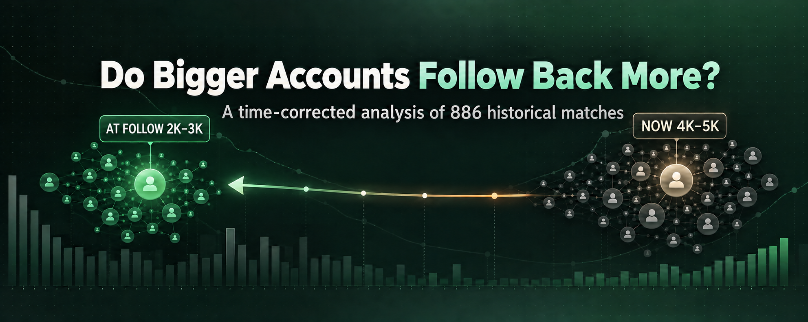
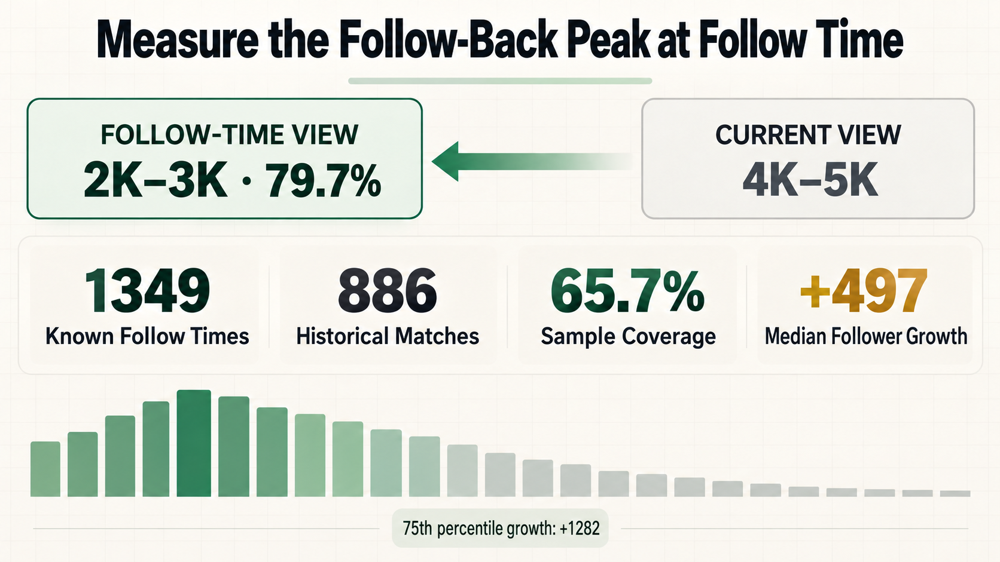

# Do Bigger Accounts Follow Back More? What 886 Historical Matches Revealed

When you are trying to grow on X, one assumption feels almost obvious: the more followers an account has, the less likely it is to follow you back.

Our first analysis appeared to support that intuition—but it also produced a surprising result. Accounts with 4,000–5,000 followers seemed to have the strongest follow-back rate.

Then we noticed the hidden problem:

**Follower count is not a static label.**

An account with 4,500 followers today may have had only 2,500 followers when we originally followed it. If we use today's number to explain a decision and outcome from the past, the most effective range can appear much higher than it really was.

So we ran the analysis again with a stricter question:

> How many followers did the account have at the moment we followed it?

Once we aligned the data in time, the apparent peak moved from 4,000–5,000 followers to 2,000–3,000.

That correction changed how we prioritize accounts inside XFollower.

## How We Built the Dataset

We used existing local records only. No additional profile requests were sent to X for this analysis.

The available dataset contained:

· 1,349 users with a confirmed follow time  
· 886 users that could be matched exactly to a historical follower-count snapshot  
· 65.7% coverage of the time-qualified sample

The match was based on the account and the recorded follow time, allowing us to compare the account's follower count at the decision point with its later follow-back outcome.

This is not a universal study of every user on X. It is an observational analysis of one real growth workflow. But it is strong enough to expose a measurement mistake that can affect almost any historical growth analysis.

## The Highest Stable Follow-Back Range Was 2K–3K

After grouping accounts by their follower count at follow time, the results were:

· 0–499 followers: 40.3% from 67 accounts  
· 500–999: 66.7% from 63 accounts  
· 1,000–1,999: 70.5% from 149 accounts  
· **2,000–2,999: 79.7% from 123 accounts**  
· 3,000–3,999: 70.9% from 79 accounts  
· 4,000–4,999: 67.3% from 49 accounts  
· 5,000–5,999: 70.2% from 47 accounts  
· 6,000–6,999: 66.7% from 21 accounts  
· 7,000–7,999: 56.3% from 16 accounts  
· 8,000–8,999: 90.9% from 11 accounts  
· 9,000–9,999: 70.0% from 10 accounts  
· 10,000–19,999: 34.8% from 69 accounts  
· 20,000–29,999: 19.2% from 26 accounts  
· 30,000 and above: 2.6% from 156 accounts

The 2,000–3,000 range matters because it combines a high observed rate with a meaningful sample size and support from the neighboring ranges.

There is a higher local result at 8,000–8,999, but it comes from only 11 accounts. Even when combined with the 9,000–9,999 range, the total is just 21 accounts. That makes it an interesting signal to watch—not a reliable reason to move the entire queue toward larger accounts.

## Why the First Analysis Pointed to 4K–5K

The matched accounts grew substantially after we followed them.

· 25th percentile growth: +10 followers  
· Median growth: +497  
· 75th percentile growth: +1,282  
· Mean growth: approximately +1,020

That means many accounts sitting in the 4,000–5,000 range today were likely in the 2,000–3,000 range when the relationship began.

Both observations can therefore be true:

1. Looking at current follower counts makes 4,000–5,000 appear strongest.
2. Looking at follower counts at follow time moves the stable peak back to 2,000–3,000.

The difference is not just statistical noise. It comes from measuring the same feature at two different points in time.

## Turning the Finding Into a Better Follow Queue

We did not turn this result into a hard filter. Large accounts are not removed, and smaller accounts are not automatically treated as good candidates.

Instead, follower count contributes to a ranking weight:

· Existing followers waiting for a follow-back: 100  
· 2,000–2,999 followers: 60  
· 1,000–1,999 and 3,000–3,999: 50  
· 4,000–4,999: 45  
· 5,000–5,999: 40  
· 500–999 and 6,000–6,999: 35  
· 7,000–7,999: 30  
· 8,000–9,999: 25  
· Below 500: 20  
· 10,000–19,999: 15  
· Unknown follower count: 10  
· 20,000–29,999: 8  
· 30,000 and above: 3

Three product decisions matter more than the exact numbers.

First, **people who already follow you remain the highest priority**. A confirmed inbound follow is a much stronger reciprocity signal than follower count.

Second, **2,000–3,000 is a ranking peak, not a gate**. Accounts outside that range still enter the queue.

Third, **larger accounts are deprioritized, not discarded**. The historical rate declines sharply, but individual accounts can still be valuable and relevant.

## What This Means for X Growth

Most follow-growth systems focus on doing more: scan more profiles, create more candidates, and send more actions.

But more activity is not the same as better prioritization.

If a queue spends its limited attention on accounts with a historically low probability of reciprocity, it creates more requests, more waiting, and more noise without necessarily improving results.

The practical opportunity is to rank candidates with evidence already available locally, then reserve new requests for moments when they can actually change a decision.

This is the direction we are building into XFollower: fewer unnecessary checks, clearer evidence, and queue decisions that can be explained instead of guessed.

## What This Analysis Does Not Prove

These results should not be treated as a universal law of X.

The main limitations are clear:

· The 886 matched accounts are the subset with usable historical snapshots, so selection bias is possible.  
· A current follow-back state confirms the outcome, but not the exact number of days it took.  
· Language, region, content category, account age, and activity level may produce different distributions.  
· Follower count is only one signal. It cannot replace interaction history, follower-to-following ratio, relevance, or recent activity.

The weights should therefore be treated as a current ranking baseline—not a permanent rule. As more event-time data becomes available, the model should be recalibrated using the same time-aligned method.

## The Bigger Lesson: Align Features With the Decision Time

The most useful result is not simply that 2,000–3,000 followers performed well.

It is this:

> When historical outcomes are used to guide today's decisions, the input features must come from the moment the original decision was made.

Follower counts grow. Account status changes. Content and audience change. If today's profile is used to explain yesterday's outcome, the apparent threshold—and sometimes the entire conclusion—can be wrong.

Data does not automatically make a growth system smarter.

First, the timeline has to be right.

---

## Suggested Post Caption

Do bigger accounts really follow back less?

After time-correcting 886 historical matches, the strongest stable follow-back range moved from 4K–5K followers to 2K–3K. The reason: today's follower count can badly misrepresent the account we originally chose.

I broke down the data, the ranking model, and the limitations here.

#XGrowth #DataAnalysis #CreatorGrowth #BuildInPublic

