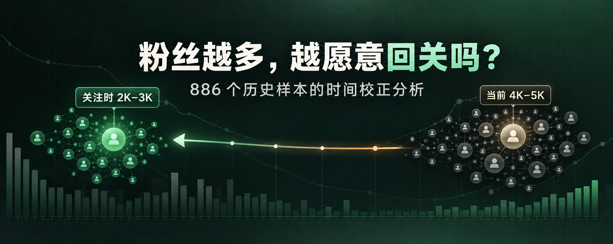
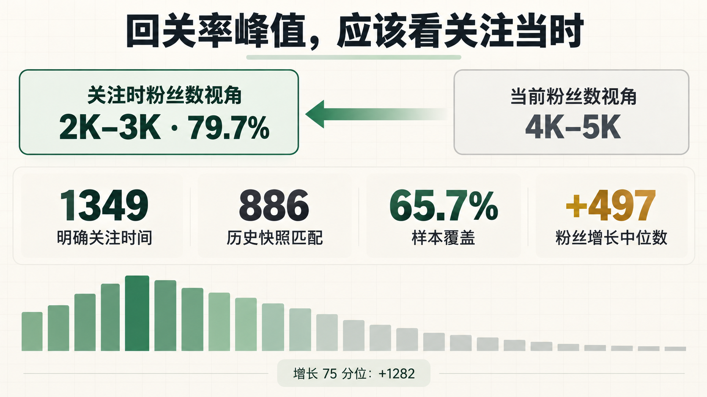

# 粉丝越多，越愿意回关吗？我用 886 个历史样本纠正了一个错觉

我一开始也有一个很直观的判断：粉丝越多的账号，回关意愿可能越低。

第一次统计似乎也支持这个感觉——按账号**现在的粉丝数**分组，4,000–5,000 粉丝这一档看起来表现最好。

但这里藏着一个容易被忽略的问题：粉丝数不是静态标签。

一个今天有 4,500 粉丝的账号，在我们关注它时，可能只有 2,500。用今天的粉丝数解释过去的回关结果，会把真正有效的区间整体向后推。

所以我重新做了一次分析。这次不再问“它现在有多少粉丝”，而是问：

> **我们关注它的那个时点，它有多少粉丝？**

结果，峰值从 4,000–5,000，回到了 2,000–3,000。

## 这次怎么分析

本次只使用本地已有历史数据，没有为了分析向 X 发起新的资料请求。

- 1,349 个用户有明确的关注时间；
- 其中 886 个用户可以通过“账号 + 关注时间”精确匹配到当时保存的粉丝数快照；
- 有效匹配覆盖率为 65.7%。

这 886 个样本不是全体用户，也不是一项随机实验，但它们足以回答一个非常具体的问题：如果把粉丝数还原到关注发生时，原来的分布会怎样变化？

## 关键结果：2,000–3,000 是最稳定的高回关区间

按“关注当时的粉丝数”重新分组后，各档回关率如下：

- 0–499：40.3%，67 个样本；
- 500–999：66.7%，63 个样本；
- 1,000–1,999：70.5%，149 个样本；
- **2,000–2,999：79.7%，123 个样本；**
- 3,000–3,999：70.9%，79 个样本；
- 4,000–4,999：67.3%，49 个样本；
- 5,000–5,999：70.2%，47 个样本；
- 6,000–6,999：66.7%，21 个样本；
- 7,000–7,999：56.3%，16 个样本；
- 8,000–8,999：90.9%，11 个样本；
- 9,000–9,999：70.0%，10 个样本；
- 10,000–19,999：34.8%，69 个样本；
- 20,000–29,999：19.2%，26 个样本；
- 30,000 以上：2.6%，156 个样本。

2,000–3,000 不只是数值最高的区间之一，它同时具备相对充足的样本量和连续区间支持，因此比小样本的局部高点更适合用于排序。

比如 8,000–8,999 这一档出现了 90.9% 的回关率，但只有 11 个样本。把相邻的 8,000–9,999 合并后，也只有 21 个样本。它是一个值得继续观察的信号，却不足以推翻整体下降趋势，更不适合直接设成最高优先级。

## 为什么第一次会看错

匹配样本从关注时点到现在的粉丝增长并不小：

- 25 分位：增加 10；
- 中位数：增加 497；
- 75 分位：增加 1,282；
- 平均增加约 1,020。

也就是说，大量账号在我们关注之后继续增长。今天落在 4,000–5,000 的账号，关注当时很可能正好位于 2,000–3,000。

这解释了两个看似矛盾的观察：

1. 用当前粉丝数回看历史结果，峰值像是在 4,000–5,000；
2. 还原到关注当时，稳定峰值其实在 2,000–3,000。

问题不在直觉本身，而在特征取值的时间点不一致。

## 如何把结果用于关注队列

这次调整没有把高粉账号“一刀切”过滤掉，而是把粉丝量换算成排序权重：

- 已经关注我们的待回关用户：100；
- 2,000–2,999：60；
- 1,000–1,999、3,000–3,999：50；
- 4,000–4,999：45；
- 5,000–5,999：40；
- 500–999、6,000–6,999：35；
- 7,000–7,999：30；
- 8,000–9,999：25；
- 500 以下：20；
- 10,000–19,999：15；
- 20,000–29,999：8；
- 30,000 以上：3；
- 粉丝数未知：10。

这里最重要的不是某个精确分数，而是三条原则：

第一，**已关注我们的用户优先级最高**。这是明确的互惠信号，不能被粉丝量覆盖。

第二，**2,000–3,000 是排序峰值，不是硬门槛**。其他区间仍然会进入队列，只是执行顺序不同。

第三，**高粉账号降权但不删除**。历史数据说明它们的回关率明显下降，但仍可能存在值得关注的个体。

## 这份数据不能证明什么

这是一份本地账号的观察性分析，不应该被解释成“所有 X 用户都遵循同一规律”。

它还有几个明确限制：

- 886 个匹配样本只覆盖有历史快照的用户，可能存在选择偏差；
- “当前已经回关”只能证明结果，不能精确证明回关发生在第几天；
- 不同语言、地区、内容方向和账号活跃度，可能形成不同分布；
- 粉丝数只是一个粗粒度特征，不能替代互动意愿、关注粉丝比、活跃度等信号。

因此，这套权重应该被看作当前样本下的排序基线，而不是永久规则。后续数据增加后，应按同样的事件时点口径持续重算。

## 真正值得保留的方法

这次复盘最有价值的结论，不只是“2,000–3,000 更容易回关”。

更重要的是：**用历史结果训练今天的决策时，特征必须取自事件发生时，而不是事后观察时。**

粉丝数会增长，账号状态会变化，内容方向也会变化。只要拿今天的状态去解释过去，就可能把有效区间、阈值甚至因果方向一起看错。

数据不会自动给出答案。先把时间对齐，答案才有意义。

---

## 发布配文

粉丝数不是静态标签。用“现在有多少粉”解释过去的回关结果，会把真正有效的区间整体向后推。

复盘 886 个可匹配历史样本后，我把关注队列的峰值从 4,000–5,000 校正到了 2,000–3,000。完整方法、数据、权重策略和局限都写在这篇文章里。

